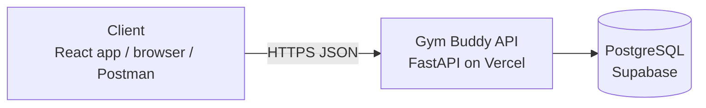
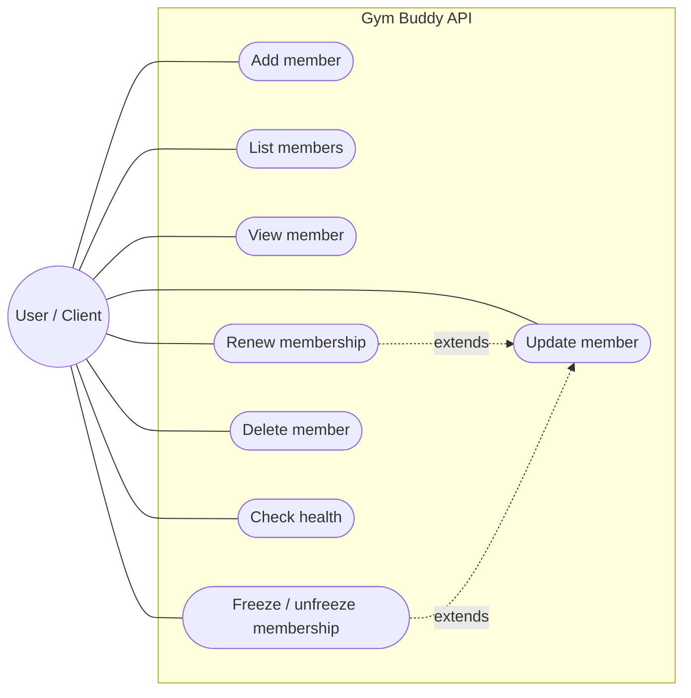
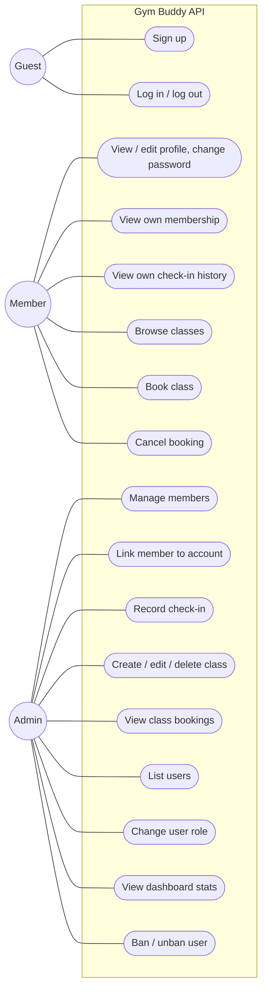
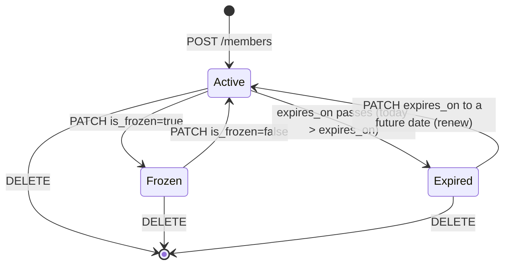

# Software Requirements Specification (SRS) — Gym Buddy

| Field | Value |
|---|---|
| Product | Gym Buddy |
| Version | MVP + Beta (final release) |
| Releases | MVP — Mid-term, Beta — Final |
| Status | Final: every requirement below is built |
| Related docs | [Product Requirements Document (PRD)](01-prd.md), [Technical Design Document (TDD)](03-tdd.md), [Final report](FINAL_REPORT.md) |

Every requirement has a **Release** column: **MVP** is built for the mid-term, **Beta** is added for the final. The "Built so far" notes record how each part was built, including where the final system differs from a requirement's first wording. The biggest such change: in the final release **a member is a user account with a membership** (there is no separate member record to link), so the MVP's `full_name` is the account's `name`, `is_active` became `is_frozen`, and staff start a membership by the email the person signed up with.

**Documents in this set**

| Short form | Full form | Purpose | File |
|---|---|---|---|
| PRD | Product Requirements Document | What we build and why | [01-prd.md](01-prd.md) |
| SRS | Software Requirements Specification | Exact requirements, permissions and acceptance criteria (this document) | [02-srs.md](02-srs.md) |
| TDD | Technical Design Document | How we build it: architecture, data model, API | [03-tdd.md](03-tdd.md) |

## 1. Introduction

### 1.1 Purpose
This document lists the requirements for Gym Buddy: the MVP (gym member CRUD REST API) and the Beta (accounts, roles, class bookings, check-ins and security), deployed on Vercel.

### 1.2 Scope
- **MVP:** a client can create, list, view, update and delete gym members over HTTP. A member record holds name, phone, membership plan, start and expiry dates and an active flag. There are no accounts; all members are in one shared list.
- **Beta:** gym members sign up and log in, see their own membership, visits and payments, book classes, and follow the workouts their trainer assigns them. Trainers run classes, clients and training groups. Gym managers run members, attendance, payments, classes, equipment and announcements; admins also manage plans, expenses, users, roles, the activity log and moderation.
- Out of scope: see [PRD, section 5](01-prd.md#5-scope). Online card payments are not part of this system: staff record payments taken at the desk (cash, card, bank transfer or mobile banking).

### 1.3 Definitions

| Term | Meaning |
|---|---|
| CRUD | Create, Read, Update, Delete |
| REST | API style where resources (like `members`) are accessed with HTTP methods (GET, POST, PATCH, DELETE) |
| Member | A person with a gym membership. In the MVP, a member record (name, phone, plan, dates, status); in the final release, a user account on which staff have set a plan |
| Plan | (Beta) What the gym sells: a name, a price, a length in days, offered or retired. Admins manage them; a new database starts with Monthly, Quarterly and Yearly. (MVP: `monthly`, `quarterly` or `yearly`) |
| Valid membership | A membership that is not frozen and whose `expires_on` is today or later. (MVP: `is_active = true`) |
| Frozen membership | A membership paused by staff: `is_frozen = true` (MVP: `is_active = false`) |
| Expired membership | A membership with `expires_on` before today |
| Waiting for a membership | (Beta) A User account with no plan yet: it is on the gym manager's waiting list until staff start a membership |
| Session | (Beta) One login on one browser, stored in `auth_session`; logging out or a ban ends it on the server |
| Permission | (Beta) A named right such as `members:read`, held by roles (`backend/app/rbac.py`); every protected endpoint asks for one |
| Payment | (Beta) Money a member paid at the desk, recorded by staff, optionally renewing the membership; it can be voided but never deleted |
| Workout | (Beta) A training session in a training group, which may be assigned to one person, who marks it done |
| Training group | (Beta) Members training under a trainer. Trainers and staff start one; its owner adds people and ticks what each may do with the group's workouts |
| Class | (Beta) A scheduled workout session with a name, start time, duration, capacity and an optional trainer |
| Trainer | (Beta) An account with the role `trainer` who teaches classes; a class's `trainer_id` points at one. Classes from before trainers were accounts keep a free-text `trainer_name` |
| Booking | (Beta) A member's reserved spot in a class |
| Emergency contact | (Beta) The person to call if something happens to a member at the gym: a name and a phone, kept on the member's account |
| Announcement | (Beta) News from the gym (a title, a message and an optional end date) that gym managers and admins post and every logged-in user reads until its end date |
| Check-in | (Beta) A record that a member arrived at the gym, entered by staff, with when they left once checked out |
| Personal trainer | (Beta) The trainer staff picked for a member; the member is that trainer's client |
| Equipment | (Beta) What the gym owns: working, being repaired or out of order, with its services |
| Expense | (Beta) Money the gym spent; payments minus expenses is the month's net income |
| RBAC | Role-Based Access Control: what a caller can do depends on their role |
| JWT | JSON Web Token: a signed token that proves who the caller is |
| Access token | (Beta) Short-lived JWT sent in the `Authorization: Bearer` header |
| Refresh token | (Beta) Long-lived random token in an HttpOnly cookie, used to get a new access token |
| Client | Anything that calls the API: the React frontend, `/api/docs`, curl, Postman |
| OpenAPI | Standard API description; FastAPI generates it and shows it at `/api/docs` |

## 2. Overall description

### 2.1 System context

### 2.2 Users and roles

| Role | Release | Description |
|---|---|---|
| Anonymous client | MVP | Anyone who can reach the API; full access to the shared member list |
| Guest | Beta | Not logged in; can only sign up, log in, check health and read the API docs |
| User | Beta | Logged in with global role `user` (everyone who signs up); edits their own profile, views their own membership and check-ins, browses classes, books and cancels their own bookings |
| Trainer | Beta | Logged in with global role `trainer` (given by an admin): sees the classes they teach, who booked each one and who came, sees their own clients, runs training groups, reports equipment faults, and has the same own-account pages as a User. Cannot manage members or classes |
| Gym Manager | Beta | Gym staff with global role `gym_manager`: manage all members, classes, attendance, payments, equipment and announcements. Cannot list users, change roles, or see the admin statistics, plans or expenses |
| Admin | Beta | Global role `admin`: everything a Gym Manager can do, plus list users, change roles, view dashboard stats, ban / unban users, and read the activity log and the security view |

`user`, `trainer`, `gym_manager` and `admin` are **global** roles stored on the user account. An account has at most one membership, stored on the account itself (plan, dates, frozen). A logged-in `user` with no membership can log in, edit their profile and be in a training group, but gets `404` on the membership endpoints and cannot book until staff start their membership.

### 2.3 Use cases

**MVP**

**Beta**

Every Admin is also a logged-in user, so they can log out, edit their profile and change their password.

### 2.4 Constraints
- C-1: Runs on Vercel serverless functions (no local disk that survives between requests).
- C-2: Backend in Python 3.10+ with FastAPI.
- C-3: All API routes start with `/api`, because `vercel.json` sends `/api/*` to the backend.
- C-4: Requests and responses use JSON.
- C-5: Production database is Supabase PostgreSQL; local development uses SQLite.
- C-6: (Beta) Login is implemented in our own API (no third-party login providers).
- C-7: Dates (`joined_on`, `expires_on`) are plain calendar dates; "today" and every date filter use the gym's own day (Dhaka, UTC+6, no daylight saving time). Times are stored in UTC.

### 2.5 Assumptions
- A-1: A hosted database is available to the Vercel project through an environment variable.
- A-2: The app is used for demos and class work, so traffic is low.
- A-3: (Beta) The first admin is promoted manually in the Supabase table editor.
- A-4: (Beta) A person signs up before staff start their membership. When members became accounts, the MVP's member records were dropped and staff started memberships again for the people who needed one (README, "Upgrading a database from before members became users").
- A-5: Money is taken at the front desk; the system records it (section 3.7a) but does not take card payments online.

## 3. Functional requirements

### 3.1 Members — MVP

| ID | Requirement | Release | Story |
|---|---|---|---|
| FR-01 | The system shall create a member from a JSON body with `full_name`, `plan`, `expires_on` (required) and `phone`, `joined_on`, `notes` (optional). `joined_on` defaults to today. New members have `is_active = true`. | MVP | US-01 |
| FR-02 | The system shall return the list of members, newest first. The list can be filtered by `status`: `active` (valid), `expired` or `frozen`; (Beta) also `expiring_soon` (FR-53). | MVP | US-02 |
| FR-03 | The list shall support `offset` (default 0) and `limit` (default 20, max 100) query parameters. | MVP | US-02 |
| FR-04 | The system shall return one member by their ID. | MVP | US-03 |
| FR-05 | The system shall update any of `full_name`, `phone`, `plan`, `expires_on`, `is_active`, `notes` on an existing member. Fields not sent stay unchanged. Setting a later `expires_on` renews the membership; setting `is_active = false` freezes it. | MVP | US-04, US-05 |
| FR-06 | The system shall delete a member by their ID. | MVP | US-06 |
| FR-06a | The system shall delete several members in one request, given 1 to 100 IDs, and report how many were deleted. | MVP | US-06 |
| FR-07 | The system shall set `created_at` when a member is created and update `updated_at` on every change. | MVP | US-04 |
| FR-08 | The system shall reject invalid input with status `422` and one sentence saying which fields are wrong and why, never repeating the value that was sent (it may be a password). This includes an `expires_on` earlier than `joined_on`. | MVP | US-07 |
| FR-09 | The system shall return `404` when a member ID does not exist. | MVP | US-07 |
| FR-10 | The system shall expose `GET /api/health` returning `{"status": "ok"}`. | MVP | US-08 |
| FR-11 | The system shall publish interactive API docs at `/api/docs`. | MVP | US-07 |

> **Built so far (members):** FR-01 to FR-11 in the MVP, and kept in the final release with these changes: a member is a user account with a membership, so a member's `id` is the account's id, `full_name` is the account's `name`, and `is_active` became `is_frozen` (`true` freezes). `POST /members` takes the `email` of an existing account instead of a name (FR-23 as built), and `DELETE` removes the whole account. `created_at` is the account's; there is no separate `updated_at` for a membership (FR-07).

### 3.2 Authentication and profile — Beta

| ID | Requirement | Release | Story |
|---|---|---|---|
| FR-12 | The system shall let a guest sign up with `email`, `name` and `password`. Email is unique (case-insensitive); a duplicate returns `409`. New users always get role `user`; the sign-up form cannot choose a role. Signing up does not create or link a membership record. | Beta | US-09 |
| FR-13 | The system shall log a user in with email and password, returning an access token in the body and setting a refresh token cookie. Wrong email or password returns `401` with the same message for both. | Beta | US-10 |
| FR-14 | The system shall issue a new access token when called with a valid refresh token cookie, and replace (rotate) the refresh token. With no cookie at all it answers `204` (nobody is logged in on this browser); an expired, revoked or unknown token answers `401` and clears the cookie. | Beta | US-10 |
| FR-15 | The system shall log a user out by revoking the refresh token's session and clearing the cookie. The session's access token is refused from the next request on, not only when it expires. | Beta | US-10 |
| FR-16 | The system shall return the logged-in user's profile (`id`, `email`, `name`, `role`). The password hash is never returned. | Beta | US-10 |
| FR-40 | A user shall be able to change their own `name`. Email and role cannot be changed through the profile. | Beta | US-23, US-24 |
| FR-41 | A user shall be able to change their password by sending the current and the new password. A wrong current password returns `400`, a new one shorter than 8 or longer than 128 characters `422`, and the same one `400`; every failed attempt is recorded, and wrong current passwords count towards the lockout (FR-34). On success every other session of the user is revoked; the session that made the change stays logged in. | Beta | US-24 |
| FR-80 | A user shall be able to list their own active sessions (one per browser where they are logged in) with the time it started, the time it was last used, its IP address and browser, and which one is the current session. | Beta | US-10 |
| FR-81 | A user shall be able to revoke one of their own sessions. Its refresh token and access token stop working at once. Another user's session, or one that is no longer active, returns `404`. | Beta | US-10 |
| FR-82 | A refresh token used again more than 30 seconds after it was replaced shall revoke its whole session (`401`), because only a copy can still hold it. Within the 30 seconds (two tabs refreshing at once) the request gets an access token without a new cookie. | Beta | US-10 |

> **Built so far:** all of 3.2 (FR-12 – FR-16, FR-40, FR-41, FR-80 – FR-82). Each login is a row in `auth_session`; the access token (15 minutes) names it with `sid`, and every request checks that the session is still active. The app keeps the access token in memory and refreshes it on a `401`. The login attempt limit (FR-34) is built: the 5th wrong password in a row answers `429` with `Retry-After`, attempts while locked do not count, and an existing login is not ended.

### 3.3 Own membership and check-ins — Beta

| ID | Requirement | Release | Story |
|---|---|---|---|
| FR-17 | A logged-in user shall be able to view their own membership record (plan, dates, status). If no membership is linked to their account, the response is `404`. | Beta | US-11 |
| FR-18 | A logged-in user shall be able to list their own check-in history (newest first, paginated). A user can never read another member's membership or check-ins through these endpoints. | Beta | US-11 |

### 3.4 Member management by admin — Beta

| ID | Requirement | Release | Story |
|---|---|---|---|
| FR-19 | In the Beta, the member endpoints (`/api/v1/members`) create, list, view, update and delete shall be available to gym managers and admins only; deleting an account, and starting or editing the membership of a staff account, to admins only (`403` for a gym manager). A caller who is not logged in gets `401`; a `user` gets `403`. | Beta | US-13 |
| FR-23 | When creating or updating a member, a gym manager or admin may set `user_id` to link the record to an existing account. A user can be linked to only one member (`409` otherwise); an unknown `user_id` returns `422`. | Beta | US-13 |

> **Built so far (member management):** FR-19, and FR-23 in its final form: there is no record to link, because the membership is stored on the account. `POST /members` takes the `email` the person signed up with and starts the membership on that account; an email with no account gives `422` ("Ask the person to sign up first") and an account that already has a membership gives `409`. FR-55 lists the accounts waiting for one, and **Start membership** fills the email in.

### 3.5 Roles (RBAC) and admin — Beta

| ID | Requirement | Release | Story |
|---|---|---|---|
| FR-20 | Every user shall have exactly one global role: `user`, `trainer`, `gym_manager` or `admin`. | Beta | US-12 |
| FR-21 | An admin shall be able to list all users (paginated). | Beta | US-12 |
| FR-22 | An admin shall be able to change another user's role. An admin cannot change their own role (`400`), so the system always keeps at least one admin. | Beta | US-12 |
| FR-24 | A caller whose role does not hold the permission an endpoint needs shall get `403` (admin permissions: every role except `admin`). | Beta | US-12, US-13 |
| FR-83 | Every protected endpoint shall name the permission it needs, and the roles that hold each permission shall be defined in one server module. `GET /users/me`, login and refresh shall return the caller's permissions, and the app shall show only the pages and buttons those permissions allow. | Beta | US-12 |
| FR-35 | An admin shall be able to view dashboard stats: total members, active members, expired members, new members in the last 7 days, memberships expiring soon (FR-53), total and upcoming classes, check-ins today and in the last 7 days, and total users, admins and banned users. | Beta | US-20 |
| FR-36 | An admin shall be able to ban a user with an optional reason. Banning revokes all the user's refresh tokens. An admin cannot ban themself or another admin (`400`); demote the admin first. | Beta | US-21 |
| FR-37 | A banned user shall get `403` ("Account banned") on login and on every authenticated request, even with an access token that has not expired yet. | Beta | US-21 |
| FR-38 | An admin shall be able to unban a user; the user can then log in again. The user's linked membership and bookings are kept while banned. | Beta | US-22 |
| FR-39 | The admin user list shall show each user's status (`active` / `banned`), ban date and ban reason. | Beta | US-21 |
| FR-98 | An admin shall be able to filter the user list by `role` and by `status` (`active` / `banned`) together with the search (`q`) and pagination, and download the users matching the same filters as CSV (newest first, the FR-51 format). The download is recorded in the activity log. An unknown role or status gives `422`. | Beta | US-12 |
| FR-99 | An admin shall be able to open one user's details: the account, membership and login lockout, their active sessions, how many workouts (added, assigned, done), bookings, visits and payments they have with the 5 newest of each, when the password last changed, their groups (name, owner or member, size) and their 10 newest activity rows. | Beta | US-12 |
| FR-100 | An admin shall be able to end every active session of another user; the user's next request gets `401` and their refresh cookie stops working. Their own account is refused (`400`). | Beta | US-21 |
| FR-101 | An admin shall be able to ban or unban up to 100 users at once with one optional reason, in one transaction. The admin themself, other admins, accounts that are already banned (or, for an unban, not banned) and unknown ids are skipped and listed in the response with the reason; the others are banned or unbanned. | Beta | US-21, US-22 |
| FR-102 | The dashboard shall also show the accounts created in the last 7 days, the number of workouts (in all and added in the last 7 days) and the number of training groups. | Beta | US-20 |
| FR-103 | Every admin action on users that changes something (role change, ban and unban, one or many, password reset, ending sessions) and every users CSV download shall be written to the activity log (FR-85). | Beta | US-29 |

> **Built so far (admin):** FR-35 with the member, check-in and user numbers (class numbers are `total` and `upcoming`), and FR-36 to FR-39; a ban revokes every session in the same transaction. An admin lands on the dashboard after logging in. FR-98 to FR-103 are built: the Users page filters, ticks users for a bulk ban or unban, exports CSV and opens a user's details (`#/users?user=ID`) with Log out everywhere.

### 3.6 Classes and bookings — Beta

| ID | Requirement | Release | Story |
|---|---|---|---|
| FR-25 | A gym manager or admin shall be able to create a class with `name`, `starts_at` (not in the past, `422`), `duration_minutes` and `capacity` (and optional `description` and trainer, FR-69). | Beta | US-14 |
| FR-26 | Any logged-in user shall be able to list classes (optionally only upcoming, ordered by start time) and view one class. Each class shows `booked_count` and, for members, whether they booked it (`is_booked_by_me`). | Beta | US-15 |
| FR-27 | A gym manager or admin shall be able to edit or delete a class. Lowering `capacity` below the current number of bookings returns `422`. Deleting a class deletes its bookings. | Beta | US-14 |
| FR-28 | A gym manager or admin shall be able to list the bookings of a class (member name and booking time); a trainer only for the classes they teach (FR-71). | Beta | US-17 |
| FR-29 | A member with a valid membership shall be able to book a class that has not started yet, and cancel their own booking. Booking returns `400` if the membership is not valid or the class already started, `409` if the class is full or the member already booked it. A member can book or cancel only for themself, and (Beta, built) cannot cancel once the class has started (`400`). | Beta | US-16 |

> **Built so far (gym manager):** FR-25, FR-26 (with `booked_count`), FR-27 and FR-28. Deleting a member also deletes their bookings.

> **Built so far (user):** FR-29 (book and cancel; two people booking the last place at the same moment cannot both get it) and `is_booked_by_me` in FR-26.

### 3.7 Check-ins — Beta

| ID | Requirement | Release | Story |
|---|---|---|---|
| FR-30 | A gym manager or admin shall be able to record a check-in for a member. The request returns `400` if the membership is not valid (frozen or expired). The check-in stores who recorded it and when. | Beta | US-18 |
| FR-31 | A gym manager or admin shall be able to list a member's check-ins (newest first, paginated). | Beta | US-18 |
| FR-42 | A gym manager or admin shall be able to list everyone who checked in on a day (today by default), newest first, with the member's name, when they left and who recorded it, searched by name, email or phone, or narrowed to who is in the gym now. | Beta | US-18 |
| FR-32 | A member may check in more than once on the same day; each is its own record. A member checked in today and not checked out yet cannot be checked in again (`409`). | Beta | US-18 |
| FR-33 | A user whose account has no linked membership shall get `404` for FR-17, FR-18 and FR-29. | Beta | US-11 |

> **Built so far (gym manager):** FR-30, FR-31, FR-32 and FR-42. Deleting a member also deletes their check-ins. The member's own view of their check-ins (FR-18) is built, with FR-17, FR-23 and FR-33 (see the user notes).

> **Built so far (user):** FR-17, FR-18, FR-23, FR-33 and FR-41. A person with no membership yet gets a clear message with the email to give the front desk, instead of an error page. Gym managers and admins who have a membership can book through the API; the screens for booking are the User's.

### 3.7a Plans and payments — Beta

| ID | Requirement | Release | Story |
|---|---|---|---|
| FR-43 | Each plan shall have a name, a price in whole taka, a length in days, an optional description, and be offered or retired. Any logged-in user can list them, cheapest first. | Beta | US-25 |
| FR-44 | A gym manager or admin shall be able to record a payment for a member: `amount` (whole taka, 1 to 10,000,000), `method` (`cash`, `card`, `bank_transfer` or `mobile_banking`) and an optional `note` (up to 200 characters). A User gets `403`, a logged-out caller `401`, an unknown member `404`. | Beta | US-25 |
| FR-45 | When a payment names a `renew_plan`, the member's `expires_on` shall become the later of today and the current expiry, plus that plan's days, and the member's `plan` shall become that plan. A frozen member's expiry is extended but they stay frozen. | Beta | US-25 |
| FR-46 | A gym manager or admin shall be able to list a member's payments, newest first, paginated. Each payment keeps the member's name, so it still reads correctly if the member is deleted; deleting a member never deletes their payments. | Beta | US-25 |
| FR-47 | An admin shall be able to change a plan's `name`, `price` (1 to 10,000,000), `duration_days` (1 to 3,660) and `description`; only the fields sent change. Other roles get `403`. New values apply to later payments and memberships only; payments already taken are not changed. Adding and retiring plans is FR-109 and FR-110. | Beta | US-26 |
| FR-48 | A gym manager or admin shall be able to list all payments, newest first, paginated, filtered by date range (`date_from`, `date_to`: the gym's calendar days, both inclusive), `method` and part of the member's name (any case). Voided payments are left out unless `include_voided=true`. The response includes `total_amount`: the sum of every matching payment that is not voided, across all pages. A User gets `403`; `date_from` after `date_to` gives `422`. | Beta | US-25 |
| FR-49 | A logged-in user shall be able to list their own payments, newest first, paginated, with voided payments included and marked. Nobody can list another person's payments this way. | Beta | US-25 |
| FR-50 | An admin shall be able to void a payment with a required `reason` (1 to 200 characters). The payment stays on record with `voided_at`, `void_reason` and who voided it, but is left out of every total and of revenue. Voiding an already voided payment changes nothing. Voiding does not change the member's expiry date. A gym manager gets `403`, an unknown payment `404`. | Beta | US-25 |
| FR-51 | An admin shall be able to download the payments matching the FR-48 filters as a CSV file (UTF-8 with a byte order mark, one header row, newest first). A text cell starting with `=`, `+`, `-`, `@`, a tab or a carriage return is saved with a leading `'`, so a spreadsheet shows it as text instead of running it as a formula. A gym manager gets `403`. | Beta | US-25 |
| FR-52 | An admin shall be able to view revenue in whole taka: today, this month, the last 30 days (today included, with its start date), the last 30 days split by payment method (all four methods, zero when unused, with the number of payments), and each of the last 6 months (oldest first, this month last). Days and months are calendar day at the gyms, the same as the FR-48 date filters, so each number equals the FR-48 `total_amount` for the same dates. Voided payments are never counted. A gym manager or user gets `403`. | Beta | US-20 |
| FR-53 | A gym manager or admin shall be able to list the memberships that are expiring soon: not frozen, with `expires_on` from today to today + 7 days (both included), soonest first. The dashboard's `expiring_soon` count uses the same rule, so it always equals the length of this list. | Beta | US-25 |

> **Built so far (payments):** FR-43 to FR-53.

### 3.7b Finding and linking members — Beta

| ID | Requirement | Release | Story |
|---|---|---|---|
| FR-54 | A gym manager or admin shall be able to search the member list with `q`: members whose name, email or phone contains the text, in any case, combined with the `status` filter. `%` and `_` match themselves. | Beta | US-13 |
| FR-55 | A gym manager or admin shall be able to list the accounts waiting for a membership: role `user` and no plan, newest sign-up first, with the same `q` search on name and email. Starting a membership removes the account from this list. | Beta | US-13 |
| FR-56 | The admin user list shall show each account's `plan`, `expires_on` and `is_frozen` (empty for an account without a membership) and accept `q` to search by name or email. | Beta | US-12 |
| FR-57 | The Members page shall open on a member and a filter given in its address (`#/members?filter=...&member=ID`), and every member's name in the payments list, class bookings and the attendance list shall link there. | Beta | US-13 |

> **Built so far (finding members):** FR-54 to FR-57.

### 3.7c Bookings and renewals — Beta

| ID | Requirement | Release | Story |
|---|---|---|---|
| FR-58 | A gym manager or admin shall be able to list a member's bookings with the class name, start time, length and trainer: `when=upcoming` (soonest first, the default) or `when=past` (latest first), paginated. | Beta | US-17 |
| FR-59 | A gym manager or admin shall be able to cancel a member's booking for them. A booking for a class that has started cannot be cancelled by anyone (`400`); a missing booking is `404`. | Beta | US-17 |
| FR-60 | A logged-in user shall be able to list their own bookings the same way (FR-58); nobody can list another person's this way. | Beta | US-16 |
| FR-61 | My membership shall show the member's upcoming bookings with Cancel and their past bookings on request, and the price and length of every plan with the member's own plan marked. | Beta | US-11 |

> **Built so far (bookings and renewals):** FR-58 to FR-61.

### 3.7d Front desk overview — Beta

| ID | Requirement | Release | Story |
|---|---|---|---|
| FR-62 | A gym manager or admin shall be able to view today's overview: check-ins since midnight at the gym and who is inside now, equipment to fix and services due (FR-118), memberships expiring soon (FR-53), accounts waiting for a membership (FR-55), payments taken since midnight at the gym that are not voided (count and sum), and the next 5 classes that have not started with their bookings and capacity. Each number shall equal the list it links to. A user gets `403`. | Beta | US-20 |
| FR-63 | A gym manager and an admin shall land on the Dashboard after logging in: the overview (FR-62), with the admin statistics (FR-35, FR-52) below it for an admin. | Beta | US-20 |

### 3.7e Admin password reset — Beta

| ID | Requirement | Release | Story |
|---|---|---|---|
| FR-64 | An admin shall be able to reset the password of a user or gym manager (not their own, not another admin's: `400`). The system makes a random temporary password of 12 characters without look-alike characters, returns it once (not cached), revokes every session of the account, and clears any login lockout. A gym manager gets `403`. | Beta | US-24 |
| FR-65 | After a reset, the account shall be able to call only `GET /users/me` and `POST /users/me/password`; every other request returns `403` ("Choose a new password first"), and the app shows only a Choose a new password screen. | Beta | US-24 |
| FR-66 | Changing the password shall refuse a new password equal to the current one (`400`), end the must-choose-a-new-password state, and revoke every other session. The session made with the temporary password stays logged in and can use the app straight away. | Beta | US-24 |

### 3.7f Trainers — Beta

| ID | Requirement | Release | Story |
|---|---|---|---|
| FR-67 | An admin shall be able to give an account the `trainer` role on the Users page (FR-22). A trainer can use their own account pages and My classes, and gets `403` on member, payment, check-in, overview and admin endpoints. | Beta | US-12 |
| FR-68 | A gym manager or admin shall be able to list the trainers: every account with the `trainer` role, `{id, name}`, by name. A user or trainer gets `403`. | Beta | US-14 |
| FR-69 | A class shall have an optional `trainer_id`, which must be an account with the `trainer` role (`422` otherwise). Every class response shall show the trainer's current account name as `trainer_name`. A class without a trainer account keeps its old text `trainer_name`; sending `trainer_id` (a trainer, or `null` for none) replaces it. When an admin changes a trainer's role, their classes keep their name as text and no longer point at them. | Beta | US-14, US-15 |
| FR-70 | A trainer shall be able to list the classes they teach with `booked_count`: `when=upcoming` (soonest first, the default) or `when=past` (latest first), paginated, and shall land on My classes after logging in. Other roles get `403`. | Beta | US-17 |
| FR-71 | A trainer shall be able to list the bookings of the classes they teach only; for any other class the response is `403`. | Beta | US-17 |

### 3.7g Announcements — Beta

Story US-27: as a gym manager, I want to post holiday hours, new classes and other news in the app, so members see them without a phone call or a notice on the wall.

| ID | Requirement | Release | Story |
|---|---|---|---|
| FR-72 | A gym manager or admin shall be able to post an announcement: `title` (1–100 characters after trimming), `message` (1–1,000 characters after trimming) and an optional `ends_on` (a date, not before today: `422`). The system records who posted it and when. A user or trainer gets `403`. | Beta | US-27 |
| FR-73 | Any logged-in user shall be able to list the current announcements (no `ends_on`, or `ends_on` today or later), newest first, paginated, each with `posted_at`, `updated_at` (null until edited) and the poster's current name. An announcement stops showing the day after its `ends_on`, with nothing to run. | Beta | US-27 |
| FR-74 | A gym manager or admin shall be able to list every announcement including ended ones (`include_ended=true`; other roles `403`), edit one (only the fields sent change; `ends_on: null` removes the end date; a new `ends_on` before today is `422`) and delete one (`404` for an unknown id). An edit keeps the poster and `posted_at` and sets `updated_at`. | Beta | US-27 |
| FR-75 | Members shall see the current announcements on My membership (the card is hidden when there are none), trainers on My classes, and gym managers and admins on the Dashboard, which links to the Announcements page. Deleting the account that posted an announcement keeps the announcement, without a poster name. | Beta | US-27 |

### 3.7h Member profile details — Beta

Story US-28: as a member, I want to keep my phone, date of birth and emergency contact up to date myself, so the gym can reach me, or someone close to me, when it matters.

| ID | Requirement | Release | Story |
|---|---|---|---|
| FR-76 | Every account shall hold, next to `phone`, an optional `date_of_birth` (from 1900-01-01 to today) and an optional emergency contact: `emergency_contact_name` (up to 100 characters) and `emergency_contact_phone` (up to 20), set or cleared together (`422` otherwise). Text is trimmed, and blank text counts as not given. | Beta | US-28 |
| FR-77 | A logged-in user of any role shall be able to read their own phone, date of birth and emergency contact (`GET /users/me/profile`) and change them (`PATCH`, only the fields sent) on My account. | Beta | US-28 |
| FR-78 | A gym manager or admin shall see a member's date of birth (with their age) and emergency contact in the member details, and edit them through `PATCH /members/{id}` with the FR-76 rules. Starting a membership without a phone keeps a phone the person already saved. | Beta | US-28, US-13 |
| FR-79 | Only the person themself, gym managers and admins shall be able to read these details (NFR-20). They are not part of `/users/me`, the login response, the waiting list or the admin user list, and a user or trainer gets `403` on every member endpoint. | Beta | US-28 |

> **Built so far (profile details):** FR-76 to FR-79. Photos and health records are out of scope.

> **Built so far (announcements):** FR-72 to FR-75. Email and push notifications are out of scope. Trainers can read the current announcements through the API but have no page showing them yet.

> **Built so far (trainers):** FR-67 to FR-71. The class form picks the trainer from a list, offering an old class's text name until it is replaced; the admin dashboard also counts trainers.

> **Built so far (password reset):** FR-64 to FR-66. Tokens now record their issue time to the fraction of a second, so a change or reset ends a login made earlier in the same second.

> **Built so far (overview):** FR-62 and FR-63. The payments list also opens on a date range given in its address (`#/payments?from=&to=`), which the overview's payments number links to.

### 3.7i Activity log and security view — Beta

Story US-29: as an admin, I want to see who did what to which account, from where and when, and to spot password guessing, so I can react to an attack or undo a mistake.

| ID | Requirement | Release | Story |
|---|---|---|---|
| FR-84 | The system shall keep an activity log: one row per security event with the time (UTC), the event, the account that did it and its email, the account it was done to and its email, details, the client IP address and the browser (User-Agent). Rows are only ever added. The emails are copied into the row, so it still reads correctly after the account is deleted. The log is indexed on time, event and actor. | Beta | US-29 |
| FR-85 | The system shall record sign up, login, failed login (a wrong password, an email with no account, a locked account or a banned account, always with the email that was typed), account lockout, logout, password change, failed password change, password reset, role change, ban, unban, session revoke (by its owner, or by the server when a replaced refresh token is used again), account deletion (one or many), every delete of a workout, group, class, piece of equipment, announcement, plan or expense, someone removed from or leaving a group, a cancelled booking, a voided payment, and every CSV export. The row is saved in the same transaction as the change. An action that changes nothing (banning a banned user, giving the same role, logging out twice) adds no row. | Beta | US-29 |
| FR-86 | On Vercel the client IP address shall be the first address in `X-Forwarded-For`, which the platform sets; anywhere else it is the address of the connection, since the header could be made up. | Beta | US-29 |
| FR-87 | An admin shall be able to list the log, newest first, paginated, filtered by `event`, by `user_id` (rows where that account acted or was acted on), by date range (`date_from`, `date_to`: days at the gym, both inclusive) and by `q` (part of an email, the IP address or the details, any case). An unknown event or `date_from` after `date_to` gives `422`. Every other role gets `403`. | Beta | US-29 |
| FR-88 | An admin shall be able to download the rows matching the FR-87 filters as CSV, in the same order, up to the newest 10,000 rows, with the FR-51 format (byte order mark, formula-safe cells). The download is itself recorded (FR-85), after the rows are read. | Beta | US-29 |
| FR-89 | An admin shall be able to see the failed logins of the last 24 hours and of the last 7 days: how many there were, how many lockouts, and the 10 IP addresses and 10 emails with the most failed logins, each with how many different emails (for an address) or addresses (for an email) were involved and the time of the last attempt. | Beta | US-29 |

> **Built so far (activity log):** FR-84 to FR-89 and NFR-23, with the Activity and Security pages for admins (`activity:read`). Deleting old rows and email alerts are out of scope.

### 3.7j Workouts and training groups — Beta

Story US-30: as a trainer, I want to run a training group where I decide what each member may do, and give members workouts, so we can plan sessions together without anyone changing what they should not.

| ID | Requirement | Release | Story |
|---|---|---|---|
| FR-90 | *Withdrawn.* Personal workouts (a private diary only its owner could read) were built in PR #70 and removed: nobody at the gym could see them, so they did not help run it. Every workout is now in a training group (`422` without `group_id`). | Beta | US-30 |
| FR-91 | A trainer, gym manager or admin (`groups:create`; a user gets `403`) shall be able to start a training group (`name`, 1–100 characters) and becomes its owner. Any logged-in user shall be able to list the groups they own or belong to, each with their own permissions in it (`my_permissions`). | Beta | US-30 |
| FR-92 | The owner shall be able to add an existing account to the group by its email, with `can_create`, `can_update` and `can_assign` (`422` if no account has the email, `409` if it is already in the group), change those permissions, and remove a member. A member may leave the group. The owner cannot leave or lose a permission (`400`). Only the owner sees the members' emails. | Beta | US-30 |
| FR-93 | Everyone in a group shall be able to read the group, its people and its workouts. `can_create` allows adding a workout to the group, `can_update` editing one, and `can_assign` assigning one to someone in the group or unassigning it (`422` for someone outside the group). The owner holds all three. A member without the permission gets `403`. | Beta | US-30 |
| FR-94 | Only the owner shall be able to delete a workout (whoever added it), rename or delete the group and add, remove or change the permissions of members: other members get `403`. Anyone outside the group gets `404` for the group, its people, its workouts and each of its workouts. Deleting a group deletes its workouts and memberships. | Beta | US-30 |
| FR-95 | The per-group permissions shall be worked out in the RBAC module (`rbac.group_permissions()`) and checked on the server on every request; a changed permission applies on the member's next request. The app shall show only the buttons the caller's `my_permissions` allow. | Beta | US-30 |
| FR-96 | A user shall be able to list the workouts assigned to them. Leaving or being removed from a group unassigns that group's workouts from them. Marking one done is FR-116. | Beta | US-30 |
| FR-97 | Deleting an account shall delete the groups it owns (with their workouts and memberships), and its memberships in other groups; the workouts it added stay without an owner, and the ones assigned to it become unassigned. | Beta | US-30 |

> **Built so far (training):** FR-91 to FR-97, on the Training page (Assigned to me, My groups). Admins have no special access through these endpoints; they review and delete on All groups and All workouts (3.7k). Group chat and invitations by email are out of scope.

### 3.7k Content moderation — Beta

Story US-31: as an admin, I want to find and remove any training group or workout, so I can take down unsuitable content in groups I am not in.

| ID | Requirement | Release | Story |
|---|---|---|---|
| FR-104 | An admin shall be able to list every workout, latest workout date first, paginated, with its owner (name and email), group and assignee, filtered by `owner_id`, `group_id`, `status` (`unassigned`, `to_do`, `done`), date range (`date_from`, `date_to`: the workout's date, both inclusive) and `q` (part of the title, the notes, or the owner's name or email, any case). | Beta | US-31 |
| FR-105 | An admin shall be able to list every training group, newest first, paginated, with its owner, number of people and number of workouts, filtered by `owner_id`, date range (the day it was made) and `q` (group name, or the owner's name or email). | Beta | US-31 |
| FR-106 | An admin shall be able to delete one workout or group, or up to 100 at once in one transaction (unknown ids are skipped). Deleting a group also deletes its workouts and memberships. There is no undo (no soft delete), and admins cannot edit anyone else's content. | Beta | US-31 |
| FR-107 | Every moderation delete shall be written to the activity log (`workout_delete` / `group_delete`), naming the admin, the owner as the account affected, and the workout's title and date or the group's name and how many workouts went with it. | Beta | US-31, US-29 |
| FR-108 | An admin shall be able to download the workouts, and the groups, matching the FR-104 / FR-105 filters as CSV (same rows and order as the list, the FR-51 format); each download is logged. Users, trainers and gym managers get `403` on every moderation endpoint (`content:moderate`). | Beta | US-31 |

> **Built so far (moderation):** FR-104 to FR-108, on the Training page (All groups and All workouts, delete one or the ticked ones after a question, owner filter linked from a user's details). The groups CSV goes beyond the issue, which asked only for the workouts CSV.

### 3.7l Plans, attendance, trainers, equipment and expenses — Beta

Stories: US-32 as an admin, I want to decide which plans the gym sells, so prices and offers can change. US-33 as a gym manager, I want to see who is inside and who came to a class. US-34 as a trainer, I want to see my clients and whether they did their workouts. US-35 as a gym manager, I want to know which equipment is broken or due for a service. US-36 as an admin, I want to record expenses and see the net income. US-37 as a gym manager, I want to start and pay for a membership in one step.

| ID | Requirement | Release | Story |
|---|---|---|---|
| FR-109 | An admin shall be able to add a plan (`name` 1–60 characters, unique in any case, else `409`; price and days as in FR-47). Its code is made from the name and never changes. Other roles get `403`. | Beta | US-32 |
| FR-110 | An admin shall be able to retire a plan and offer it again. A retired plan cannot be chosen for a membership, a plan change or a renewal (`422`); members and payments that have it keep it. A plan no member or payment has can be deleted; any other answers `409`. | Beta | US-32 |
| FR-111 | When a membership is started without `expires_on`, it shall run for the plan's days from `joined_on`. With `payment_method`, the plan's price shall be recorded as the first payment in the same transaction. | Beta | US-37 |
| FR-112 | A gym manager or admin shall be able to check a member out, recording when they left. A visit already checked out, or from an earlier day, gives `400`. | Beta | US-33 |
| FR-113 | A gym manager or admin (any class) or the class's trainer (their own classes, else `403`) shall be able to mark whether each person who booked came, change the mark or clear it, from one hour before the class starts (`400` before). The member sees the mark on their past bookings. | Beta | US-33 |
| FR-114 | A gym manager or admin shall be able to pick a member's personal trainer, an account with the role `trainer` (`422` otherwise), or none. The member sees the trainer's name on My membership. When the account stops being a trainer or is deleted, its clients have no trainer. | Beta | US-34 |
| FR-115 | A trainer shall be able to list their own clients, by name, with email, phone, plan, membership dates and last visit, and never notes, payments, date of birth or emergency contact, nor another trainer's clients. | Beta | US-34 |
| FR-116 | Only the person a workout is assigned to shall be able to mark it done or clear the mark (`403` for anyone else in the group, whatever their permissions). Assigning it to someone else clears the mark. | Beta | US-34 |
| FR-117 | A gym manager or admin shall be able to add, edit and delete equipment: name, category, quantity, status (`working`, `maintenance`, `out_of_order`), when it was bought and last serviced, how often it is serviced, and notes. The next service date is the last service (or the purchase, or today) plus that many days. | Beta | US-35 |
| FR-118 | A trainer, gym manager or admin shall be able to list equipment by status and category, by what needs attention, and by services overdue or due within 7 days, and report a fault, which marks it out of order with the reason and who reported it. A user gets `403`. | Beta | US-35 |
| FR-119 | A gym manager or admin shall be able to record a service or repair: the equipment works again, the fault is cleared and the next service is counted from today. | Beta | US-35 |
| FR-120 | An admin shall be able to add, list (by date range, category and description, with the total of every match), edit, delete and export as CSV the gym's expenses (category, whole taka, a date up to today, description). Deletes and exports are written to the activity log. Other roles get `403`. | Beta | US-36 |
| FR-121 | The revenue view (FR-52) shall include this month's expenses and net income, and the expenses and net income of each of the last 6 months. | Beta | US-36 |

> **Built so far (gym management):** FR-109 to FR-121.

### 3.8 Account security — Beta

| ID | Requirement | Release | Story |
|---|---|---|---|
| FR-34 | After 5 wrong passwords in a row for an account, on login or as the current password of a password change, the system shall block both for that account for 15 minutes and return `429`. A successful login resets the counter. | Beta | US-19 |

### 3.9 Validation rules

| Field | Rule | Release |
|---|---|---|
| `full_name` | Required on create, string, 1–100 characters after trimming spaces | MVP |
| `phone` | Optional, string, max 20 characters | MVP |
| `plan` | Required on create, one of `monthly`, `quarterly`, `yearly` | MVP |
| `joined_on` | Optional, date in `YYYY-MM-DD` format, defaults to today | MVP |
| `expires_on` | Required on create, date in `YYYY-MM-DD` format, not earlier than `joined_on` | MVP |
| `is_active` | Boolean (final release: `is_frozen`, boolean, `true` freezes) | MVP |
| `notes` | Optional, string, max 500 characters | MVP |
| `offset` | Integer ≥ 0 | MVP |
| `limit` | Integer 1–100 | MVP |
| `status` (filter) | `active`, `expired` or `frozen` | MVP |
| `email` | Valid email, max 254 characters, stored lowercase | Beta |
| `name` (user) | 1–100 characters | Beta |
| `password` | 8–128 characters | Beta |
| `role` | `user`, `trainer`, `gym_manager` or `admin` | Beta |
| `reason` (ban) | Optional, max 500 characters | Beta |
| `email` (start a membership) | Required; the email of an existing account that has no membership yet (`422` if no account has it, `409` if it already has one) | Beta |
| `name` (class) | 1–100 characters | Beta |
| `description` (class) | Optional, max 500 characters | Beta |
| `trainer_id` (class) | Optional; an account with the role `trainer` (`422` otherwise), or `null` for none. `trainer_name` is no longer sent: it is read-only and kept only on classes from before trainers were accounts | Beta |
| `starts_at` | Date and time (ISO 8601, stored in UTC) | Beta |
| `duration_minutes` | Integer 15–240 | Beta |
| `capacity` | Integer 1–200 | Beta |
| `title` (announcement) | 1–100 characters after trimming | Beta |
| `message` (announcement) | 1–1,000 characters after trimming; line breaks are kept | Beta |
| `date_of_birth` | Optional date in `YYYY-MM-DD` format, from 1900-01-01 to today | Beta |
| `emergency_contact_name` | Optional, max 100 characters after trimming; given together with `emergency_contact_phone` or not at all | Beta |
| `emergency_contact_phone` | Optional, max 20 characters after trimming; given together with `emergency_contact_name` or not at all | Beta |
| `ends_on` (announcement) | Optional date in `YYYY-MM-DD` format, not before today; `null` on edit removes it | Beta |

### 3.10 Membership states

A new member always starts as `Active` if `expires_on` is today or later. "Expired" is calculated from the date, not stored, so nothing needs to run when a membership ends. A frozen membership is not valid even if its expiry date is in the future. Only an **Active** (valid) membership can book classes or be checked in.

### 3.11 Permission matrix — Beta

| Action | Guest | User | Trainer | Gym Manager | Admin |
|---|---|---|---|---|---|
| Sign up, log in | Yes | — | — | — | — |
| Log out, view own profile, change own name and password | No | Yes | Yes | Yes | Yes |
| List own sessions, log out one of them | No | Yes | Yes | Yes | Yes |
| View own membership and check-in history | No | Yes (`404` if no membership yet) | Only with a membership | Only with a membership | Only with a membership |
| Create, list, view, update, delete members | No | No (`403`) | No (`403`) | Yes | Yes |
| Start a membership on an account (by its email) | No | No (`403`) | No (`403`) | Yes | Yes |
| Check a member in or out, list attendance and a member's visits | No | No (`403`) | No (`403`) | Yes | Yes |
| List and view classes | No | Yes | Yes | Yes | Yes |
| Create, edit, delete classes | No | No (`403`) | No (`403`) | Yes | Yes |
| List trainers (the class form's choices) | No | No (`403`) | No (`403`) | Yes | Yes |
| View a class's bookings, mark who came | No | No (`403`) | Own classes only (`403` for others) | Yes | Yes |
| List the classes I teach, list my clients | No | No (`403`) | Yes | No (`403`) | No (`403`) |
| Pick a member's personal trainer | No | No (`403`) | No (`403`) | Yes | Yes |
| List equipment, report a fault | No | No (`403`) | Yes | Yes | Yes |
| Add, edit, service, delete equipment | No | No (`403`) | No (`403`) | Yes | Yes |
| Add, edit, retire, delete plans; manage expenses | No | No (`403`) | No (`403`) | No (`403`) | Yes |
| Book or cancel own class booking | No | Yes (valid membership needed to book) | Only with a membership | Only with a membership | Only with a membership |
| List own bookings | No | Yes | Yes | Yes | Yes |
| List or cancel a member's bookings | No | No (`403`) | No (`403`) | Yes | Yes |
| View today's overview | No | No (`403`) | No (`403`) | Yes | Yes |
| Reset someone's password | No | No (`403`) | No (`403`) | No (`403`) | Yes (not self, not other admins) |
| List users, change roles | No | No (`403`) | No (`403`) | No (`403`) | Yes |
| View a user's details, export users, log a user out everywhere, ban or unban many at once | No | No (`403`) | No (`403`) | No (`403`) | Yes (not self; bans also not other admins) |
| View dashboard stats and revenue, ban / unban users | No | No (`403`) | No (`403`) | No (`403`) | Yes (not self, not other admins) |
| List members expiring soon | No | No (`403`) | No (`403`) | Yes | Yes |
| Search members, list accounts waiting for a membership | No | No (`403`) | No (`403`) | Yes | Yes |
| View own payments | No | Yes | Yes | Yes | Yes |
| Record payments, list a member's payments and all payments | No | No (`403`) | No (`403`) | Yes | Yes |
| Void a payment, export payments as CSV | No | No (`403`) | No (`403`) | No (`403`) | Yes |
| View and edit own phone, date of birth and emergency contact | No | Yes | Yes | Yes | Yes |
| View and edit a member's date of birth and emergency contact | No | No (`403`) | No (`403`) | Yes | Yes |
| Read the current announcements | No | Yes | Yes | Yes | Yes |
| Post, edit, delete announcements; list ended ones | No | No (`403`) | No (`403`) | Yes | Yes |
| Read the activity log and the security view, export the log as CSV | No | No (`403`) | No (`403`) | No (`403`) | Yes |
| See workouts assigned to me, mark them done | No | Yes | Yes | Yes | Yes |
| Start a training group | No | No (`403`) | Yes | Yes | Yes |
| List the groups I am in; in a group, what the group permissions below allow | No | Yes | Yes | Yes | Yes |
| Read a group one is not in, or its workouts (workout and group endpoints) | No | No (`404`) | No (`404`) | No (`404`) | No (`404`) |
| Moderate content: list, export and delete anyone's workouts and groups | No | No (`403`) | No (`403`) | No (`403`) | Yes (no editing) |

Every endpoint except sign up, log in, refresh, health and the docs returns `401` when no valid token is sent.

**Permissions (RBAC).** Each endpoint asks for a permission, not a role. The map from role to permissions lives in one place on the server (`backend/app/rbac.py`); the role is read from the database on every request.

| Permission | Allows | User | Trainer | Gym Manager | Admin |
|---|---|---|---|---|---|
| `members:read` | Member list and details, waiting list, a member's visits and bookings | No | No | Yes | Yes |
| `members:manage` | Start and edit memberships (not of staff accounts, except for an admin); cancel a booking for a member | No | No | Yes | Yes |
| `members:delete` | Delete a member's whole account, one or many | No | No | No | Yes |
| `check_ins:record` | Check members in and out; the attendance list of any day | No | No | Yes | Yes |
| `payments:manage` | Take payments; a member's payments; the list of all payments | No | No | Yes | Yes |
| `payments:void` | Void a payment | No | No | No | Yes |
| `payments:export` | Export payments as CSV | No | No | No | Yes |
| `classes:manage` | Add, edit and delete classes; list trainers; any class's bookings | No | No | Yes | Yes |
| `classes:teach` | My classes, their bookings and attendance (only the classes I teach) | No | Yes | No | No |
| `clients:read` | My clients | No | Yes | No | No |
| `groups:create` | Start a training group | No | Yes | Yes | Yes |
| `equipment:read` | The equipment list; report a fault | No | Yes | Yes | Yes |
| `equipment:manage` | Add, edit, service and delete equipment | No | No | Yes | Yes |
| `expenses:manage` | List, add, edit, delete and export expenses | No | No | No | Yes |
| `overview:read` | The front desk part of the Dashboard | No | No | Yes | Yes |
| `announcements:manage` | Post, edit and delete announcements; list ended ones | No | No | Yes | Yes |
| `dashboard:read` | Dashboard stats and revenue | No | No | No | Yes |
| `users:read` | List users | No | No | No | Yes |
| `users:change_role` | Change a role (not one's own) | No | No | No | Yes |
| `users:ban` | Ban and unban (not oneself, not another admin) | No | No | No | Yes |
| `users:reset_password` | Reset a password (not one's own, not another admin's) | No | No | No | Yes |
| `users:revoke_sessions` | End every session of another user | No | No | No | Yes |
| `users:export` | Download the users CSV | No | No | No | Yes |
| `plans:edit` | Add, edit, retire and delete plans | No | No | No | Yes |
| `activity:read` | The activity log, its CSV export and the security view | No | No | No | Yes |
| `content:moderate` | List, export and delete anyone's workouts and groups | No | No | No | Yes |

**Group permissions.** Inside a training group, what someone may do depends on the group, not on their role. `rbac.group_permissions()` gives the owner all five, a member `read` plus the flags the owner ticked, and anyone else none (`404`).

| Group permission | Allows | Owner | Member | Not in the group |
|---|---|---|---|---|
| `read` | See the group, its people and its workouts | Yes | Yes | No (`404`) |
| `create` | Add a workout to the group | Yes | If `can_create` (else `403`) | No (`404`) |
| `update` | Edit the group's workouts | Yes | If `can_update` (else `403`) | No (`404`) |
| `assign` | Assign a group workout to someone in the group | Yes | If `can_assign` (else `403`) | No (`404`) |
| `manage` | Rename or delete the group; add, remove and set the permissions of members | Yes | No (`403`); a member may only remove themself (leave) | No (`404`) |

Actions on one's own account and data (profile, password, sessions, own membership, bookings and payments, reading classes, plans and current announcements) need only a login: the server takes the user id from the token, never from the request.

> **Built so far (RBAC):** FR-83. Every protected route declares its permission with `require_permission(...)`; no router compares role names. Moving from role checks to permissions changed no status code for any role (every route was called as each role before and after).

### 3.12 Status codes

| Case | Code | Release |
|---|---|---|
| Resource created | `201 Created` | MVP |
| Read or update succeeded | `200 OK` | MVP |
| Deleted / logged out / booking cancelled | `204 No Content` | MVP |
| Validation failed | `422 Unprocessable Content` | MVP |
| Resource not found, or caller may not know it exists | `404 Not Found` | MVP |
| Unexpected server error | `500 Internal Server Error` | MVP |
| Bad request (e.g. membership not valid, class already started, admin changing own role) | `400 Bad Request` | Beta |
| Missing, invalid or expired token; wrong login | `401 Unauthorized` | Beta |
| Logged in but role not allowed (including a trainer and another class's bookings, and a group member without the group permission), or account banned | `403 Forbidden` | Beta |
| Duplicate or full (email taken, already booked, class full, account already linked) | `409 Conflict` | Beta |
| Too many failed logins | `429 Too Many Requests` | Beta |

## 4. Non-functional requirements

| ID | Category | Requirement | Release |
|---|---|---|---|
| NFR-01 | Performance | 95% of member requests answer in under 500 ms (excluding a cold start). | MVP |
| NFR-02 | Persistence | Data is stored in a database and is not lost on redeploy or restart. | MVP |
| NFR-03 | Availability | The production API is reachable on the Vercel URL during the semester. | MVP |
| NFR-04 | Security | All traffic uses HTTPS (provided by Vercel). | MVP |
| NFR-05 | Security | Database credentials and secrets are stored only in Vercel environment variables, never in Git. `backend/.env.example` lists the variables with placeholders only; a developer's `backend/.env` is ignored by git and never read on Vercel. | MVP |
| NFR-06 | Security | Database queries use the ORM with parameters, never string-built SQL. | MVP |
| NFR-07 | Security | Error responses do not expose stack traces or database details. | MVP |
| NFR-08 | Maintainability | Code is split into layers: routes, schemas, models, database. (Built: routers only handle HTTP and call `app/services/`, which hold the rules and queries.) | MVP |
| NFR-09 | Usability (API) | Every endpoint is listed in `/api/docs` with request and response schemas. | MVP |
| NFR-10 | Deployability | The app runs on Vercel; a push to `main` updates production. | MVP |
| NFR-11 | Security | Passwords are hashed with Argon2; plain passwords are never stored, logged or returned. | Beta |
| NFR-22 | Security | Before hashing, each password is mixed with a server-side secret (pepper, HMAC-SHA256) of at least 32 bytes from the `PASSWORD_PEPPER` env var, so a copy of the database alone is not enough to test guesses. | Beta |
| NFR-12 | Security | Access tokens are JWTs signed with a secret of at least 32 bytes from an env var, valid for 15 minutes. | Beta |
| NFR-13 | Security | Refresh tokens are random, valid for 7 days, stored only as a hash, and replaced on every refresh. | Beta |
| NFR-14 | Security | The refresh token cookie is `HttpOnly`, `Secure`, `SameSite=Strict` and limited to path `/api/v1/auth`. | Beta |
| NFR-15 | Security | Frontend and API share one origin. CORS allows only the deployed frontend (`https://2321648gymbuddy.vercel.app`, built in, so it is allowed even when the variable is not set) and what `FRONTEND_ORIGIN` lists (exact origins, never `*`, with credentials); a request from any other origin, preflight included, gets no CORS headers. | Beta |
| NFR-16 | Security | Responses include security headers: `X-Content-Type-Options`, `X-Frame-Options`, `Referrer-Policy`, `Strict-Transport-Security`. | Beta |
| NFR-17 | Security | Every permission check runs on the server for every request; the frontend hiding a button is never the only protection. | Beta |
| NFR-18 | Performance | Sign up and login answer in under 1 s (password hashing is slow on purpose). | Beta |
| NFR-19 | Maintainability | Database schema changes are made through Alembic migrations, not by hand. | Beta |
| NFR-20 | Privacy | Member phone numbers, dates of birth, emergency contacts and notes are returned only to gym staff (gym managers and admins) and to the member themself. | Beta |
| NFR-21 | Consistency | Booking a class checks capacity and inserts the booking in one database transaction, so a class is never over capacity and a member never books the same class twice. | Beta |
| NFR-24 | Maintainability | An automated test suite (`pytest`, throwaway SQLite database) covers login and lockout, access token rejection (missing, tampered, expired, after logout), refresh rotation and reuse, at least four RBAC rules and CORS, and passes before a change is merged. | Beta |
| NFR-23 | Security | The activity log never holds a password, a temporary password, a password hash or a token: the server builds each row's details from names, roles, reasons and ids only. | Beta |

> **Built so far (security):** NFR-11 to NFR-17 (headers set for every response in `vercel.json`), NFR-20, NFR-21, NFR-22, NFR-23 and NFR-24 (`backend/tests/`, run with `pytest`; not in CI). NFR-15 now has a CORS allowlist (`FRONTEND_ORIGIN`). Schema changes are applied on start by `create_db_and_tables()` rather than Alembic (NFR-19). Production is deployed with `vercel --prod`; the project is not connected to GitHub, so a push to `main` does not deploy by itself (NFR-10).

## 5. Acceptance criteria

### MVP

**AC-01 Add member (FR-01, FR-07)**
- Given a valid body `{"full_name": "Rafi Ahmed", "plan": "monthly", "expires_on": "2026-11-10"}`
- When the client sends `POST /api/v1/members`
- Then the response is `201` with an `id`, `is_active: true`, `joined_on` set to today, and `created_at` set.

**AC-02 Add member with invalid data (FR-08)**
- Given a body `{}`, or `{"full_name": "", ...}`, or `"plan": "weekly"`, or `expires_on` earlier than `joined_on`
- When the client sends `POST /api/v1/members`
- Then the response is `422` and mentions the wrong field.

**AC-03 List members (FR-02, FR-03)**
- Given 25 members exist
- When the client sends `GET /api/v1/members?limit=10&offset=0`
- Then the response is `200` with 10 members, newest first.
- When the client sends `GET /api/v1/members?status=expired`, only members with `expires_on` before today are returned.

**AC-04 Get member (FR-04, FR-09)**
- Given member `5` exists
- When the client sends `GET /api/v1/members/5`, the response is `200` with that member.
- When the client sends `GET /api/v1/members/9999`, the response is `404`.

**AC-05 Renew membership (FR-05, FR-07)**
- Given member `5` has `expires_on: 2026-10-01`
- When the client sends `PATCH /api/v1/members/5` with `{"expires_on": "2026-12-01"}`
- Then the response is `200`, `expires_on` is `2026-12-01`, the name is unchanged, and `updated_at` is newer.

**AC-06 Freeze membership (FR-05)**
- Given member `5` is active
- When the client sends `PATCH /api/v1/members/5` with `{"is_active": false}`
- Then the response is `200` with `is_active: false`, and `GET /api/v1/members?status=frozen` includes member `5`.

**AC-07 Delete member (FR-06, FR-09)**
- Given member `5` exists
- When the client sends `DELETE /api/v1/members/5`
- Then the response is `204`, and a following `GET /api/v1/members/5` returns `404`.

**AC-08 Health (FR-10)**
- When the client sends `GET /api/health`
- Then the response is `200` with `{"status": "ok"}`.

### Beta

**AC-09 Sign up (FR-12)**
- Given no account exists for `a@x.com`
- When a guest signs up with that email, the response is `201` with role `member` and no password field.
- When anyone signs up again with `A@x.com`, the response is `409`.

**AC-10 Log in (FR-13)**
- Given user `a@x.com` exists
- When they log in with the right password, the response is `200` with an `access_token`, and a `refresh_token` cookie is set.
- When they log in with a wrong password, the response is `401`.

**AC-11 Token required (FR-24)**
- When a client calls `GET /api/v1/users/me` or `GET /api/v1/classes` without a token, or with an expired one
- Then the response is `401`.

**AC-12 Own membership only (FR-17, FR-18, FR-33)**
- Given user A is linked to member `5` and user B is linked to member `6`
- When A sends `GET /api/v1/users/me/membership`, the response is `200` with member `5`.
- When A sends `GET /api/v1/members/6`, the response is `403`.
- Given user C has no linked membership, when C sends `GET /api/v1/users/me/membership`, the response is `404`.

**AC-13 Admin only members (FR-19, FR-24)**
- When a `member` calls `POST /api/v1/members` or `GET /api/v1/members`, the response is `403`.
- When an `admin` calls them, the response is `201` or `200`.

**AC-14 Link account to member (FR-23)**
- Given member `5` has no account and user A exists
- When an admin sends `PATCH /api/v1/members/5` with `{"user_id": <A's id>}`, the response is `200`.
- When an admin links the same user to member `6`, the response is `409`.

**AC-15 Create class (FR-25, FR-26)**
- When an admin creates class "Morning Yoga" with `capacity: 2`
- Then the response is `201`, and the class appears in `GET /api/v1/classes?upcoming=true` with `booked_count: 0`.
- When a `member` sends `POST /api/v1/classes`, the response is `403`.

**AC-16 Book class (FR-29, NFR-21)**
- Given member A has a valid membership and class `3` is upcoming with free spots
- When A sends `POST /api/v1/classes/3/bookings`, the response is `201` and `booked_count` goes up by 1.
- When A books the same class again, the response is `409`.

**AC-17 Class full (FR-29)**
- Given class `3` has `capacity: 2` and 2 bookings
- When another valid member sends `POST /api/v1/classes/3/bookings`
- Then the response is `409` and no booking is created.

**AC-18 Booking needs a valid membership (FR-29)**
- Given member B's membership is expired or frozen
- When B sends `POST /api/v1/classes/3/bookings`
- Then the response is `400`.
- When the class has already started, the response is `400` for a valid member too.

**AC-19 Cancel booking (FR-29)**
- Given member A booked class `3`
- When A sends `DELETE /api/v1/classes/3/bookings`
- Then the response is `204` and the spot is free again.
- When A sends it again, the response is `404`.

**AC-20 Lower capacity (FR-27)**
- Given class `3` has 2 bookings
- When an admin sends `PATCH /api/v1/classes/3` with `{"capacity": 1}`
- Then the response is `422`.

**AC-21 View bookings (FR-28)**
- When an admin sends `GET /api/v1/classes/3/bookings`, the response is `200` with the booked members.
- When a `member` sends it, the response is `403`.

**AC-22 Record check-in (FR-30, FR-31, FR-32)**
- Given member `5` has a valid membership
- When an admin sends `POST /api/v1/members/5/check-ins`, the response is `201` with `checked_in_at`.
- A second check-in while member `5` is inside returns `409`; after `POST /api/v1/check-ins/{id}/check-out` (`200`, `checked_out_at` set) it is `201` again.
- Given member `6` is expired, `POST /api/v1/members/6/check-ins` returns `400`.
- Member `5`'s owner sees both check-ins in `GET /api/v1/users/me/check-ins`, newest first.

**AC-23 Change role (FR-22)**
- When an admin sets user B's role to `admin`, the response is `200` and B can now call admin endpoints.
- When an admin tries to change their own role, the response is `400`.

**AC-24 Login lockout (FR-34)**
- Given 5 failed logins in a row for `a@x.com`
- When the right password is sent within 15 minutes
- Then the response is `429`; after 15 minutes the login succeeds.

**AC-25 Dashboard stats (FR-35)**
- Given 30 members (20 valid, 8 expired, 2 frozen), 6 classes (2 upcoming), 12 check-ins today, 10 users (1 banned)
- When an admin sends `GET /api/v1/admin/stats`
- Then the response is `200` with `members.total = 30`, `members.active = 20`, `members.expired = 8`, `classes.upcoming = 2`, `check_ins.today = 12`, `users.banned = 1`.
- When a `member` sends it, the response is `403`.

**AC-26 Ban user (FR-36, FR-37)**
- Given user B is logged in with a valid access token
- When an admin bans B with reason "abuse"
- Then B's next request with the same access token returns `403`, B's refresh fails, and B's login returns `403`.
- When an admin tries to ban themself or another admin, the response is `400`.

**AC-27 Unban user (FR-38)**
- Given user B is banned
- When an admin unbans B
- Then B can log in again and still sees their linked membership and bookings.

**AC-28 Edit profile (FR-40)**
- When a user sends `PATCH /api/v1/users/me` with `{"name": "Rafi A."}`
- Then the response is `200` with the new name, and `email` and `role` are unchanged.

**AC-29 Change password (FR-41)**
- When a user sends the wrong `current_password`, the response is `400`.
- When they send the right one and a valid `new_password`, the response is `204`, the refresh and access tokens of their other sessions fail, the session that made the change keeps working, and they can log in only with the new password.

**AC-30 List all payments (FR-48)**
- Given payments of 1,500 (cash, 10 days ago), 4,000 (card, today) and 700 (mobile banking, today)
- When a gym manager sends `GET /api/v1/payments`, the response is `200` with all three, newest first, and `total_amount` 6,200.
- With `date_from` and `date_to` set to today, only the two from today are listed and `total_amount` is 4,700; with `method=card` it is 4,000.
- With `limit=1`, one payment is returned but `total` is 3 and `total_amount` is still 6,200.
- A User gets `403`, and `date_from` after `date_to` gives `422`.

**AC-31 Void a payment (FR-50)**
- When a gym manager sends `POST /api/v1/payments/{id}/void`, the response is `403`; with no reason an admin gets `422`.
- When an admin sends `{"reason": "Entered twice"}`, the response is `200` with `voided_at`, `void_reason` and `voided_by_name` set.
- The payment is no longer in `GET /api/v1/payments` and `total_amount` drops by its amount; with `include_voided=true` it is listed again but `total_amount` does not change.
- Voiding it again returns `200` with the first `voided_at` and reason unchanged.

**AC-32 Own payments and CSV export (FR-49, FR-51)**
- When member A sends `GET /api/v1/users/me/payments`, only A's payments are returned, voided ones marked.
- When an admin sends `GET /api/v1/payments/export.csv?method=card`, the response is `200` `text/csv` with a header row and only card payments; a gym manager gets `403`.
- A note `=1+2` is saved in the CSV as `'=1+2`.

**AC-33 Revenue (FR-52)**
- Given payments of 1,000 cash today, 500 card today (voided), 2,000 card 10 days ago, 300 mobile banking 29 days ago and 400 cash 30 days ago
- When an admin sends `GET /api/v1/admin/revenue`, the response is `200` with `today = 1000` and `last_30_days = 3300`; `by_method` lists cash 1,000, card 2,000, bank transfer 0 and mobile banking 300.
- Each total equals `total_amount` from `GET /api/v1/payments` with the same `date_from` and `date_to`, including each of the 6 months.
- A gym manager gets `403`.

**AC-34 Expiring soon (FR-53)**
- Given active members expiring today, in 5 days, in 7 days and in 8 days, one expired yesterday and one frozen expiring in 3 days
- When a gym manager sends `GET /api/v1/members?status=expiring_soon`, the response lists the three expiring today, in 5 days and in 7 days, in that order.
- `GET /api/v1/admin/stats` returns `members.expiring_soon = 3`.

**AC-35 Search and waiting list (FR-54, FR-55, FR-56)**
- Given members Rafi Ahmed (phone 01711222333) and Mina Das, and User accounts Walt and Wendy with no membership
- `GET /api/v1/members?q=rafi`, `?q=222333` and `?q=RAFI@X` each return only Rafi; `?q=x.com&status=frozen` returns none.
- `GET /api/v1/members/waiting` returns Walt and Wendy, newest first, and not the staff accounts or the members; after a membership is started for Wendy, only Walt.
- `GET /api/v1/admin/users` shows Rafi with `plan = monthly` and Walt with `plan = null`; `?q=max` returns only Max Manager.
- A User gets `403` for the waiting list.

**AC-36 Bookings (FR-58 – FR-60)**
- Given member A booked Spin (tomorrow), Yoga (in 2 days), HIIT (in 3 days) and Pilates (started 2 days ago)
- When a gym manager sends `GET /api/v1/members/{A}/bookings`, the response lists Spin, Yoga, HIIT in that order; with `when=past` it lists Pilates.
- When the gym manager sends `DELETE /api/v1/members/{A}/bookings/{Spin}`, the response is `204`; again, `404`. For Pilates it is `400`, for staff and for A alike.
- When member B sends `GET /api/v1/members/{A}/bookings`, the response is `403`; `GET /api/v1/users/me/bookings` returns only B's own.

**AC-37 Overview (FR-62)**
- Given 3 check-ins today, 2 active members expiring within 7 days (and a frozen one that is not counted), 2 User accounts with no membership, payments today of 4,000 and 700 (voided) and one of 1,500 yesterday, and 6 upcoming classes
- When a gym manager sends `GET /api/v1/overview`, the response has `check_ins_today = 3`, `expiring_soon = 2`, `waiting = 2`, `payments_today = {count: 1, amount: 4000}` and the next 5 classes, soonest first.
- Each number equals `total` (or `total_amount`) of the list it links to; a user gets `403`.

**AC-38 Password reset (FR-64 – FR-66)**
- Given member A who is logged in and locked out after 5 wrong passwords
- When an admin sends `POST /api/v1/admin/users/{A}/reset-password`, the response is `200` with a 12-character `temporary_password` and `Cache-Control: no-store`; for the admin's own account or another admin's it is `400`, for a gym manager `403`.
- A's earlier login gets `401`, the old password `401`, and the temporary password logs in with `must_change_password = true`.
- With that login, `GET /api/v1/users/me` is `200` but `GET /api/v1/classes` is `403`; setting the temporary password again is `400`; a new password is `204`.
- Then the temporary password stops working, the same session can call `GET /api/v1/classes`, and the new password logs in with `must_change_password = false`.

**AC-39 Trainers (FR-67 – FR-71)**
- Given trainers Zara and Bilal, member A booked on Spin (tomorrow, trainer Zara), and Old Yoga with the text trainer name "Lina"
- When a gym manager sends `GET /api/v1/trainers`, the response is `200` with Bilal and Zara, in that order; a user or trainer gets `403`.
- `POST /api/v1/classes` with the `trainer_id` of a User is `422`; with Zara's id the class shows `trainer_name = "Zara"`, and after Zara's name is changed on My account the class shows the new one.
- Editing Old Yoga without `trainer_id` keeps "Lina"; sending Bilal's id shows Bilal and clears "Lina".
- When Zara sends `GET /api/v1/trainers/me/classes`, only Zara's classes are listed, soonest first; `GET /api/v1/classes/{Spin}/bookings` lists A; for Old Yoga it is `403`. A gym manager gets `403` for `/trainers/me/classes`.
- After an admin changes Zara's role to User, Spin shows `trainer_id = null` and `trainer_name = "Zara"`, and Zara gets `403` for `/trainers/me/classes`.

**AC-40 Announcements (FR-72 – FR-75)**
- Given today is 22 November
- When a gym manager sends `POST /api/v1/announcements` `{"title": "Eid hours", "message": "Open 10:00 to 16:00", "ends_on": "2026-11-24"}`, the response is `201` with `posted_by_name` = the manager and `updated_at = null`; with `ends_on` 21 November it is `422`, and from a user or trainer `403`.
- Member A's `GET /api/v1/announcements` lists Eid hours, newest first, until 24 November; on 25 November it is no longer listed, and A's `include_ended=true` is `403`. A gym manager's `include_ended=true` still lists it.
- `PATCH` with only a new `title` succeeds on the ended announcement and sets `updated_at`; `ends_on: null` makes it current again; `DELETE` is `204`, then `404`.
- After the poster's account is deleted, the announcement is still listed with `posted_by_name = null`.

**AC-41 Profile details (FR-76 – FR-79)**
- Given members A and B, and a gym manager
- When A sends `PATCH /api/v1/users/me/profile` `{"date_of_birth": "1995-04-12", "emergency_contact_name": "Rina", "emergency_contact_phone": "01811000000"}`, the response is `200`, and the gym manager's `GET /api/v1/members/{A}` shows the same three values.
- A's `date_of_birth` in the future or before 1900 is `422`; an emergency contact with only a name, or clearing only one of the two, is `422` and the saved contact stays.
- When the gym manager sends `PATCH /api/v1/members/{A}` with a new `emergency_contact_phone`, A's `GET /api/v1/users/me/profile` shows it.
- B's `GET /api/v1/members/{A}` is `403`, B's `GET /api/v1/users/me/profile` shows only B's own details, and A's `GET /api/v1/users/me` has none of them.

**AC-42 Sessions and refresh (FR-14, FR-15, FR-80 – FR-82, NFR-12 – NFR-14)**
- Given user A logs in on browser 1 and on browser 2
- Then each login returns an access token whose `exp` is 15 minutes after `iat`, with `sub`, `role` and `sid`, and sets a `refresh_token` cookie that is `HttpOnly`, `Secure`, `SameSite=Strict`, path `/api/v1/auth`, 7 days.
- When browser 1 sends `POST /api/v1/auth/refresh`, the response is `200` with a new access token and a new cookie; a tampered or expired access token gets `401`.
- When the replaced cookie is sent again after 30 seconds, the response is `401`, and browser 1's current cookie and access token get `401` too.
- `GET /api/v1/users/me/sessions` on browser 2 lists its session with `current = true`. When browser 2 revokes browser 1's session, browser 1's next request gets `401`; revoking it again, or revoking user B's session, is `404`.
- When browser 2 sends `POST /api/v1/auth/logout`, the response is `204`, the cookie is cleared, browser 2's access token gets `401`, and refresh without a cookie returns `204`.

**AC-43 Permissions (FR-24, FR-83, NFR-17)**
- When each role logs in, `user.permissions` is `[]` for a User, `["classes:teach"]` for a Trainer, the 7 staff permissions for a Gym Manager, and those plus the 12 admin permissions for an Admin; `GET /api/v1/users/me` returns the same list.
- A Gym Manager's `GET /api/v1/admin/stats` is `403` and `GET /api/v1/members` is `200`; a User's `GET /api/v1/members` is `403`.
- Trainer A's `GET /api/v1/classes/{id}/bookings` is `200` for a class A teaches and `403` for trainer B's class.
- When an admin changes trainer A's role to `user`, A's next `GET /api/v1/trainers/me/classes` is `403` with the same access token, and A's `permissions` become `[]`.

**AC-44 Activity log and security view (FR-84 – FR-89, NFR-23)**
- Given user A, an admin and a gym manager, on Vercel
- When someone sends `POST /api/v1/auth/login` with A's email and a wrong password, the admin's `GET /api/v1/admin/activity?event=login_failed` lists it first, with A's email and id, the details `Wrong password`, the first address of `X-Forwarded-For` and the browser's User-Agent. A login with an email that has no account is listed with that email and no account.
- After 5 wrong passwords in a row, an `account_locked` row names A, and `GET /api/v1/admin/activity/security` counts 5 failed logins for A's email and for that address, and 1 lockout.
- When the admin bans A with a reason, a `ban` row names the admin, A and the reason; banning A again adds no row.
- For the same filters, every page of `GET /api/v1/admin/activity` and `GET /api/v1/admin/activity/export.csv` return the same rows in the same order, and the export adds an `export` row.
- The gym manager, a trainer and a user get `403` on all three endpoints; no login gets `401`.
- No row holds any password, the temporary password from a reset, a token or a hash.

**AC-45 Training groups and workouts (FR-91 – FR-97, FR-116)**
- Given owner O (a trainer) of group G, member A with no permissions ticked, member B with all three, and user X outside G
- A's `POST /api/v1/workouts` with `group_id` G is `403`; B's is `201`, and B can assign it to A; assigning it to X is `422`.
- A's `PATCH /api/v1/workouts/{id}` on a G workout is `403` and B's is `200`; X's is `404`.
- A's `PATCH /api/v1/groups/{G}` and `DELETE /api/v1/groups/{G}` are `403`, X's are `404`, and O's are `200` and `204`.
- When O ticks `can_update` for A, A's next `PATCH` on the workout is `200`.
- X, a user, gets `403` on `POST /api/v1/groups`; a trainer gets `201`.
- With a workout assigned to A, A's `PUT /api/v1/workouts/{id}/completion` is `200` with `completed_at` set, and O's and B's are `403`; assigning it to B clears `completed_at`.
- When A leaves G, A's `GET /api/v1/groups/{G}` is `404` and the G workouts assigned to A become unassigned.

**AC-47 Content moderation (FR-104 – FR-108)**
- Given trainer A with group G (two workouts, member B), trainer C with group H (one workout), and an admin in neither
- `GET /api/v1/admin/workouts` lists all three workouts with their titles and notes, while G's workouts still answer `404` to C and to the admin through `/api/v1/workouts/{id}`.
- `?owner_id=A` returns G's two workouts; `GET /api/v1/admin/workouts/export.csv` with the same filters returns the same rows in the same order and adds an `export` row.
- `DELETE /api/v1/admin/groups/{G}` is `204`; G's workouts and memberships are gone, B's `GET /api/v1/groups/{G}` is `404`, and a `group_delete` row names the admin and A.
- `POST /api/v1/admin/workouts/bulk-delete` with C's workout, a duplicate and an unknown id returns `{"deleted": 1}` and adds one `workout_delete` row.
- A user, a trainer and a gym manager get `403` on all eight moderation endpoints; no login gets `401`.

**AC-48 Settings, CORS and tests (NFR-05, NFR-15, NFR-24)**
- `backend/.env.example` names `DATABASE_URL`, `JWT_SECRET`, `PASSWORD_PEPPER` and `FRONTEND_ORIGIN` with placeholders only, and `git ls-files` lists no `.env`, database or key file.
- With `FRONTEND_ORIGIN=https://2321648gymbuddy.vercel.app`, a request with that `Origin` gets `Access-Control-Allow-Origin` with that origin and `Access-Control-Allow-Credentials: true`; a request or preflight from `https://evil.example` gets no `Access-Control-*` header; `FRONTEND_ORIGIN=*` stops the backend at start-up.
- `pip install -r requirements-dev.txt` then `pytest` in `backend/` passes.

**AC-46 Admin user management (FR-98 – FR-103)**
- Given an admin, a second admin B, users C and D, and a trainer
- `GET /api/v1/admin/users?q=…&role=user&status=active&offset=0&limit=1` returns one matching user and `total` counts all of them; the next offset returns the next one; `GET /api/v1/admin/users/export.csv` with the same filters returns the same users in the same order and adds an `export` row.
- `POST /api/v1/admin/users/bulk-ban` with C, D, B and the admin's own id bans C and D, and lists B (an admin) and the admin themself in `skipped` with the reasons; C's next request gets `403 Account banned`.
- `POST /api/v1/admin/users/bulk-unban` with C and an active user unbans C and lists the active user as skipped.
- `GET /api/v1/admin/users/{D}` shows D's active sessions, record counts and groups, and no password hash.
- `POST /api/v1/admin/users/{D}/revoke-sessions` returns the number ended, and D's next request with the old access token gets `401`; the admin's own id gets `400`.
- A gym manager gets `403` on every one of these endpoints.

## 6. Traceability

| Story | Requirements | Endpoint (see [TDD, section 6](03-tdd.md#6-rest-api-design)) | Release |
|---|---|---|---|
| US-01 | FR-01, FR-07 | `POST /api/v1/members` | MVP |
| US-02 | FR-02, FR-03 | `GET /api/v1/members` | MVP |
| US-03 | FR-04 | `GET /api/v1/members/{id}` | MVP |
| US-04, US-05 | FR-05, FR-07 | `PATCH /api/v1/members/{id}` | MVP |
| US-06 | FR-06, FR-06a | `DELETE /api/v1/members/{id}`, `POST /api/v1/members/bulk-delete` | MVP |
| US-07 | FR-08, FR-09, FR-11 | All, `/api/docs` | MVP |
| US-08 | FR-10 | `GET /api/health` | MVP |
| US-09 | FR-12 | `POST /api/v1/auth/signup` | Beta |
| US-10 | FR-13 – FR-16, FR-80 – FR-82 | `/api/v1/auth/login`, `/refresh`, `/logout`, `GET /api/v1/users/me`, `GET /api/v1/users/me/sessions`, `DELETE /api/v1/users/me/sessions/{id}` | Beta |
| US-11 | FR-17, FR-18, FR-33 | `GET /api/v1/users/me/membership`, `GET /api/v1/users/me/check-ins` | Beta |
| US-12 | FR-20 – FR-22, FR-24, FR-83 | `GET /api/v1/admin/users`, `PATCH /api/v1/admin/users/{id}/role`, `GET /api/v1/users/me` (permissions) | Beta |
| US-13 | FR-19, FR-23, FR-24 | `/api/v1/members` (admin-only in Beta) | Beta |
| US-14 | FR-25, FR-27 | `POST /api/v1/classes`, `PATCH` / `DELETE /api/v1/classes/{id}` | Beta |
| US-15 | FR-26 | `GET /api/v1/classes`, `GET /api/v1/classes/{id}` | Beta |
| US-16 | FR-29, NFR-21 | `POST` / `DELETE /api/v1/classes/{id}/bookings` | Beta |
| US-17 | FR-28 | `GET /api/v1/classes/{id}/bookings` | Beta |
| US-18 | FR-30 – FR-32, FR-42 | `POST` / `GET /api/v1/members/{id}/check-ins`, `GET /api/v1/check-ins` | Beta |
| US-32 | FR-109, FR-110 | `POST /api/v1/plans`, `PATCH` / `DELETE /api/v1/plans/{plan}` | Beta |
| US-33 | FR-112, FR-113 | `POST /api/v1/check-ins/{id}/check-out`, `PUT /api/v1/classes/{id}/bookings/{member_id}/attendance` | Beta |
| US-34 | FR-114 – FR-116 | `POST` / `PATCH /api/v1/members`, `GET /api/v1/trainers/me/clients`, `PUT /api/v1/workouts/{id}/completion` | Beta |
| US-35 | FR-117 – FR-119 | `/api/v1/equipment`, `/api/v1/equipment/{id}`, `/report`, `/service` | Beta |
| US-36 | FR-120, FR-121 | `/api/v1/expenses`, `/api/v1/expenses/{id}`, `/api/v1/expenses/export.csv`, `GET /api/v1/admin/revenue` | Beta |
| US-37 | FR-111 | `POST /api/v1/members` | Beta |
| US-19 | FR-34, NFR-11 – NFR-14 | `POST /api/v1/auth/login` | Beta |
| US-20 | FR-35, FR-52 | `GET /api/v1/admin/stats`, `GET /api/v1/admin/revenue` | Beta |
| US-21 | FR-36, FR-37, FR-39 | `POST /api/v1/admin/users/{id}/ban`, `GET /api/v1/admin/users` | Beta |
| US-12, US-20, US-21, US-22 | FR-98 – FR-103 | `GET /api/v1/admin/users?role=&status=`, `GET /api/v1/admin/users/export.csv`, `GET /api/v1/admin/users/{id}`, `POST /api/v1/admin/users/{id}/revoke-sessions`, `POST /api/v1/admin/users/bulk-ban`, `POST /api/v1/admin/users/bulk-unban`, `GET /api/v1/admin/stats` | Beta |
| US-22 | FR-38 | `POST /api/v1/admin/users/{id}/unban` | Beta |
| US-23, US-24 | FR-16, FR-40, FR-41 | `GET` / `PATCH /api/v1/users/me`, `POST /api/v1/users/me/password` | Beta |
| US-12, US-14, US-15, US-17 | FR-67 – FR-71 | `GET /api/v1/trainers`, `GET /api/v1/trainers/me/classes`, `POST` / `PATCH /api/v1/classes`, `GET /api/v1/classes/{id}/bookings`, `PATCH /api/v1/admin/users/{id}/role` | Beta |
| US-28 | FR-76 – FR-79, NFR-20 | `GET` / `PATCH /api/v1/users/me/profile`, `GET` / `PATCH /api/v1/members/{id}`, `POST /api/v1/members` | Beta |
| US-27 | FR-72 – FR-75 | `GET` / `POST /api/v1/announcements`, `PATCH` / `DELETE /api/v1/announcements/{id}` | Beta |
| US-24 | FR-64 – FR-66 | `POST /api/v1/admin/users/{id}/reset-password`, `POST /api/v1/users/me/password` | Beta |
| US-20 | FR-62, FR-63 | `GET /api/v1/overview` | Beta |
| US-11, US-16, US-17 | FR-58 – FR-61 | `GET /api/v1/members/{id}/bookings`, `DELETE /api/v1/members/{id}/bookings/{class_id}`, `GET /api/v1/users/me/bookings` | Beta |
| US-12, US-13 | FR-54 – FR-57 | `GET /api/v1/members?q=`, `GET /api/v1/members/waiting`, `GET /api/v1/admin/users?q=` | Beta |
| US-31 | FR-104 – FR-108 | `GET /api/v1/admin/workouts`, `/api/v1/admin/workouts/export.csv`, `/api/v1/admin/workouts/bulk-delete`, `DELETE /api/v1/admin/workouts/{id}`, `GET /api/v1/admin/groups`, `/api/v1/admin/groups/export.csv`, `/api/v1/admin/groups/bulk-delete`, `DELETE /api/v1/admin/groups/{id}` | Beta |
| US-30 | FR-90 – FR-97 | `/api/v1/workouts`, `/api/v1/workouts/assigned`, `/api/v1/workouts/{id}`, `PUT /api/v1/workouts/{id}/assignee`, `/api/v1/groups`, `/api/v1/groups/{id}`, `/api/v1/groups/{id}/workouts`, `/api/v1/groups/{id}/members`, `/api/v1/groups/{id}/members/{user_id}` | Beta |
| US-29 | FR-84 – FR-89, NFR-23 | `GET /api/v1/admin/activity`, `GET /api/v1/admin/activity/export.csv`, `GET /api/v1/admin/activity/security` | Beta |
| US-25, US-26 | FR-43 – FR-51, FR-53 | `GET /api/v1/members?status=expiring_soon`, `/api/v1/plans`, `/api/v1/members/{id}/payments`, `/api/v1/payments`, `/api/v1/payments/{id}/void`, `/api/v1/payments/export.csv`, `/api/v1/users/me/payments`, `PATCH /api/v1/plans/{plan}` | Beta |