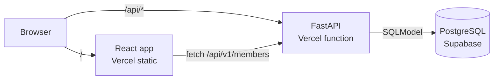
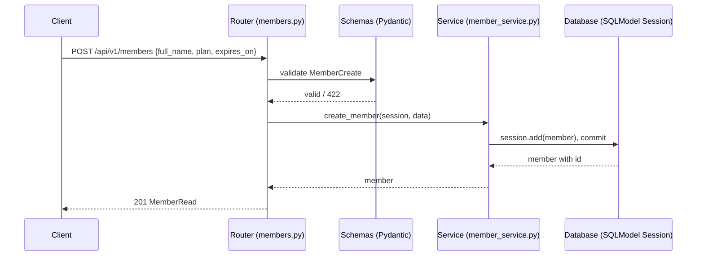
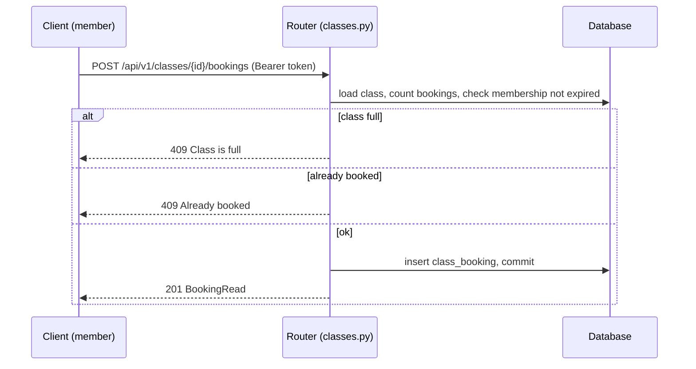
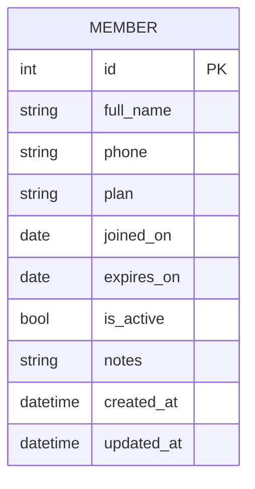
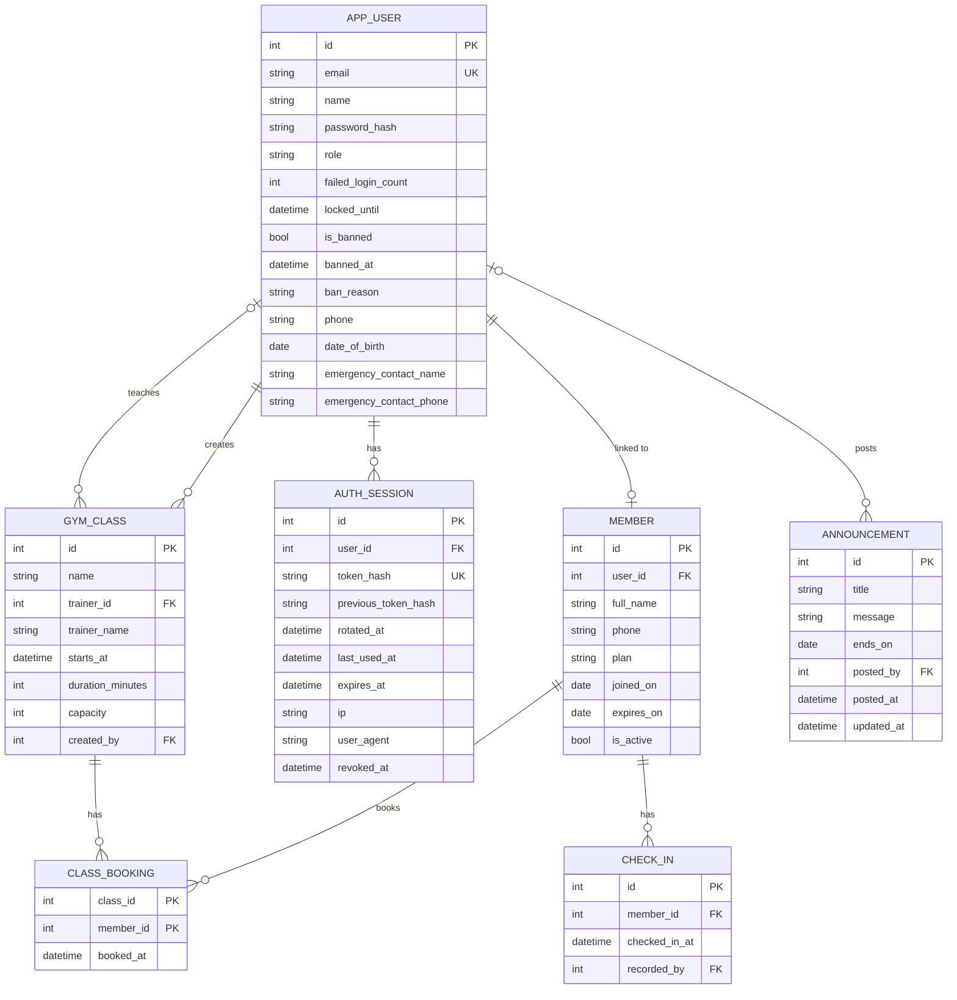
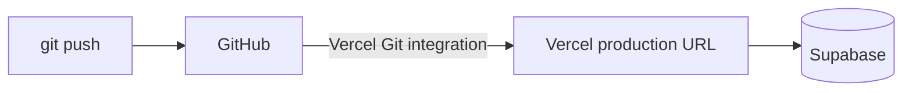

# Technical Design Document (TDD) — Gym Buddy

| Field | Value |
|---|---|
| Product | Gym Buddy |
| Version | MVP + Beta |
| Releases | MVP — Mid-term, Beta — Final |
| Status | Draft |
| Related docs | [Product Requirements Document (PRD)](01-prd.md), [Software Requirements Specification (SRS)](02-srs.md) |

Sections and tables are marked **MVP** or **Beta**. Build the MVP parts for the mid-term; the Beta parts extend them for the final.

**Documents in this set**

| Short form | Full form | Purpose | File |
|---|---|---|---|
| PRD | Product Requirements Document | What we build and why | [01-prd.md](01-prd.md) |
| SRS | Software Requirements Specification | Exact requirements, permissions and acceptance criteria | [02-srs.md](02-srs.md) |
| TDD | Technical Design Document | How we build it: architecture, data model, API (this document) | [03-tdd.md](03-tdd.md) |

## 1. Overview

- **MVP:** a FastAPI REST API for gym member CRUD (name, phone, membership plan, start and expiry dates), stored in a SQL database through SQLModel, deployed together with the Vite + React frontend as one Vercel project.
- **Beta:** the same app gains user accounts and login (JWT), global roles (`member`/`admin`), workout classes with member bookings and capacity limits, attendance check-ins, an admin dashboard, and security hardening. Schema changes are managed with Alembic.

## 2. Tech stack

| Layer | Choice | Why | Release |
|---|---|---|---|
| API | FastAPI | Validation, OpenAPI docs and type hints out of the box; already in the repo template | MVP |
| ORM / models | SQLModel | One class works as both the Pydantic schema and the database table; made by the FastAPI author | MVP |
| Database (production) | PostgreSQL on Supabase | Free tier, managed Postgres with a web dashboard (table editor, SQL editor), built-in connection pooler for serverless | MVP |
| DB driver | `psycopg[binary]` (psycopg 3) | Standard Postgres driver for SQLAlchemy/SQLModel | MVP |
| Database (local) | SQLite | No setup needed | MVP |
| Frontend | Vite + React + TypeScript | Already in the repo template | MVP |
| Hosting | Vercel | Frontend and backend in one project (`vercel.json`), auto deploy from GitHub | MVP |
| Migrations | Alembic | Versioned schema changes as the model grows from 1 to 6 tables | Beta |
| JWT | PyJWT | Sign and verify access tokens | Beta |
| Password hashing | `pwdlib[argon2]` | Argon2 hashing, recommended in the FastAPI docs | Beta |

## 3. Architecture



`vercel.json` already routes `/api/*` to the backend service and everything else to the frontend, so every backend route must start with `/api`. For the same reason the API docs are served at `/api/docs` (not FastAPI's default `/docs`):

```python
app = FastAPI(title="Gym Buddy API", docs_url="/api/docs", openapi_url="/api/openapi.json", redoc_url=None)
```

### 3.1 Request flow — MVP



### 3.2 Login and refresh flow — Beta

```mermaid
sequenceDiagram
    participant C as Client
    participant A as Auth router
    participant D as Database
    C->>A: POST /api/v1/auth/login {email, password}
    A->>D: find user, check lockout, verify Argon2 hash (peppered)
    A->>D: insert auth_session (hash of a new refresh token, IP, browser)
    A-->>C: 200 {access_token (sub, role, sid; 15 min)} + Set-Cookie refresh_token (HttpOnly)
    Note over C: keep the access token in memory; send Authorization: Bearer on each request
    C->>A: GET /api/v1/... (Bearer)
    A->>D: get_auth(): verify signature and exp, load user, check ban, check session sid is active
    A-->>C: 200, or 401 once the token expired or the session was revoked
    C->>A: POST /api/v1/auth/refresh (cookie, after a 401 or on page load)
    A->>D: find session by token hash; swap in a new hash only if it is unchanged (rotation)
    A-->>C: 200 {access_token} + new refresh_token cookie; the client repeats the request
    C->>A: POST /api/v1/auth/logout (cookie)
    A->>D: set auth_session.revoked_at
    A-->>C: 204 + cookie cleared; the old access token now gets 401
```

### 3.3 Class booking flow — Beta



## 4. Project structure

```
backend/
  main.py              # creates the app, includes routers, health check
  app/
    __init__.py
    config.py          # (Beta) settings from env vars: JWT secret, token lifetimes
    database.py        # engine, get_session()
    models.py          # tables + Create / Update / Read schemas
    security.py        # password hashing (Argon2 + pepper), access tokens (JWT create/verify), refresh token generation and hashing
    deps.py            # get_auth (token + session check), get_current_user
    rbac.py            # permission constants, role → permission map, require_permission(), has_permission(), is_owner()
    request_info.py    # client_ip() (X-Forwarded-For on Vercel) and user_agent() for the session list
    routers/
      __init__.py
      members.py       # /api/v1/members (+ check-ins in Beta)
      auth.py          # /api/v1/auth/signup, /login, /refresh, /logout (sets and clears the refresh cookie)
      users.py         # /api/v1/users/me (profile, change name, change password, my sessions)
      admin.py         # /api/v1/admin/stats, /revenue, /users (list, change role, ban, unban), /plans (set prices)
      check_ins.py     # /api/v1/check-ins/today
      classes.py       # /api/v1/classes (read: anyone logged in; change and bookings: gym manager, admin)
      plans.py         # /api/v1/plans (anyone logged in)
      payments.py      # /api/v1/payments (list: gym manager, admin; void and CSV export: admin)
      overview.py      # /api/v1/overview (gym manager, admin)
      trainers.py      # /api/v1/trainers (list: gym manager, admin) and /trainers/me/classes (trainer)
      announcements.py # /api/v1/announcements (read the current ones: anyone logged in; post, edit, delete and ended ones: gym manager, admin)
      classes.py       # (Beta) /api/v1/classes/* (classes and bookings)
    services/
      __init__.py
      member_service.py  # member rules and queries; raises MemberNotFoundError / InvalidExpiryError
      auth_service.py    # sign up (always role user), log in (re-hashes a pre-pepper hash), change password; raises EmailTakenError / InvalidCredentialsError
      session_service.py # login sessions: start, rotate the refresh token (grace period, reuse detection), list, revoke one or all; raises InvalidRefreshTokenError / SessionNotFoundError
      user_service.py    # list users and trainers, change role (an ex-trainer's classes keep the name as text), rename, ban / unban; raises UserNotFoundError / CannotChangeOwnRoleError / CannotBanError
      stats_service.py   # member, check-in, class and user counts for the admin dashboard and the gym manager overview (each reuses the rule of the list it links to)
      revenue_service.py # revenue today, this month, last 30 days, by method and by month (voided left out)
      payment_service.py # plan prices, record a payment (and renew), payment lists and total, void, CSV export; raises PaymentNotFoundError
      class_service.py   # classes and bookings: create, list, edit, delete, who booked, a trainer's own classes; raises ClassNotFoundError / CapacityBelowBookingsError / TrainerNotFoundError / NotYourClassError
      checkin_service.py # record a check-in (membership must be valid), history, today's list; raises MembershipNotValidError
      search.py          # contains_any(): the any-case text search shared by the member, waiting and user lists
      profile_service.py # phone, date of birth and emergency contact: update my own, and the both-or-neither contact check member_service also uses; raises IncompleteEmergencyContactError
      announcement_service.py # post, list (current or all, newest first, with the poster's name), edit, delete; raises AnnouncementNotFoundError
  alembic/             # (Beta) migration scripts
  alembic.ini          # (Beta)
  requirements.txt
frontend/
  src/
    App.tsx            # shows HomePage
    components/        # add form, member list, details panel
    context/           # AuthContext: who is logged in, login / signup / logout; restores the login with a refresh on load
    layouts/           # AppLayout: header, and the pages each role may open
    pages/             # HomePage (members), LoginPage, SignupPage, AccountPage, DashboardPage (admin), OverviewPage (gym manager, admin), UsersPage (admin), ClassesPage (gym manager, admin), PaymentsPage (gym manager, admin), MembershipPage and TimetablePage (user), MyClassesPage (trainer), PlansPage (admin), AnnouncementsPage (gym manager, admin); (Later) AboutPage, MemberDetailsPage; (Beta, Could) MyMembership, Classes, AdminDashboard
    services/          # fetch calls to the API; api.ts keeps the access token in memory and refreshes it once on a 401
    types/             # TypeScript types
    utils/             # display helpers; membersLink() builds the #/members?filter=&member= address
    hooks/             # useDebouncedValue: search boxes ask the API once typing pauses
docs/
  01-prd.md
  02-srs.md
  03-tdd.md
```

Keep routers thin: validate input, check permissions through dependencies, then call a function in `services/`. The service holds the business rules and the database queries and raises plain Python errors (`MemberNotFoundError`, `InvalidExpiryError`); `main.py` turns them into the 404 and 422 responses.

## 5. Data model

### 5.1 `member` table — MVP

| Column | Type | Rules |
|---|---|---|
| `id` | integer | Primary key, auto increment |
| `full_name` | varchar(100) | Not null |
| `phone` | varchar(20) | Nullable |
| `plan` | varchar(10) | `monthly`, `quarterly` or `yearly`, not null |
| `joined_on` | date | Not null, defaults to today |
| `expires_on` | date | Not null, must be on or after `joined_on` |
| `is_active` | boolean | Not null, default `true` (set to `false` to freeze a membership) |
| `notes` | varchar(500) | Nullable |
| `created_at` | timestamp (UTC) | Not null, set on insert |
| `updated_at` | timestamp (UTC) | Not null, set on insert and every update |



### 5.2 Full data model — Beta

`user` is a reserved word in PostgreSQL, so the table is named `app_user`. Classes are stored in `gym_class` because `class` is reserved in Python.

**`app_user`**

> Built so far: `id`, `email`, `name`, `password_hash`, `role`, `is_banned`, `banned_at`, `ban_reason`, `password_changed_at`, `failed_login_count`, `locked_until` and `created_at` (the lockout columns are added to an existing table on start). `password_changed_at` only records the last change: a password change or reset ends logins by revoking `auth_session` rows. `password_hash` starts with `peppered$` once it is made with the pepper (section 10.2).

| Column | Type | Rules |
|---|---|---|
| `id` | integer | Primary key |
| `email` | varchar(254) | Unique, stored lowercase |
| `name` | varchar(100) | Not null |
| `password_hash` | varchar | Argon2 hash, never returned by the API |
| `must_change_password` | boolean | Default false; true after an admin reset until a new password is chosen |
| `role` | varchar(20) | `user`, `trainer`, `gym_manager` or `admin`, default `user` |
| `failed_login_count` | integer | Default 0 |
| `locked_until` | timestamp (UTC) | Nullable |
| `is_banned` | boolean | Default `false` |
| `banned_at` | timestamp (UTC) | Nullable |
| `ban_reason` | varchar(500) | Nullable |
| `phone` | varchar(20) | Nullable |
| `date_of_birth` | date | Nullable; 1900-01-01 to today when sent. Added to an existing table on start |
| `emergency_contact_name` | varchar(100) | Nullable; set or cleared together with `emergency_contact_phone`. Added to an existing table on start |
| `emergency_contact_phone` | varchar(20) | Nullable; set or cleared together with `emergency_contact_name`. Added to an existing table on start |
| `created_at`, `updated_at` | timestamp (UTC) | Not null |

`phone`, `date_of_birth` and the emergency contact are read only through `MemberRead` (member endpoints: gym managers and admins; `/users/me/membership`: the member) and `ProfileRead` (`/users/me/profile`: the person), never through `UserRead`, so they stay out of the login response and every account list (NFR-20).

**`auth_session`** (one row per login on one browser; holds the current refresh token's hash)

| Column | Type | Rules |
|---|---|---|
| `id` | integer | Primary key; the `sid` claim of every access token issued for this login |
| `user_id` | integer | FK → `app_user.id`, on delete cascade, indexed |
| `token_hash` | varchar(64) | SHA-256 of the current refresh token, unique |
| `previous_token_hash` | varchar(64) | Nullable, indexed: the token the last refresh replaced (reuse detection) |
| `rotated_at` | timestamp (UTC) | Nullable: time of the last refresh |
| `created_at` | timestamp (UTC) | Not null: the login time |
| `last_used_at` | timestamp (UTC) | Not null: the login or the last refresh |
| `expires_at` | timestamp (UTC) | Not null: last refresh + 7 days |
| `ip` | varchar(45) | Nullable: client address at login |
| `user_agent` | varchar(300) | Nullable: browser at login |
| `revoked_at` | timestamp (UTC) | Nullable: set by logout, a revoke, a password change (other sessions) or reset, a ban, or a reused refresh token |

A session is active while `revoked_at IS NULL AND expires_at > now`. Rows are kept after they end; `member_service._delete_accounts()` deletes them with the account.

**`member` (new column in Beta)**

| Column | Type | Rules |
|---|---|---|
| `user_id` | integer | FK → `app_user.id`, nullable, unique (index `ix_member_user_id`; built so far without `on delete set null`, since accounts are never deleted). Added to an existing table by `create_db_and_tables()`. Links a membership record to a login account. `null` = walk-in member without an account |

**`gym_class`**

> Built so far: all columns and the `starts_at` index. `class_booking` rows are created when a member books (`POST /classes/{id}/bookings`); booking locks the class row (`SELECT ... FOR UPDATE` on PostgreSQL) before counting, so the capacity is never exceeded, and the service deletes bookings with the class or the member (SQLite does not enforce `on delete cascade` by default).

| Column | Type | Rules |
|---|---|---|
| `id` | integer | Primary key |
| `name` | varchar(100) | Not null |
| `description` | varchar(500) | Nullable |
| `trainer_id` | integer | FK → `app_user.id`, nullable, on delete set null, index `ix_gym_class_trainer_id`. Always an account with the role `trainer`: changing that account's role sets it to null and copies the name into `trainer_name`. Added to an existing table (with its index) by `create_db_and_tables()` |
| `trainer_name` | varchar(100) | Nullable. Free text from before trainers were accounts; cleared whenever `trainer_id` is sent. Responses show `coalesce(trainer's account name, trainer_name)` |
| `starts_at` | timestamp (UTC) | Not null |
| `duration_minutes` | integer | Not null, 15–240 |
| `capacity` | integer | Not null, 1–200 |
| `created_by` | integer | FK → `app_user.id` |
| `created_at`, `updated_at` | timestamp (UTC) | Not null |

**`class_booking`**

| Column | Type | Rules |
|---|---|---|
| `class_id` | integer | PK part, FK → `gym_class.id`, on delete cascade |
| `member_id` | integer | PK part, FK → `member.id`, on delete cascade |
| `booked_at` | timestamp (UTC) | Not null |

**`plan_price`**

| Column | Type | Rules |
|---|---|---|
| `plan` | varchar(10) | Primary key: `monthly`, `quarterly` or `yearly` |
| `price` | integer | Whole taka |
| `duration_days` | integer | Days a renewal adds |
| `updated_at` | timestamp (UTC) | Not null |

Filled with monthly 1,500 / 30, quarterly 4,000 / 90 and yearly 14,000 / 365 when the table is first created; existing rows are never overwritten.

**`payment`**

| Column | Type | Rules |
|---|---|---|
| `id` | integer | Primary key |
| `member_id` | integer | FK → `app_user.id` (the member who paid), nullable, on delete set null (the service sets it to null before deleting the account, since SQLite does not enforce it) |
| `member_name` | varchar(100) | The member's name when the payment was taken |
| `amount` | integer | Whole taka, 1 to 10,000,000 |
| `method` | varchar(20) | `cash`, `card`, `bank_transfer` or `mobile_banking` |
| `plan` | varchar(10) | Nullable: the plan renewed by this payment |
| `note` | varchar(200) | Nullable |
| `paid_at` | timestamp (UTC) | Not null, indexed |
| `renewed_until` | date | Nullable: the new expiry when the payment renewed the membership |
| `recorded_by` | integer | FK → `app_user.id` |
| `voided_at` | timestamp (UTC) | Nullable: set when an admin voids the payment; a voided payment is left out of every total |
| `void_reason` | varchar(200) | Nullable: required when voiding |
| `voided_by` | integer | FK → `app_user.id`, nullable: the admin who voided it |

Voiding is a conditional `UPDATE ... WHERE voided_at IS NULL`, so voiding twice (or two admins at once) keeps the first time and reason. The three void columns are added to an existing table on start.

**`check_in`**

> Built so far: all four columns, with indexes on `member_id` and `checked_in_at`. The service deletes a member's check-ins before deleting the member, because SQLite (local development) does not enforce `on delete cascade` by default.

| Column | Type | Rules |
|---|---|---|
| `id` | integer | Primary key |
| `member_id` | integer | FK → `member.id`, on delete cascade |
| `checked_in_at` | timestamp (UTC) | Not null |
| `recorded_by` | integer | FK → `app_user.id`: the gym manager or admin who recorded it |

**`announcement`**

> Built so far: all columns and the `posted_at` index. A new table, so `create_all()` makes it on start and nothing is added to an existing table.

| Column | Type | Rules |
|---|---|---|
| `id` | integer | Primary key |
| `title` | varchar(100) | Not null, 1–100 characters after trimming |
| `message` | varchar(1000) | Not null, 1–1,000 characters after trimming; line breaks are kept |
| `ends_on` | date | Nullable: the last UTC day it shows, inclusive (like `expires_on`). `null` = shows until deleted. Not before today when sent |
| `posted_by` | integer | FK → `app_user.id`, nullable, on delete set null (the service sets it to null before deleting an account, since SQLite does not enforce it) |
| `posted_at` | timestamp (UTC) | Not null, indexed (`ix_announcement_posted_at`): the lists are newest first |
| `updated_at` | timestamp (UTC) | Nullable: set on every edit, `null` until then |

"Current" is worked out from the date on every read (`ends_on IS NULL OR ends_on >= today`), like an expired membership, so nothing has to run when an announcement ends.

Indexes: `member(user_id)`, `class_booking(member_id)`, `check_in(member_id, checked_in_at)`, `gym_class(starts_at)`, `gym_class(trainer_id)`, `announcement(posted_at)`, `auth_session(user_id)`, `auth_session(token_hash)` (unique), `auth_session(previous_token_hash)`.



**Who can see a member record:**
- A member (`role = member`): only the record where `member.user_id` is their own id.
- An admin: every member record.

**A membership is "valid"** when `is_active` is true and `expires_on >= today`. Booking a class and checking in both require a valid membership.

### 5.3 Schemas

| Schema | Used for | Fields | Release |
|---|---|---|---|
| `MemberCreate` | `POST` member body | `full_name`, `phone?`, `plan`, `joined_on?`, `expires_on`, `notes?` | MVP |
| `MemberUpdate` | `PATCH` member body | all optional: `full_name`, `phone`, `plan`, `expires_on`, `is_active`, `notes`; (Beta) extends `ProfileUpdate`, so staff also send `date_of_birth` and the emergency contact | MVP |
| `MemberRead` | Member responses | all member columns (+ `user_id` in Beta; `date_of_birth`, `emergency_contact_name`, `emergency_contact_phone` with the profile details) | MVP |
| `MemberPage` | Member list response | `items` (`MemberRead[]`), `total` (all members matching the filter), `offset`, `limit` | MVP |
| `MemberBulkDelete` | Bulk delete body | `ids` (1 to 100 member IDs) | MVP |
| `MemberBulkDeleteResult` | Bulk delete response | `deleted` (how many members were deleted) | MVP |
| `SignupRequest` | Sign up | `email`, `name`, `password` | Beta |
| `LoginRequest` | Log in | `email`, `password` | Beta |
| `TokenResponse` | Login / refresh | `access_token`, `token_type: "bearer"`, `expires_in` (900), `user` (`UserRead`); the refresh token is only in the cookie | Beta |
| `SessionRead` | My sessions | `id`, `created_at`, `last_used_at`, `expires_at`, `ip`, `user_agent`, `current` (the session of this request); never the token hashes | Beta |
| `UserRead` | User responses | `id`, `email`, `name`, `role`, `created_at` (never `password_hash`) | Beta |
| `MeRead` | My own account (`/users/me`, login, refresh) | `UserRead` fields + `permissions` (the caller's role's permissions from `app/rbac.py`) | Beta |
| `RoleUpdate` | Change role | `role` | Beta |
| `ProfileUpdate` | Change own name | `name` | Beta |
| `PasswordChange` | Change own password | `current_password`, `new_password` | Beta |
| `ProfileRead` / `ProfileUpdate` | My contact details | `phone`, `date_of_birth` (1900-01-01 to today), `emergency_contact_name` (≤ 100), `emergency_contact_phone` (≤ 20); on update all optional, blank text becomes null, and the service checks the contact is both-or-neither against the saved values | Beta |
| `AdminUserRead` | Admin user list | `UserRead` + `is_banned`, `banned_at`, `ban_reason`, `plan?`, `expires_on?`, `is_frozen` | Beta |
| `AccountPage` | Accounts waiting for a membership | `items: UserRead[]`, `total`, `offset`, `limit` | Beta |
| `BanRequest` | Ban a user | `reason?` | Beta |
| `PasswordResetResult` | Admin password reset | `user: AdminUserRead`, `temporary_password` (shown once) | Beta |
| `AdminStats` | Dashboard | `members {total, active, expired, frozen, new_last_7_days, expiring_soon}`, `classes {total, upcoming}`, `check_ins {today, last_7_days}`, `users {total, users, trainers, gym_managers, admins, banned}` | Beta |
| `Overview` | Gym manager start page | `check_ins_today`, `expiring_soon`, `waiting`, `payments_today {count, amount}`, `next_classes: ClassRead[]` (5) | Beta |
| `RevenueStats` | Dashboard revenue | `today`, `this_month`, `last_30_days`, `last_30_days_from` (date), `by_method [{method, amount, count}]` (all four methods), `months [{month: "YYYY-MM", amount}]` (6, oldest first) | Beta |
| `ClassCreate` / `ClassUpdate` | Create / edit class | `name`, `description?`, `trainer_id?` (an account with the role `trainer`, or null), `starts_at`, `duration_minutes`, `capacity` (all optional on update; on update a `trainer_id` left out keeps the trainer) | Beta |
| `TrainerRead` | Trainer list | `id`, `name` | Beta |
| `ClassRead` | Class responses | all class columns except `created_by` (`trainer_name` is the trainer's current account name, or the old text name) + `booked_count` (`is_booked_by_me` comes with member booking); times are UTC with a trailing `Z` | Beta |
| `ClassPage` / `BookingPage` | Class and booking lists | `items`, `total`, `offset`, `limit` | Beta |
| `BookingRead` | Booking responses | `class_id`, `member_id`, `member_name`, `booked_at` | Beta |
| `BookedClassRead` / `BookedClassPage` | A member's bookings | `class_id`, `class_name`, `starts_at`, `duration_minutes`, `trainer_name?`, `booked_at` | Beta |
| `PaymentCreate` / `PaymentRead` / `PaymentPage` | Record and list payments | create: `amount`, `method`, `note?`, `renew_plan?`; read: `id`, `member_id?`, `member_name`, `amount`, `method`, `plan?`, `note?`, `paid_at`, `renewed_until?`, `recorded_by_name?`, `voided_at?`, `void_reason?`, `voided_by_name?` | Beta |
| `PaymentListPage` | All payments | `PaymentPage` + `total_amount` (sum of the matching payments that are not voided, across all pages) | Beta |
| `PaymentFilter` | Query filters for the list and the CSV | `date_from?`, `date_to?` (UTC days, inclusive; `date_from` after `date_to` is `422`), `method?`, `member?` (part of the name, any case), `include_voided` (default false) | Beta |
| `VoidRequest` | Void a payment | `reason` (1 to 200 characters, required) | Beta |
| `PlanRead` | Plan prices | `plan`, `price`, `duration_days` | Beta |
| `PlanUpdate` | Change a plan | `price` (1 to 10,000,000), `duration_days` (1 to 3,660), both required | Beta |
| `CheckInRead` | Check-in responses | `id`, `member_id`, `member_name`, `checked_in_at`, `recorded_by_name` | Beta |
| `CheckInPage` | Check-in lists | `items: CheckInRead[]`, `total`, `offset`, `limit` | Beta |
| `AnnouncementCreate` / `AnnouncementUpdate` | Post / edit an announcement | `title` (1–100), `message` (1–1,000), `ends_on?` (a date not before today, or null for none); all optional on update, where `title` and `message` cannot be null and a left-out `ends_on` keeps the end date | Beta |
| `AnnouncementRead` / `AnnouncementPage` | Announcement responses and lists | `id`, `title`, `message`, `ends_on?`, `posted_at`, `updated_at?` (null until edited), `posted_by_name?` (null once the poster's account is deleted); page: `items`, `total`, `offset`, `limit` | Beta |

MVP sketch:

```python
class MemberBase(SQLModel):
    full_name: str = Field(min_length=1, max_length=100)
    phone: str | None = Field(default=None, max_length=20)
    plan: str = Field(regex="^(monthly|quarterly|yearly)$")
    expires_on: date
    notes: str | None = Field(default=None, max_length=500)

class Member(MemberBase, table=True):
    id: int | None = Field(default=None, primary_key=True)
    joined_on: date = Field(default_factory=date.today)
    is_active: bool = True
    created_at: datetime = Field(default_factory=lambda: datetime.now(timezone.utc))
    updated_at: datetime = Field(default_factory=lambda: datetime.now(timezone.utc))

class MemberCreate(MemberBase):
    joined_on: date | None = None

class MemberUpdate(SQLModel):
    full_name: str | None = Field(default=None, min_length=1, max_length=100)
    phone: str | None = Field(default=None, max_length=20)
    plan: str | None = Field(default=None, regex="^(monthly|quarterly|yearly)$")
    expires_on: date | None = None
    is_active: bool | None = None
    notes: str | None = Field(default=None, max_length=500)

class MemberRead(MemberBase):
    id: int
    joined_on: date
    is_active: bool
    created_at: datetime
    updated_at: datetime
```

`full_name` is trimmed before validation so `"   "` is rejected. `expires_on` before `joined_on` returns `422`.

## 6. REST API design

Base path: `/api/v1`. All bodies are JSON.

### 6.1 Endpoints — MVP

In the MVP no login is needed. In the Beta the member endpoints become admin-only (members use `/users/me/membership` instead).

| Method | Path | Body | Success | Errors | FR |
|---|---|---|---|---|---|
| `POST` | `/api/v1/members` | `MemberCreate` | `201` `MemberRead` | `422` | FR-01, FR-07 |
| `GET` | `/api/v1/members?offset=0&limit=20&status=` | — | `200` `MemberPage` | `422` | FR-02, FR-03 |
| `GET` | `/api/v1/members/{id}` | — | `200` `MemberRead` | `404` | FR-04 |
| `PATCH` | `/api/v1/members/{id}` | `MemberUpdate` | `200` `MemberRead` | `404`, `422` | FR-05, FR-07 |
| `DELETE` | `/api/v1/members/{id}` | — | `204` | `404` | FR-06 |
| `POST` | `/api/v1/members/bulk-delete` | `MemberBulkDelete` | `200` `MemberBulkDeleteResult` | `422` | FR-06a |
| `GET` | `/api/health` | — | `200` `{"status":"ok"}` | — | FR-10 |

`status` is an optional filter: `active` (valid membership), `expired` (`expires_on < today`) or `frozen` (`is_active = false`).

### 6.2 Endpoints — Beta

"Who" uses the roles from the [SRS permission matrix (section 3.11)](02-srs.md#311-permission-matrix--beta). Every endpoint except auth, health and docs needs `Authorization: Bearer <access_token>` (`401` without it).

**Auth and profile**

| Method | Path | Who | Body | Success | Errors | FR |
|---|---|---|---|---|---|---|
| `POST` | `/api/v1/auth/signup` | Guest | `SignupRequest` | `201` `UserRead` | `409`, `422` | FR-12 |
| `POST` | `/api/v1/auth/login` | Guest | `LoginRequest` | `200` `TokenResponse` + cookie | `401`, `429` | FR-13, FR-34 |
| `POST` | `/api/v1/auth/refresh` | Refresh cookie | — | `200` `TokenResponse` + new cookie (none when another request rotated the same token within 30 s); `204` with no cookie | `401` + cookie cleared (expired, revoked, unknown or reused) | FR-14, FR-82 |
| `POST` | `/api/v1/auth/logout` | Refresh cookie | — | `204`, session revoked, cookie cleared (always `204`) | — | FR-15 |
| `GET` | `/api/v1/users/me` | Member | — | `200` `MeRead` | `401` | FR-16, FR-83 |
| `PATCH` | `/api/v1/users/me` | Member | `ProfileUpdate` | `200` `MeRead` | `422` | FR-40 |
| `POST` | `/api/v1/users/me/password` | Any logged-in user, also while a new password is due | `PasswordChange` | `204` (every other session is revoked, this one stays; clears `must_change_password`) | `400` (wrong current password or same password), `401`, `422` | FR-41, FR-66 |
| `GET` | `/api/v1/users/me/sessions` | Any logged-in user | — | `200` `SessionRead[]`, active only, most recently used first | `401` | FR-80 |
| `DELETE` | `/api/v1/users/me/sessions/{id}` | Any logged-in user | — | `204` (that session's refresh and access tokens stop working) | `401`, `404` (not mine or not active) | FR-81 |
| `GET` | `/api/v1/users/lookup?email` or `?id` | Gym Manager, Admin | — | `200` `AccountLookup` (`id`, `name`, `email`) | `403`, `404`, `422` | FR-23 |
| `GET` | `/api/v1/users/me/profile` | Any logged-in user | — | `200` `ProfileRead` (my own only) | `401` | FR-77 |
| `PATCH` | `/api/v1/users/me/profile` | Any logged-in user | `ProfileUpdate` | `200` `ProfileRead` | `401`, `422` (date of birth out of range, too long, emergency contact with only a name or a phone) | FR-76, FR-77 |
| `GET` | `/api/v1/users/me/membership` | Any logged-in user | — | `200` `MemberRead` | `401`, `404` (no membership linked) | FR-17 |
| `GET` | `/api/v1/users/me/check-ins?offset&limit` | Any logged-in user | — | `200` `CheckInPage` (newest first) | `401`, `404` | FR-18 |

**Members (gym manager and admin)** — same five endpoints as the MVP, now for gym managers and admins only (`401` without a token, `403` for a `user`).

| Method | Path | Who | Body | Success | Errors | FR |
|---|---|---|---|---|---|---|
| `POST` | `/api/v1/members` | Gym Manager, Admin | `MemberCreate` (+ optional `user_id`) | `201` `MemberRead` | `403`, `409` (user already linked), `422` | FR-19 |
| `GET` | `/api/v1/members?offset&limit&status&q` | Gym Manager, Admin | — | `200` `MemberPage` (`status=expiring_soon`: soonest expiry first; `q`: name, email or phone) | `403` | FR-19, FR-53, FR-54 |
| `GET` | `/api/v1/members/waiting?offset&limit&q` | Gym Manager, Admin | — | `200` `AccountPage` (role `user`, no plan, newest first; declared before `/{member_id}`) | `403` | FR-55 |
| `GET` | `/api/v1/members/{id}` | Gym Manager, Admin | — | `200` `MemberRead` | `403`, `404` | FR-19 |
| `PATCH` | `/api/v1/members/{id}` | Gym Manager, Admin | `MemberUpdate` | `200` `MemberRead` | `403`, `404`, `422` | FR-19 |
| `DELETE` | `/api/v1/members/{id}` | Gym Manager, Admin | — | `204` | `403`, `404` | FR-19 |
| `POST` | `/api/v1/members/{id}/check-ins` | Gym Manager, Admin | — | `201` `CheckInRead` | `400` (frozen: "Membership is frozen"; expired: "Membership expired on YYYY-MM-DD"), `403`, `404` | FR-30 |
| `GET` | `/api/v1/members/{id}/check-ins?offset&limit` | Gym Manager, Admin | — | `200` `CheckInPage` (newest first) | `403`, `404`, `422` | FR-31 |
| `GET` | `/api/v1/check-ins/today?offset&limit` | Gym Manager, Admin | — | `200` `CheckInPage` (since midnight UTC, newest first; `limit` up to 100, default 50) | `401`, `403`, `422` | FR-42 |

**Admin**

| Method | Path | Who | Body | Success | Errors | FR |
|---|---|---|---|---|---|---|
| `GET` | `/api/v1/admin/users?offset&limit&q` | Admin | — | `200` `AdminUserPage` (`AdminUserRead` items, with ban info and membership) | `403` | FR-21, FR-56 |
| `PATCH` | `/api/v1/admin/users/{user_id}/role` | Admin | `RoleUpdate` | `200` `AdminUserRead` (from `trainer` to another role: the trainer's classes keep the name as text) | `400` (own role), `403`, `404` | FR-22, FR-67 |
| `GET` | `/api/v1/admin/stats` | Admin | — | `200` `AdminStats` | `403` | FR-35 |
| `GET` | `/api/v1/admin/revenue` | Admin | — | `200` `RevenueStats` | `401`, `403` | FR-52 |
| `GET` | `/api/v1/overview` | Gym Manager, Admin | — | `200` `Overview` (`payment_service.totals_since()`, `checkin_service.count_since()`, the member list's `status_filters("expiring_soon")` and `WAITING`, `class_service.list_classes(upcoming)`) | `401`, `403` | FR-62 |
| `POST` | `/api/v1/admin/users/{user_id}/ban` | Admin | `BanRequest` | `200` `AdminUserRead` | `400` (self / other admin), `403`, `404` | FR-36 |
| `POST` | `/api/v1/admin/users/{user_id}/unban` | Admin | — | `200` `AdminUserRead` | `403`, `404` | FR-38 |
| `POST` | `/api/v1/admin/users/{user_id}/reset-password` | Admin | — | `200` `PasswordResetResult`, `Cache-Control: no-store` | `400` (self or another admin), `403`, `404` | FR-64 |

`GET /api/v1/admin/users` returns `AdminUserRead` items so the Users page can show who is banned, since when and why (FR-39).

`GET /api/v1/admin/stats` returns `{members: {total, active, expired, frozen, new_last_7_days, expiring_soon}, users: {total, users, trainers, gym_managers, admins, banned}, check_ins, classes}`. "Active", "expired", "frozen" and "expiring_soon" call the member list's own `status_filters()`, so each count equals the list with that filter.

Ban rules: banning is idempotent (banning a banned user changes nothing), an admin cannot ban themself or another admin (`400`), and unbanning clears `banned_at` and `ban_reason` but keeps the role. `get_current_user` returns `403 Account banned` for a banned user on every request, and `/auth/login` does the same after the password is checked, so a stranger cannot find out who is banned.

**Plans and payments**

| Method | Path | Who | Body | Success | Errors | FR |
|---|---|---|---|---|---|---|
| `GET` | `/api/v1/plans` | Any logged-in user | — | `200` `PlanRead[]` (monthly, quarterly, yearly) | `401` | FR-43 |
| `PUT` | `/api/v1/admin/plans/{plan}` | Admin | `PlanUpdate` | `200` `PlanRead` | `401`, `403`, `422` (unknown plan or out-of-range value) | FR-47 |
| `POST` | `/api/v1/members/{id}/payments` | Gym Manager, Admin | `PaymentCreate` | `201` `PaymentRead` (with `renew_plan`, the member's expiry and plan change too) | `403`, `404`, `422` | FR-44, FR-45 |
| `GET` | `/api/v1/members/{id}/payments?offset&limit` | Gym Manager, Admin | — | `200` `PaymentPage` (newest first, voided included) | `403`, `404`, `422` | FR-46 |
| `GET` | `/api/v1/payments?date_from&date_to&method&member&include_voided&offset&limit` | Gym Manager, Admin | — | `200` `PaymentListPage` (newest first) | `401`, `403`, `422` | FR-48 |
| `GET` | `/api/v1/users/me/bookings?when&offset&limit` | Any logged-in user | — | `200` `BookedClassPage` (own only; `upcoming` soonest first, `past` latest first) | `401`, `422` | FR-60 |
| `GET` | `/api/v1/members/{id}/bookings?when&offset&limit` | Gym Manager, Admin | — | `200` `BookedClassPage` | `403`, `404`, `422` | FR-58 |
| `DELETE` | `/api/v1/members/{id}/bookings/{class_id}` | Gym Manager, Admin | — | `204` | `400` (class started), `403`, `404` | FR-59 |
| `GET` | `/api/v1/users/me/payments?offset&limit` | Any logged-in user | — | `200` `PaymentPage` (own payments only, voided included) | `401` | FR-49 |
| `POST` | `/api/v1/payments/{id}/void` | Admin | `VoidRequest` | `200` `PaymentRead` (voiding again: unchanged) | `401`, `403`, `404`, `422` | FR-50 |
| `GET` | `/api/v1/payments/export.csv?date_from&date_to&method&member&include_voided` | Admin | — | `200` `text/csv` attachment `payments-YYYY-MM-DD.csv` | `401`, `403`, `422` | FR-51 |

**Classes and bookings**

| Method | Path | Who | Body | Success | Errors | FR |
|---|---|---|---|---|---|---|
| `POST` | `/api/v1/classes` | Gym Manager, Admin | `ClassCreate` | `201` `ClassRead` | `401`, `403`, `422` (including a `trainer_id` that is not a trainer) | FR-25, FR-69 |
| `GET` | `/api/v1/classes?offset&limit&upcoming=true` | Any logged-in user | — | `200` `ClassPage` (ordered by `starts_at`) | `401`, `422` | FR-26 |
| `GET` | `/api/v1/classes/{class_id}` | Any logged-in user | — | `200` `ClassRead` | `401`, `404` | FR-26 |
| `PATCH` | `/api/v1/classes/{class_id}` | Gym Manager, Admin | `ClassUpdate` | `200` `ClassRead` (a sent `trainer_id` clears `trainer_name`) | `403`, `404`, `422` (capacity below current bookings, or a `trainer_id` that is not a trainer) | FR-27, FR-69 |
| `DELETE` | `/api/v1/classes/{class_id}` | Gym Manager, Admin | — | `204` (its bookings are deleted too) | `403`, `404` | FR-27 |
| `GET` | `/api/v1/classes/{class_id}/bookings` | Gym Manager, Admin; Trainer for the classes they teach | — | `200` `BookingPage` (in booking order) | `403` (including a trainer and another class), `404` | FR-28, FR-71 |
| `GET` | `/api/v1/trainers` | Gym Manager, Admin | — | `200` `TrainerRead[]` (role `trainer`, by name; not paged, like `/plans`) | `401`, `403` | FR-68 |
| `GET` | `/api/v1/trainers/me/classes?when&offset&limit` | Trainer | — | `200` `ClassPage` (classes with `trainer_id` = me; `upcoming` soonest first, `past` latest first) | `401`, `403`, `422` | FR-70 |
| `POST` | `/api/v1/classes/{class_id}/bookings` | Any logged-in user with a linked, valid membership | — | `201` `BookingRead` | `400` (membership not valid / class already started), `404`, `409` (full or already booked) | FR-28, FR-29 |
| `DELETE` | `/api/v1/classes/{class_id}/bookings` | Any logged-in user with a membership | — | `204` (cancel my booking) | `400` (class started), `404` | FR-29 |

**Announcements**

| Method | Path | Who | Body | Success | Errors | FR |
|---|---|---|---|---|---|---|
| `GET` | `/api/v1/announcements?offset&limit` | Any logged-in user | — | `200` `AnnouncementPage` (current only: no `ends_on`, or `ends_on` today or later in UTC; newest first) | `401`, `422` | FR-73 |
| `GET` | `/api/v1/announcements?include_ended=true&offset&limit` | Gym Manager, Admin | — | `200` `AnnouncementPage` (every announcement, newest first) | `401`, `403` (any other role) | FR-74 |
| `POST` | `/api/v1/announcements` | Gym Manager, Admin | `AnnouncementCreate` | `201` `AnnouncementRead` (`posted_by` = the caller) | `401`, `403`, `422` (empty title or message, too long, `ends_on` before today) | FR-72 |
| `PATCH` | `/api/v1/announcements/{announcement_id}` | Gym Manager, Admin | `AnnouncementUpdate` | `200` `AnnouncementRead` (only the fields sent change; sets `updated_at`) | `401`, `403`, `404`, `422` | FR-74 |
| `DELETE` | `/api/v1/announcements/{announcement_id}` | Gym Manager, Admin | — | `204` | `401`, `403`, `404` | FR-74 |

### 6.3 Examples

Create:

```http
POST /api/v1/members
Content-Type: application/json

{ "full_name": "Rafi Ahmed", "phone": "01700000000", "plan": "monthly", "expires_on": "2026-11-10" }
```

```http
201 Created

{
  "id": 1,
  "full_name": "Rafi Ahmed",
  "phone": "01700000000",
  "plan": "monthly",
  "joined_on": "2026-10-10",
  "expires_on": "2026-11-10",
  "is_active": true,
  "notes": null,
  "created_at": "2026-10-10T10:00:00Z",
  "updated_at": "2026-10-10T10:00:00Z"
}
```

Renew a membership:

```http
PATCH /api/v1/members/1
Content-Type: application/json

{ "expires_on": "2026-12-10" }
```

Log in (Beta):

```http
POST /api/v1/auth/login
Content-Type: application/json

{ "email": "a@x.com", "password": "correct horse battery" }
```

```http
200 OK
Set-Cookie: refresh_token=...; HttpOnly; Secure; SameSite=Strict; Path=/api/v1/auth; Max-Age=604800

{ "access_token": "eyJhbGciOi...", "token_type": "bearer", "expires_in": 900,
  "user": { "id": 7, "email": "a@x.com", "name": "Rafi", "role": "user", "created_at": "...", "must_change_password": false } }
```

### 6.4 Error format

Use FastAPI's default format so there is no custom code to maintain:

```json
{ "detail": "Member not found" }
```

Validation errors (`422`) use FastAPI's built-in list format, which names the failing field:

```json
{ "detail": [ { "loc": ["body", "full_name"], "msg": "String should have at least 1 character", "type": "string_too_short" } ] }
```

A catch-all exception handler returns `500` with `{"detail": "Internal server error"}` and logs the real error (NFR-07).

### 6.5 Design rules
- Plural nouns for resources (`/members`, `/classes`, `/bookings`, `/check-ins`), no verbs in paths (except the `auth` actions and `ban`/`unban`).
- Nested paths show ownership: a class's bookings live under `/classes/{class_id}/bookings`; a member's check-ins under `/members/{id}/check-ins`.
- `PATCH` for partial update; only fields sent are changed (`model_dump(exclude_unset=True)`).
- Lists are ordered by `created_at` descending (classes by `starts_at` ascending) and take `offset` / `limit`.
- `404` (not `403`) when the caller is not allowed to know a resource exists; `403` when they can see it but not do the action.
- `/api/v1` prefix so a future `v2` of the API can live next to it.

## 7. Database access

- `database.py` creates one engine from the `DATABASE_URL` env var, defaulting to `sqlite:///./gym_buddy.db` locally.
- `get_session()` is a FastAPI dependency that yields a `Session` per request.
- MVP: tables are created on startup with `SQLModel.metadata.create_all(engine)`.
- Beta: `create_all` is removed and the schema is managed by Alembic (section 12).
- On Vercel, connect through Supabase's **transaction pooler** (Supavisor, port `6543`), because each serverless function opens its own connections.
- The transaction pooler does not support prepared statements, so the engine is created with `poolclass=NullPool` (the pooler does the pooling) and `connect_args={"prepare_threshold": None}` for psycopg.
- URL format: `postgresql+psycopg://postgres.<project-ref>:<password>@aws-0-<region>.pooler.supabase.com:6543/postgres`.
- Only the Postgres database is used. Supabase Auth, Storage and the auto-generated REST API are not used; login is our own (section 10) and all access goes through our FastAPI backend.
- Row Level Security (RLS) is not used because the browser never talks to Supabase directly; permissions are enforced in FastAPI. Keep the Supabase `anon` and `service_role` keys out of the frontend.

## 8. Configuration

| Variable | Local | Vercel | Release |
|---|---|---|---|
| `DATABASE_URL` | not set (SQLite default) | Supabase transaction pooler URL (port `6543`) | MVP |
| `JWT_SECRET` | optional (a temporary secret per run) | Required: random 32+ byte secret (`python -c "import secrets; print(secrets.token_urlsafe(48))"`) | Beta |
| `PASSWORD_PEPPER` | optional (a fixed development pepper) | Required: random 32+ byte secret, generated the same way. Never changed once set: every password hashed with it would stop verifying | Beta |
| `MIGRATION_DATABASE_URL` | not needed | Not on Vercel. Used only on a developer machine to run Alembic against Supabase (session pooler, port `5432`) | Beta |

Token lifetimes are constants, not env vars: `ACCESS_TOKEN_LIFETIME` (15 minutes) in `app/security.py`, `REFRESH_LIFETIME` (7 days) and `ROTATION_GRACE` (30 seconds) in `app/services/session_service.py`.

No secrets are committed. `.env` stays in `.gitignore`.

Supabase setup (one time):
1. Create a project at supabase.com and save the database password.
2. **Connect** -> **Transaction pooler** -> copy the URI, and change the scheme to `postgresql+psycopg://`.
3. In Vercel -> Project -> **Settings** -> **Environment Variables**, add it as `DATABASE_URL`.
4. Add `psycopg[binary]` to `backend/requirements.txt`.

Free-tier Supabase projects pause after a week with no activity; open the dashboard and restore the project before a demo if needed.

## 9. Deployment



- The repo is connected to Vercel through the Vercel GitHub integration (already set up by the template); a push to `main` deploys to production.
- Environment variables from section 8 are set in the Vercel project settings.
- (Beta) Before merging a change that includes a new migration, run `alembic upgrade head` against Supabase (section 12), then merge so Vercel deploys the matching code.

## 10. Auth and RBAC design — Beta

### 10.1 Tokens

| Token | Format | Lifetime | Where it lives |
|---|---|---|---|
| Access token | JWT, HS256, claims `sub` (user id), `role`, `sid` (session id), `iat`, `exp` | 15 min | Frontend memory only (a module variable in `services/api.ts`); sent as `Authorization: Bearer` |
| Refresh token | Random 32 bytes (`secrets.token_urlsafe`) | 7 days from the last refresh | `refresh_token` cookie (`HttpOnly`, `Secure`, `SameSite=Strict`, `Path=/api/v1/auth`); `auth_session.token_hash` keeps only its SHA-256 hash |

- **Create:** `POST /auth/login` checks the password, inserts an `auth_session` row, sets the cookie and returns an access token naming that row in `sid`.
- **Verify (every protected request):** `deps.get_auth()` decodes the token with `JWT_SECRET` (a bad signature, an expired `exp` or a missing claim → `401`), loads the user (gone → `401`; banned → `403 Account banned`), then checks that session `sid` belongs to the user and is active (otherwise `401`). Every other dependency builds on it, and FastAPI runs it once per request.
- **Refresh rotation:** `session_service.rotate()` finds the session by the cookie's hash and replaces the hash with a new token's in one `UPDATE ... WHERE id = ? AND token_hash = <old hash>`. If that matches no row, another request rotated first: this one still gets an access token but no new cookie, so the browser keeps the winner's cookie. The session id stays the same, so `sid` in new access tokens does not change.
- **Reuse detection:** the replaced hash is kept in `previous_token_hash`. Sent again within `ROTATION_GRACE` (30 s, for example two tabs refreshing at once), it gets an access token without a new cookie. Sent later, only a copy can hold it, so the whole session is revoked (`401`) and both holders must log in again.
- **Revoke:** logout (`POST /auth/logout`, by the cookie), `DELETE /users/me/sessions/{id}`, a password change (every session but the caller's), an admin reset or a ban (every session) set `revoked_at`. The access tokens of a revoked session fail on their next request, because `get_auth()` checks the session; there is no wait for `exp`.
- **Expiry:** after 15 minutes the API answers `401`. `services/api.ts` then calls `refreshSession()` once (all requests failing together share one promise) and repeats the request. If the refresh fails, `AuthContext.endSession()` shows Log in. On page load the app always calls refresh (scripts cannot see the HttpOnly cookie); with no cookie the answer is `204`, so a visitor sees no console error, and "Loading…" covers the wait instead of a flash of the Log in page.
- The `role` claim is only informational; permission checks always use the role loaded from the database, so a role change applies on the next request.

### 10.2 Passwords and login lockout

- Hash with Argon2 (`argon2-cffi`) after mixing in the pepper: `argon2(HMAC-SHA256(PASSWORD_PEPPER, password))`, stored as `peppered$<argon2 hash>`. Verify on login; never log or return the hash.
- A hash without the `peppered$` prefix was made before the pepper: it is verified as it was made, and `auth_service.authenticate()` replaces it with a peppered hash on that successful login (`security.password_needs_rehash()`). Each path runs exactly one Argon2 check, so timing does not show which kind of hash an account has.
- Unknown email and wrong password both return `401 "Invalid email or password"`, so emails cannot be discovered.
- Wrong password: `failed_login_count += 1`. At 5, set `locked_until = now + 15 min` and reset the count. While `locked_until > now`, login returns `429`. A successful login resets the count.
- Stored in the database (not in memory) because serverless functions do not share memory.
- **Built so far:** `auth_service.authenticate()` refuses a locked account before checking the password. The `+ 1` is an `UPDATE ... SET failed_login_count = failed_login_count + 1`, so parallel wrong passwords all count; the 5th answers `429` straight away. The `429` carries `Retry-After` (seconds) and the message "Too many failed logins. Try again in N minutes." Attempts while locked do not count, and the lockout only blocks new logins: tokens already issued keep working. Unknown emails are never locked (there is no row to count on), so they always get the same `401`; after 5 tries the `429` does show that an account exists, an accepted trade-off of locking per account.

### 10.3 Permission dependencies

All the rules live in `app/rbac.py` (final spec 2.2: one reusable RBAC module):

```python
class Permission(str, Enum):
    MEMBERS_READ = "members:read"
    CLASSES_TEACH = "classes:teach"
    USERS_BAN = "users:ban"
    ...                                   # 16 in all (SRS 3.11)

ROLE_PERMISSIONS = {
    "user": frozenset(),                  # only their own account and data
    "trainer": frozenset({Permission.CLASSES_TEACH}),
    "gym_manager": _GYM_MANAGER,          # 7 permissions
    "admin": _GYM_MANAGER | {...},        # those + 8 admin permissions
}

def require_permission(*permissions: Permission):
    """Dependency: the caller needs at least one of these, else 403."""
    def check(user: CurrentUser) -> User:   # CurrentUser: token, session, ban and must-change-password checks (401/403)
        if not any(has_permission(user, p) for p in permissions):
            raise HTTPException(403, "You do not have permission to do this")
        return user
    return check
```

A request goes: `get_auth` (token signature and expiry, user, ban, session; section 10.1) → `get_current_user` (`403` while a new password is due) → `require_permission(...)` (`403` without the permission) → the route → the service. The role is loaded from the database, never taken from the token, so a role change applies on the next request. The same list goes to the app in `MeRead.permissions` (`rbac.me()`), which decides the menu and the page guards from it.

Routes declare the check in one of two ways, both resolved before the body is validated (so a caller without the permission gets `403`, not `422`):

```python
READ_MEMBERS = Depends(require_permission(Permission.MEMBERS_READ))

@router.get("/{member_id}", response_model=MemberRead, dependencies=[READ_MEMBERS])   # when the route does not need the user
def get_member(member_id: int, session: SessionDep) -> User: ...

Banner = Annotated[User, Depends(require_permission(Permission.USERS_BAN))]

@router.post("/users/{user_id}/ban", response_model=AdminUserRead)                   # when it needs to know who acts
def ban_user(user_id: int, session: SessionDep, admin: Banner, body: BanRequest | None = None) -> User: ...
```

| Route group | Dependency |
|---|---|
| `/api/v1/users/me/*`, `GET /classes`, `GET /classes/{id}`, `POST` / `DELETE /classes/{id}/bookings`, `GET /plans`, `GET /announcements` | `CurrentUser` only: the caller's own data |
| `GET /members`, `GET /members/waiting`, `GET /members/{id}`, `GET /members/{id}/check-ins`, `GET /members/{id}/bookings` | `members:read` |
| `POST /members`, `PATCH` / `DELETE /members/{id}`, `POST /members/bulk-delete`, `DELETE /members/{id}/bookings/{class_id}` | `members:manage` |
| `POST /members/{id}/check-ins`, `GET /check-ins/today` | `check_ins:record` |
| `POST` / `GET /members/{id}/payments`, `GET /payments` | `payments:manage` |
| `POST /payments/{id}/void` / `GET /payments/export.csv` | `payments:void` / `payments:export` |
| `POST /classes`, `PATCH` / `DELETE /classes/{id}`, `GET /trainers` | `classes:manage` |
| `GET /classes/{id}/bookings` | `classes:manage` or `classes:teach`; the service then refuses a caller without `classes:manage` who does not teach the class (`rbac.is_owner()`, `NotYourClassError` → `403`) |
| `GET /trainers/me/classes` | `classes:teach` |
| `GET /overview` | `overview:read` |
| `POST /announcements`, `PATCH` / `DELETE /announcements/{id}`; `GET /announcements?include_ended=true` | `announcements:manage` (the last one checked in the route with `rbac.has_permission()`) |
| `GET /admin/stats`, `GET /admin/revenue` | `dashboard:read` |
| `GET /admin/users` / `PATCH .../role` / `POST .../ban`, `.../unban` / `POST .../reset-password` | `users:read` / `users:change_role` / `users:ban` / `users:reset_password` |
| `PUT /admin/plans/{plan}` | `plans:edit` |

Helpers: `has_permission(user, p)`; `roles_with(p)` for queries (the trainer list is every account whose role holds `classes:teach`); `is_owner(user, owner_id)` for records that belong to someone, where the caller answers `404` for a private record and `403` for a public one (a class). `rbac.py` imports `app.deps`, so nothing `app.deps` imports may import `rbac.py`.

Row-level rules that depend on the data are checked inside the route:
- Own membership: query with `Member.user_id == user.id`; a member can never pass an id to read another member's record.
- Book class: class must exist (`404`), `starts_at` must be in the future (`400`), `count(bookings) < capacity` (`409` if full), and no existing `(class_id, member_id)` row (`409`). Do the capacity check and insert in one transaction.
- Cancel booking: delete the caller's own `(class_id, member_id)` row; none found → `404`.
- Edit class capacity: new `capacity` below the current booking count → `422`.
- Check-in: member must be valid (`400` otherwise); a second check-in for the same member on the same UTC date is allowed but the dashboard counts distinct members.
- Link account: `user_id` on a member must reference an existing user not already linked to another member, otherwise `409`.
- Change role: `user_id == caller` → `400`.
- Ban: target is the caller or an admin → `400`. Otherwise set `is_banned = true`, `banned_at = now`, `ban_reason`, and revoke all the user's sessions in the same transaction (`session_service.revoke_all()`). Unban clears the three fields; the revoked sessions stay revoked.
- Login rejects a banned user with `403`; refresh answers `401`, because the ban revoked the sessions (and `rotate()` also refuses a banned user).
- Change password: verify `current_password` (`400` if wrong), hash `new_password`, and revoke every session except the caller's (`keep=auth.session_id`) in the same transaction; the caller stays logged in.
- **Built so far (trainers):** `class_service` checks that a sent `trainer_id` is an account with the role `trainer` (`TrainerNotFoundError` → `422`) and clears the old `trainer_name`; lists outer-join the trainer's account and select `coalesce(app_user.name, gym_class.trainer_name)`, so a renamed trainer shows everywhere. `user_service.change_role()` calls `class_service.release_trainer()` when an account stops being a trainer, in the same commit.
- **Built so far (profile details):** `profile_service.check_emergency_contact()` merges the sent fields with the saved ones before checking, so sending only a new contact phone works, and a refused change leaves the saved contact alone (`IncompleteEmergencyContactError` → `422`). `PATCH /users/me/profile` and `member_service.update_member()` both call it. `start_membership()` keeps a saved phone when the Add member form leaves it empty.
- **Built so far (announcements):** `announcement_service` filters current ones with `or_(ends_on IS NULL, ends_on >= utc_today())` and outer-joins `app_user` for the poster's name, so an announcement whose poster's account is gone is still listed. An `ends_on` before today is refused by the schemas' validator (`422`); an edit that leaves `ends_on` out keeps an ended announcement's date, so its text can still be corrected. `member_service._delete_accounts()` sets `posted_by` to null before deleting an account.
- **Built so far (password reset):** `get_logged_in_user` returns the user from `get_auth` (token, ban and session check); `get_current_user` (used by every route and by `require_roles`) also returns `403 Choose a new password first` while `must_change_password` is set. Only `GET /users/me` and `POST /users/me/password` take `LoggedInUser` instead (the password route takes `AuthDep` to know which session to keep), so a reset account can see who it is and choose a password. The reset revokes every session; after choosing a password the same session goes on working.

### 10.4 Admin dashboard stats

One endpoint, plain `COUNT` queries (no extra tables):

```python
now = datetime.now(timezone.utc)
today = date.today()
week_ago = now - timedelta(days=7)
stats = AdminStats(
    members={
        "total": count(Member),
        "active": count(Member, Member.is_active, Member.expires_on >= today),
        "expired": count(Member, Member.expires_on < today),
        "new_last_7_days": count(Member, Member.created_at >= week_ago),
    },
    classes={
        "total": count(GymClass),
        "upcoming": count(GymClass, GymClass.starts_at >= now),
    },
    check_ins={
        "today": count(CheckIn, CheckIn.checked_in_at >= start_of_today_utc),
        "last_7_days": count(CheckIn, CheckIn.checked_in_at >= week_ago),
    },
    users={
        "total": count(AppUser),
        "admins": count(AppUser, AppUser.role == "admin"),
        "banned": count(AppUser, AppUser.is_banned),
    },
)
```

`count(model, *filters)` is a small helper around `select(func.count()).select_from(model).where(*filters)`.

> Built so far: members are users with a plan, so the member counts are `COUNT`s on `app_user` with the member list's `status_filters()` (including `expiring_soon`: not frozen, `today <= expires_on <= today + 7`).

**Revenue (`GET /api/v1/admin/revenue`).** `revenue_service.revenue_stats()` sums `payment.amount` where `voided_at IS NULL` over UTC day ranges built with the same `start_of_day()` the payments list filter uses: today, the first of this month, and today − 29 days (30 days counting today). `by_method` is one `GROUP BY method` over the last 30 days, filled to all four methods. The 6 months are six small range sums (first of the month up to the first of the next), which keeps the code the same on SQLite and PostgreSQL (no date functions in SQL).

## 11. Security — Beta

| Area | Design |
|---|---|
| Passwords | Argon2 (`argon2-cffi`) over HMAC-SHA256 with `PASSWORD_PEPPER`, minimum 8 characters |
| Tokens | Section 10.1: 15-minute access token checked against its session on every request; rotating refresh token with reuse detection; `JWT_SECRET` and `PASSWORD_PEPPER` only in env vars, required on Vercel |
| Cookies | `HttpOnly`, `Secure`, `SameSite=Strict`, path-limited |
| CORS | Not enabled: frontend and API share the Vercel origin; locally Vite proxies `/api` |
| Security headers | Added for all routes in `vercel.json` (below) |
| Brute force | Login lockout (section 10.2) |
| Injection | SQLModel/SQLAlchemy parameterised queries only; the member-name filter escapes `%` and `_` |
| CSV export | Text cells starting with `=`, `+`, `-`, `@`, tab or carriage return get a leading `'` (formula injection); UTF-8 with a byte order mark so Excel reads Bengali names correctly; admins only |
| Errors | Catch-all handler returns a generic `500`; details only in logs |
| Data exposure | Response schemas (`UserRead`, `MemberRead`) list fields explicitly; `password_hash` and token hashes are never in a response schema. Member phone numbers and notes are returned only to admins and the member themself |

```json
"headers": [
  {
    "source": "/(.*)",
    "headers": [
      { "key": "X-Content-Type-Options", "value": "nosniff" },
      { "key": "X-Frame-Options", "value": "DENY" },
      { "key": "Referrer-Policy", "value": "strict-origin-when-cross-origin" },
      { "key": "Strict-Transport-Security", "value": "max-age=63072000; includeSubDomains" }
    ]
  }
]
```

## 12. Migrations — Beta

- Add Alembic in `backend/alembic/`, with `target_metadata = SQLModel.metadata`.
- Revision `0001_mvp`: the MVP `member` table. On the existing Supabase database (created by `create_all`), run `alembic stamp 0001_mvp` once instead of upgrading.
- Revision `0002_beta`: create `app_user` (including lockout and ban columns), `refresh_token`, `gym_class`, `class_booking`, `check_in`; add nullable unique `user_id` and its index to `member` (existing MVP members stay as walk-in members, so no data is deleted).
- Run migrations from a developer machine: `MIGRATION_DATABASE_URL=... alembic upgrade head` (Supabase session pooler, port `5432`), then merge the code.
- After `0002_beta`, remove `create_all` from startup.
- Until Alembic is added, `create_db_and_tables()` also adds columns that were created after a table first existed (`app_user.is_banned`, `banned_at`, `ban_reason`) with `ALTER TABLE ... ADD COLUMN`, only when they are missing, so an existing Supabase database keeps its data. Remove this with `create_all`.
- Promote the first admin in the Supabase table editor: set `role = 'admin'` on your `app_user` row.

## 13. Risks

| Risk | Mitigation |
|---|---|
| Serverless cold starts make the first request slow | Acceptable; measure NFR-01 excluding cold start |
| Too many DB connections from serverless functions | Use Supabase transaction pooler (port `6543`) with `NullPool` |
| Free-tier project pauses when idle | Check the Supabase dashboard before demos; any API activity keeps it awake |
| Code deployed before its migration ran (or the reverse) | Always run `alembic upgrade head` before merging a migration; keep migrations additive where possible |
| JWT secret leaked | Only in Vercel env vars; rotating it logs everyone out (acceptable) |
| Permission bug exposes another member's data | All permission checks go through the dependencies in section 10.3; review every new route against the [SRS permission matrix](02-srs.md#311-permission-matrix--beta) |
| Two members book the last class spot at the same time | Capacity check and insert run in one transaction; the composite primary key blocks duplicate bookings |
| Expiry compared against the wrong date (time zones) | Store `expires_on` as a plain date; compare with the server's `date.today()` in UTC and state this in the SRS |
| No automated tests or CI yet | Review each PR manually against the [SRS acceptance criteria](02-srs.md#5-acceptance-criteria); tests and CI are planned after this semester's scope |