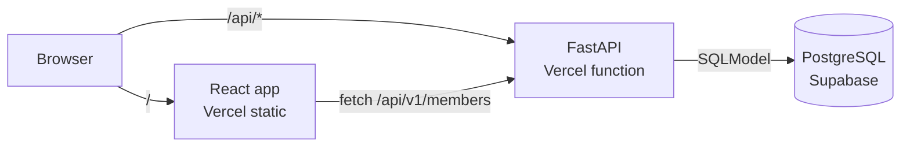
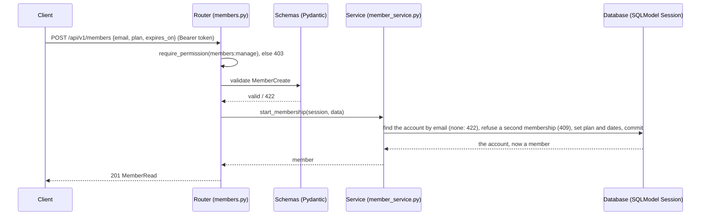
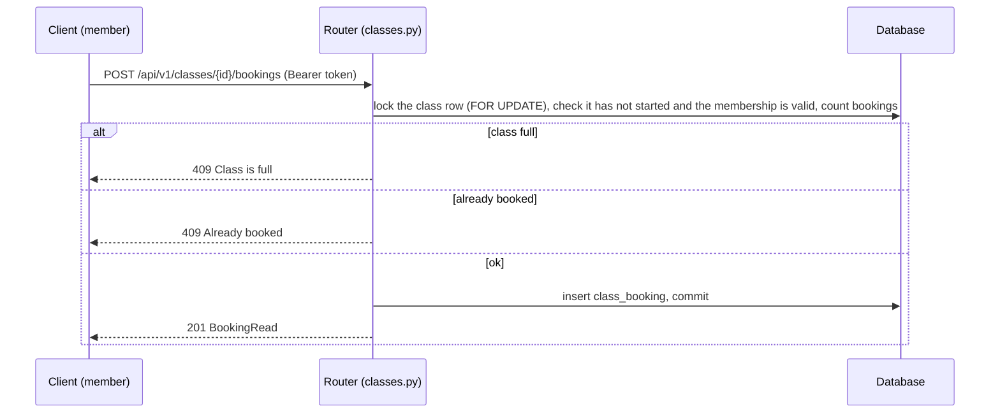
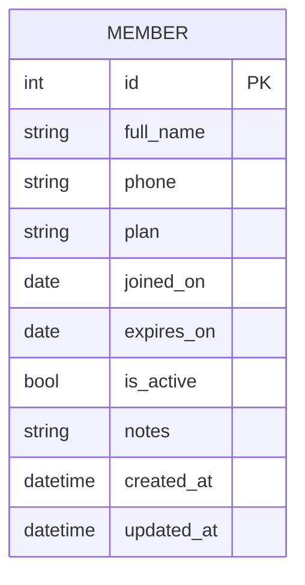
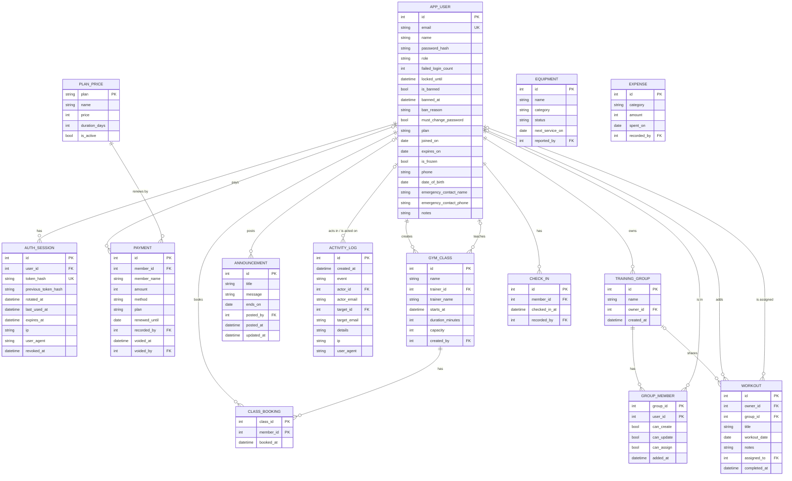
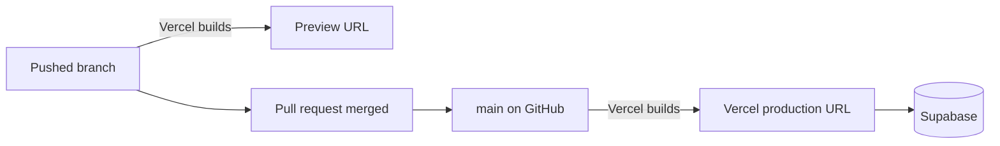

# Technical Design Document (TDD) — Gym Buddy

| Field | Value |
|---|---|
| Product | Gym Buddy |
| Version | MVP + Beta (final release) |
| Releases | MVP — Mid-term, Beta — Final |
| Status | Final: describes the system as built |
| Related docs | [Product Requirements Document (PRD)](01-prd.md), [Software Requirements Specification (SRS)](02-srs.md), [Final report](FINAL_REPORT.md) |

Sections and tables are marked **MVP** or **Beta**. The MVP parts were built for the mid-term; the Beta parts extend them for the final. Where the final build replaced an MVP design (the `member` table, Alembic), the MVP text is kept as history and marked so.

**Documents in this set**

| Short form | Full form | Purpose | File |
|---|---|---|---|
| PRD | Product Requirements Document | What we build and why | [01-prd.md](01-prd.md) |
| SRS | Software Requirements Specification | Exact requirements, permissions and acceptance criteria | [02-srs.md](02-srs.md) |
| TDD | Technical Design Document | How we build it: architecture, data model, API (this document) | [03-tdd.md](03-tdd.md) |

## 1. Overview

- **MVP:** a FastAPI REST API for gym member CRUD (name, phone, membership plan, start and expiry dates), stored in a SQL database through SQLModel, deployed together with the Vite + React frontend as one Vercel project.
- **Beta:** the same app gains user accounts and login (short-lived JWT plus a rotating refresh cookie, with server-side sessions), four global roles (`user`, `trainer`, `gym_manager`, `admin`) checked through one permission module, members as accounts with a membership, workout classes with bookings and capacity limits, check-ins, payments and revenue, announcements, workouts and training groups with per-member permissions, an activity log, content moderation and security hardening. Missing tables and columns are added by the app on start (section 12).

## 2. Tech stack

| Layer | Choice | Why | Release |
|---|---|---|---|
| API | FastAPI | Validation, OpenAPI docs and type hints out of the box; already in the repo template | MVP |
| ORM / models | SQLModel | One class works as both the Pydantic schema and the database table; made by the FastAPI author | MVP |
| Database (production) | PostgreSQL on Supabase | Free tier, managed Postgres with a web dashboard (table editor, SQL editor), built-in connection pooler for serverless | MVP |
| DB driver | `psycopg[binary]` (psycopg 3) | Standard Postgres driver for SQLAlchemy/SQLModel | MVP |
| Database (local) | SQLite | No setup needed | MVP |
| Frontend | Vite + React + TypeScript | Already in the repo template | MVP |
| Hosting | Vercel | Frontend and backend in one project (`vercel.json`), deployed on every push to `main` | MVP |
| Schema changes | `create_db_and_tables()` on start | Creates missing tables and adds missing columns and indexes, keeping data. Alembic was planned but not adopted: every change was additive (section 12) | Beta |
| JWT | PyJWT | Sign and verify access tokens | Beta |
| Password hashing | `argon2-cffi` | Argon2 hashing, over HMAC-SHA256 with a pepper (section 10.2) | Beta |
| Tests | pytest + httpx (`TestClient`) | Backend suite on a throwaway SQLite database (section 14); development only | Beta |

## 3. Architecture



`vercel.json` already routes `/api/*` to the backend service and everything else to the frontend, so every backend route must start with `/api`. For the same reason the API docs are served at `/api/docs` (not FastAPI's default `/docs`):

```python
app = FastAPI(title="Gym Buddy API", docs_url="/api/docs", openapi_url="/api/openapi.json", redoc_url=None)
```

### 3.1 Request flow — MVP



The MVP version of this flow took `full_name` and inserted a `member` row; since members became accounts (PR #40) it starts a membership on an existing account, as shown.

### 3.2 Login and refresh flow — Beta

```mermaid
sequenceDiagram
    participant C as Client
    participant A as Auth router
    participant D as Database
    C->>A: POST /api/v1/auth/login {email, password}
    A->>D: find user, check lockout, verify Argon2 hash (peppered)
    A->>D: insert auth_session (hash of a new refresh token, IP, browser)
    A-->>C: 200 {access_token (sub, role, sid; 5 min)} + Set-Cookie refresh_token (HttpOnly)
    Note over C: keep the access token in memory; send Authorization: Bearer on each request
    C->>A: GET /api/v1/... (Bearer)
    A->>D: get_auth(): verify signature and exp, load user, check ban, check session sid is active
    A-->>C: 200, or 401 once the token expired or the session was revoked
    C->>A: POST /api/v1/auth/refresh (cookie, after a 401 or on page load)
    A->>D: find session by token hash; swap in a new hash only if it is unchanged (rotation)
    A-->>C: 200 {access_token} + new refresh_token cookie; the client repeats the request
    C->>A: POST /api/v1/auth/logout (cookie)
    A->>D: set auth_session.revoked_at
    A-->>C: 204 + cookie cleared; the old access token now gets 401
```

### 3.3 Class booking flow — Beta



## 4. Project structure

```
backend/
  main.py              # creates the app: CORS, routers, error handlers, health check
  app/
    __init__.py        # loads backend/.env (developer machines only) before any module reads a variable
    config.py          # settings: load_local_env() (backend/.env, never on Vercel, never overriding) and frontend_origins() (FRONTEND_ORIGIN for CORS)
    cors.py            # AllowlistCORSMiddleware: CORS only for the deployed frontend and FRONTEND_ORIGIN; other origins get no CORS headers
    database.py        # engine, get_session()
    models.py          # tables + Create / Update / Read schemas
    security.py        # password hashing (Argon2 + pepper), access tokens (JWT create/verify), refresh token generation and hashing
    deps.py            # get_auth (token + session check), get_current_user
    rbac.py            # every role rule: permission constants, role → permission map, require_permission(), has_permission(), is_staff(), is_admin(), may_edit_account(), is_owner(), group permissions
    request_info.py    # client_ip() (X-Forwarded-For on Vercel), user_agent() and ClientDep: where a request came from, for the login devices and the activity log
    routers/
      __init__.py
      members.py       # /api/v1/members (+ check-ins in Beta)
      auth.py          # /api/v1/auth/signup, /login, /refresh, /logout (sets and clears the refresh cookie)
      users.py         # /api/v1/users/me (profile, change name, change password, my sessions)
      admin.py         # /api/v1/admin/stats, /revenue, /users (list, change role, ban, unban)
      check_ins.py     # /api/v1/check-ins (a day's attendance, who is inside, check out: gym manager, admin)
      classes.py       # /api/v1/classes (read: anyone logged in; change and bookings: gym manager, admin)
      plans.py         # /api/v1/plans (read: anyone logged in; add, edit, retire, delete: admin)
      equipment.py     # /api/v1/equipment (list, report a fault: trainer, gym manager, admin; the rest: gym manager, admin)
      expenses.py      # /api/v1/expenses (admin)
      payments.py      # /api/v1/payments (list: gym manager, admin; void and CSV export: admin)
      overview.py      # /api/v1/overview (gym manager, admin)
      trainers.py      # /api/v1/trainers (list: gym manager, admin), /trainers/me/classes and /trainers/me/clients (trainer)
      announcements.py # /api/v1/announcements (read the current ones: anyone logged in; post, edit, delete and ended ones: gym manager, admin)
      activity.py      # /api/v1/admin/activity (list, CSV export, security view: admin)
      workouts.py      # /api/v1/workouts (assigned to me, add, read, edit, assign, mark done, delete: by group permission)
      groups.py        # /api/v1/groups (my groups, start, read, rename, delete, a group's workouts and members)
      moderation.py    # /api/v1/admin/workouts and /api/v1/admin/groups (list, CSV export, delete one or many: admin)
    services/
      __init__.py
      member_service.py  # member rules and queries; raises MemberNotFoundError / InvalidExpiryError
      auth_service.py    # sign up (always role user), log in (re-hashes a pre-pepper hash), change password; raises EmailTakenError / InvalidCredentialsError
      session_service.py # login sessions: start, rotate the refresh token (grace period, reuse detection), list, revoke one or all; raises InvalidRefreshTokenError / SessionNotFoundError
      user_service.py    # list users (search, role, status), users CSV, a user's details, change role (an ex-trainer lets go of classes and clients), rename, ban / unban one or many, end a user's sessions; raises UserNotFoundError / CannotChangeOwnRoleError / CannotBanError / CannotRevokeOwnSessionsError
      stats_service.py   # member, check-in, class and user counts for the Dashboard's front desk and admin parts (each reuses the rule of the list it links to)
      revenue_service.py # revenue today, this month, last 30 days, by method and by month (voided left out), with expenses and net income
      plan_service.py    # membership plans: list, add, edit, retire, delete, get_offered(); raises PlanNotFoundError / PlanNotOfferedError / PlanNameTakenError / PlanInUseError
      trainer_service.py # who can be a trainer, a trainer's clients, release_trainer(); raises TrainerNotFoundError
      expense_service.py # expenses: list with total, add, edit, delete (logged), CSV, total_between() for net income
      equipment_service.py # equipment: list, add, edit, report a fault, record a service, next service date, stats
      payment_service.py # record a payment (and renew), payment lists and total, void, CSV export; raises PaymentNotFoundError
      class_service.py   # classes and bookings: create, list, edit, delete, who booked and who came, a trainer's own classes; raises ClassNotFoundError / CapacityBelowBookingsError / AttendanceNotOpenError / NotYourClassError
      checkin_service.py # check in (membership must be valid, not already inside) and out, history, a day's list, who is inside; raises MembershipNotValidError / AlreadyInsideError / CannotCheckOutError
      search.py          # contains_any(): the any-case text search shared by the member, waiting and user lists
      profile_service.py # phone, date of birth and emergency contact: update my own, and the both-or-neither contact check member_service also uses; raises IncompleteEmergencyContactError
      announcement_service.py # post, list (current or all, newest first, with the poster's name), edit, delete; raises AnnouncementNotFoundError
      activity_service.py # the activity log: record() (called by the other services), list, CSV export, failed-login summary (section 10.5)
      csv_export.py      # the CSV writer the payments and activity exports share: byte order mark, formula-safe cells, UTC times
      group_service.py   # training groups: access() and require() on rbac.group_permissions(), list with counts, members, delete_for_accounts(); raises GroupNotFoundError / GroupPermissionError / GroupOwnerError
      moderation_service.py # admin lists, CSVs and deletes of anyone's workouts and groups (one activity row per delete)
      workout_service.py # workouts in groups: lists, add, edit, assign, mark done, delete; raises WorkoutNotFoundError / NotAssignedToYouError / AssigneeNotInGroupError
  tests/               # pytest suite (section 14): conftest.py, test_login.py, test_tokens.py, test_refresh.py, test_devices.py, test_rbac.py, test_gym.py, test_startup.py, test_robustness.py, test_rules.py, test_cors.py, test_config.py
  .env.example         # the four variables with placeholders only (copy to backend/.env)
  requirements-dev.txt # -r requirements.txt + pytest, httpx (not installed by Vercel)
  pytest.ini
  requirements.txt
frontend/
  src/
    App.tsx            # hash router: picks the page for #/members, #/classes, ...; guards each page by permission
    components/        # the forms, lists and panels the pages are built from
    context/           # AuthContext: who is logged in, login / signup / logout; restores the login with a refresh on load; PlansContext: the plans' names and prices
    layouts/           # AppLayout: the sidebar with the pages each role may open
    pages/             # DashboardPage, MembersPage, AttendancePage, PaymentsPage, ClassesPage and AnnouncementsPage (gym manager, admin); EquipmentPage (trainer, gym manager, admin); PlansPage, ExpensesPage, UsersPage (one user's details at `#/users?user=ID`), SecurityPage and ActivityPage (admin); MyClassesPage and MyClientsPage (trainer); MembershipPage and TimetablePage (user); TrainingPage (everyone; one group at `#/training?group=ID`; All groups and All workouts for admins), AccountPage, DevicesPage, LoginPage, SignupPage, ChoosePasswordPage (after an admin reset)
    services/          # fetch calls to the API; api.ts keeps the access token in memory and refreshes it once on a 401
    types/             # TypeScript types
    utils/             # display helpers; membersLink() builds the #/members?filter=&member= address
    hooks/             # usePagedList (Previous / Next); useDebouncedValue: search boxes ask the API once typing pauses
scripts/
  seed_demo.py         # demo accounts and sample data through the public API (standard library only; not deployed)
docs/
  01-prd.md
  02-srs.md
  03-tdd.md
  FINAL_REPORT.md
```

Keep routers thin: validate input, check permissions through dependencies, then call a function in `services/`. The service holds the business rules and the database queries and raises plain Python errors (`MemberNotFoundError`, `InvalidExpiryError`); `errors.py` turns them into the 404 and 422 responses.

## 5. Data model

### 5.1 `member` table — MVP

> **Replaced in the final release.** Members became accounts (PR #40): the membership columns (`plan`, `joined_on`, `expires_on`, `is_frozen`, `phone`, `notes`) moved onto `app_user` (section 5.2), `full_name` became the account's `name`, and `is_active` became `is_frozen`. On its first start, the new code dropped the old `member` table and the tables that pointed at it, and created them again pointing at `app_user` (section 12). The MVP table is kept below as history.

| Column | Type | Rules |
|---|---|---|
| `id` | integer | Primary key, auto increment |
| `full_name` | varchar(100) | Not null |
| `phone` | varchar(20) | Nullable |
| `plan` | varchar(10) | `monthly`, `quarterly` or `yearly`, not null |
| `joined_on` | date | Not null, defaults to today |
| `expires_on` | date | Not null, must be on or after `joined_on` |
| `is_active` | boolean | Not null, default `true` (set to `false` to freeze a membership) |
| `notes` | varchar(500) | Nullable |
| `created_at` | timestamp (UTC) | Not null, set on insert |
| `updated_at` | timestamp (UTC) | Not null, set on insert and every update |



### 5.2 Full data model — Beta

`user` is a reserved word in PostgreSQL, so the table is named `app_user`. Classes are stored in `gym_class` because `class` is reserved in Python.

**`app_user`**

> Built so far: `id`, `email`, `name`, `password_hash`, `role`, `is_banned`, `banned_at`, `ban_reason`, `password_changed_at`, `failed_login_count`, `locked_until` and `created_at` (the lockout columns are added to an existing table on start). `password_changed_at` only records the last change: a password change or reset ends logins by revoking `auth_session` rows. `password_hash` starts with `peppered$` once it is made with the pepper (section 10.2).

| Column | Type | Rules |
|---|---|---|
| `id` | integer | Primary key |
| `email` | varchar(254) | Unique, stored lowercase |
| `name` | varchar(100) | Not null |
| `password_hash` | varchar | Argon2 hash, never returned by the API |
| `must_change_password` | boolean | Default false; true after an admin reset until a new password is chosen |
| `role` | varchar(20) | `user`, `trainer`, `gym_manager` or `admin`, default `user` |
| `failed_login_count` | integer | Default 0 |
| `locked_until` | timestamp (UTC) | Nullable |
| `is_banned` | boolean | Default `false` |
| `banned_at` | timestamp (UTC) | Nullable |
| `ban_reason` | varchar(500) | Nullable |
| `phone` | varchar(20) | Nullable |
| `date_of_birth` | date | Nullable; 1900-01-01 to today when sent. Added to an existing table on start |
| `emergency_contact_name` | varchar(100) | Nullable; set or cleared together with `emergency_contact_phone`. Added to an existing table on start |
| `emergency_contact_phone` | varchar(20) | Nullable; set or cleared together with `emergency_contact_name`. Added to an existing table on start |
| `password_changed_at` | timestamp (UTC) | Nullable: the last password change or reset |
| `plan` | varchar(40) | Nullable: the code of a row in `plan_price`. Null until staff start a membership; an account with a plan is a member. Widened from varchar(10) on start |
| `trainer_id` | integer | FK → `app_user.id`, nullable, on delete set null, indexed (`ix_app_user_trainer_id`): the personal trainer. Cleared when that account stops being a trainer. Added to an existing table on start |
| `joined_on` | date | Nullable; set with `plan` |
| `expires_on` | date | Nullable; set with `plan`, never before `joined_on` |
| `is_frozen` | boolean | Default `false`; a frozen membership cannot check in or book, whatever its expiry date |
| `notes` | varchar(500) | Nullable: staff notes on the membership |
| `created_at` | timestamp (UTC) | Not null |

`phone`, `date_of_birth` and the emergency contact are read only through `MemberRead` (member endpoints: gym managers and admins; `/users/me/membership`: the member) and `ProfileRead` (`/users/me/profile`: the person), never through `UserRead`, so they stay out of the login response and every account list (NFR-20).

**`auth_session`** (one row per login on one browser, shown to its owner as a login device; holds the current refresh token's hash)

| Column | Type | Rules |
|---|---|---|
| `id` | integer | Primary key; the `sid` claim of every access token issued for this login |
| `user_id` | integer | FK → `app_user.id`, on delete cascade, indexed |
| `token_hash` | varchar(64) | SHA-256 of the current refresh token, unique |
| `previous_token_hash` | varchar(64) | Nullable, indexed: the token the last refresh replaced (reuse detection) |
| `rotated_at` | timestamp (UTC) | Nullable: time of the last refresh |
| `created_at` | timestamp (UTC) | Not null: the login time |
| `last_used_at` | timestamp (UTC) | Not null: the login or the last refresh |
| `expires_at` | timestamp (UTC) | Not null: last refresh + 7 days |
| `ip` | varchar(45) | Nullable: client address at login |
| `user_agent` | varchar(300) | Nullable: browser at login |
| `revoked_at` | timestamp (UTC) | Nullable: set by logout, a revoke, a password change (other sessions) or reset, a ban, a reused refresh token, or a new login on the same browser |

A session is active while `revoked_at IS NULL AND expires_at > now`. Rows are kept after they end; `member_service._delete_accounts()` deletes them with the account.

**Membership on the account (replaces the planned `member.user_id` link)**

The first Beta design linked a `member` row to an account with a nullable `member.user_id`. It was built in PR #32 and replaced in PR #40: keeping two records per person meant names that could disagree and an extra linking step. A member's id is now their account id, and `check_in`, `class_booking` and `payment` point at `app_user.id`.

**`gym_class`**

> Built so far: all columns and the `starts_at` index. `class_booking` rows are created when a member books (`POST /classes/{id}/bookings`); booking locks the class row (`SELECT ... FOR UPDATE` on PostgreSQL) before counting, so the capacity is never exceeded, and the service deletes bookings with the class or the member (SQLite does not enforce `on delete cascade` by default).

| Column | Type | Rules |
|---|---|---|
| `id` | integer | Primary key |
| `name` | varchar(100) | Not null |
| `description` | varchar(500) | Nullable |
| `trainer_id` | integer | FK → `app_user.id`, nullable, on delete set null, index `ix_gym_class_trainer_id`. Always an account with the role `trainer`: changing that account's role sets it to null and copies the name into `trainer_name`. Added to an existing table (with its index) by `create_db_and_tables()` |
| `trainer_name` | varchar(100) | Nullable. Free text from before trainers were accounts; cleared whenever `trainer_id` is sent. Responses show `coalesce(trainer's account name, trainer_name)` |
| `starts_at` | timestamp (UTC) | Not null |
| `duration_minutes` | integer | Not null, 15–240 |
| `capacity` | integer | Not null, 1–200 |
| `created_by` | integer | FK → `app_user.id` |
| `created_at`, `updated_at` | timestamp (UTC) | Not null |

**`class_booking`**

| Column | Type | Rules |
|---|---|---|
| `class_id` | integer | PK part, FK → `gym_class.id`, on delete cascade |
| `member_id` | integer | PK part, FK → `app_user.id` (the member who booked), on delete cascade, indexed |
| `booked_at` | timestamp (UTC) | Not null |
| `attended` | boolean | Nullable: came, did not come, or not marked. Added to an existing table on start |

**`plan_price`** (the membership plans; the class is `MembershipPlan`)

| Column | Type | Rules |
|---|---|---|
| `plan` | varchar(40) | Primary key: a code made from the first name (`student-monthly`); it never changes |
| `name` | varchar(60) | Not null, unique in any case (checked by `plan_service`). Added to an existing table on start and filled from the code |
| `description` | varchar(300) | Nullable |
| `is_active` | boolean | Default true; false = retired |
| `price` | integer | Whole taka |
| `duration_days` | integer | Days a renewal adds |
| `updated_at` | timestamp (UTC) | Not null |

A new, empty table gets Monthly 1,500 / 30, Quarterly 4,000 / 90 and Yearly 14,000 / 365; after that the admin's changes, retirements and deletions stay.

**`expense`**: `id`, `category` (`rent`, `salaries`, `utilities`, `equipment`, `maintenance`, `marketing`, `other`), `amount` (whole taka), `spent_on` (date, indexed), `description` (varchar 200, nullable), `recorded_by` (FK → `app_user.id`, on delete set null), `created_at`.

**`equipment`**: `id`, `name`, `category` (`cardio`, `strength`, `free_weights`, `functional`, `other`), `quantity`, `status` (`working`, `maintenance`, `out_of_order`; indexed), `purchased_on`, `service_every_days`, `last_serviced_on`, `next_service_on` (indexed; worked out on every save so the list can filter on it), `issue`, `reported_by` (FK → `app_user.id`, on delete set null), `reported_at`, `notes`, `created_at`, `updated_at`.

**`payment`**

| Column | Type | Rules |
|---|---|---|
| `id` | integer | Primary key |
| `member_id` | integer | FK → `app_user.id` (the member who paid), nullable, on delete set null (the service sets it to null before deleting the account, since SQLite does not enforce it) |
| `member_name` | varchar(100) | The member's name when the payment was taken |
| `amount` | integer | Whole taka, 1 to 10,000,000 |
| `method` | varchar(20) | `cash`, `card`, `bank_transfer` or `mobile_banking` |
| `plan` | varchar(10) | Nullable: the plan renewed by this payment |
| `note` | varchar(200) | Nullable |
| `paid_at` | timestamp (UTC) | Not null, indexed |
| `renewed_until` | date | Nullable: the new expiry when the payment renewed the membership |
| `recorded_by` | integer | FK → `app_user.id` |
| `voided_at` | timestamp (UTC) | Nullable: set when an admin voids the payment; a voided payment is left out of every total |
| `void_reason` | varchar(200) | Nullable: required when voiding |
| `voided_by` | integer | FK → `app_user.id`, nullable: the admin who voided it |

Voiding is a conditional `UPDATE ... WHERE voided_at IS NULL`, so voiding twice (or two admins at once) keeps the first time and reason. The three void columns are added to an existing table on start.

**`check_in`**

> Built so far: all four columns, with indexes on `member_id` and `checked_in_at`. The service deletes a member's check-ins before deleting the member, because SQLite (local development) does not enforce `on delete cascade` by default.

| Column | Type | Rules |
|---|---|---|
| `id` | integer | Primary key |
| `member_id` | integer | FK → `app_user.id` (the member who arrived), on delete cascade, indexed |
| `checked_in_at` | timestamp (UTC) | Not null |
| `recorded_by` | integer | FK → `app_user.id`: the gym manager or admin who recorded it |

**`announcement`**

> Built so far: all columns and the `posted_at` index. A new table, so `create_all()` makes it on start and nothing is added to an existing table.

| Column | Type | Rules |
|---|---|---|
| `id` | integer | Primary key |
| `title` | varchar(100) | Not null, 1–100 characters after trimming |
| `message` | varchar(1000) | Not null, 1–1,000 characters after trimming; line breaks are kept |
| `ends_on` | date | Nullable: the last day it shows, inclusive (like `expires_on`). `null` = shows until deleted. Not before today when sent |
| `posted_by` | integer | FK → `app_user.id`, nullable, on delete set null (the service sets it to null before deleting an account, since SQLite does not enforce it) |
| `posted_at` | timestamp (UTC) | Not null, indexed (`ix_announcement_posted_at`): the lists are newest first |
| `updated_at` | timestamp (UTC) | Nullable: set on every edit, `null` until then |

"Current" is worked out from the date on every read (`ends_on IS NULL OR ends_on >= today`), like an expired membership, so nothing has to run when an announcement ends.

**`activity_log`** (one row per security event; rows are only ever added)

> Built so far: all columns and the indexes on `created_at`, `event`, `actor_id` and `target_id`. A new table, so `create_all()` makes it on start.

| Column | Type | Rules |
|---|---|---|
| `id` | integer | Primary key |
| `created_at` | timestamp (UTC) | Not null, indexed (`ix_activity_log_created_at`): the list is newest first and the security view counts from a time |
| `event` | varchar(30) | Not null, indexed (`ix_activity_log_event`): one of the `ActivityEvent` values (section 10.5) |
| `actor_id` | integer | FK → `app_user.id`, nullable, on delete set null, indexed (`ix_activity_log_actor_id`). Null when no account acted: an email with no account on a failed login, or the server itself (a lockout, a reused refresh token) |
| `actor_email` | varchar(254) | Nullable: the actor's email at the time; on a failed login, the email that was typed (lowercased), which may match no account |
| `target_id` | integer | FK → `app_user.id`, nullable, on delete set null, indexed (`ix_activity_log_target_id`): the account acted on when it is not the actor's own |
| `target_email` | varchar(254) | Nullable: the target's email at the time; kept for a deleted account |
| `details` | varchar(500) | Nullable: built by the server, such as `Wrong password`, `user → trainer`, `Reason: …; sessions ended: 2`, `payments.csv: 12 rows; method=cash` |
| `ip` | varchar(45) | Nullable: the client address (section 10.5) |
| `user_agent` | varchar(300) | Nullable: the browser's User-Agent |

`member_service._delete_accounts()` sets `actor_id` and `target_id` to null before deleting an account (SQLite does not enforce `on delete set null`); the copied emails keep the rows readable.

**`training_group`**

> Built so far: all columns and the `owner_id` index. New tables (`training_group`, `group_member`, `workout`), so `create_all()` makes them on start.

| Column | Type | Rules |
|---|---|---|
| `id` | integer | Primary key |
| `name` | varchar(100) | Not null, 1–100 characters after trimming |
| `owner_id` | integer | FK → `app_user.id`, on delete cascade, indexed (`ix_training_group_owner_id`). The owner holds every group permission and has no `group_member` row |
| `created_at` | timestamp (UTC) | Not null |

**`group_member`** (the people the owner added, and what each may do)

| Column | Type | Rules |
|---|---|---|
| `group_id` | integer | PK part, FK → `training_group.id`, on delete cascade |
| `user_id` | integer | PK part, FK → `app_user.id`, on delete cascade, indexed (`ix_group_member_user_id`: "my groups") |
| `can_create` | boolean | Default false: add workouts to the group |
| `can_update` | boolean | Default false: edit the group's workouts |
| `can_assign` | boolean | Default false: assign the group's workouts |
| `added_at` | timestamp (UTC) | Not null |

The composite primary key stops the same account being added twice, even by two requests at once (`409`).

**`workout`**

| Column | Type | Rules |
|---|---|---|
| `id` | integer | Primary key |
| `owner_id` | integer | FK → `app_user.id`, nullable, on delete set null, indexed: who added it. The workout stays with `null` when that account is deleted |
| `group_id` | integer | FK → `training_group.id`, on delete cascade, indexed; every new workout has one. (`null` only on personal workouts from before they were withdrawn, which only moderation lists.) Cannot change after creation |
| `title` | varchar(100) | Not null, 1–100 characters after trimming |
| `workout_date` | date | Not null, 2000-01-01 to today + 365 days when sent |
| `notes` | varchar(1000) | Nullable; blank text becomes null |
| `assigned_to` | integer | FK → `app_user.id`, nullable, on delete set null, indexed. Only someone in the group (the owner or a member) |
| `completed_at` | timestamp (UTC) | Nullable: when the assignee marked it done; cleared when it is reassigned. Added to an existing table on start |
| `created_at`, `updated_at` | timestamp (UTC) | Not null; `updated_at` changes on every edit and assignment |

`group_service.delete_for_accounts()` runs inside `member_service._delete_accounts()`: it deletes the account's own groups (their workouts and members first), its `group_member` rows and any old personal workouts, and sets `owner_id` and `assigned_to` to null on the group workouts that remain. Deleting a group, and leaving one, delete or update the dependent rows in the service too, since SQLite does not enforce the cascades by default.

Indexes: `app_user(email)` (unique), `class_booking(member_id)`, `check_in(member_id, checked_in_at)`, `gym_class(starts_at)`, `gym_class(trainer_id)`, `announcement(posted_at)`, `auth_session(user_id)`, `auth_session(token_hash)` (unique), `auth_session(previous_token_hash)`, `activity_log(created_at)`, `activity_log(event)`, `activity_log(actor_id)`, `activity_log(target_id)`, `training_group(owner_id)`, `group_member(user_id)`, `workout(owner_id)`, `workout(group_id)`, `workout(assigned_to)`.



**Who can see a membership:**
- The person themself: only their own, through `/users/me/membership` (the id comes from the token, never from the request).
- Gym managers and admins (`members:read`): every member, through `/members`.
- Trainers and other users: none (`403` on `/members`).

**A membership is "valid"** when `plan` is set, `is_frozen` is false and `expires_on >= today`. Booking a class and checking in both require a valid membership.

### 5.3 Schemas

| Schema | Used for | Fields | Release |
|---|---|---|---|
| `MemberCreate` | `POST` member body | MVP: `full_name`, `phone?`, `plan`, `joined_on?`, `expires_on`, `notes?`. Final: `email` (an existing account) instead of `full_name`, `expires_on?` (default: the plan's days), `trainer_id?`, `payment_method?` (record the first payment) | MVP |
| `MemberUpdate` | `PATCH` member body | all optional: `name` (MVP `full_name`), `phone`, `plan`, `expires_on`, `is_frozen` (MVP `is_active`), `notes`; (Beta) extends `ProfileUpdate`, so staff also send `date_of_birth` and the emergency contact | MVP |
| `MemberRead` | Member responses | `id` (the account id), `name`, `email`, `phone`, `date_of_birth`, `emergency_contact_name`, `emergency_contact_phone`, `plan`, `joined_on`, `expires_on`, `is_frozen`, `trainer_id?`, `trainer_name?`, `notes` | MVP |
| `MemberPage` | Member list response | `items` (`MemberRead[]`), `total` (all members matching the filter), `offset`, `limit` | MVP |
| `MemberBulkDelete` | Bulk delete body | `ids` (1 to 100 member IDs) | MVP |
| `MemberBulkDeleteResult` | Bulk delete response | `deleted` (how many members were deleted) | MVP |
| `SignupRequest` | Sign up | `email`, `name`, `password` | Beta |
| `LoginRequest` | Log in | `email`, `password` | Beta |
| `TokenResponse` | Login / refresh | `access_token`, `token_type: "bearer"`, `expires_in` (300), `user` (`UserRead`); the refresh token is only in the cookie | Beta |
| `SessionRead` | My login devices | `id`, `created_at`, `last_used_at`, `expires_at`, `ip`, `user_agent`, `current` (the session of this request); never the token hashes | Beta |
| `UserRead` | User responses | `id`, `email`, `name`, `role`, `created_at` (never `password_hash`) | Beta |
| `MeRead` | My own account (`/users/me`, login, refresh) | `UserRead` fields + `permissions` (the caller's role's permissions from `app/rbac.py`) + `plan?` | Beta |
| `UserRoleUpdate` | Change role | `role` | Beta |
| `UserNameUpdate` | Change own name | `name` | Beta |
| `PasswordChange` | Change own password | `current_password`, `new_password` | Beta |
| `ProfileRead` / `ProfileUpdate` | My contact details | `phone`, `date_of_birth` (1900-01-01 to today), `emergency_contact_name` (≤ 100), `emergency_contact_phone` (≤ 20); on update all optional, blank text becomes null, and the service checks the contact is both-or-neither against the saved values | Beta |
| `AdminUserRead` | Admin user list | `UserRead` + `is_banned`, `banned_at`, `ban_reason`, `plan?`, `expires_on?`, `is_frozen` | Beta |
| `AccountPage` | Accounts waiting for a membership | `items: UserRead[]`, `total`, `offset`, `limit` | Beta |
| `BanRequest` | Ban a user | `reason?` | Beta |
| `UserFilter` | Query filters for the admin user list and the users CSV | `q?` (≤ 100: part of the name or email), `role?`, `status?` (`active` / `banned`) | Beta |
| `BulkUserAction` | Bulk ban / unban | `ids` (1 to 100 account ids; duplicates count once), `reason?` (≤ 500) | Beta |
| `BulkBanResult` / `BulkUnbanResult` | Bulk ban / unban response | `banned` (or `unbanned`): the ids changed; `skipped: [{id, name?, reason}]` | Beta |
| `SessionsRevoked` | End a user's sessions | `revoked` (how many active sessions ended) | Beta |
| `ModerationWorkoutFilter` / `ModerationGroupFilter` | Moderation filters for the lists and CSVs | workouts: `owner_id?`, `group_id?`, `status?`, `date_from?`, `date_to?` (the workout's date), `q?`; groups: `owner_id?`, `date_from?`, `date_to?` (the day it was made), `q?`; `date_from` after `date_to` is `422` | Beta |
| `ModerationWorkoutRead` / `ModerationWorkoutPage` | Admin workout list | `WorkoutRead` + `owner_email?`; page: `items`, `total`, `offset`, `limit` | Beta |
| `ModerationGroupRead` / `ModerationGroupPage` | Admin group list | `id`, `name`, `owner_id`, `owner_name`, `owner_email`, `created_at`, `member_count` (owner included), `workout_count` | Beta |
| `ContentBulkDelete` / `ContentDeleted` | Delete many | `ids` (1 to 100) / `deleted` (how many; unknown ids skipped) | Beta |
| `AdminUserDetail` | A user's details | `AdminUserRead` + `joined_on?`, `locked_until?`, `password_changed_at?`, `sessions: AdminSessionRead[]` (`id`, `created_at`, `last_used_at`, `expires_at`, `ip?`, `user_agent?`), `records {visits, bookings, payments, workouts_added, workouts_assigned, workouts_completed}`, `recent_records {workouts, bookings, visits, payments}` (5 newest of each), `groups [{id, name, is_owner, member_count}]`, `recent_activity: ActivityRead[]` (10); never the password hash | Beta |
| `PasswordResetResult` | Admin password reset | `user: AdminUserRead`, `temporary_password` (shown once) | Beta |
| `AdminStats` | Dashboard | `members {total, active, expired, frozen, new_last_7_days, expiring_soon}`, `classes {total, upcoming}`, `check_ins {today, last_7_days, inside_now, by_day [{day, count}]}`, `users {total, users, trainers, gym_managers, admins, banned, new_last_7_days}`, `workouts {total, last_7_days, completed}`, `groups {total}`, `equipment {total, needs_attention, service_due}` | Beta |
| `Overview` | Front desk part of the Dashboard | `check_ins_today`, `inside_now`, `expiring_soon`, `waiting`, `payments_today {count, amount}`, `equipment_attention`, `equipment_service_due`, `next_classes: ClassRead[]` (5) | Beta |
| `RevenueStats` | Dashboard revenue | `today`, `this_month`, `expenses_this_month`, `net_this_month`, `last_30_days`, `last_30_days_from` (date), `by_method [{method, amount, count}]` (all four methods), `months [{month: "YYYY-MM", amount, expenses, net}]` (6, oldest first) | Beta |
| `ClassCreate` / `ClassUpdate` | Create / edit class | `name`, `description?`, `trainer_id?` (an account with the role `trainer`, or null), `starts_at`, `duration_minutes`, `capacity` (all optional on update; on update a `trainer_id` left out keeps the trainer) | Beta |
| `TrainerRead` | Trainer list | `id`, `name` | Beta |
| `ClientRead` / `ClientPage` | A trainer's clients | `id`, `name`, `email`, `phone?`, `plan`, `expires_on`, `is_frozen`, `last_visit_at?` | Beta |
| `ClassRead` | Class responses | all class columns except `created_by` (`trainer_name` is the trainer's current account name, or the old text name) + `booked_count` (`is_booked_by_me` comes with member booking); times are UTC with a trailing `Z` | Beta |
| `ClassPage` / `BookingPage` | Class and booking lists | `items`, `total`, `offset`, `limit` | Beta |
| `BookingRead` | Booking responses | `class_id`, `member_id`, `member_name`, `booked_at`, `attended?` | Beta |
| `AttendanceUpdate` | Mark attendance | `attended` (required; `null` clears) | Beta |
| `BookedClassRead` / `BookedClassPage` | A member's bookings | `class_id`, `class_name`, `starts_at`, `duration_minutes`, `trainer_name?`, `booked_at`, `attended?` | Beta |
| `PaymentCreate` / `PaymentRead` / `PaymentPage` | Record and list payments | create: `amount`, `method`, `note?`, `renew_plan?`; read: `id`, `member_id?`, `member_name`, `amount`, `method`, `plan?`, `note?`, `paid_at`, `renewed_until?`, `recorded_by_name?`, `voided_at?`, `void_reason?`, `voided_by_name?` | Beta |
| `PaymentListPage` | All payments | `PaymentPage` + `total_amount` (sum of the matching payments that are not voided, across all pages) | Beta |
| `PaymentFilter` | Query filters for the list and the CSV | `date_from?`, `date_to?` (days at the gym, inclusive; `date_from` after `date_to` is `422`), `method?`, `member?` (part of the name, any case), `include_voided` (default false) | Beta |
| `VoidRequest` | Void a payment | `reason` (1 to 200 characters, required) | Beta |
| `PlanRead` | Plans | `plan` (code), `name`, `price`, `duration_days`, `description?`, `is_active` | Beta |
| `PlanCreate` / `PlanUpdate` | Add / change a plan | `name` (1–60), `price` (1 to 10,000,000), `duration_days` (1 to 3,660), `description?` (≤ 300); update: all optional, plus `is_active` | Beta |
| `EquipmentCreate` / `EquipmentUpdate` / `EquipmentRead` / `EquipmentPage` | Equipment | the `equipment` columns staff set (update also `status`); read adds `next_service_on?`, `issue?`, `reported_by_name?`, `reported_at?` | Beta |
| `EquipmentReport` / `EquipmentFilter` | Report a fault / list filters | `issue` (1–500) / `status?`, `category?`, `needs_attention`, `service_due`, `q?` | Beta |
| `ExpenseCreate` / `ExpenseUpdate` / `ExpenseRead` / `ExpensePage` / `ExpenseFilter` | Expenses | `category`, `amount`, `spent_on` (up to today), `description?`; read adds `recorded_by_name?`; page adds `total_amount`; filter: `date_from?`, `date_to?`, `category?`, `q?` | Beta |
| `CheckInRead` | Check-in responses | `id`, `member_id`, `member_name`, `checked_in_at`, `checked_out_at?`, `recorded_by_name?` | Beta |
| `CheckInPage` | Check-in lists | `items: CheckInRead[]`, `total`, `offset`, `limit` | Beta |
| `AnnouncementCreate` / `AnnouncementUpdate` | Post / edit an announcement | `title` (1–100), `message` (1–1,000), `ends_on?` (a date not before today, or null for none); all optional on update, where `title` and `message` cannot be null and a left-out `ends_on` keeps the end date | Beta |
| `ActivityRead` / `ActivityPage` | Activity log | `id`, `created_at`, `event`, `actor_id?`, `actor_email?`, `target_id?`, `target_email?`, `details?`, `ip?`, `user_agent?`; page: `items`, `total`, `offset`, `limit` | Beta |
| `ActivityFilter` | Query filters for the activity list and its CSV | `event?` (an `ActivityEvent`), `user_id?` (actor or target), `date_from?`, `date_to?` (days at the gym, inclusive; `date_from` after `date_to` is `422`), `q?` (≤ 100: part of an email, the IP or the details) | Beta |
| `WorkoutCreate` / `WorkoutUpdate` | Add / edit a workout | `title` (1–100), `workout_date` (2000-01-01 to today + 365), `notes?` (≤ 1,000, blank → null); create also `group_id` (required) and `assigned_to?`; update: all optional, `title` and `workout_date` not null | Beta |
| `WorkoutAssign` / `WorkoutCompletion` | Assign a workout / mark it done | `user_id` (required; `null` unassigns) / `done` | Beta |
| `WorkoutRead` / `WorkoutPage` | Workout responses and lists | `id`, `title`, `workout_date`, `notes?`, `group_id?`, `group_name?`, `owner_id?`, `owner_name?`, `assigned_to?`, `assigned_to_name?`, `completed_at?`, `created_at`, `updated_at`; page: `items`, `total`, `offset`, `limit` | Beta |
| `GroupCreate` | Start or rename a group | `name` (1–100) | Beta |
| `GroupRead` / `GroupPage` | Group responses and lists | `id`, `name`, `owner_id`, `owner_name`, `created_at`, `member_count` (owner included), `workout_count`, `my_permissions` (`read`, `create`, `update`, `assign`, `manage`) | Beta |
| `GroupMemberAdd` / `GroupMemberUpdate` | Add someone / change their permissions | add: `email`, `can_create`, `can_update`, `can_assign` (default false); update: the three flags, optional, not null | Beta |
| `GroupMemberRead` | A group's people | `user_id`, `name`, `email?` (owner's view only), `is_owner`, `can_create`, `can_update`, `can_assign`, `added_at` | Beta |
| `SecuritySummary` | Security view | `since`, `hours`, `min_count`, `total`, `failed_logins`, `lockouts`, `by_ip [HostileByIp: ip?, count, events [{event, count}], accounts, emails (up to 5), user_agent?, last_at]`, `by_account [{email, user_id?, count, ips, last_at}]` (10 of each) | Beta |
| `AnnouncementRead` / `AnnouncementPage` | Announcement responses and lists | `id`, `title`, `message`, `ends_on?`, `posted_at`, `updated_at?` (null until edited), `posted_by_name?` (null once the poster's account is deleted); page: `items`, `total`, `offset`, `limit` | Beta |

MVP sketch:

```python
class MemberBase(SQLModel):
    full_name: str = Field(min_length=1, max_length=100)
    phone: str | None = Field(default=None, max_length=20)
    plan: str = Field(regex="^(monthly|quarterly|yearly)$")
    expires_on: date
    notes: str | None = Field(default=None, max_length=500)

class Member(MemberBase, table=True):
    id: int | None = Field(default=None, primary_key=True)
    joined_on: date = Field(default_factory=date.today)
    is_active: bool = True
    created_at: datetime = Field(default_factory=lambda: datetime.now(timezone.utc))
    updated_at: datetime = Field(default_factory=lambda: datetime.now(timezone.utc))

class MemberCreate(MemberBase):
    joined_on: date | None = None

class MemberUpdate(SQLModel):
    full_name: str | None = Field(default=None, min_length=1, max_length=100)
    phone: str | None = Field(default=None, max_length=20)
    plan: str | None = Field(default=None, regex="^(monthly|quarterly|yearly)$")
    expires_on: date | None = None
    is_active: bool | None = None
    notes: str | None = Field(default=None, max_length=500)

class MemberRead(MemberBase):
    id: int
    joined_on: date
    is_active: bool
    created_at: datetime
    updated_at: datetime
```

`full_name` is trimmed before validation so `"   "` is rejected. `expires_on` before `joined_on` returns `422`.

> The code above is the MVP design. In the final release the `Member` table is gone: the membership fields are columns of `User` (`app_user`, section 5.2), `MemberCreate` takes the account's `email`, and `MemberRead` is built from the account (`backend/app/models.py`).

## 6. REST API design

Base path: `/api/v1`. All bodies are JSON.

### 6.1 Endpoints — MVP

In the MVP no login is needed. In the Beta the member endpoints need `members:read` or `members:manage` (gym managers and admins), and members use `/users/me/membership` instead.

| Method | Path | Body | Success | Errors | FR |
|---|---|---|---|---|---|
| `POST` | `/api/v1/members` | `MemberCreate` | `201` `MemberRead` | `422` | FR-01, FR-07 |
| `GET` | `/api/v1/members?offset=0&limit=20&status=` | — | `200` `MemberPage` | `422` | FR-02, FR-03 |
| `GET` | `/api/v1/members/{id}` | — | `200` `MemberRead` | `404` | FR-04 |
| `PATCH` | `/api/v1/members/{id}` | `MemberUpdate` | `200` `MemberRead` | `404`, `422` | FR-05, FR-07 |
| `DELETE` | `/api/v1/members/{id}` | — | `204` | `404` | FR-06 |
| `POST` | `/api/v1/members/bulk-delete` | `MemberBulkDelete` | `200` `MemberBulkDeleteResult` | `422` | FR-06a |
| `GET` | `/api/health` | — | `200` `{"status":"ok"}` | — | FR-10 |

`status` is an optional filter: `active` (valid membership), `expired` (`expires_on < today`), `frozen` (`is_frozen = true`; MVP `is_active = false`) or, in the Beta, `expiring_soon`.

### 6.2 Endpoints — Beta

"Who" uses the roles from the [SRS permission matrix (section 3.11)](02-srs.md#311-permission-matrix--beta). Every endpoint except auth, health and docs needs `Authorization: Bearer <access_token>` (`401` without it).

**Auth and profile**

| Method | Path | Who | Body | Success | Errors | FR |
|---|---|---|---|---|---|---|
| `POST` | `/api/v1/auth/signup` | Guest | `SignupRequest` | `201` `UserRead` | `409`, `422` | FR-12 |
| `POST` | `/api/v1/auth/login` | Guest | `LoginRequest` | `200` `TokenResponse` + cookie | `401`, `429` | FR-13, FR-34 |
| `POST` | `/api/v1/auth/refresh` | Refresh cookie | — | `200` `TokenResponse` + new cookie (none when another request rotated the same token within 30 s); `204` with no cookie | `401` + cookie cleared (expired, revoked, unknown or reused) | FR-14, FR-82 |
| `POST` | `/api/v1/auth/logout` | Refresh cookie | — | `204`, session revoked, cookie cleared (always `204`) | — | FR-15 |
| `GET` | `/api/v1/users/me` | Any logged-in user | — | `200` `MeRead` | `401` | FR-16, FR-83 |
| `PATCH` | `/api/v1/users/me` | Any logged-in user | `UserNameUpdate` | `200` `MeRead` | `422` | FR-40 |
| `POST` | `/api/v1/users/me/password` | Any logged-in user, also while a new password is due | `PasswordChange` | `204` (every other session is revoked, this one stays; clears `must_change_password`) | `400` (wrong current password or same password), `401`, `422`, `429` (locked after 5 wrong passwords) | FR-34, FR-41, FR-66 |
| `GET` | `/api/v1/users/me/sessions` | Any logged-in user | — | `200` `SessionRead[]`, one per valid refresh token, most recently used first | `401` | FR-80 |
| `DELETE` | `/api/v1/users/me/sessions/{id}` | Any logged-in user | — | `204` (that session's refresh and access tokens stop working) | `401`, `404` (not mine or not active) | FR-81 |
| `GET` | `/api/v1/users/me/profile` | Any logged-in user | — | `200` `ProfileRead` (my own only) | `401` | FR-77 |
| `PATCH` | `/api/v1/users/me/profile` | Any logged-in user | `ProfileUpdate` | `200` `ProfileRead` | `401`, `422` (date of birth out of range, too long, emergency contact with only a name or a phone) | FR-76, FR-77 |
| `GET` | `/api/v1/users/me/membership` | Any logged-in user | — | `200` `MemberRead` | `401`, `404` (no membership linked) | FR-17 |
| `GET` | `/api/v1/users/me/check-ins?offset&limit` | Any logged-in user | — | `200` `CheckInPage` (newest first) | `401`, `404` | FR-18 |

**Members (gym manager and admin)** — same five endpoints as the MVP, now for gym managers and admins only (`401` without a token, `403` for a `user`).

| Method | Path | Who | Body | Success | Errors | FR |
|---|---|---|---|---|---|---|
| `POST` | `/api/v1/members` | Gym Manager, Admin | `MemberCreate` (+ optional `user_id`) | `201` `MemberRead` | `403`, `409` (user already linked), `422` | FR-19 |
| `GET` | `/api/v1/members?offset&limit&status&q` | Gym Manager, Admin | — | `200` `MemberPage` (`status=expiring_soon`: soonest expiry first; `q`: name, email or phone) | `403` | FR-19, FR-53, FR-54 |
| `GET` | `/api/v1/members/waiting?offset&limit&q` | Gym Manager, Admin | — | `200` `AccountPage` (role `user`, no plan, newest first; declared before `/{member_id}`) | `403` | FR-55 |
| `GET` | `/api/v1/members/{id}` | Gym Manager, Admin | — | `200` `MemberRead` | `403`, `404` | FR-19 |
| `PATCH` | `/api/v1/members/{id}` | Gym Manager, Admin (staff accounts: Admin) | `MemberUpdate` | `200` `MemberRead` | `403`, `404`, `422` | FR-19 |
| `DELETE` | `/api/v1/members/{id}` | Admin (`members:delete`) | — | `204` | `400` (a gym manager or admin), `403`, `404` | FR-19 |
| `POST` | `/api/v1/members/bulk-delete` | Admin (`members:delete`) | `MemberBulkDelete` | `200` `MemberBulkDeleteResult` (unknown ids are skipped) | `400` (one of them is a gym manager or admin: nothing is deleted), `403`, `422` | FR-06a, FR-19 |
| `POST` | `/api/v1/members/{id}/check-ins` | Gym Manager, Admin | — | `201` `CheckInRead` | `400` (frozen: "Membership is frozen"; expired: "Membership expired on YYYY-MM-DD"), `403`, `404`, `409` (already inside) | FR-30, FR-32 |
| `GET` | `/api/v1/members/{id}/check-ins?offset&limit` | Gym Manager, Admin | — | `200` `CheckInPage` (newest first) | `403`, `404`, `422` | FR-31 |
| `GET` | `/api/v1/check-ins?day&inside&q&offset&limit` | Gym Manager, Admin | — | `200` `CheckInPage` (a day, today by default, newest first; `limit` up to 100, default 50) | `401`, `403`, `422` | FR-42 |
| `POST` | `/api/v1/check-ins/{check_in_id}/check-out` | Gym Manager, Admin | — | `200` `CheckInRead` | `400` (already out, or an earlier day), `403`, `404` | FR-112 |

**Admin**

| Method | Path | Who | Body | Success | Errors | FR |
|---|---|---|---|---|---|---|
| `GET` | `/api/v1/admin/users?offset&limit&q&role&status` | Admin | — | `200` `AdminUserPage` (`AdminUserRead` items, with ban info and membership; the filters combine) | `403`, `422` | FR-21, FR-56, FR-98 |
| `GET` | `/api/v1/admin/users/export.csv?q&role&status` | Admin (`users:export`) | — | `200` `text/csv` attachment `users-YYYY-MM-DD.csv`, `Cache-Control: no-store`; adds an `export` row | `401`, `403`, `422` | FR-98 |
| `POST` | `/api/v1/admin/users/bulk-ban` | Admin (`users:ban`) | `BulkUserAction` | `200` `BulkBanResult` (one transaction; one `ban` row per banned user) | `403`, `422` | FR-101 |
| `POST` | `/api/v1/admin/users/bulk-unban` | Admin (`users:ban`) | `BulkUserAction` | `200` `BulkUnbanResult` | `403`, `422` | FR-101 |
| `GET` | `/api/v1/admin/users/{user_id}` | Admin (`users:read`) | — | `200` `AdminUserDetail` | `403`, `404`, `422` | FR-99 |
| `GET` | `/api/v1/admin/workouts?owner_id&group_id&status&date_from&date_to&q&offset&limit` | Admin (`content:moderate`) | — | `200` `ModerationWorkoutPage` (latest workout date first) | `401`, `403`, `422` | FR-104 |
| `GET` | `/api/v1/admin/workouts/export.csv` (same filters) | Admin (`content:moderate`) | — | `200` `text/csv` `workouts-YYYY-MM-DD.csv`, `Cache-Control: no-store`; adds an `export` row | `401`, `403`, `422` | FR-108 |
| `POST` / `DELETE` | `/api/v1/admin/workouts/bulk-delete` / `/api/v1/admin/workouts/{workout_id}` | Admin (`content:moderate`) | `ContentBulkDelete` / — | `200` `ContentDeleted` / `204`; one `workout_delete` row each | `403`, `404` (single), `422` | FR-106, FR-107 |
| `GET` | `/api/v1/admin/groups?owner_id&date_from&date_to&q&offset&limit` | Admin (`content:moderate`) | — | `200` `ModerationGroupPage` (newest first) | `401`, `403`, `422` | FR-105 |
| `GET` | `/api/v1/admin/groups/export.csv` (same filters) | Admin (`content:moderate`) | — | `200` `text/csv` `groups-YYYY-MM-DD.csv`; adds an `export` row | `401`, `403`, `422` | FR-108 |
| `POST` / `DELETE` | `/api/v1/admin/groups/bulk-delete` / `/api/v1/admin/groups/{group_id}` | Admin (`content:moderate`) | `ContentBulkDelete` / — | `200` `ContentDeleted` / `204`; the groups' workouts and memberships go too (`group_service.delete_groups()`); one `group_delete` row each | `403`, `404` (single), `422` | FR-106, FR-107 |
| `POST` | `/api/v1/admin/users/{user_id}/revoke-sessions` | Admin (`users:revoke_sessions`) | — | `200` `SessionsRevoked` (a `session_revoke` row when at least one ended) | `400` (yourself), `403`, `404` | FR-100 |
| `PATCH` | `/api/v1/admin/users/{user_id}/role` | Admin | `UserRoleUpdate` | `200` `AdminUserRead` (from `trainer` to another role: the trainer's classes keep the name as text) | `400` (own role), `403`, `404` | FR-22, FR-67 |
| `GET` | `/api/v1/admin/stats` | Admin | — | `200` `AdminStats` | `403` | FR-35 |
| `GET` | `/api/v1/admin/revenue` | Admin | — | `200` `RevenueStats` | `401`, `403` | FR-52 |
| `GET` | `/api/v1/overview` | Gym Manager, Admin | — | `200` `Overview` (`payment_service.totals_since()`, `checkin_service.today_counts()`, the member list's `status_filters("expiring_soon")` and `WAITING`, `class_service.list_classes(upcoming)`) | `401`, `403` | FR-62 |
| `POST` | `/api/v1/admin/users/{user_id}/ban` | Admin | `BanRequest` | `200` `AdminUserRead` | `400` (self / other admin), `403`, `404` | FR-36 |
| `POST` | `/api/v1/admin/users/{user_id}/unban` | Admin | — | `200` `AdminUserRead` | `403`, `404` | FR-38 |
| `POST` | `/api/v1/admin/users/{user_id}/reset-password` | Admin | — | `200` `PasswordResetResult`, `Cache-Control: no-store` | `400` (self or another admin), `403`, `404` | FR-64 |

`GET /api/v1/admin/users` returns `AdminUserRead` items so the Users page can show who is banned, since when and why (FR-39).

`GET /api/v1/admin/stats` returns `{members: {total, active, expired, frozen, new_last_7_days, expiring_soon}, users: {total, users, trainers, gym_managers, admins, banned}, check_ins, classes}`. "Active", "expired", "frozen" and "expiring_soon" call the member list's own `status_filters()`, so each count equals the list with that filter.

Ban rules: banning is idempotent (banning a banned user changes nothing), an admin cannot ban themself or another admin (`400`), and unbanning clears `banned_at` and `ban_reason` but keeps the role. `get_current_user` returns `403 Account banned` for a banned user on every request, and `/auth/login` does the same after the password is checked, so a stranger cannot find out who is banned.

**Plans and payments**

| Method | Path | Who | Body | Success | Errors | FR |
|---|---|---|---|---|---|---|
| `GET` | `/api/v1/plans` | Any logged-in user | — | `200` `PlanRead[]` (cheapest first, retired included) | `401` | FR-43 |
| `POST` | `/api/v1/plans` | Admin | `PlanCreate` | `201` `PlanRead` | `401`, `403`, `409` (name taken), `422` | FR-109 |
| `PATCH` / `DELETE` | `/api/v1/plans/{plan}` | Admin | `PlanUpdate` / — | `200` `PlanRead` / `204` | `401`, `403`, `404`, `409` (name taken / in use), `422` | FR-47, FR-110 |
| `GET` / `POST` | `/api/v1/expenses` | Admin | filters / `ExpenseCreate` | `200` `ExpensePage` / `201` `ExpenseRead` | `401`, `403`, `422` | FR-120 |
| `PATCH` / `DELETE` | `/api/v1/expenses/{expense_id}` | Admin | `ExpenseUpdate` / — | `200` `ExpenseRead` / `204` (adds an `expense_delete` row) | `403`, `404`, `422` | FR-120 |
| `GET` | `/api/v1/expenses/export.csv` (same filters) | Admin | — | `200` `text/csv`; adds an `export` row | `401`, `403`, `422` | FR-120 |
| `POST` | `/api/v1/members/{id}/payments` | Gym Manager, Admin | `PaymentCreate` | `201` `PaymentRead` (with `renew_plan`, the member's expiry and plan change too) | `403`, `404`, `422` | FR-44, FR-45 |
| `GET` | `/api/v1/members/{id}/payments?offset&limit` | Gym Manager, Admin | — | `200` `PaymentPage` (newest first, voided included) | `403`, `404`, `422` | FR-46 |
| `GET` | `/api/v1/payments?date_from&date_to&method&member&include_voided&offset&limit` | Gym Manager, Admin | — | `200` `PaymentListPage` (newest first) | `401`, `403`, `422` | FR-48 |
| `GET` | `/api/v1/users/me/bookings?when&offset&limit` | Any logged-in user | — | `200` `BookedClassPage` (own only; `upcoming` soonest first, `past` latest first) | `401`, `422` | FR-60 |
| `GET` | `/api/v1/members/{id}/bookings?when&offset&limit` | Gym Manager, Admin | — | `200` `BookedClassPage` | `403`, `404`, `422` | FR-58 |
| `DELETE` | `/api/v1/members/{id}/bookings/{class_id}` | Gym Manager, Admin | — | `204` | `400` (class started), `403`, `404` | FR-59 |
| `GET` | `/api/v1/users/me/payments?offset&limit` | Any logged-in user | — | `200` `PaymentPage` (own payments only, voided included) | `401` | FR-49 |
| `POST` | `/api/v1/payments/{id}/void` | Admin | `VoidRequest` | `200` `PaymentRead` (voiding again: unchanged) | `401`, `403`, `404`, `422` | FR-50 |
| `GET` | `/api/v1/payments/export.csv?date_from&date_to&method&member&include_voided` | Admin | — | `200` `text/csv` attachment `payments-YYYY-MM-DD.csv` | `401`, `403`, `422` | FR-51 |

**Classes and bookings**

| Method | Path | Who | Body | Success | Errors | FR |
|---|---|---|---|---|---|---|
| `POST` | `/api/v1/classes` | Gym Manager, Admin | `ClassCreate` | `201` `ClassRead` | `401`, `403`, `422` (including a `trainer_id` that is not a trainer) | FR-25, FR-69 |
| `GET` | `/api/v1/classes?offset&limit&upcoming=true` | Any logged-in user | — | `200` `ClassPage` (ordered by `starts_at`) | `401`, `422` | FR-26 |
| `GET` | `/api/v1/classes/{class_id}` | Any logged-in user | — | `200` `ClassRead` | `401`, `404` | FR-26 |
| `PATCH` | `/api/v1/classes/{class_id}` | Gym Manager, Admin | `ClassUpdate` | `200` `ClassRead` (a sent `trainer_id` clears `trainer_name`) | `403`, `404`, `422` (capacity below current bookings, or a `trainer_id` that is not a trainer) | FR-27, FR-69 |
| `DELETE` | `/api/v1/classes/{class_id}` | Gym Manager, Admin | — | `204` (its bookings are deleted too) | `403`, `404` | FR-27 |
| `GET` | `/api/v1/classes/{class_id}/bookings` | Gym Manager, Admin; Trainer for the classes they teach | — | `200` `BookingPage` (in booking order) | `403` (including a trainer and another class), `404` | FR-28, FR-71 |
| `GET` | `/api/v1/trainers` | Gym Manager, Admin | — | `200` `TrainerRead[]` (role `trainer`, by name; not paged, like `/plans`) | `401`, `403` | FR-68 |
| `GET` | `/api/v1/trainers/me/classes?when&offset&limit` | Trainer | — | `200` `ClassPage` (classes with `trainer_id` = me; `upcoming` soonest first, `past` latest first) | `401`, `403`, `422` | FR-70 |
| `GET` | `/api/v1/trainers/me/clients?offset&limit` | Trainer (`clients:read`) | — | `200` `ClientPage` (members with `trainer_id` = me) | `401`, `403` | FR-115 |
| `PUT` | `/api/v1/classes/{class_id}/bookings/{member_id}/attendance` | Gym Manager, Admin; Trainer for the classes they teach | `AttendanceUpdate` | `200` `BookingRead` | `400` (over an hour before), `403`, `404` | FR-113 |
| `POST` | `/api/v1/classes/{class_id}/bookings` | Any logged-in user with a linked, valid membership | — | `201` `BookingRead` | `400` (membership not valid / class already started), `404`, `409` (full or already booked) | FR-28, FR-29 |
| `DELETE` | `/api/v1/classes/{class_id}/bookings` | Any logged-in user with a membership | — | `204` (cancel my booking) | `400` (class started), `404` | FR-29 |

**Announcements**

| Method | Path | Who | Body | Success | Errors | FR |
|---|---|---|---|---|---|---|
| `GET` | `/api/v1/announcements?offset&limit` | Any logged-in user | — | `200` `AnnouncementPage` (current only: no `ends_on`, or `ends_on` today or later; newest first) | `401`, `422` | FR-73 |
| `GET` | `/api/v1/announcements?include_ended=true&offset&limit` | Gym Manager, Admin | — | `200` `AnnouncementPage` (every announcement, newest first) | `401`, `403` (any other role) | FR-74 |
| `POST` | `/api/v1/announcements` | Gym Manager, Admin | `AnnouncementCreate` | `201` `AnnouncementRead` (`posted_by` = the caller) | `401`, `403`, `422` (empty title or message, too long, `ends_on` before today) | FR-72 |
| `PATCH` | `/api/v1/announcements/{announcement_id}` | Gym Manager, Admin | `AnnouncementUpdate` | `200` `AnnouncementRead` (only the fields sent change; sets `updated_at`) | `401`, `403`, `404`, `422` | FR-74 |
| `DELETE` | `/api/v1/announcements/{announcement_id}` | Gym Manager, Admin | — | `204` | `401`, `403`, `404` | FR-74 |

**Equipment**

| Method | Path | Who | Body | Success | Errors | FR |
|---|---|---|---|---|---|---|
| `GET` | `/api/v1/equipment?status&category&needs_attention&service_due&q&offset&limit` | Trainer, Gym Manager, Admin | — | `200` `EquipmentPage` (by name; `service_due`: most overdue first) | `401`, `403`, `422` | FR-118 |
| `POST` | `/api/v1/equipment/{equipment_id}/report` | Trainer, Gym Manager, Admin | `EquipmentReport` | `200` `EquipmentRead` | `403`, `404`, `422` | FR-118 |
| `POST` | `/api/v1/equipment` | Gym Manager, Admin | `EquipmentCreate` | `201` `EquipmentRead` | `403`, `422` | FR-117 |
| `PATCH` / `DELETE` | `/api/v1/equipment/{equipment_id}` | Gym Manager, Admin | `EquipmentUpdate` / — | `200` `EquipmentRead` / `204` | `403`, `404`, `422` | FR-117 |
| `POST` | `/api/v1/equipment/{equipment_id}/service` | Gym Manager, Admin | — | `200` `EquipmentRead` | `403`, `404` | FR-119 |

**Training groups and workouts (group permissions in section 10.3)**

| Method | Path | Who | Body | Success | Errors | FR |
|---|---|---|---|---|---|---|
| `GET` | `/api/v1/workouts/assigned?offset&limit` | Any logged-in user | — | `200` `WorkoutPage` (workouts assigned to me; declared before `/{workout_id}`) | `401` | FR-96 |
| `POST` | `/api/v1/workouts` | `create` in the group | `WorkoutCreate` | `201` `WorkoutRead` | `403`, `404` (not in the group), `422` | FR-93 |
| `GET` | `/api/v1/workouts/{workout_id}` | `read` in the group | — | `200` `WorkoutRead` | `404` | FR-93 |
| `PATCH` | `/api/v1/workouts/{workout_id}` | `update` in the group | `WorkoutUpdate` | `200` `WorkoutRead` | `403`, `404`, `422` | FR-93 |
| `PUT` | `/api/v1/workouts/{workout_id}/assignee` | `assign` in the group | `WorkoutAssign` | `200` `WorkoutRead` (not done, if the person changed) | `403`, `404`, `422` (not in the group) | FR-93, FR-116 |
| `PUT` | `/api/v1/workouts/{workout_id}/completion` | The person it is assigned to | `WorkoutCompletion` | `200` `WorkoutRead` | `403`, `404` | FR-116 |
| `DELETE` | `/api/v1/workouts/{workout_id}` | `manage` in the group (its owner) | — | `204` | `403`, `404` | FR-93 |
| `GET` | `/api/v1/groups?offset&limit` | Any logged-in user | — | `200` `GroupPage` (groups I own or am in, by name) | `401` | FR-91 |
| `POST` | `/api/v1/groups` | Trainer, Gym Manager, Admin (`groups:create`) | `GroupCreate` | `201` `GroupRead` (I am the owner) | `401`, `403`, `422` | FR-91 |
| `GET` | `/api/v1/groups/{group_id}` | `read` | — | `200` `GroupRead` | `404` | FR-91 |
| `PATCH` / `DELETE` | `/api/v1/groups/{group_id}` | `manage` (owner) | `GroupCreate` / — | `200` `GroupRead` / `204` | `403`, `404`, `422` | FR-94 |
| `GET` | `/api/v1/groups/{group_id}/workouts?offset&limit` | `read` | — | `200` `WorkoutPage` | `404` | FR-93 |
| `GET` | `/api/v1/groups/{group_id}/members` | `read` | — | `200` `GroupMemberRead[]` (owner first, then by name; not paged) | `404` | FR-92 |
| `POST` | `/api/v1/groups/{group_id}/members` | `manage` | `GroupMemberAdd` | `201` `GroupMemberRead` | `403`, `404`, `409`, `422` (no account) | FR-92 |
| `PATCH` | `/api/v1/groups/{group_id}/members/{user_id}` | `manage` | `GroupMemberUpdate` | `200` `GroupMemberRead` | `400` (owner), `403`, `404` | FR-92, FR-95 |
| `DELETE` | `/api/v1/groups/{group_id}/members/{user_id}` | `manage`; or the member themself (leave) | — | `204` (their assigned workouts in the group are unassigned) | `400` (owner), `403`, `404` | FR-92, FR-96 |

Path ids above 2,147,483,647 (the 32-bit id columns) are refused with `422` before reaching the database.

**Activity log and security (admin)**

| Method | Path | Who | Body | Success | Errors | FR |
|---|---|---|---|---|---|---|
| `GET` | `/api/v1/admin/activity?event&user_id&date_from&date_to&q&offset&limit` | Admin | — | `200` `ActivityPage` (newest first; `limit` up to 100, default 50) | `401`, `403`, `422` (unknown event, `date_from` after `date_to`) | FR-87 |
| `GET` | `/api/v1/admin/activity/export.csv?event&user_id&date_from&date_to&q` | Admin | — | `200` `text/csv` attachment `activity-YYYY-MM-DD.csv`, `Cache-Control: no-store`; the same rows as the list, up to 10,000; adds an `export` row | `401`, `403`, `422` | FR-88 |
| `GET` | `/api/v1/admin/activity/security` | Admin | — | `200` `SecuritySummary` | `401`, `403` | FR-89 |

### 6.3 Examples

Start a membership (final release; the person has signed up as `rafi@example.com`):

```http
POST /api/v1/members
Authorization: Bearer eyJhbGciOi...
Content-Type: application/json

{ "email": "rafi@example.com", "phone": "01700000000", "plan": "monthly", "expires_on": "2026-12-22" }
```

```http
201 Created

{
  "id": 5,
  "name": "Rafi Ahmed",
  "email": "rafi@example.com",
  "phone": "01700000000",
  "date_of_birth": null,
  "emergency_contact_name": null,
  "emergency_contact_phone": null,
  "plan": "monthly",
  "joined_on": "2026-11-22",
  "expires_on": "2026-12-22",
  "is_frozen": false,
  "notes": null
}
```

In the MVP the same request sent `full_name` instead of `email`, needed no token, and the response had `is_active`, `created_at` and `updated_at`.

Renew a membership:

```http
PATCH /api/v1/members/1
Content-Type: application/json

{ "expires_on": "2026-12-10" }
```

Log in (Beta):

```http
POST /api/v1/auth/login
Content-Type: application/json

{ "email": "a@x.com", "password": "correct horse battery" }
```

```http
200 OK
Set-Cookie: refresh_token=...; HttpOnly; Secure; SameSite=Strict; Path=/api/v1/auth; Max-Age=604800

{ "access_token": "eyJhbGciOi...", "token_type": "bearer", "expires_in": 900,
  "user": { "id": 7, "email": "a@x.com", "name": "Rafi", "role": "user", "created_at": "...", "must_change_password": false } }
```

### 6.4 Error format

Every error has the same shape, one sentence the app can show as it is:

```json
{ "detail": "Member not found" }
```

Validation errors (`422`) name each failing field. FastAPI's own list would repeat the value that was sent, which on sign up or a password change is the password, so `errors.py` answers with only the fields and the reasons:

```json
{ "detail": "email: value is not a valid email address; password: String should have at least 8 characters" }
```

`backend/app/errors.py` holds the two tables that map every service exception to its status code and message. A value PostgreSQL cannot store (a NUL character) is a `422` too, and ids, offsets and dates outside what a column can hold are refused before they reach the database (`backend/app/params.py`, `models.Day`).

A catch-all exception handler returns `500` with `{"detail": "Internal server error"}` and logs the real error (NFR-07).

### 6.5 Design rules
- Plural nouns for resources (`/members`, `/classes`, `/bookings`, `/check-ins`), no verbs in paths (except the `auth` actions and `ban`/`unban`).
- Nested paths show ownership: a class's bookings live under `/classes/{class_id}/bookings`; a member's check-ins under `/members/{id}/check-ins`.
- `PATCH` for partial update; only fields sent are changed (`model_dump(exclude_unset=True)`).
- Lists are ordered by `created_at` descending (classes by `starts_at` ascending) and take `offset` / `limit`.
- `404` (not `403`) when the caller is not allowed to know a resource exists; `403` when they can see it but not do the action.
- `/api/v1` prefix so a future `v2` of the API can live next to it.

## 7. Database access

- `database.py` creates one engine from the `DATABASE_URL` env var (or `POSTGRES_URL`, set by the Supabase integration), defaulting to `backend/gym_buddy.db` (SQLite) locally and `/tmp/gym_buddy.db` on Vercel without one.
- `get_session()` is a FastAPI dependency that yields a `Session` per request.
- On start, `create_db_and_tables()` runs `SQLModel.metadata.create_all(engine)` for new tables, adds the columns and indexes newer code needs to existing tables, and fills `plan_price` (section 12).
- On Vercel, connect through Supabase's **transaction pooler** (Supavisor, port `6543`), because each serverless function opens its own connections.
- The transaction pooler does not support prepared statements, so the engine is created with `connect_args={"prepare_threshold": None}` for psycopg.
- Connections are reused between requests (`pool_size=3`, `max_overflow=7`): opening one takes many round trips, which was most of a request's time with the first version's `NullPool`. Each is checked before use (`pool_pre_ping`) and replaced after 4 minutes (`pool_recycle`), because a paused function can wake up with a connection the pooler has closed.
- The Vercel function region must be the database's region (Project → Settings → Functions). With the two in different continents, every query is a long trip: a request with one new connection and two lookups measured 1.6 s, and 0.25 s once they were in the same region.
- Counts for one page are taken in one query with `FILTER (WHERE ...)` per count, and the login check is one query, so a request makes few round trips.
- URL format: `postgresql+psycopg://postgres.<project-ref>:<password>@aws-0-<region>.pooler.supabase.com:6543/postgres`.
- Only the Postgres database is used. Supabase Auth, Storage and the auto-generated REST API are not used; login is our own (section 10) and all access goes through our FastAPI backend.
- Row Level Security (RLS) is not used because the browser never talks to Supabase directly; permissions are enforced in FastAPI. Keep the Supabase `anon` and `service_role` keys out of the frontend.

## 8. Configuration

| Variable | Local | Vercel | Release |
|---|---|---|---|
| `DATABASE_URL` | not set (SQLite default) | Supabase transaction pooler URL (port `6543`) | MVP |
| `JWT_SECRET` | optional (a temporary secret per run) | Required: random 32+ byte secret (`python -c "import secrets; print(secrets.token_urlsafe(48))"`) | Beta |
| `PASSWORD_PEPPER` | optional (a fixed development pepper) | Required: random 32+ byte secret, generated the same way. Never changed once set: every password hashed with it would stop verifying | Beta |
| `FRONTEND_ORIGIN` | optional (default `http://localhost:5173`, the Vite dev server) | optional: `https://2321648gymbuddy.vercel.app` is always allowed. One exact origin or several separated by commas; `*` stops the backend at start-up | Beta |

Token lifetimes are constants, not env vars: `ACCESS_TOKEN_LIFETIME` (5 minutes) in `app/security.py`, `REFRESH_LIFETIME` (7 days) and `ROTATION_GRACE` (30 seconds) in `app/services/session_service.py`.

No secrets are committed. `.env` stays in `.gitignore`. `backend/.env.example` lists `DATABASE_URL`, `JWT_SECRET`, `PASSWORD_PEPPER` and `FRONTEND_ORIGIN` with placeholders only; the secrets' placeholder (`change-me`) is shorter than 32 bytes on purpose, so it is ignored locally (temporary secrets are used) and refused on Vercel. On a developer machine `app/config.load_local_env()`, run from `app/__init__.py`, reads `backend/.env` with python-dotenv (`override=False`), so the terminal's variables win; it never runs on Vercel.

Supabase setup (one time):
1. Create a project at supabase.com and save the database password.
2. **Connect** -> **Transaction pooler** -> copy the URI (`postgres://` or `postgresql://`; `database.py` switches it to the psycopg driver).
3. In Vercel -> Project -> **Settings** -> **Environment Variables**, add it as `DATABASE_URL`.

Free-tier Supabase projects pause after a week with no activity; open the dashboard and restore the project before a demo if needed.

## 9. Deployment



- The Vercel project is connected to GitHub (Project → **Settings** → **Git**): a push to `main` deploys production, and every other pushed branch gets a preview. The result is a status on the commit; a failed one leaves the last good deployment in place.
- Vercel checks `vercel.json` against its schema (https://openapi.vercel.sh/vercel.json) before building. `pytest` and `npm run build` do not read that file, so the preview must have deployed before a pull request is merged.
- Environment variables from section 8 are set in the Vercel project settings; `JWT_SECRET` and `PASSWORD_PEPPER` must be set before the first deploy that needs them, or every logged-in request returns `500`.
- The first request after a deploy runs `create_db_and_tables()`, which brings the Supabase schema up to date (section 12); there is no separate migration step.
- Demo data for the live site is made with `scripts/seed_demo.py` (README, **Demo data**), which uses the public API like any other client.

## 10. Auth and RBAC design — Beta

### 10.1 Tokens

| Token | Format | Lifetime | Where it lives |
|---|---|---|---|
| Access token | JWT, HS256, claims `sub` (user id), `role`, `sid` (session id), `iat`, `exp` | 5 min | Frontend memory only (a module variable in `services/api.ts`); sent as `Authorization: Bearer` |
| Refresh token | Random 32 bytes (`secrets.token_urlsafe`) | 7 days from the last refresh | `refresh_token` cookie (`HttpOnly`, `Secure`, `SameSite=Strict`, `Path=/api/v1/auth`); `auth_session.token_hash` keeps only its SHA-256 hash |

- **Create:** `POST /auth/login` checks the password, inserts an `auth_session` row, sets the cookie and returns an access token naming that row in `sid`. If the browser still sends an earlier refresh cookie (such as after a logout while offline), `session_service._end_replaced()` revokes that session in the same transaction, because the new cookie overwrites the only copy of its token.
- **Verify (every protected request):** `deps.get_auth()` decodes the token with `JWT_SECRET` (a bad signature, an expired `exp` or a missing claim → `401`), loads the user together with session `sid` in one query (`session_service.get_login()`): user gone → `401`; banned → `403 Account banned`; the session not the user's or no longer active → `401`. Every other dependency builds on it, and FastAPI runs it once per request.
- **Refresh rotation:** `session_service.rotate()` finds the session by the cookie's hash and replaces the hash with a new token's in one `UPDATE ... WHERE id = ? AND token_hash = <old hash>`. If that matches no row, another request rotated first: this one still gets an access token but no new cookie, so the browser keeps the winner's cookie. The session id stays the same, so `sid` in new access tokens does not change.
- **Reuse detection:** the replaced hash is kept in `previous_token_hash`. Sent again within `ROTATION_GRACE` (30 s, for example two tabs refreshing at once), it gets an access token without a new cookie. Sent later, only a copy can hold it, so the whole session is revoked (`401`) and both holders must log in again. Only the last replaced hash is kept: a token two or more rotations old matches no row, so it is refused like an unknown token (`401`) but does not end the session.
- **Revoke:** logout (`POST /auth/logout`, by the cookie), `DELETE /users/me/sessions/{id}`, a password change (every session but the caller's), an admin reset or a ban (every session) set `revoked_at`. The access tokens of a revoked session fail on their next request, because `get_auth()` checks the session; there is no wait for `exp`.
- **Login devices:** `session_service.list_active_sessions()` returns the rows with `revoked_at` null and `expires_at` in the future, which are exactly the sessions whose refresh token still works. The refresh cookie is not sent to `/users/me/sessions` (its path is `/api/v1/auth`), so `current` is the row the access token names in `sid`.
- **Expiry:** after 5 minutes the API answers `401`. `services/api.ts` then calls `refreshSession()` once (all requests failing together share one promise) and repeats the request. If the refresh fails, `AuthContext` (the `onEnd` handler it gives `setSessionHandlers()`) shows Log in. On page load the app always calls refresh (scripts cannot see the HttpOnly cookie); with no cookie the answer is `204`, so a visitor sees no console error, and "Loading…" covers the wait instead of a flash of the Log in page.
- The `role` claim is only informational; permission checks always use the role loaded from the database, so a role change applies on the next request.

### 10.2 Passwords and login lockout

- Hash with Argon2 (`argon2-cffi`) after mixing in the pepper: `argon2(HMAC-SHA256(PASSWORD_PEPPER, password))`, stored as `peppered$<argon2 hash>`. Verify on login; never log or return the hash.
- A hash without the `peppered$` prefix was made before the pepper: it is verified as it was made, and `auth_service.authenticate()` replaces it with a peppered hash on that successful login (`security.password_needs_rehash()`). Each path runs exactly one Argon2 check, so timing does not show which kind of hash an account has.
- Unknown email and wrong password both return `401 "Invalid email or password"`, so emails cannot be discovered.
- Wrong password, on login or as the current password of a password change (`auth_service._count_wrong_password()`): `failed_login_count += 1`. At 5, set `locked_until = now + 15 min` and reset the count. While `locked_until > now`, both return `429`. A successful login or password change resets the count.
- Stored in the database (not in memory) because serverless functions do not share memory.
- **Built so far:** `auth_service.authenticate()` refuses a locked account before checking the password. The `+ 1` is an `UPDATE ... SET failed_login_count = failed_login_count + 1`, so parallel wrong passwords all count; the 5th answers `429` straight away. The `429` carries `Retry-After` (seconds) and the message "Too many failed logins. Try again in N minutes." Attempts while locked do not count, and the lockout only blocks new logins and password changes: tokens already issued keep working. Unknown emails are never locked (there is no row to count on), so they always get the same `401`; after 5 tries the `429` does show that an account exists, an accepted trade-off of locking per account.

### 10.3 Permission dependencies

All the rules live in `app/rbac.py` (final spec 2.2: one reusable RBAC module):

```python
class Permission(str, Enum):
    MEMBERS_READ = "members:read"
    CLASSES_TEACH = "classes:teach"
    USERS_BAN = "users:ban"
    ...                                   # 26 in all (SRS 3.11)

ROLE_PERMISSIONS = {
    "user": frozenset(),                  # only their own account and data
    "trainer": frozenset({CLASSES_TEACH, CLIENTS_READ, GROUPS_CREATE, EQUIPMENT_READ}),
    "gym_manager": _GYM_MANAGER,          # 10 permissions
    "admin": _GYM_MANAGER | {...},        # those + 14 admin permissions
}

def require_permission(*permissions: Permission):
    """Dependency: the caller needs at least one of these, else 403."""
    def check(user: CurrentUser) -> User:   # CurrentUser: token, session, ban and must-change-password checks (401/403)
        if not any(has_permission(user, p) for p in permissions):
            raise HTTPException(403, "You do not have permission to do this")
        return user
    return check
```

A request goes: `get_auth` (token signature and expiry, user, ban, session; section 10.1) → `get_current_user` (`403` while a new password is due) → `require_permission(...)` (`403` without the permission) → the route → the service. The role is loaded from the database, never taken from the token, so a role change applies on the next request. The same list goes to the app in `MeRead.permissions` (`rbac.me()`), which decides the menu and the page guards from it.

Routes declare the check in one of two ways, both resolved before the body is validated (so a caller without the permission gets `403`, not `422`):

```python
READ_MEMBERS = Depends(require_permission(Permission.MEMBERS_READ))

@router.get("/{member_id}", response_model=MemberRead, dependencies=[READ_MEMBERS])   # when the route does not need the user
def get_member(member_id: int, session: SessionDep) -> dict: ...

Banner = Annotated[User, Depends(require_permission(Permission.USERS_BAN))]

@router.post("/users/{user_id}/ban", response_model=AdminUserRead)                   # when it needs to know who acts
def ban_user(user_id: int, session: SessionDep, admin: Banner, body: BanRequest | None = None) -> User: ...
```

| Route group | Dependency |
|---|---|
| `/api/v1/users/me/*`, `GET /classes`, `GET /classes/{id}`, `POST` / `DELETE /classes/{id}/bookings`, `GET /plans`, `GET /announcements` | `CurrentUser` only: the caller's own data |
| `GET /members`, `GET /members/waiting`, `GET /members/{id}`, `GET /members/{id}/check-ins`, `GET /members/{id}/bookings` | `members:read` |
| `POST /members`, `PATCH /members/{id}` (staff accounts: an admin, `rbac.may_edit_account()`), `DELETE /members/{id}/bookings/{class_id}` | `members:manage` |
| `DELETE /members/{id}`, `POST /members/bulk-delete` | `members:delete` |
| `POST /members/{id}/check-ins`, `GET /check-ins`, `POST /check-ins/{id}/check-out` | `check_ins:record` |
| `POST` / `GET /members/{id}/payments`, `GET /payments` | `payments:manage` |
| `POST /payments/{id}/void` / `GET /payments/export.csv` | `payments:void` / `payments:export` |
| `POST /classes`, `PATCH` / `DELETE /classes/{id}` | `classes:manage` |
| `GET /trainers` | `classes:manage` or `members:manage` |
| `GET /classes/{id}/bookings`, `PUT /classes/{id}/bookings/{member_id}/attendance` | `classes:manage` or `classes:teach`; the service then refuses a caller without `classes:manage` who does not teach the class (`rbac.is_owner()`, `NotYourClassError` → `403`) |
| `GET /trainers/me/classes` / `GET /trainers/me/clients` | `classes:teach` / `clients:read` |
| `GET /equipment`, `POST /equipment/{id}/report` / the other `/equipment` routes | `equipment:read` / `equipment:manage` |
| `/expenses/*` | `expenses:manage` |
| `GET /overview` | `overview:read` |
| `POST /announcements`, `PATCH` / `DELETE /announcements/{id}`; `GET /announcements?include_ended=true` | `announcements:manage` (the last one checked in the route with `rbac.has_permission()`) |
| `GET /admin/stats`, `GET /admin/revenue` | `dashboard:read` |
| `GET /admin/users`, `GET /admin/users/{id}` / `PATCH .../role` / `POST .../ban`, `.../unban`, `POST /admin/users/bulk-ban`, `/bulk-unban` / `POST .../reset-password` | `users:read` / `users:change_role` / `users:ban` / `users:reset_password` |
| `POST /admin/users/{id}/revoke-sessions` / `GET /admin/users/export.csv` | `users:revoke_sessions` / `users:export` |
| `GET` / `POST` / `DELETE` `/admin/workouts*`, `/admin/groups*` (moderation) | `content:moderate` |
| `POST /plans`, `PATCH` / `DELETE /plans/{plan}` | `plans:edit` |
| `POST /groups` | `groups:create` |
| `GET /admin/activity`, `GET /admin/activity/export.csv`, `GET /admin/activity/security` | `activity:read` |
| `/workouts/*`, `/groups/*` | `CurrentUser`, then the group permissions below (`rbac.group_permissions()`) inside the service |

Helpers: `has_permission(user, p)`; `roles_with(p)` and `plain_roles()` for queries (the trainer list is every account whose role holds `classes:teach`); `is_staff(user)` and `is_admin(user)`, worked out from the permissions; `may_edit_account(actor, account)` (a staff account: admins only); `is_owner(user, owner_id)` for records that belong to someone, where the caller answers `404` for a private record and `403` for a public one (a class). `rbac.py` imports `app.deps`, so nothing `app.deps` imports may import `rbac.py`.

**Group permissions (training groups).** A second, per-group layer lives in the same module:

```python
class GroupPermission(str, Enum):
    READ = "read"; CREATE = "create"; UPDATE = "update"; ASSIGN = "assign"; MANAGE = "manage"

def group_permissions(user, owner_id, member: GroupMember | None) -> frozenset[GroupPermission]:
    if is_owner(user, owner_id): return frozenset(GroupPermission)       # the owner: all five
    if member is None: return frozenset()                                 # outsider: the caller answers 404
    return {READ} | {CREATE if member.can_create} | {UPDATE if ...} | {ASSIGN if ...}
```

`group_service.access(session, user, group_id)` loads the group and the caller's `group_member` row, asks `group_permissions()`, and raises `GroupNotFoundError` (`404`) for an empty set; `group_service.require(permissions, p)` raises `GroupPermissionError` (`403`, naming the missing permission). Every group route and every group-workout action goes through these two, so the flags are read from the database on every request and a change applies on the member's next request. `workout_service._access()` goes through `access()` too; an outsider's `GroupNotFoundError` becomes `WorkoutNotFoundError`, so a workout's id does not show that it exists either. Deleting a workout needs `update`; `PUT /workouts/{id}/assignee` needs `assign` and an assignee for whom `group_service.in_group()` is true. A member may call `DELETE /groups/{id}/members/{own id}` without `manage` (leave). `GroupRead.my_permissions` lists the caller's set in the enum's order for the app's buttons.

| Action | Needs, in the group |
|---|---|
| Read the group, its people, its workouts | `read`, else `404` |
| Add a workout | `create` (and `assign` with `assigned_to`), else `403` |
| Edit a workout | `update`, else `403` |
| Delete a workout | `manage` (the owner), else `403` |
| Assign a workout | `assign`, else `403` |
| Mark a workout done | being the person it is assigned to (`rbac.is_owner(user, workout.assigned_to)`), else `403` |
| Rename or delete the group; add, change or remove members | `manage`, else `403` (a member may remove themself) |

Row-level rules that depend on the data are checked inside the route:
- Own membership: the caller's own `app_user` row (`member_service.get_own_membership(user)`); a member can never pass an id to read another member's record.
- Book class: class must exist (`404`), `starts_at` must be in the future (`400`), `count(bookings) < capacity` (`409` if full), and no existing `(class_id, member_id)` row (`409`). Do the capacity check and insert in one transaction.
- Cancel booking: delete the caller's own `(class_id, member_id)` row; none found → `404`.
- Edit class capacity: new `capacity` below the current booking count → `422`.
- Check-in: member must be valid (`400` otherwise); a member checked in today and not checked out is refused (`AlreadyInsideError` → `409`); coming back after a check-out is allowed.
- Start a membership: `member_service.start_membership()` finds the account by email (none → `AccountNotFoundError`, `422`) and refuses one that already has a plan (`AlreadyMemberError`, `409`). The plan must be offered (`plan_service.get_offered()` → `422`); the expiry defaults to its days, and with `payment_method` the first payment is added in the same commit.
- Change role: `user_id == caller` → `400`.
- Ban: target is the caller or an admin → `400`. Otherwise set `is_banned = true`, `banned_at = now`, `ban_reason`, and revoke all the user's sessions in the same transaction (`session_service.revoke_all()`). Unban clears the three fields; the revoked sessions stay revoked.
- Login rejects a banned user with `403`; refresh answers `401`, because the ban revoked the sessions (and `rotate()` also refuses a banned user).
- Change password: verify `current_password` (`400` if wrong), hash `new_password`, and revoke every session except the caller's (`keep=auth.session_id`) in the same transaction; the caller stays logged in.
- **Built so far (trainers):** `trainer_service.check_trainer()` checks that a sent `trainer_id` (of a class or a member) is an account with the role `trainer` (`TrainerNotFoundError` → `422`) and clears the old `trainer_name`; lists outer-join the trainer's account and select `coalesce(app_user.name, gym_class.trainer_name)`, so a renamed trainer shows everywhere. `user_service.change_role()` calls `trainer_service.release_trainer()` (classes keep the name as text, clients have no trainer) when an account stops being a trainer, in the same commit.
- **Built so far (profile details):** `profile_service.check_emergency_contact()` merges the sent fields with the saved ones before checking, so sending only a new contact phone works, and a refused change leaves the saved contact alone (`IncompleteEmergencyContactError` → `422`). `PATCH /users/me/profile` and `member_service.update_member()` both call it. `start_membership()` keeps a saved phone when the Add member form leaves it empty.
- **Built so far (announcements):** `announcement_service` filters current ones with `or_(ends_on IS NULL, ends_on >= gym_today())` and outer-joins `app_user` for the poster's name, so an announcement whose poster's account is gone is still listed. An `ends_on` before today is refused by the schemas' validator (`422`); an edit that leaves `ends_on` out keeps an ended announcement's date, so its text can still be corrected. `member_service._delete_accounts()` sets `posted_by` to null before deleting an account.
- **Built so far (password reset):** `get_logged_in_user` returns the user from `get_auth` (token, ban and session check); `get_current_user` (used by every route and by `require_permission`) also returns `403 Choose a new password first` while `must_change_password` is set. Only `GET /users/me` and `POST /users/me/password` take `LoggedInUser` instead (the password route takes `AuthDep` to know which session to keep), so a reset account can see who it is and choose a password. The reset revokes every session; after choosing a password the same session goes on working.

### 10.4 Admin dashboard stats

One endpoint, plain `COUNT` queries (no extra tables):

```python
now = datetime.now(timezone.utc)
today = date.today()
week_ago = now - timedelta(days=7)
stats = AdminStats(
    members={  # members are accounts with a plan
        "total": count(User, User.plan.is_not(None)),
        "active": count(User, User.plan.is_not(None), ~User.is_frozen, User.expires_on >= today),
        "expired": count(User, User.plan.is_not(None), User.expires_on < today),
        "new_last_7_days": count(User, User.plan.is_not(None), User.joined_on > today - timedelta(days=7)),
    },
    classes={
        "total": count(GymClass),
        "upcoming": count(GymClass, GymClass.starts_at >= now),
    },
    check_ins={
        "today": count(CheckIn, CheckIn.checked_in_at >= start_of_today_utc),
        "last_7_days": count(CheckIn, CheckIn.checked_in_at >= week_ago),
    },
    users={
        "total": count(User),
        "admins": count(User, User.role == "admin"),
        "banned": count(User, User.is_banned),
    },
)
```

`count(model, *filters)` is a small helper around `select(func.count()).select_from(model).where(*filters)`.

> Built so far (accounts, workouts, groups): `users.new_last_7_days` counts `app_user.created_at >= now − 7 days`; `workouts` is `COUNT(workout)` and the ones with `created_at` in the last 7 days (`workout_service.workout_stats()`); `groups.total` is `COUNT(training_group)`. These are counts only, so no workout's content reaches the dashboard.

**Admin user management (`user_service`).** The list and the CSV share `UserFilter` and `_conditions()` (search with `contains_any()`, `role =`, `is_banned` for the status) and the same order (`created_at DESC, id DESC`). `bulk_ban()` / `bulk_unban()` take the ids once each, load the accounts in one query, and apply the single ban's rules through the same `_ban()` / `_unban()` helpers (which revoke sessions and add the activity row) to each, collecting the refusals into `skipped`; one `commit()` at the end makes the whole list one transaction. `revoke_sessions()` reuses `session_service.revoke_all()`, which `get_auth()` then sees on the user's next request (`401`). `user_detail()` builds the response from `session_service.list_active_sessions()`, `workout_service.counts_for()`, `group_service.groups_of()` and `activity_service.list_activity(user_id=…)`, and leaves out `password_hash` before the response schema is applied.

> Built so far: members are users with a plan, so the member counts are `COUNT`s on `app_user` with the member list's `status_filters()` (including `expiring_soon`: not frozen, `today <= expires_on <= today + 7`).

**Revenue (`GET /api/v1/admin/revenue`).** `revenue_service.revenue_stats()` sums `payment.amount` where `voided_at IS NULL` over day ranges (the gym's days) built with the same `start_of_day()` the payments list filter uses: today, the first of this month, and today − 29 days (30 days counting today). `by_method` is one `GROUP BY method` over the last 30 days, filled to all four methods. The 6 months are six small range sums (first of the month up to the first of the next), which keeps the code the same on SQLite and PostgreSQL (no date functions in SQL).

### 10.5 Activity log — Beta

`app/services/activity_service.py` holds the log (SRS 3.7i). Other services call `activity_service.record(session, event, client, actor=…, target=…, details=…)`, which only adds the row; the caller commits it together with the change it describes, so a ban and its row are saved together or not at all. A failure that raises an error (a wrong password) commits its row first, so the row survives the error response.

| Event | Recorded by | Actor / target | Details |
|---|---|---|---|
| `signup` | `auth_service.signup()` (flushed first for the new id) | the new account / — | — |
| `login` | `session_service.start_session()`, with the new session | the account / — | — |
| `login_failed` | `auth_service.authenticate()` | the account if one has the email, with the typed email / — | `Wrong password`, `No account has this email`, `Account is locked` or `Account is banned` |
| `account_locked` | `auth_service._count_wrong_password()` on the 5th wrong password | — / the account | `5 wrong passwords in a row; logins blocked for 15 minutes` |
| `auth_rejected` | `deps.get_auth()` through `activity_service.record_auth_rejected()`, when the access token was not made with our secret or is malformed, at most once a minute for each address (one `COUNT` before the insert). An expired token (`ExpiredTokenError`) is not logged: it happens every 5 minutes, and so does a request with no token | — / — (the IP is whoever sent it) | `The access token was not valid` (never the token) |
| `access_denied` | `rbac.require_permission()`, when the account lacks every permission the route needs (the 403) | the account / — | `GET /api/v1/admin/activity/security needs activity:read` |
| `logout` | `session_service.logout()`, only for a session that was still open | the account / — | — |
| `session_revoke` | `session_service.revoke_own_session()`; `rotate()` when a replaced refresh token comes back after the grace period; `_end_replaced()` when a new login on the same browser replaces it | the owner / —; or — / the owner (the IP is whoever sent the old token); or who logged in / the owner, if that is someone else | the session id and its address, or why the server ended it |
| `password_change`, `password_change_failed` | `auth_service.change_password()` | the account / — | how many other sessions were logged out; or `Current password was wrong` / `New password was too short or too long` / `New password was the same as the current one` / `Account is locked` |
| `password_reset` | `user_service.reset_password()` | the admin / the account | `Temporary password issued; sessions ended: N` (never the password) |
| `role_change` | `user_service.change_role()`, only when the role differs | the admin / the account | `user → trainer` |
| `ban`, `unban` | `user_service.ban_user()`, `unban_user()`, only when the state changes | the admin / the account | the reason and how many sessions ended |
| `account_delete` | `member_service.delete_member()`, `bulk_delete_members()` (one row each) | the admin / the email only | the person's name and how it was deleted |
| `export` | `payment_service.export_csv()`, `expense_service.export_csv()`, `activity_service.export_csv()`, `user_service.export_csv()`, `moderation_service.export_*_csv()`, after the rows are read | the admin / — | the file, the row count and the filters |
| `group_member_remove`, `booking_cancel` | `group_service.remove_member()`, `class_service.cancel_booking()` | whoever did it / the person affected, when it is someone else | the group, or the class and its time |
| `workout_delete`, `group_delete` | `moderation_service.delete_workouts()` / `delete_groups()`, one row per item, in the delete's transaction (`workout_service` and `group_service` log the owner's own deletes) | the admin / the owner (by email if the account is gone) | the title, date and group; or the group's name and how many workouts went with it |
| `class_delete`, `equipment_delete`, `announcement_delete`, `plan_delete`, `expense_delete` | the delete in `class_service`, `equipment_service`, `announcement_service`, `plan_service`, `expense_service` | whoever did it / — | what was deleted (a class: its time and how many bookings went with it) |
| `payment_void` | `payment_service`, when a payment is voided | the admin / — | the amount, the member's name and the reason |

- **Client address:** routes take `ClientDep` (`app/request_info.py`), a `Client(ip, user_agent)` built from the request, and pass it to the service. On Vercel (`VERCEL` is set) the IP is the first address in `X-Forwarded-For`, which the platform overwrites; elsewhere it is the connection's address, because the header could be made up. Both are cut to the column lengths.
- **No secrets (NFR-23):** `record()` takes no request body. Every `details` text is built in the service from names, roles, reasons, ids and counts; no service passes a password, the temporary password, a token or a hash. The end-to-end check scans every row for the passwords and tokens it used.
- **Reading:** `ActivityFilter` is shared by the list and the CSV, and both use the same `_conditions()` and the same order (`created_at DESC, id DESC`), so they return the same rows. `q` uses `search.contains_any()` over `actor_email`, `target_email`, `ip` and `details`. The CSV stops at `EXPORT_LIMIT` (10,000) so one download stays within a serverless function's limits, and uses `csv_export.to_csv()`, the same writer as the payments CSV (byte order mark, formula-safe cells).
- **Security view:** for the window (now − `hours`, 1 to 168) one `COUNT` of the hostile rows (`login_failed`, `auth_rejected`, `access_denied`), one of `login_failed` and one of `account_locked`. By address, one `GROUP BY ip` over the hostile rows (`COUNT(*)`, `COUNT(DISTINCT actor_email)`, `MAX(user_agent)`, `MAX(created_at)`, `HAVING COUNT(*) >= min_count`, ordered by count, limited to 10), then two queries limited to those addresses: `GROUP BY ip, event` for what happened, and `GROUP BY ip, actor_email` (newest first, at most 1,000 rows, 5 emails kept per address) for the emails. By email, one `GROUP BY actor_email` over the `login_failed` rows (`MAX(actor_id)` for the account, `COUNT(*)`, `COUNT(DISTINCT ip)`, `MAX(created_at)`, the same `HAVING`, limited to 10). The same SQL runs on SQLite and PostgreSQL. Anyone can send a made-up token, so `auth_rejected` is written at most once a minute for each address: a flood of garbage tokens adds at most 60 rows an hour from one address, and its count on the page is lower than the number of requests. Deleting old rows is out of scope.
- Out of scope: deleting old rows and email alerts.

## 11. Security — Beta

| Area | Design |
|---|---|
| Passwords | Argon2 (`argon2-cffi`) over HMAC-SHA256 with `PASSWORD_PEPPER`, minimum 8 characters |
| Tokens | Section 10.1: 5-minute access token checked against its session on every request; rotating refresh token with reuse detection; `JWT_SECRET` and `PASSWORD_PEPPER` only in env vars, required on Vercel |
| Cookies | `HttpOnly`, `Secure`, `SameSite=Strict`, path-limited |
| CORS | Frontend and API share the Vercel origin (locally Vite proxies `/api`), so the app needs no CORS. `AllowlistCORSMiddleware` (Starlette's `CORSMiddleware` with `allow_origins=frontend_origins()`, `allow_credentials=True`, methods `GET`/`POST`/`PUT`/`PATCH`/`DELETE`, headers `Authorization`/`Content-Type`) answers only the deployed frontend (`https://2321648gymbuddy.vercel.app`, built in, so it is allowed even when the variable is not set) and what `FRONTEND_ORIGIN` lists. A request whose `Origin` is not on the list skips the middleware entirely, so it gets no CORS headers (plain Starlette would still add `Access-Control-Allow-Credentials`), and its preflight gets the app's `405`. `*` is refused at start-up |
| Security headers | Added for all routes in `vercel.json` (below) |
| Brute force | Login lockout (section 10.2) |
| Injection | SQLModel/SQLAlchemy parameterised queries only; the member-name filter escapes `%` and `_` |
| CSV export | Text cells starting with `=`, `+`, `-`, `@`, tab or carriage return get a leading `'` (formula injection); UTF-8 with a byte order mark so Excel reads Bengali names correctly; admins only; both exports share `csv_export.py` and are recorded in the activity log |
| Audit trail | `activity_log` (section 10.5): logins, failed logins, lockouts, password and role changes, bans, ended sessions, deletions and exports with IP and browser, saved in the same transaction as the change; never a password, token or hash; read only with `activity:read` |
| Errors | Catch-all handler returns a generic `500`; details only in logs |
| Data exposure | Response schemas (`UserRead`, `MemberRead`) list fields explicitly; `password_hash` and token hashes are never in a response schema. Member phone numbers, dates of birth, emergency contacts and notes are returned only to gym staff (gym managers and admins) and the member themself |

```json
"headers": [
  {
    "source": "/((?!api/).*)",
    "headers": [{ "key": "Access-Control-Allow-Origin", "value": "https://2321648gymbuddy.vercel.app" }]
  },
  {
    "source": "/(.*)",
    "headers": [
      { "key": "X-Content-Type-Options", "value": "nosniff" },
      { "key": "X-Frame-Options", "value": "DENY" },
      { "key": "Referrer-Policy", "value": "strict-origin-when-cross-origin" },
      { "key": "Strict-Transport-Security", "value": "max-age=63072000; includeSubDomains" }
    ]
  }
]
```

## 12. Schema changes — Beta

The plan was Alembic (revisions `0001_mvp` and `0002_beta`, run by hand against Supabase before each merge). It was not adopted: every change in the final release was additive (new tables, new nullable or defaulted columns, new indexes), apart from one planned replacement, so the app brings the schema up to date itself and deployment stays one step. `create_db_and_tables()` in `backend/app/database.py` runs on start, in this order:

1. (Removed.) The one destructive change, dropping the MVP's `member` tables when members became accounts (PR #40), has run everywhere and its code is gone: a start never deletes anything.
2. `SQLModel.metadata.create_all(engine)`: create any table that does not exist yet (and the three dropped ones, now pointing at `app_user`).
3. `_add_missing_columns()`: for each `(table, column, definition)` in `_ADDED_COLUMNS` (the lockout, ban, password and membership columns on `app_user`, the void columns on `payment`, `trainer_id` on `gym_class`, …), `ALTER TABLE … ADD COLUMN` when the column is missing (`IF NOT EXISTS` on PostgreSQL, since two serverless instances may start together), then `CREATE INDEX IF NOT EXISTS` for `_ADDED_INDEXES`.
4. `_widen_plan_columns()`: on PostgreSQL, the plan code columns go from varchar(10) to varchar(40), once (a widening keeps the data and does not rewrite the table; SQLite does not enforce the length).
5. `_seed_plans()`: an empty plan table gets the three default plans; plans from before they had names get one. A plan an admin changed, retired or deleted stays that way.
6. `_save_version()`: store `_schema_version()`, a fingerprint of every table, column and index the code expects, in `schema_state`.

Every cold start first compares that fingerprint with the saved one, in one query, and skips all six steps when they match (about 26 statements saved). After dropping a table by hand, delete the `schema_state` row so it is made again.

A change that renames or removes a column, or changes a type other than that one widening, cannot be made this way; that is the point to adopt Alembic (risks, section 13).

The first admin is promoted by hand in the Supabase table editor or SQL editor (`update app_user set role = 'admin' where email = …`); after that admins give roles on the Users page.

## 13. Risks

| Risk | Mitigation |
|---|---|
| Serverless cold starts make the first request slow | Acceptable; measure NFR-01 excluding cold start |
| Too many DB connections from serverless functions | Use Supabase transaction pooler (port `6543`) and a small pool (3, at most 10) in each function instance |
| Free-tier project pauses when idle | Check the Supabase dashboard before demos; any API activity keeps it awake |
| A schema change that is not additive | `create_db_and_tables()` only adds tables, columns and indexes (section 12). Adopt Alembic before the first rename, removal or type change |
| JWT secret leaked | Only in Vercel env vars; rotating it logs everyone out (acceptable) |
| Permission bug exposes another member's data | All permission checks go through the dependencies in section 10.3; review every new route against the [SRS permission matrix](02-srs.md#311-permission-matrix--beta) |
| Two members book the last class spot at the same time | Capacity check and insert run in one transaction; the composite primary key blocks duplicate bookings |
| Expiry compared against the wrong date (time zones) | Store `expires_on` as a plain date; compare with `gym_today()`, the date in Dhaka, and state this in the SRS |
| No CI | The pytest suite (section 14) runs locally before each merge; review each PR against the [SRS acceptance criteria](02-srs.md#5-acceptance-criteria). CI is out of scope this semester |

## 14. Testing — Beta

`backend/tests/` (pytest, `pytest.ini`: `testpaths = tests`, `pythonpath = .`). `conftest.py` sets `DATABASE_URL` to a SQLite file in a new temporary folder, test-only `JWT_SECRET` and `PASSWORD_PEPPER`, and `FRONTEND_ORIGIN=https://frontend.test` **before** importing the app (the database URL is read at import), so no real setting or `backend/.env` reaches the tests (the `.env` loader never overrides a variable that is set). An autouse fixture drops and re-creates every table before each test. `account("ana", role="admin")` signs up, sets the role in the database and returns a `TestClient` logged in as that account; clients use `https://testserver` so the `Secure` refresh cookie is sent back.

| File | Covers |
|---|---|
| `test_login.py` | Right password (tokens, cookie flags), any-case email, wrong password and unknown email give the same `401`, the 5th wrong password answers `429` with `Retry-After` and blocks even the right one, a right password resets the count, the failed login is logged without the password |
| `test_tokens.py` | Missing, garbage, tampered (signature), forged (another `sub`), expired and `sid`-less tokens get `401`; `exp` is 5 minutes after `iat`; the token stops working after logout although it is still well signed; a ban answers `403` |
| `test_refresh.py` | No cookie `204`; rotation gives a new cookie and a working token; the replaced cookie within the grace period gets a token but no cookie; after the grace period it ends the whole session for both holders; a cookie two rotations old is refused; refresh after logout or a ban is refused |
| `test_devices.py` | Each login is a device and the one asking is marked; no token hash is sent; a refresh keeps the device; an expired refresh token is not listed; logging a device out ends its refresh and access tokens; a new login on the same browser replaces its device (also another account's, which is logged); a failed login does not |
| `test_rbac.py` | Every admin `GET` route without a path parameter (found from the OpenAPI schema) is `403` for a user, trainer and gym manager, `200` for an admin, `401` for a visitor; staff routes; a role change applies with the same token; a user cannot start a group; another person's session is `404`; a group and its workouts are `404` to outsiders (an admin too); a group member without `can_update` gets `403`, then `200` once ticked; only the owner renames or deletes a group; an admin cannot ban another admin or themself, nor change their own role; a bulk ban skips the admin |
| `test_gym.py` | Plans (add, retire, delete, in use), a membership with its first payment, check-in and check-out, class attendance, a trainer's own clients, marking a workout done, equipment services and faults, expenses and net income, a user's record counts |
| `test_robustness.py` | Ids, offsets and dates no column can hold are `422`, never `500`; a validation error is one sentence without the password; no class in the past; days are the gym's days; every delete and void is logged; a user's newest records; moderation filters; logout with a just-replaced token |
| `test_rules.py` | The final spec's rules over the OpenAPI schema: every endpoint but sign in, refresh, log out and the health check is `401` for a visitor, every staff and admin endpoint `403` for a plain user; nobody gives themself a role; role names are compared only in `rbac.py`; only a group's owner deletes a workout; a gym manager cannot delete accounts or edit staff accounts; every failed password change is recorded and guessing is locked out; leaving, removing and cancelling are logged; the Dashboard's 7-day counts; the deployed frontend is always allowed by CORS |
| `test_startup.py` | A start with nothing to change runs one query; an older schema version is checked and filled in again; a deleted plan stays deleted; the login check is one query; a token does not open another account's session |
| `test_cors.py` | `FRONTEND_ORIGIN` gets `Access-Control-Allow-Origin` and credentials, and its preflight is allowed; other origins (including look-alikes and `null`) and their preflights get no `Access-Control-*` header; `*` is never sent |
| `test_config.py` | `.env` fills in missing variables but never overrides, is never read on Vercel, may be absent; `FRONTEND_ORIGIN` lists, trailing slashes, `*` and scheme-less values refused, defaults locally and on Vercel |

Run: `pip install -r requirements-dev.txt` (adds `pytest` and `httpx` to `requirements.txt`; Vercel installs only `requirements.txt`), then `pytest` in `backend/`. 121 tests, all passing on SQLite; the 113 before `test_devices.py` and the token lifetime check were also run on PostgreSQL. Not in CI (out of scope).

**Smoke test through the public API.** `scripts/seed_demo.py` (README, **Demo data**) signs accounts up, gives roles, starts memberships, takes payments, checks members in and out, creates classes, books them, posts announcements, adds equipment and expenses, and sets up a training group with mixed permissions, stopping at the first unexpected status code. Run against a fresh local backend and then again, it creates everything once and nothing the second time. Its results were checked by role: each account's role and landing page, `403` when a group member without `update` edits a group workout, `404` for someone outside the group, a class at capacity, and the Overview numbers (`check_ins_today`, `expiring_soon`, `waiting`, `payments_today`) matching the seeded data.
