Independent University, Bangladesh  
CSE309 Web Application & Internet

# Final Project Submission Report

**Submitted by:**  
Name: Tanvir Mahmud  
Student ID: 2321648  
Section: 5  
Team Number: Not applicable (individual project; there were no teams this semester)

Project Title: Gym Buddy: A Gym Management System  
Vercel URL: https://2321648gymbuddy.vercel.app/  
GitHub Repository: https://github.com/TanvirMahmudTushar/gym-buddy

**Submitted To:**  
Sayef Reyadh  
Adjunct Lecturer  
Department of Computer Science & Engineering  
Independent University, Bangladesh

Semester: Autumn 2026  
Date of Submission: 28 November 2026

## Table of Contents

- [1. Executive Summary](#1-executive-summary)
- [Part A. Product Requirements (PRD)](#part-a-product-requirements-prd)
  - [A1. Problem Statement](#a1-problem-statement) · [A2. Users and Roles](#a2-users-and-roles) · [A3. Goals and Success Measures](#a3-goals-and-success-measures) · [A4. Scope and Non-Goals](#a4-scope-and-non-goals) · [A5. User Stories](#a5-user-stories)
- [Part B. Software Requirements (SRS)](#part-b-software-requirements-srs)
  - [B1. Introduction](#b1-introduction) · [B2. Functional Requirements](#b2-functional-requirements) · [B3. Non-Functional Requirements](#b3-non-functional-requirements) · [B4. Roles and Permission Matrix](#b4-roles-and-permission-matrix) · [B5. Use Cases](#b5-use-cases) · [B6. Acceptance Criteria](#b6-acceptance-criteria) · [B7. Traceability Matrix](#b7-traceability-matrix)
- [Part C. Technical Design (TDD)](#part-c-technical-design-tdd)
  - [C1. Technology Stack](#c1-technology-stack) · [C2. System Architecture](#c2-system-architecture) · [C3. Backend and Frontend Structure](#c3-backend-and-frontend-structure) · [C4. Data Model](#c4-data-model) · [C5. API Design](#c5-api-design) · [C6. JWT Authentication Design](#c6-jwt-authentication-design) · [C7. RBAC Design](#c7-rbac-design) · [C8. Admin Dashboard Design](#c8-admin-dashboard-design) · [C9. Security Design and Threats](#c9-security-design-and-threats) · [C10. Deployment on Vercel](#c10-deployment-on-vercel) · [C11. Testing](#c11-testing)
- [Part D. Evidence: Screenshots of the Running Application](#part-d-evidence-screenshots-of-the-running-application)
- [Part E. Project Management and Conclusion](#part-e-project-management-and-conclusion)
- [Appendix: Test accounts](#appendix-test-accounts)

### List of figures

| No. | Caption | Section |
|---|---|---|
| Figure 1 | Use case diagram | B5 |
| Figure 2 | System architecture | C2 |
| Figure 3 | Backend layers | C3 |
| Figure 4 | Entity-relationship diagram | C4 |
| Figure 5 | JWT sequence: login, request, expiry, refresh, reuse, logout | C6 |
| Figure 6 | Authorisation flow for one request | C7 |
| Figure 7 | Admin pages and the endpoints they call | C8 |
| Figure 8 | Deployment layout | C10 |

### List of screenshots

| No. | Caption | Requirement |
|---|---|---|
| S1 | Sign up refuses a weak password | FR-AUTH-01 |
| S2 | A member's own membership page | FR-RBAC-05, FR-DOM-01 |
| S3 | Change password: wrong current password rejected | FR-AUTH-13 |
| S4 | Login devices (sessions) with Log out | FR-AUTH-09, FR-AUTH-10 |
| S5 | Training group: people and their permissions | FR-RBAC-06 |
| S6 | A group member without Edit gets 403 (app message and network tab) | FR-RBAC-06 |
| S7a, S7b | Expired access token gets 401; the Authorization header (masked) | FR-AUTH-04, FR-AUTH-05 |
| S8a, S8b | Refresh returns a new access token; the HttpOnly refresh cookie | FR-AUTH-06 |
| S9 | A banned user is rejected on the next request | FR-RBAC-11 |
| S10 | Admin dashboard statistics | FR-ADM-01 |
| S11 | Users list with search, role filter and pagination | FR-ADM-02 |
| S12 | User detail with sessions | FR-ADM-03 |
| S13a, S13b | Ban dialog with a reason; the banned state | FR-ADM-04 |
| S14 | Moderation list with a filter and a bulk action | FR-ADM-09 |
| S15 | Activity log filtered, showing the ban and unban | FR-ADM-10 |
| S16 | Security view: failed logins by IP and by account | FR-ADM-11 |
| S17 | Activity CSV export downloaded and opened | FR-ADM-12 |
| S18 | Vercel production deployment and domain | NFR-10 |
| S19 | Vercel environment variable names (values hidden) | NFR-05 |
| S20 | Live API documentation | NFR-09 |
| S21 | Automated test run: 136 passed | NFR-24 |

## 1. Executive Summary

### 1.1 Project overview

**Gym Buddy** is a web application that runs a small gym day to day. It replaces the paper register and spreadsheet that many small gyms in Bangladesh still use. Members sign up, see their membership, visits and payments, book classes and follow the workouts their trainer assigns. The front desk (Gym Manager) starts and renews memberships, checks members in and out, takes payments, runs the class timetable, tracks equipment and posts announcements. Trainers see who booked their classes, mark attendance, look after their clients and run training groups in which they decide what each member may do. Admins also set the plans, record expenses and see net income, manage accounts, roles and bans, read the activity log and the security view, moderate content and export CSV files.

**Stack:** React 19 with TypeScript (Vite) · FastAPI with SQLModel (Python) · PostgreSQL on Supabase (SQLite locally) · PyJWT and Argon2 · deployed as one project on Vercel.

### 1.2 What was built since the mid assessment

The mid-term MVP was a member CRUD API with a one-page front end. Since then:

- **JWT authentication with refresh and logout:** a 5-minute access token kept in memory, a 7-day refresh token in an HttpOnly cookie that rotates on every use (a reused old token ends the session), logout, a Login devices page to end any session, and lockout after 5 wrong passwords.
- **Role based access control:** four roles (User, Trainer, Gym Manager, Admin) mapped to 26 permissions in one module (`backend/app/rbac.py`), ownership rules (own data only comes from the token), and per-group permissions (Add, Edit, Assign) inside training groups, with owner-only actions.
- **Admin dashboard:** statistics and revenue, a Users page (search, filters, details, ban and unban one or many, role change, password reset, log out everywhere), moderation of groups and workouts, the Activity log, the Security view of failed logins and denied requests, and CSV exports.
- **Audit logging, brute-force protection and deployment:** every security event and admin action is written to `activity_log` in the same transaction as the change; login lockout works across serverless instances; security headers and a CORS allowlist protect the browser side; the app is deployed on Vercel and every merge to `main` deploys production.
- **Gym features:** plans, memberships with payments, attendance, classes with capacity and attendance, trainers and clients, equipment, expenses and net income, and announcements.

### 1.3 Live links

**Table 1: Links**

| What | Link |
|---|---|
| GitHub repository | https://github.com/TanvirMahmudTushar/gym-buddy |
| Vercel frontend | https://2321648gymbuddy.vercel.app/ |
| API (base) | https://2321648gymbuddy.vercel.app/api/v1 (health: https://2321648gymbuddy.vercel.app/api/health) |
| API docs (Swagger UI) | https://2321648gymbuddy.vercel.app/api/docs |
| Video demo | Submitted in the Google Form (YouTube, unlisted) |

The test account user IDs and passwords are not in this file. They are in the Appendix of the PDF report and in the submission form.

## Part A. Product Requirements (PRD)

### A1. Problem Statement

Small gyms keep their members in a paper register or a spreadsheet. The person at the front desk cannot quickly tell whose membership has expired, who is in the building right now, how much was taken today, or whether the evening class is already full. Members have to phone or visit the desk to ask when their membership ends or to reserve a place, and trainers keep their clients' plans in notebooks or chat groups that the gym cannot see.

This costs the gym money (expired members keep training, payments are not recorded), wastes staff time and leads to over-full classes. A shared spreadsheet also has no privacy: anyone who can open it can read every member's phone number, and nobody can tell who changed what. The gym needs one system that keeps the records, lets each person see only what they should, and records who did what.

### A2. Users and Roles

**Table 2: Users and roles**

| Role | Who they are | Main tasks | Must never be able to |
|---|---|---|---|
| Visitor | Anyone who opens the site without logging in | Sign up, log in | Read or change any data; every endpoint except sign up, log in, refresh, log out and health answers `401` |
| User (member) | A gym member with an account | See own membership, visits, payments and bookings; book and cancel classes; edit own contact details; change password; end own sessions; follow assigned workouts | See another member's records, phone or payments; use staff or admin endpoints (`403`); give themself a role |
| Group member | A User (or any role) added to a training group | See the group's workouts and people; add, edit or assign workouts only if the owner ticked that permission; leave the group | Delete a workout, rename or delete the group, or change other members (`403`); see a group they are not in (`404`) |
| Group owner | The trainer or staff member who started the group | Everything a member can, plus delete workouts, rename or delete the group, add and remove people and set their permissions | Read or change groups they do not own or belong to |
| Trainer | A coach employed by the gym | My classes (who booked, mark who came), My clients, start training groups, report equipment faults | Use member, payment, check-in or admin endpoints (`403`); see another trainer's clients |
| Gym Manager | The front desk | Members and memberships, check-in and out, payments, classes, equipment, announcements, the front desk dashboard | Delete accounts, edit staff accounts, void payments, export CSVs, use admin endpoints (`403`) |
| Admin | The owner or manager of the gym | Everything a Gym Manager can, plus plans, expenses, users, roles, bans, password resets, moderation, activity log, security view, exports | Change their own role, ban themself or another admin, reset another admin's password (`400`); edit anyone's workouts (moderation can only delete); see inside a group they are not in through the group endpoints |

### A3. Goals and Success Measures

**Table 3: Goals and measures**

| ID | Goal | Measure (testable) | Result |
|---|---|---|---|
| G-1 | Staff run memberships, attendance and payments in one place | A membership can be started and paid in one request; check-in is refused (`400`) for a frozen or expired membership | Met (`test_a_new_membership_runs_for_the_plans_days_and_can_be_paid_at_once`, `test_a_frozen_member_cannot_check_in`) |
| G-2 | **Security:** no user can read another user's data | Every "my" endpoint takes the user id from the token; a User gets `403` on every staff and admin endpoint; another user's session is `404` | Met (`test_a_user_cannot_reach_another_users_records`, `test_a_plain_user_gets_403_on_every_staff_and_admin_endpoint`) |
| G-3 | **Security:** sessions are short-lived and revocable | Access token lifetime is exactly 5 minutes; after logout, a ban, a password change or a revoke, the next request with the old token gets `401` or `403` | Met (`test_token_is_valid_for_5_minutes`, `test_token_stops_working_after_logout`, `test_token_stops_working_when_the_user_is_banned`) |
| G-4 | **Security:** guessing passwords does not work | The 5th wrong password in a row answers `429` and blocks for 15 minutes, also for an email with no account | Met (`test_fifth_wrong_password_locks_the_account`, `test_an_email_with_no_account_is_locked_like_an_account`) |
| G-5 | A class is never over-booked | Booking locks the class row and counts in one transaction; a full class answers `409` | Met (checked by two parallel bookings in the end-to-end run; see C11) |
| G-6 | Admins can see who did what | Every ban, unban, role change, reset, delete, void and export adds one activity row with actor, target, IP and browser, and no password or token | Met (`test_staff_deletes_and_voids_are_logged`, `test_failed_logins_are_in_the_activity_log_without_the_password`; S15) |
| G-7 | The app is always deployed from `main` | A merge to `main` produces a Vercel production deployment; pages answer in under 1 s after a cold start | Met (S18; a typical request takes about 0.25 s) |

### A4. Scope and Non-Goals

**In scope (built):**

- Authentication: sign up, log in, refresh with rotation, log out, login devices, lockout, profile and password change, admin password reset.
- RBAC: four roles, 26 permissions, ownership rules, training groups with Add / Edit / Assign permissions and owner-only actions.
- Admin dashboard: statistics and revenue, users (search, filters, detail, ban and unban one or many, role change, reset, revoke sessions), moderation, activity log, security view, CSV exports.
- Audit log of security events and admin actions.
- Deployment on Vercel with PostgreSQL on Supabase.
- Gym domain: plans, memberships, payments, attendance, classes and bookings, trainers and clients, training groups and workouts, equipment, expenses and net income, announcements, front desk overview.

**Out of scope (decided not to build, and why):**

| Not built | Why |
|---|---|
| Online card or mobile-wallet payments | Needs a payment gateway account and merchant approval; the gym records cash, card, bank and mobile payments taken at the desk |
| Email or SMS (verification, reminders, self-service password reset) | Needs a mail or SMS provider; an admin reset with a one-time temporary password covers lost passwords |
| QR or card check-in | Needs hardware; staff check members in from the Attendance page |
| Waiting lists and recurring classes | Not needed for a small gym's weekly timetable; can be added later |
| A personal workout diary | Built first (PR #70) and removed: nobody at the gym could see it, so it did not help run the gym. Workouts now live in training groups |
| CI pipeline and database migrations tool | Time; the tests run locally before every merge, and the schema only grows (see E3) |

**Assumptions and constraints:**

- Modern evergreen browsers (Chrome, Edge, Firefox, Safari); the layout works from phone width up.
- Vercel serverless functions keep no memory or disk between requests, so sessions and lockout counters are stored in the database.
- Supabase free tier: a small connection pool through the transaction pooler; the project pauses after a week without use.
- "Today" is the gym's day in Dhaka (UTC+6); times are stored in UTC.
- The first admin is promoted once with one SQL line; after that admins give roles in the app.
- One developer, about four weeks of work for the final release.

### A5. User Stories

**Table 4: User stories**

| ID | Story | Role | Area |
|---|---|---|---|
| US-01 | As a visitor I want to sign up with my email and a password so that I get my own account | Visitor | Auth |
| US-02 | As a user I want to log in and stay logged in while I use the app, and log out when I leave, so that only I can use my account | User | Auth |
| US-03 | As a user I want to see where I am logged in and log out a device I do not recognise so that a lost phone cannot use my account | User | Auth |
| US-04 | As a user I want my password stored safely and repeated wrong guesses blocked so that my account is hard to break into | User | Auth |
| US-05 | As a member I want to see my plan, expiry date, visits and payments so that I know when to renew | User | Domain |
| US-06 | As a member I want to book and cancel a class so that I do not need to call the front desk | User | Domain |
| US-07 | As a trainer I want to start a training group and decide who may add, edit or assign workouts so that members help plan without changing what they should not | Group owner | RBAC / groups |
| US-08 | As a group member with Add permission I want to add a workout to my group so that the team sees today's plan | Group member | RBAC / groups |
| US-09 | As a group member without Edit permission I want the app to refuse my edit so that the plan stays as the trainer set it | Group member | RBAC / groups |
| US-10 | As a member I want a group I am not in to stay invisible to me so that private groups stay private | User | RBAC / groups |
| US-11 | As a gym manager I want to start a membership with its first payment and check members in so that the desk runs from one screen | Gym Manager | Domain |
| US-12 | As a trainer I want to see who booked my class and mark who came so that I can prepare and track attendance | Trainer | Domain |
| US-13 | As an admin I want a dashboard with members, revenue, expenses and net income so that I can see how the gym is doing | Admin | Admin |
| US-14 | As an admin I want to find users by name, role or status and ban an abusive one with a reason so that they are logged out at once | Admin | Admin |
| US-15 | As an admin I want to see who did what, from where and when, and to spot password guessing so that I can react to an attack or undo a mistake | Admin | Admin |
| US-16 | As an admin I want to remove unsuitable groups or workouts, one or many at a time, so that content stays appropriate | Admin | Admin |
| US-17 | As an admin I want to export users, payments, expenses and the activity log as CSV so that I can keep records outside the app | Admin | Admin |
| US-18 | As an admin I want to set the plans and record expenses so that prices and net income are correct | Admin | Domain |

## Part B. Software Requirements (SRS)

### B1. Introduction

**Purpose.** This part states exactly what Gym Buddy shall do. Each requirement has an ID that is used again in the tests (C11), the traceability matrix (B7) and the screenshots (Part D). The detailed SRS in the repository ([02-srs.md](02-srs.md)) numbers the same requirements FR-01 to FR-121; the "SRS" column below gives that number.

**Intended readers.** The course instructor and examiner, a developer who will maintain the code, and a tester.

**Definitions.**

| Term | Meaning in this project |
|---|---|
| JWT | JSON Web Token (RFC 7519): a signed JSON object. Gym Buddy signs it with HS256 and a secret from `JWT_SECRET` |
| Access token | A JWT sent as `Authorization: Bearer` on every API request; lasts 5 minutes; kept only in the page's memory |
| Refresh token | A random 32-byte value in an HttpOnly cookie, used only at `POST /api/v1/auth/refresh` to get a new access token; lasts 7 days and is replaced on every use; the server stores only its SHA-256 hash |
| Session | One login, stored as a row of `auth_session`; the access token names it in the `sid` claim |
| RBAC | Role based access control: what a caller may do depends on their role's permissions |
| Role | One of `user`, `trainer`, `gym_manager`, `admin`; exactly one per account |
| Permission | A named right such as `users:ban`; each endpoint asks for a permission, never for a role |
| Group permission | A right inside one training group: `read`, `create`, `update`, `assign`, `manage` |
| Audit log | The `activity_log` table: one row per security event or admin action, only ever added to |

**References.** RFC 7519 (JWT); RFC 6265 (cookies) and the `SameSite` attribute; OWASP ASVS 4.0 (V2 authentication, V3 session management, V4 access control); OWASP Cheat Sheets (Password Storage, JWT for Java/Python, CSRF Prevention, Logging); FastAPI documentation (security, dependencies); SQLModel documentation; Vercel documentation (`vercel.json`, environment variables); Supabase documentation (connection pooler).

### B2. Functional Requirements

**Table 5: Authentication (FR-AUTH)**

| ID | Requirement | SRS |
|---|---|---|
| FR-AUTH-01 | The system shall let a visitor sign up with a name, an email (unique in any case) and a password of 8 to 128 characters; a new account always gets the role `user`, and a duplicate email gets `409`. | FR-12 |
| FR-AUTH-02 | The system shall store every password only as `argon2(HMAC-SHA256(PASSWORD_PEPPER, password))` and never store, log or return a plain password or its hash. | NFR-11, NFR-22 |
| FR-AUTH-03 | The system shall log a user in with email and password, return an access token in the body and set the refresh cookie; a wrong password and an unknown email shall get the same `401` message. | FR-13 |
| FR-AUTH-04 | The system shall issue access tokens signed with HS256 that carry `sub` (user id), `role`, `sid` (session id), `iat` and `exp`, and expire 5 minutes after they are issued. | NFR-12 |
| FR-AUTH-05 | The system shall, on every protected request, check the token's signature and expiry, that the user exists, that the user is not banned and that the session is still active, and answer `401` (or `403` for a ban) otherwise. | FR-15, FR-37 |
| FR-AUTH-06 | The system shall issue a new access token at `POST /auth/refresh` for a valid refresh cookie, and replace the refresh token with a new one each time; with no cookie it shall answer `204`. | FR-14, NFR-13 |
| FR-AUTH-07 | The system shall end the whole session when a refresh token that was already replaced is used again more than 30 seconds later. | FR-82 |
| FR-AUTH-08 | The system shall log a user out by revoking the session and clearing the cookie, so that the session's access token is refused from the next request. | FR-15 |
| FR-AUTH-09 | The system shall list a user's own active sessions with login time, last use, expiry, IP address, browser and which one is current. | FR-80 |
| FR-AUTH-10 | The system shall let a user end one of their own sessions; its refresh and access tokens stop working at once, and another user's session gets `404`. | FR-81 |
| FR-AUTH-11 | The system shall block login (and password change) for 15 minutes with `429` after 5 wrong passwords in a row for an account, and block an email with no account the same way. | FR-34 |
| FR-AUTH-12 | The system shall let a user change their own name, phone, date of birth and emergency contact, but not their email or role. | FR-40, FR-76, FR-77 |
| FR-AUTH-13 | The system shall let a user change their password with the current one; a wrong current password gets `400` and counts toward the lockout, and on success every other session is revoked. | FR-41, FR-66 |
| FR-AUTH-14 | The system shall let an admin reset a user's password to a one-time temporary password, after which the account can only choose a new password. | FR-64, FR-65 |

**Table 6: Role based access control (FR-RBAC)**

| ID | Requirement | SRS |
|---|---|---|
| FR-RBAC-01 | The system shall give every account exactly one role: `user`, `trainer`, `gym_manager` or `admin`. | FR-20 |
| FR-RBAC-02 | The system shall define the permissions of each role in one server module, and every protected endpoint shall name the permission it needs; no other module shall compare role names. | FR-83 |
| FR-RBAC-03 | The system shall check every permission on the server for every request: no login gives `401`, a missing permission `403`, and the refusal is written to the activity log. | FR-24, NFR-17 |
| FR-RBAC-04 | The system shall load the caller's role from the database on every request, so that a role change applies on the next request. | FR-83 |
| FR-RBAC-05 | The system shall take the user id for every "my" endpoint (membership, visits, payments, bookings, sessions, profile) from the token, so that a user can never read another user's records. | FR-17, FR-18, FR-49, FR-60 |
| FR-RBAC-06 | The system shall check group permissions on every group request: a member may add workouts only with `create`, edit only with `update`, assign only with `assign`, else `403`. | FR-93, FR-95 |
| FR-RBAC-07 | The system shall let only a group's owner delete workouts, rename or delete the group and add, remove or change members (`403` for others). | FR-94 |
| FR-RBAC-08 | The system shall answer `404` to anyone outside a group for the group, its people and its workouts, including admins. | FR-94 |
| FR-RBAC-09 | The system shall let only trainers, gym managers and admins start a training group (`403` for a user). | FR-91 |
| FR-RBAC-10 | The system shall refuse (`400`) an admin changing their own role, banning themself or another admin, or resetting another admin's password. | FR-22, FR-36, FR-64 |
| FR-RBAC-11 | The system shall reject a banned user with `403` on login and on the next request, even with an access token that has not expired. | FR-37 |
| FR-RBAC-12 | The system shall never let a caller choose or raise their own role. | FR-12, FR-22 |
| FR-RBAC-13 | The system shall let only admins delete accounts and edit staff accounts' memberships (`403` for a gym manager). | FR-19 |

**Table 7: Admin dashboard (FR-ADM)**

| ID | Requirement | SRS |
|---|---|---|
| FR-ADM-01 | The system shall show admins statistics: members (total, active, expired, new in 7 days, expiring soon), classes, check-ins, users (total, admins, banned, new in 7 days), workouts and groups, revenue (today, month, 30 days by method, 6 months) and expenses and net income. | FR-35, FR-52, FR-102, FR-121 |
| FR-ADM-02 | The system shall list users with search by name or email, filters by role and status, and pagination with a total. | FR-21, FR-56, FR-98 |
| FR-ADM-03 | The system shall show one user's details: account, membership, lockout, active sessions, record counts with the newest of each, groups and their 10 newest activity rows. | FR-99 |
| FR-ADM-04 | The system shall let an admin ban a user with an optional reason (all their sessions are revoked in the same transaction) and unban them. | FR-36, FR-38, FR-39 |
| FR-ADM-05 | The system shall let an admin change another user's role. | FR-22, FR-67 |
| FR-ADM-06 | The system shall let an admin end every session of another user. | FR-100 |
| FR-ADM-07 | The system shall ban or unban up to 100 users at once in one transaction and report which were done and which were skipped, with the reason. | FR-101 |
| FR-ADM-08 | The system shall let an admin reset a user's password (see FR-AUTH-14). | FR-64 |
| FR-ADM-09 | The system shall let an admin list every workout and training group with filters (owner, group, status, dates, text) and delete one or up to 100 at once; admins cannot edit content. | FR-104 to FR-107 |
| FR-ADM-10 | The system shall keep an append-only activity log and let admins list it newest first with filters by event, user, date range and text. | FR-84 to FR-87 |
| FR-ADM-11 | The system shall show admins the failed logins, rejected tokens and denied requests of the last 1 to 168 hours, grouped by IP address and by email, with the lockout count. | FR-89 |
| FR-ADM-12 | The system shall export users, payments, expenses, workouts, groups and the activity log as CSV using the same filters as the list, at most 10,000 rows, with formula-safe cells, and log each export. | FR-51, FR-88, FR-98, FR-108, FR-120 |
| FR-ADM-13 | The system shall write every admin change (role, ban, unban, reset, revoke, delete, void, export) to the activity log in the same transaction as the change. | FR-85, FR-103 |

**Table 8: Gym domain (FR-DOM)**

| ID | Requirement | SRS |
|---|---|---|
| FR-DOM-01 | The system shall let staff start a membership on an existing account by email, with a plan, dates and optional first payment, and edit, freeze, renew and (admin) delete it; members are filtered by status and searched by name, email or phone. | FR-01 to FR-11, FR-23, FR-54 to FR-57, FR-111 |
| FR-DOM-02 | The system shall let admins add, edit, retire and delete plans; a plan in use can only be retired. | FR-43, FR-47, FR-109, FR-110 |
| FR-DOM-03 | The system shall record check-ins (valid membership only, not twice while inside) and check-outs, and list a day's attendance and who is inside now. | FR-30 to FR-32, FR-42, FR-112 |
| FR-DOM-04 | The system shall let staff create, edit and delete classes with a trainer and a capacity, and let members with a valid membership book and cancel; a class shall never exceed its capacity. | FR-25 to FR-29, FR-58 to FR-61, NFR-21 |
| FR-DOM-05 | The system shall record payments (renewing the membership when a plan is given), list them with totals, and let admins void them with a reason. | FR-44 to FR-50, FR-53 |
| FR-DOM-06 | The system shall let trainers list their own classes and clients and mark who came to their own classes. | FR-68 to FR-71, FR-113 to FR-115 |
| FR-DOM-07 | The system shall let group members see their assigned workouts, and only the assignee mark one done. | FR-96, FR-97, FR-116 |
| FR-DOM-08 | The system shall track equipment, faults and services with the next service date. | FR-117 to FR-119 |
| FR-DOM-09 | The system shall let admins record expenses and see net income. | FR-120, FR-121 |
| FR-DOM-10 | The system shall let staff post announcements with an optional end date, shown to members, trainers and staff. | FR-72 to FR-75 |
| FR-DOM-11 | The system shall show staff today's overview: inside now, check-ins, payments, expiring soon, waiting to join, equipment to fix and the next classes. | FR-62, FR-63 |

### B3. Non-Functional Requirements

**Table 9: Non-functional requirements**

| ID | Category | Requirement | How it is met |
|---|---|---|---|
| NFR-05 | Security | Secrets (`DATABASE_URL`, `JWT_SECRET`, `PASSWORD_PEPPER`) are only in environment variables, never in Git; `JWT_SECRET` and `PASSWORD_PEPPER` must be at least 32 bytes on Vercel | Vercel project settings (S19); `backend/.env.example` holds placeholders that are too short on purpose |
| NFR-07 | Security | Login errors are generic; server errors never show a stack trace | Same `401` for wrong password and unknown email; catch-all handler returns a plain `500` |
| NFR-14 | Security | The refresh cookie is `HttpOnly`, `Secure`, `SameSite=Strict`, `Path=/api/v1/auth` | S8b |
| NFR-15 | Security | CORS allows only the deployed frontend and `FRONTEND_ORIGIN`, never `*` | `app/cors.py`; `test_cors.py` |
| NFR-16 | Security | Every response has `X-Content-Type-Options`, `X-Frame-Options: DENY`, `Referrer-Policy`, HSTS; pages also send a Content-Security-Policy | `vercel.json` headers |
| NFR-23 | Security | The activity log never holds a password, token or hash | Rows built from names, ids and reasons only; `test_failed_logins_are_in_the_activity_log_without_the_password` |
| NFR-01 | Performance | Every list is paginated (`limit` 1 to 100, default 20); 95% of requests answer in under 500 ms after a cold start | `params.py` limits; about 0.25 s measured on the live site |
| NFR-18 | Performance | Login and sign up answer in under 1 s (Argon2 is slow on purpose) | About 0.4 s for a login in the browser's network tab |
| NFR-25 | Usability | Responsive layout from phone width; every list shows loading, empty and error states; actions that cannot be undone ask first | Shared `ListState`, `Alert`, `ConfirmModal` components; tables become cards on a phone |
| NFR-02 | Reliability | Data persists across restarts and redeploys | PostgreSQL on Supabase; nothing on the function's disk |
| NFR-21 | Reliability | A class is never over-booked | Row lock and count in one transaction; composite primary key on bookings |
| NFR-08 | Maintainability | Routers only handle HTTP; services hold rules and queries; one RBAC module | `routers/` (17 files), `services/` (21 files), `rbac.py` |
| NFR-24 | Maintainability | An automated test suite passes before each merge | 136 pytest tests (S21) |
| NFR-09 | Usability (API) | Every endpoint is documented in OpenAPI | `/api/docs` (S20) |
| NFR-10 | Deployability | A merge to `main` deploys production | Vercel connected to GitHub (S18) |

### B4. Roles and Permission Matrix

The matrix below matches `backend/app/rbac.py` and was checked by calling every route as every role (`test_rbac.py`, `test_rules.py`). "Own" means the caller's own record only (the id comes from the token).

**Table 10: Endpoint groups by role**

| Endpoint group | Visitor | User | Group member | Group owner | Trainer | Gym Manager | Admin |
|---|---|---|---|---|---|---|---|
| `POST /auth/signup`, `/auth/login`, `/auth/refresh`, `/auth/logout` | Yes | Yes | Yes | Yes | Yes | Yes | Yes |
| `/users/me/*` (profile, password, sessions, membership, visits, payments, bookings) | No (401) | Own | Own | Own | Own | Own | Own |
| `GET /classes`, `GET /plans`, `GET /announcements`; book or cancel own booking | No | Yes | Yes | Yes | Yes | Yes | Yes |
| `/members/*`, `/check-ins/*`, `/payments` (list, record), `/overview`, class and announcement changes | No | No (403) | No | No | No (403) | Yes | Yes |
| Delete accounts, void payments, CSV exports, `/expenses/*`, plan changes | No | No | No | No | No | No (403) | Yes |
| `/trainers/me/classes`, `/trainers/me/clients`, a class's bookings and attendance | No | No | No | No | Own classes / clients | Yes (all) | Yes (all) |
| `GET /equipment`, report a fault | No | No | No | No | Yes | Yes | Yes |
| `POST /groups` (start a group) | No | No (403) | — | — | Yes | Yes | Yes |
| `GET /groups/{id}`, its people and workouts | No | No (404 if not in it) | Yes | Yes | 404 if not in it | 404 if not in it | 404 if not in it |
| Add / edit / assign a group workout | No | No (404) | If permission ticked, else 403 | Yes | as member or owner | as member or owner | as member or owner |
| Delete a workout; rename, delete the group; manage members | No | No (404) | No (403); may leave | Yes | owner only | owner only | owner only |
| `/admin/stats`, `/admin/revenue`, `/admin/users/*`, `/admin/activity/*`, `/admin/workouts*`, `/admin/groups*` | No | No (403) | No | No | No (403) | No (403) | Yes |

**Table 11: Group permissions**

| Group permission | Allows | Owner | Member | Not in the group |
|---|---|---|---|---|
| `read` | See the group, its people and its workouts | Yes | Yes (always) | `404` |
| `create` | Add a workout to the group | Yes | If **Add** is ticked, else `403` | `404` |
| `update` | Edit any workout in the group | Yes | If **Edit** is ticked, else `403` | `404` |
| `assign` | Assign a workout to someone in the group (or unassign) | Yes | If **Assign** is ticked, else `403` | `404` |
| `manage` | Delete workouts; rename or delete the group; add, remove people and change their permissions | Yes (owner only) | `403` (a member may only remove themself, i.e. leave) | `404` |

Marking a workout done is allowed only to the person it is assigned to, whatever their group permissions.

**Table 12: Admin rules**

| Rule | Behaviour |
|---|---|
| An admin cannot change their own role | `400`; so there is always at least one admin |
| An admin cannot ban themself or another admin | `400`; a bulk ban skips them and lists them as skipped |
| An admin cannot reset their own or another admin's password, nor end their own sessions from the admin page | `400` |
| Extra rights of an admin inside a training group | **None.** An admin who is not in a group gets `404` from the group endpoints like anyone else. Admins can only list and delete content through the moderation endpoints (`/admin/workouts`, `/admin/groups`), never edit it |
| A banned admin | Not possible: another admin must first change their role |

### B5. Use Cases

**Figure 1: Use case diagram**

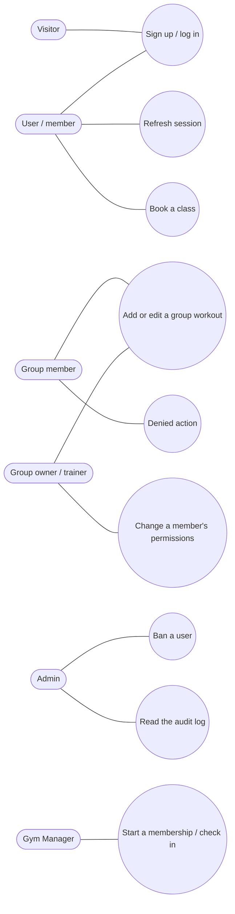

**Table 13: Use case descriptions**

| ID | Use case | Actor | Preconditions | Main flow | Alternative and error flows | Postconditions |
|---|---|---|---|---|---|---|
| UC-1 | Log in and refresh | User | Account exists, not banned | 1. Enters email and password. 2. `POST /auth/login` checks lockout and Argon2 hash. 3. Server creates a session, returns the access token and sets the refresh cookie. 4. App keeps the token in memory. 5. After 5 minutes a request gets `401`; the app calls `POST /auth/refresh` once, gets a new token and cookie, and repeats the request | Wrong password or unknown email `401`; 5th wrong `429`; banned `403`; refresh with a reused old cookie `401` and the session ends | A session row exists; the user is logged in |
| UC-2 | Create a record (add a group workout) | Group member with Add | Logged in, in the group, `can_create` ticked | 1. Opens the group. 2. Clicks Add workout, fills title, date, notes. 3. `POST /workouts` with `group_id`. 4. Server checks `create` in the group and saves | Without Add `403`; not in group `404`; invalid date `422` | The workout is in the group for everyone in it |
| UC-3 | Change a member's permissions | Group owner | Owner of the group; the person is a member | 1. Opens the group's People and permissions. 2. Ticks or unticks Add, Edit or Assign. 3. `PATCH /groups/{id}/members/{user_id}`. 4. Server checks `manage` and saves | Not the owner `403`; not in group `404`; owner's own flags `400` | The member's next request uses the new permissions |
| UC-4 | A denied action | Group member without Edit | Logged in, in the group | 1. Tries to save an edit. 2. `PATCH /workouts/{id}`. 3. Server finds no `update` permission. 4. Answers `403` "You do not have permission to edit workouts in this group"; app shows it in the dialog | A staff endpoint called by a User: `403` and an `access_denied` row in the log | Nothing changes (S6) |
| UC-5 | Ban a user | Admin | Logged in as admin; target is not an admin or self | 1. Opens Users, finds the person. 2. Clicks Ban, types a reason. 3. `POST /admin/users/{id}/ban`. 4. Server sets the ban, revokes every session and writes a `ban` row in one transaction | Target is an admin or self `400`; unknown id `404`; already banned: no change | The user's next request gets `403` (S9); the log has the ban (S15) |
| UC-6 | Read the audit log | Admin | Logged in as admin | 1. Opens Activity log. 2. Picks an event, dates or types an email or IP. 3. `GET /admin/activity?...` returns rows newest first with a total. 4. Optional: Export CSV with the same filters | Unknown event or `date_from` after `date_to` `422`; a non-admin `403` | The export itself is logged |

### B6. Acceptance Criteria

**Table 14: Acceptance criteria**

| ID | Requirement | Given | When | Then |
|---|---|---|---|---|
| AC-1 | FR-AUTH-04, FR-AUTH-05 | A user logged in more than 5 minutes ago | The app sends a request with that access token | The API answers `401`; the app refreshes once and the repeated request gets `200` (S7a) |
| AC-2 | FR-AUTH-05 | A valid access token with one character of the signature changed, or a different `sub` | It is sent to any protected endpoint | `401`, and an `auth_rejected` row is written (`test_tampered_token_gets_401`) |
| AC-3 | FR-RBAC-05 | User A is logged in | A calls another user's session, payments or member record | `404` for the session, `403` for the member endpoint; own endpoints never take an id (`test_a_user_cannot_reach_another_users_records`) |
| AC-4 | FR-RBAC-06 | A group member without Edit | They `PATCH /workouts/{id}` | `403`; after the owner ticks Edit, the same request gets `200` (`test_group_member_without_can_update_gets_403_and_with_it_200`; S6) |
| AC-5 | FR-RBAC-11 | A user with an unexpired access token | An admin bans them | Their next request gets `403` "Account banned" and refresh gets `401` (`test_token_stops_working_when_the_user_is_banned`, `test_banned_user_cannot_refresh`; S9) |
| AC-6 | FR-RBAC-10 | Two admins | One tries to ban the other, or themself, or change their own role | `400` each time (`test_admin_cannot_ban_another_admin_or_themself`, `test_admin_cannot_change_their_own_role`) |
| AC-7 | FR-AUTH-11 | An account | 5 wrong passwords in a row | The 5th answers `429` with `Retry-After`; even the right password is refused for 15 minutes (`test_fifth_wrong_password_locks_the_account`) |
| AC-8 | FR-AUTH-07 | A refresh token that was replaced more than 30 seconds ago | It is sent to `/auth/refresh` | `401` and the whole session ends for both holders (`test_reusing_a_replaced_cookie_ends_the_whole_session`) |
| AC-9 | FR-AUTH-08 | A logged-in user | They log out and the old access token is used again | `401` (`test_token_stops_working_after_logout`) |
| AC-10 | FR-RBAC-08 | A user not in a group (even an admin) | They open the group or one of its workouts | `404` (`test_a_group_and_its_workouts_are_404_for_an_outsider`) |
| AC-11 | FR-RBAC-03 | A visitor and a plain user | They call every endpoint in the OpenAPI schema | Visitor `401` everywhere except the public ones; user `403` on every staff and admin endpoint (`test_rules.py`) |
| AC-12 | FR-ADM-12 | 10,001 matching rows | An admin exports CSV | The file holds the newest 10,000 rows, cells starting with `=`, `+`, `-`, `@` are prefixed with `'`, and an `export` row is logged (`test_every_csv_export_is_limited_to_the_newest_rows`) |

### B7. Traceability Matrix

**Table 15: Requirement, endpoint or screen, test, screenshot**

| Requirement | Endpoint or screen | Automated test | Screenshot |
|---|---|---|---|
| FR-AUTH-01 | `POST /auth/signup`; Sign up page | `test_rules.py::test_nobody_can_give_themself_a_role` | S1 |
| FR-AUTH-02 | `security.hash_password()`; login | `test_login.py::test_right_password_gives_tokens_and_a_refresh_cookie` | — |
| FR-AUTH-03 | `POST /auth/login`; Log in page | `test_login.py::test_wrong_password_and_unknown_email_get_the_same_401` | — |
| FR-AUTH-04 | `security.create_access_token()` | `test_tokens.py::test_token_is_valid_for_5_minutes` | S7b |
| FR-AUTH-05 | `deps.get_auth()` | `test_tokens.py::test_expired_token_gets_401`, `test_tampered_token_gets_401`, `test_token_with_a_changed_user_id_gets_401` | S7a |
| FR-AUTH-06 | `POST /auth/refresh` | `test_refresh.py::test_refresh_rotates_the_cookie_and_gives_a_working_token` | S8a, S8b |
| FR-AUTH-07 | `session_service.rotate()` | `test_refresh.py::test_reusing_a_replaced_cookie_ends_the_whole_session` | — |
| FR-AUTH-08 | `POST /auth/logout` | `test_tokens.py::test_token_stops_working_after_logout` | — |
| FR-AUTH-09 | `GET /users/me/sessions`; Login devices | `test_devices.py::test_each_login_is_a_device_and_the_one_asking_is_marked` | S4 |
| FR-AUTH-10 | `DELETE /users/me/sessions/{id}` | `test_devices.py::test_logging_a_device_out_ends_its_refresh_and_access_tokens` | S4 |
| FR-AUTH-11 | `POST /auth/login` (lockout) | `test_login.py::test_fifth_wrong_password_locks_the_account`, `test_an_email_with_no_account_is_locked_like_an_account` | S16 |
| FR-AUTH-12 | `PATCH /users/me`, `PATCH /users/me/profile`; My account | Manual check on the live site | S3 |
| FR-AUTH-13 | `POST /users/me/password`; My account | `test_rules.py::test_every_failed_password_change_is_recorded`, `test_guessing_the_current_password_locks_the_account` | S3 |
| FR-AUTH-14 | `POST /admin/users/{id}/reset-password`; Choose a new password | Manual and end-to-end run | S12 (button) |
| FR-RBAC-01 | `models.User.role` | `test_login.py::test_a_role_typed_wrongly_in_the_database_is_a_plain_user_not_a_500` | — |
| FR-RBAC-02 | `rbac.py` | `test_rules.py::test_role_names_are_compared_only_in_the_rbac_module` | — |
| FR-RBAC-03 | `rbac.require_permission()` | `test_rules.py::test_every_endpoint_but_the_public_ones_needs_a_login`, `test_a_plain_user_gets_403_on_every_staff_and_admin_endpoint`; `test_rbac.py::test_non_admins_get_403_on_every_admin_route` | S6, S16 |
| FR-RBAC-04 | `deps.get_auth()` | `test_rbac.py::test_role_change_applies_on_the_next_request` | — |
| FR-RBAC-05 | `/users/me/*` | `test_rbac.py::test_a_user_cannot_reach_another_users_records` | S2 |
| FR-RBAC-06 | `PATCH /workouts/{id}`; group page | `test_rbac.py::test_group_member_without_can_update_gets_403_and_with_it_200` | S5, S6 |
| FR-RBAC-07 | `DELETE /workouts/{id}`, `PATCH`/`DELETE /groups/{id}` | `test_rules.py::test_a_member_with_every_permission_cannot_delete_a_workout`, `test_a_member_cannot_manage_the_group`; `test_rbac.py::test_only_the_owner_renames_or_deletes_a_group` | S5 |
| FR-RBAC-08 | `GET /groups/{id}` | `test_rbac.py::test_a_group_and_its_workouts_are_404_for_an_outsider` | — |
| FR-RBAC-09 | `POST /groups` | `test_rbac.py::test_members_cannot_start_a_group_but_trainers_and_staff_can` | — |
| FR-RBAC-10 | `/admin/users/{id}/role`, `/ban` | `test_rbac.py::test_admin_cannot_ban_another_admin_or_themself`, `test_admin_cannot_change_their_own_role` | — |
| FR-RBAC-11 | `deps.get_auth()` | `test_tokens.py::test_token_stops_working_when_the_user_is_banned`; `test_refresh.py::test_banned_user_cannot_refresh` | S9 |
| FR-RBAC-12 | `POST /auth/signup` | `test_rules.py::test_nobody_can_give_themself_a_role` | — |
| FR-RBAC-13 | `DELETE /members/{id}`, `PATCH /members/{id}` | `test_rules.py::test_only_an_admin_deletes_accounts`, `test_a_gym_manager_cannot_start_or_edit_a_staff_membership` | — |
| FR-ADM-01 | `GET /admin/stats`, `/admin/revenue`; Dashboard | `test_rbac.py::test_admin_gets_200_on_every_admin_route`; `test_rules.py::test_the_dashboard_counts_users_records_and_groups_new_in_7_days`; `test_gym.py::test_expenses_and_net_income` | S10 |
| FR-ADM-02 | `GET /admin/users`; Users | `test_rbac.py::test_admin_gets_200_on_every_admin_route` | S11 |
| FR-ADM-03 | `GET /admin/users/{id}`; user detail | `test_robustness.py::test_user_details_list_the_users_records`; `test_gym.py::test_user_details_count_the_users_records` | S12 |
| FR-ADM-04 | `POST /admin/users/{id}/ban`, `/unban` | `test_tokens.py::test_token_stops_working_when_the_user_is_banned` | S13a, S13b |
| FR-ADM-05 | `PATCH /admin/users/{id}/role` | `test_rbac.py::test_role_change_applies_on_the_next_request` | S11 (role selector) |
| FR-ADM-06 | `POST /admin/users/{id}/revoke-sessions` | End-to-end run (revoke while logged in) | S12 (button) |
| FR-ADM-07 | `POST /admin/users/bulk-ban`, `/bulk-unban` | `test_rbac.py::test_bulk_ban_skips_admins_and_bans_the_rest` | — |
| FR-ADM-08 | `POST /admin/users/{id}/reset-password` | End-to-end run | S12 (button) |
| FR-ADM-09 | `/admin/workouts*`, `/admin/groups*`; Training → All workouts | `test_robustness.py::test_moderation_filters_workouts_by_status_and_group`, `test_deletes_inside_a_group_are_logged` | S14 |
| FR-ADM-10 | `GET /admin/activity`; Activity log | `test_rules.py::test_leaving_removing_and_cancelling_are_logged`; `test_robustness.py::test_staff_deletes_and_voids_are_logged` | S15 |
| FR-ADM-11 | `GET /admin/activity/security`; Security | `test_security_view.py` (8 tests) | S16 |
| FR-ADM-12 | `*/export.csv` | `test_robustness.py::test_every_csv_export_is_limited_to_the_newest_rows` | S17 |
| FR-ADM-13 | `activity_service.record()` | `test_robustness.py::test_staff_deletes_and_voids_are_logged` | S15 |
| FR-DOM-01 | `/members/*`; Members | `test_gym.py::test_a_new_membership_runs_for_the_plans_days_and_can_be_paid_at_once` | S2 |
| FR-DOM-02 | `/plans/*`; Plans | `test_gym.py::test_admin_adds_edits_retires_and_deletes_a_plan`, `test_a_retired_plan_cannot_be_chosen_but_members_keep_it` | S2 |
| FR-DOM-03 | `/check-ins/*`; Attendance | `test_gym.py::test_check_in_then_out`, `test_a_frozen_member_cannot_check_in` | S10 |
| FR-DOM-04 | `/classes/*`; Classes, Book a class | `test_robustness.py::test_a_class_cannot_start_in_the_past`; parallel booking in the end-to-end run | S10 |
| FR-DOM-05 | `/payments/*`; Payments | `test_robustness.py::test_staff_deletes_and_voids_are_logged` | S10 |
| FR-DOM-06 | `/trainers/me/*`; My classes, My clients | `test_gym.py::test_trainer_marks_attendance_of_their_own_class_only`, `test_a_trainer_sees_only_their_own_clients` | — |
| FR-DOM-07 | `/workouts/assigned`, `PUT /workouts/{id}/completion` | `test_gym.py::test_only_the_assigned_member_marks_a_workout_done` | S5 |
| FR-DOM-08 | `/equipment/*`; Equipment | `test_gym.py::test_equipment_service_and_faults` | S10 |
| FR-DOM-09 | `/expenses/*`; Expenses | `test_gym.py::test_expenses_and_net_income` | S10 |
| FR-DOM-10 | `/announcements/*`; Announcements | Manual check | S2, S10 |
| FR-DOM-11 | `GET /overview`; Dashboard | `test_rules.py::test_the_dashboard_counts_users_records_and_groups_new_in_7_days` | S10 |

## Part C. Technical Design (TDD)

### C1. Technology Stack

**Table 16: Technology stack**

| Component | Technology | Version | Reason |
|---|---|---|---|
| Frontend | React with TypeScript | React 19.3.0, TypeScript 7.0.2 | Typed components; the course template |
| Build tool | Vite with `@vitejs/plugin-react` | Vite 8.3.2, plugin 6.1.1 | Fast dev server with an `/api` proxy, small production build |
| UI library | None: own CSS and a small set of shared components (`PageHeader`, `Modal`, `ConfirmModal`, `Pager`, `ListState`, `Alert`) | — | No extra bundle; one consistent look, and the CSP stays strict (`script-src 'self'`) |
| Backend | FastAPI (Python 3.12) | FastAPI 0.162.0, Pydantic 2.14.2 | Validation, dependency injection for auth and RBAC, OpenAPI docs built in |
| Database | PostgreSQL on Supabase (production), SQLite (local and tests) | PostgreSQL 15+ (managed) | Managed, free tier, transaction pooler suited to serverless |
| ORM | SQLModel on SQLAlchemy, driver psycopg 3 | SQLModel 0.0.48, SQLAlchemy 2.1.6, psycopg 3.3.6 | One class is both the table and the schema; parameterised queries |
| Password hashing | `argon2-cffi` (Argon2id) over HMAC-SHA256 with a pepper | 25.1.0 | Memory-hard hashing recommended by OWASP; the pepper makes a stolen database alone useless |
| JWT library | PyJWT | 2.15.1 | Small, well maintained; HS256 with required claims |
| Testing | pytest with FastAPI `TestClient` (httpx) | pytest 9.2.0, httpx 0.28.1 | Fast API tests on a throwaway database |
| Hosting | Vercel (one project: static frontend and Python function) | — | Deploys on every merge to `main`, HTTPS, previews per branch |

### C2. System Architecture

**Figure 2: System architecture**

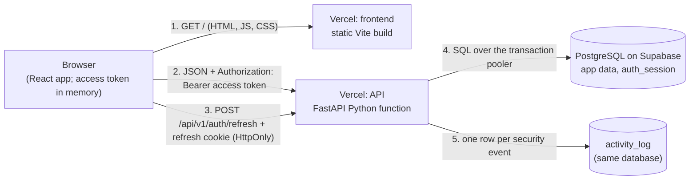

1. **Browser → frontend.** `vercel.json` sends every path that does not start with `/api/` to the static React build. The pages carry a Content-Security-Policy that only allows scripts and API calls from the same origin.
2. **Browser → API (access token).** Every API call goes through `frontend/src/services/api.ts`, which adds `Authorization: Bearer <access token>`. The token lives only in a JavaScript variable, never in `localStorage`, so it disappears when the tab closes.
3. **Browser → API (refresh cookie).** When a request gets `401`, or the page loads, the app calls `POST /api/v1/auth/refresh`. The browser adds the `refresh_token` cookie automatically because its path is `/api/v1/auth`; scripts cannot read it.
4. **API → database.** The FastAPI function connects to Supabase through the transaction pooler (port 6543) with a small connection pool and no prepared statements. Every query goes through SQLModel with parameters.
5. **API → audit log.** Services call `activity_service.record()`, which adds the row in the same transaction as the change it describes, so a ban and its log row are saved together or not at all.

The frontend and API share one origin (`https://2321648gymbuddy.vercel.app`), so the app itself needs no CORS; the CORS allowlist only decides whether another site may call the API.

### C3. Backend and Frontend Structure

**Backend (two levels):**

```text
backend/
├── main.py                 creates the app: CORS, routers, error handlers, /api/health, /api/docs
├── requirements.txt        production dependencies (installed by Vercel)
├── requirements-dev.txt    + pytest, httpx
├── pytest.ini
├── .env.example            variable names with placeholders only
├── app/
│   ├── config.py           settings from the environment; FRONTEND_ORIGIN rules
│   ├── cors.py             allowlist CORS middleware
│   ├── database.py         engine, session, create_db_and_tables()
│   ├── models.py           tables and request/response schemas
│   ├── security.py         Argon2 + pepper, JWT create/verify, refresh token hashing
│   ├── deps.py             get_auth(): token, user, ban and session check
│   ├── rbac.py             roles, permissions, require_permission(), group permissions
│   ├── request_info.py     client IP and browser for sessions and the log
│   ├── params.py           ids, paging and search limits
│   ├── errors.py           service errors → HTTP status codes
│   ├── routers/            17 files: auth, users, admin, activity, moderation, members, check_ins,
│   │                       classes, plans, payments, overview, trainers, announcements, workouts,
│   │                       groups, equipment, expenses
│   └── services/           21 files: auth, session, user, activity, moderation, member, plan,
│                           payment, revenue, stats, class, checkin, trainer, group, workout,
│                           equipment, expense, announcement, profile, search, csv_export
└── tests/                  13 files, 136 tests
```

- **Routes** (`routers/`) only read the request, declare the permission with `require_permission(...)` and call one service function.
- **Services** (`services/`) hold every rule and query and raise plain Python errors; there is no separate repository layer, because SQLModel queries are short and live next to the rule that needs them.
- **Models** (`models.py`) define tables and the Create/Update/Read schemas; response schemas list fields explicitly so `password_hash` can never be returned.
- **Authentication code:** `security.py` (hashing, tokens), `deps.py` (who is calling), `routers/auth.py` and `services/auth_service.py`, `services/session_service.py` (sessions, rotation, revoke).
- **RBAC module:** `rbac.py`, the only file that names roles.
- **Admin code:** `routers/admin.py`, `routers/activity.py`, `routers/moderation.py` with `services/user_service.py`, `activity_service.py`, `moderation_service.py`, `stats_service.py`, `revenue_service.py`.

**Figure 3: Backend layers**

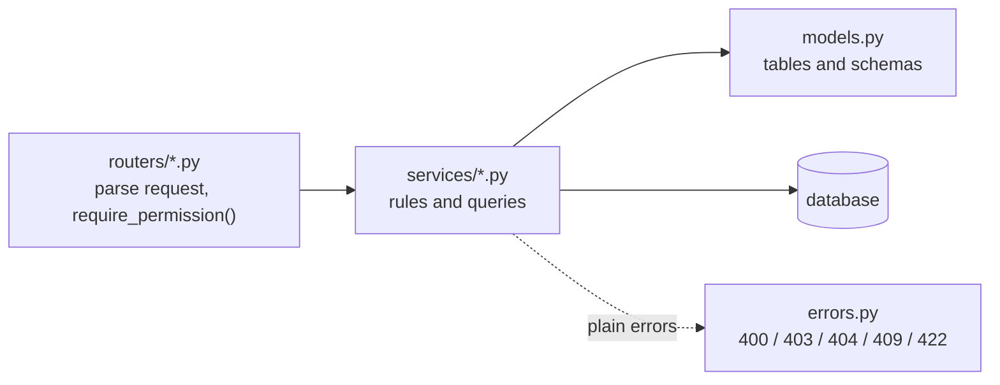

**Frontend (two levels):**

```text
frontend/
├── index.html
├── vite.config.ts          dev proxy: /api → http://localhost:8000
└── src/
    ├── main.tsx, App.tsx   hash router (#/members, #/users, …) and the page guard
    ├── context/            AuthContext (user, permissions, login/logout, restore on load), PlansContext
    ├── layouts/            AppLayout: sidebar built from the caller's permissions
    ├── pages/              23 pages (Dashboard, Members, Attendance, Payments, Classes, Training,
    │                       Equipment, Announcements, Plans, Expenses, Users, Security, Activity log,
    │                       My membership, Book a class, My classes, My clients, My account,
    │                       Login devices, Log in, Sign up, Choose a new password, No access)
    ├── components/         61 shared parts (forms, lists, modals, Pager, ListState, Alert, …)
    ├── services/           18 modules; api.ts adds the token and refreshes once on a 401
    ├── hooks/              usePagedList, useDebouncedValue
    ├── types/              TypeScript types of the API
    └── utils/              dates in the gym's time, links, formatting
```

- **Pages** are chosen from the URL hash; **route guards** live in `App.tsx`: a page opens only if the caller's permissions (from `/users/me`) allow it, otherwise **No access** is shown. The API checks again on every request.
- **API client:** `services/api.ts`; **authentication context:** `context/AuthContext.tsx`.

### C4. Data Model

**Figure 4: Entity-relationship diagram**

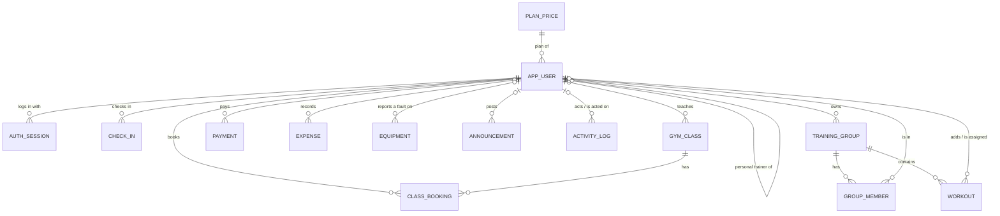

**How the security data is stored:**

- **Roles:** `app_user.role` (one of four strings). Unknown values are treated as a plain User. The role → permission map is code (`rbac.py`), not a table, so it is reviewed with the code and cannot be changed through the API.
- **Bans:** `app_user.is_banned`, `banned_at`, `ban_reason`. A ban also sets `revoked_at` on every `auth_session` row of the user.
- **Sessions and refresh tokens:** `auth_session`, one row per login: `token_hash` (SHA-256 of the current refresh token), `previous_token_hash` and `rotated_at` (reuse detection), `expires_at` (7 days from the last refresh), `last_used_at`, `ip`, `user_agent`, `revoked_at`. The plain refresh token is never stored.
- **Lockout:** `app_user.failed_login_count` and `locked_until`; kept in the database because serverless instances share no memory.
- **Group membership with permissions:** `group_member` (composite primary key `group_id`, `user_id`) with `can_create`, `can_update`, `can_assign`. The owner is `training_group.owner_id` and has no `group_member` flags to change.
- **Activity log:** `activity_log`, append-only; it copies `actor_email` and `target_email` so a row still reads correctly after the account is deleted, and is indexed on time, event, actor and target.

The tables and columns below are generated from the SQLModel metadata of the deployed code (15 tables).

**Table 17: `app_user`**

| Column | Type | Key / constraint |
|---|---|---|
| `id` | integer | PK |
| `email` | varchar(254) | unique, not null, indexed |
| `name` | varchar(100) | not null |
| `password_hash` | varchar | not null |
| `role` | varchar(20) | not null |
| `is_banned` | boolean | not null |
| `banned_at` | datetime | nullable |
| `ban_reason` | varchar(500) | nullable |
| `password_changed_at` | datetime | nullable |
| `must_change_password` | boolean | not null |
| `failed_login_count` | integer | not null |
| `locked_until` | datetime | nullable |
| `created_at` | datetime | not null |
| `plan` | varchar(40) | nullable |
| `joined_on` | date | nullable |
| `expires_on` | date | nullable |
| `trainer_id` | integer | FK → app_user.id (SET NULL), indexed |
| `is_frozen` | boolean | not null |
| `phone` | varchar(20) | nullable |
| `date_of_birth` | date | nullable |
| `emergency_contact_name` | varchar(100) | nullable |
| `emergency_contact_phone` | varchar(20) | nullable |
| `notes` | varchar(500) | nullable |

**Table 18: `plan_price`**

| Column | Type | Key / constraint |
|---|---|---|
| `plan` | varchar(40) | PK |
| `name` | varchar(60) | not null |
| `price` | integer | not null |
| `duration_days` | integer | not null |
| `description` | varchar(300) | nullable |
| `is_active` | boolean | not null |
| `updated_at` | datetime | not null |

**Table 19: `schema_state`**

| Column | Type | Key / constraint |
|---|---|---|
| `id` | integer | PK |
| `version` | varchar(64) | not null |

**Table 20: `activity_log`**

| Column | Type | Key / constraint |
|---|---|---|
| `id` | integer | PK |
| `created_at` | datetime | not null, indexed |
| `event` | varchar(30) | not null, indexed |
| `actor_id` | integer | FK → app_user.id (SET NULL), indexed |
| `actor_email` | varchar(254) | nullable |
| `target_id` | integer | FK → app_user.id (SET NULL), indexed |
| `target_email` | varchar(254) | nullable |
| `details` | varchar(500) | nullable |
| `ip` | varchar(45) | nullable |
| `user_agent` | varchar(300) | nullable |

**Table 21: `announcement`**

| Column | Type | Key / constraint |
|---|---|---|
| `id` | integer | PK |
| `title` | varchar(100) | not null |
| `message` | varchar(1000) | not null |
| `ends_on` | date | nullable |
| `posted_by` | integer | FK → app_user.id (SET NULL) |
| `posted_at` | datetime | not null, indexed |
| `updated_at` | datetime | nullable |

**Table 22: `auth_session`**

| Column | Type | Key / constraint |
|---|---|---|
| `id` | integer | PK |
| `user_id` | integer | FK → app_user.id (CASCADE), not null, indexed |
| `token_hash` | varchar(64) | unique, not null, indexed |
| `previous_token_hash` | varchar(64) | indexed |
| `rotated_at` | datetime | nullable |
| `created_at` | datetime | not null |
| `last_used_at` | datetime | not null |
| `expires_at` | datetime | not null |
| `ip` | varchar(45) | nullable |
| `user_agent` | varchar(300) | nullable |
| `revoked_at` | datetime | nullable |

**Table 23: `check_in`**

| Column | Type | Key / constraint |
|---|---|---|
| `id` | integer | PK |
| `member_id` | integer | FK → app_user.id (CASCADE), not null, indexed |
| `checked_in_at` | datetime | not null, indexed |
| `recorded_by` | integer | FK → app_user.id |
| `checked_out_at` | datetime | nullable |

**Table 24: `equipment`**

| Column | Type | Key / constraint |
|---|---|---|
| `id` | integer | PK |
| `name` | varchar(100) | not null |
| `category` | varchar(20) | not null |
| `quantity` | integer | not null |
| `status` | varchar(20) | not null, indexed |
| `purchased_on` | date | nullable |
| `service_every_days` | integer | nullable |
| `last_serviced_on` | date | nullable |
| `next_service_on` | date | indexed |
| `issue` | varchar(500) | nullable |
| `reported_by` | integer | FK → app_user.id (SET NULL) |
| `reported_at` | datetime | nullable |
| `notes` | varchar(500) | nullable |
| `created_at` | datetime | not null |
| `updated_at` | datetime | not null |

**Table 25: `expense`**

| Column | Type | Key / constraint |
|---|---|---|
| `id` | integer | PK |
| `category` | varchar(20) | not null |
| `amount` | integer | not null |
| `spent_on` | date | not null, indexed |
| `description` | varchar(200) | nullable |
| `recorded_by` | integer | FK → app_user.id (SET NULL) |
| `created_at` | datetime | not null |

**Table 26: `gym_class`**

| Column | Type | Key / constraint |
|---|---|---|
| `id` | integer | PK |
| `name` | varchar(100) | not null |
| `description` | varchar(500) | nullable |
| `trainer_id` | integer | FK → app_user.id (SET NULL), indexed |
| `trainer_name` | varchar(100) | nullable |
| `starts_at` | datetime | not null, indexed |
| `duration_minutes` | integer | not null |
| `capacity` | integer | not null |
| `created_by` | integer | FK → app_user.id |
| `created_at` | datetime | not null |
| `updated_at` | datetime | not null |

**Table 27: `payment`**

| Column | Type | Key / constraint |
|---|---|---|
| `id` | integer | PK |
| `member_id` | integer | FK → app_user.id (SET NULL), indexed |
| `member_name` | varchar(100) | not null |
| `amount` | integer | not null |
| `method` | varchar(20) | not null |
| `plan` | varchar(40) | nullable |
| `note` | varchar(200) | nullable |
| `paid_at` | datetime | not null, indexed |
| `renewed_until` | date | nullable |
| `recorded_by` | integer | FK → app_user.id |
| `voided_at` | datetime | nullable |
| `void_reason` | varchar(200) | nullable |
| `voided_by` | integer | FK → app_user.id |

**Table 28: `training_group`**

| Column | Type | Key / constraint |
|---|---|---|
| `id` | integer | PK |
| `name` | varchar(100) | not null |
| `owner_id` | integer | FK → app_user.id (CASCADE), not null, indexed |
| `created_at` | datetime | not null |

**Table 29: `class_booking`**

| Column | Type | Key / constraint |
|---|---|---|
| `class_id` | integer | PK, FK → gym_class.id (CASCADE) |
| `member_id` | integer | PK, FK → app_user.id (CASCADE) |
| `booked_at` | datetime | not null |
| `attended` | boolean | nullable |

**Table 30: `group_member`**

| Column | Type | Key / constraint |
|---|---|---|
| `group_id` | integer | PK, FK → training_group.id (CASCADE) |
| `user_id` | integer | PK, FK → app_user.id (CASCADE) |
| `can_create` | boolean | not null |
| `can_update` | boolean | not null |
| `can_assign` | boolean | not null |
| `added_at` | datetime | not null |

**Table 31: `workout`**

| Column | Type | Key / constraint |
|---|---|---|
| `id` | integer | PK |
| `owner_id` | integer | FK → app_user.id (SET NULL), indexed |
| `group_id` | integer | FK → training_group.id (CASCADE), indexed |
| `title` | varchar(100) | not null |
| `workout_date` | date | not null |
| `notes` | varchar(1000) | nullable |
| `assigned_to` | integer | FK → app_user.id (SET NULL), indexed |
| `completed_at` | datetime | nullable |
| `created_at` | datetime | not null |
| `updated_at` | datetime | not null |

### C5. API Design

- **Version prefix:** every route is under `/api/v1` (the health check is `/api/health`). Resources are plural nouns (`/members`, `/classes/{id}/bookings`); `PATCH` changes only the fields sent.
- **Pagination:** every list takes `offset` (≥ 0) and `limit` (1 to 100, default 20) and returns `{"items": [...], "total": N, "offset": 0, "limit": 20}`.
- **Error format:** always `{"detail": "One sentence the app can show as it is"}`. Validation errors are joined into one sentence and never repeat the value that was sent (it may be a password). Status codes: `201` created, `204` deleted or logged out, `400` a rule refused, `401` not logged in or token invalid, `403` no permission or banned, `404` not found or not allowed to know it exists, `409` conflict (email taken, already booked, class full), `422` invalid input, `429` locked out (with `Retry-After`).
- **Authentication:** "Yes" in the Auth column means `Authorization: Bearer <access token>` is required. Errors in the last column are the main ones; every list endpoint also answers `422` for an invalid `offset`, `limit` or filter.

**Table 32: Endpoint list (106 operations, generated from the running app's routes and their permission dependencies)**

| # | Method and path | Auth | Permission | Body | Success | Errors |
|---|---|---|---|---|---|---|
| 1 | `POST /api/v1/auth/signup` | No | public | `SignupRequest` | 201 | 409, 422 |
| 2 | `POST /api/v1/auth/login` | No | public | `LoginRequest` | 200 | 401, 403 banned, 422, 429 |
| 3 | `POST /api/v1/auth/refresh` | No | public | — | 200 | 401 |
| 4 | `POST /api/v1/auth/logout` | No | public | — | 204 | — |
| 5 | `GET /api/v1/users/me` | Yes | login only (own data) | — | 200 | 401 |
| 6 | `PATCH /api/v1/users/me` | Yes | login only (own data) | `UserNameUpdate` | 200 | 401, 422 |
| 7 | `GET /api/v1/users/me/profile` | Yes | login only (own data) | — | 200 | 401 |
| 8 | `PATCH /api/v1/users/me/profile` | Yes | login only (own data) | `ProfileUpdate` | 200 | 401, 422 |
| 9 | `GET /api/v1/users/me/membership` | Yes | login only (own data) | — | 200 | 401 |
| 10 | `GET /api/v1/users/me/check-ins` | Yes | login only (own data) | — | 200 | 401 |
| 11 | `GET /api/v1/users/me/bookings` | Yes | login only (own data) | — | 200 | 401 |
| 12 | `GET /api/v1/users/me/payments` | Yes | login only (own data) | — | 200 | 401 |
| 13 | `POST /api/v1/users/me/password` | Yes | login only (own data) | `PasswordChange` | 204 | 401, 422 |
| 14 | `GET /api/v1/users/me/sessions` | Yes | login only (own data) | — | 200 | 401 |
| 15 | `DELETE /api/v1/users/me/sessions/{session_id}` | Yes | login only (own data) | — | 204 | 401, 404, 422 |
| 16 | `GET /api/v1/admin/stats` | Yes | `dashboard:read` | — | 200 | 401, 403 |
| 17 | `GET /api/v1/admin/revenue` | Yes | `dashboard:read` | — | 200 | 401, 403 |
| 18 | `GET /api/v1/admin/users` | Yes | `users:read` | — | 200 | 401, 403 |
| 19 | `GET /api/v1/admin/users/export.csv` | Yes | `users:export` | — | 200 | 401, 403 |
| 20 | `POST /api/v1/admin/users/bulk-ban` | Yes | `users:ban` | `BulkUserAction` | 200 | 401, 403, 422 |
| 21 | `POST /api/v1/admin/users/bulk-unban` | Yes | `users:ban` | `BulkUserAction` | 200 | 401, 403, 422 |
| 22 | `GET /api/v1/admin/users/{user_id}` | Yes | `users:read` | — | 200 | 401, 403, 404, 422 |
| 23 | `POST /api/v1/admin/users/{user_id}/revoke-sessions` | Yes | `users:revoke_sessions` | — | 200 | 401, 403, 404, 422 |
| 24 | `PATCH /api/v1/admin/users/{user_id}/role` | Yes | `users:change_role` | `UserRoleUpdate` | 200 | 401, 403, 404, 422 |
| 25 | `POST /api/v1/admin/users/{user_id}/ban` | Yes | `users:ban` | `body` | 200 | 401, 403, 404, 422 |
| 26 | `POST /api/v1/admin/users/{user_id}/unban` | Yes | `users:ban` | — | 200 | 401, 403, 404, 422 |
| 27 | `POST /api/v1/admin/users/{user_id}/reset-password` | Yes | `users:reset_password` | — | 200 | 401, 403, 404, 422 |
| 28 | `POST /api/v1/members` | Yes | `members:manage` | `MemberCreate` | 201 | 401, 403, 409, 422 |
| 29 | `GET /api/v1/members` | Yes | `members:read` | — | 200 | 401, 403 |
| 30 | `GET /api/v1/members/waiting` | Yes | `members:read` | — | 200 | 401, 403 |
| 31 | `POST /api/v1/members/bulk-delete` | Yes | `members:delete` | `MemberBulkDelete` | 200 | 401, 403, 422 |
| 32 | `GET /api/v1/members/{member_id}` | Yes | `members:read` | — | 200 | 401, 403, 404, 422 |
| 33 | `PATCH /api/v1/members/{member_id}` | Yes | `members:manage` | `MemberUpdate` | 200 | 401, 403, 404, 422 |
| 34 | `POST /api/v1/members/{member_id}/check-ins` | Yes | `check_ins:record` | — | 201 | 401, 403, 404, 409, 422 |
| 35 | `GET /api/v1/members/{member_id}/check-ins` | Yes | `members:read` | — | 200 | 401, 403, 404, 422 |
| 36 | `POST /api/v1/members/{member_id}/payments` | Yes | `payments:manage` | `PaymentCreate` | 201 | 401, 403, 404, 422 |
| 37 | `GET /api/v1/members/{member_id}/payments` | Yes | `payments:manage` | — | 200 | 401, 403, 404, 422 |
| 38 | `GET /api/v1/members/{member_id}/bookings` | Yes | `members:read` | — | 200 | 401, 403, 404, 422 |
| 39 | `DELETE /api/v1/members/{member_id}/bookings/{class_id}` | Yes | `members:manage` | — | 204 | 401, 403, 404, 422 |
| 40 | `DELETE /api/v1/members/{member_id}` | Yes | `members:delete` | — | 204 | 401, 403, 404, 422 |
| 41 | `GET /api/v1/check-ins` | Yes | `check_ins:record` | — | 200 | 401, 403 |
| 42 | `POST /api/v1/check-ins/{check_in_id}/check-out` | Yes | `check_ins:record` | — | 200 | 401, 403, 404, 422 |
| 43 | `POST /api/v1/classes` | Yes | `classes:manage` | `ClassCreate` | 201 | 401, 403, 422 |
| 44 | `GET /api/v1/classes` | Yes | login only (own data) | — | 200 | 401 |
| 45 | `GET /api/v1/classes/{class_id}` | Yes | login only (own data) | — | 200 | 401, 404, 422 |
| 46 | `PATCH /api/v1/classes/{class_id}` | Yes | `classes:manage` | `ClassUpdate` | 200 | 401, 403, 404, 422 |
| 47 | `DELETE /api/v1/classes/{class_id}` | Yes | `classes:manage` | — | 204 | 401, 403, 404, 422 |
| 48 | `GET /api/v1/classes/{class_id}/bookings` | Yes | `classes:manage` or `classes:teach` | — | 200 | 401, 403, 404, 422 |
| 49 | `PUT /api/v1/classes/{class_id}/bookings/{member_id}/attendance` | Yes | `classes:manage` or `classes:teach` | `AttendanceUpdate` | 200 | 401, 403, 404, 422 |
| 50 | `POST /api/v1/classes/{class_id}/bookings` | Yes | login only (own data) | — | 201 | 401, 404, 409, 422 |
| 51 | `DELETE /api/v1/classes/{class_id}/bookings` | Yes | login only (own data) | — | 204 | 401, 404, 422 |
| 52 | `GET /api/v1/plans` | Yes | login only (own data) | — | 200 | 401 |
| 53 | `POST /api/v1/plans` | Yes | `plans:edit` | `PlanCreate` | 201 | 401, 403, 409, 422 |
| 54 | `PATCH /api/v1/plans/{plan}` | Yes | `plans:edit` | `PlanUpdate` | 200 | 401, 403, 404, 422 |
| 55 | `DELETE /api/v1/plans/{plan}` | Yes | `plans:edit` | — | 204 | 401, 403, 404, 422 |
| 56 | `GET /api/v1/payments` | Yes | `payments:manage` | — | 200 | 401, 403 |
| 57 | `GET /api/v1/payments/export.csv` | Yes | `payments:export` | — | 200 | 401, 403 |
| 58 | `POST /api/v1/payments/{payment_id}/void` | Yes | `payments:void` | `VoidRequest` | 200 | 401, 403, 404, 422 |
| 59 | `GET /api/v1/overview` | Yes | `overview:read` | — | 200 | 401, 403 |
| 60 | `GET /api/v1/trainers` | Yes | `classes:manage` or `members:manage` | — | 200 | 401, 403 |
| 61 | `GET /api/v1/trainers/me/classes` | Yes | `classes:teach` | — | 200 | 401, 403 |
| 62 | `GET /api/v1/trainers/me/clients` | Yes | `clients:read` | — | 200 | 401, 403 |
| 63 | `GET /api/v1/announcements` | Yes | login only (own data) | — | 200 | 401 |
| 64 | `POST /api/v1/announcements` | Yes | `announcements:manage` | `AnnouncementCreate` | 201 | 401, 403, 422 |
| 65 | `PATCH /api/v1/announcements/{announcement_id}` | Yes | `announcements:manage` | `AnnouncementUpdate` | 200 | 401, 403, 404, 422 |
| 66 | `DELETE /api/v1/announcements/{announcement_id}` | Yes | `announcements:manage` | — | 204 | 401, 403, 404, 422 |
| 67 | `GET /api/v1/admin/activity` | Yes | `activity:read` | — | 200 | 401, 403 |
| 68 | `GET /api/v1/admin/activity/security` | Yes | `activity:read` | — | 200 | 401, 403 |
| 69 | `GET /api/v1/admin/activity/export.csv` | Yes | `activity:read` | — | 200 | 401, 403 |
| 70 | `GET /api/v1/workouts/assigned` | Yes | group permission (Table 11) | — | 200 | 401, 403 |
| 71 | `POST /api/v1/workouts` | Yes | group permission (Table 11) | `WorkoutCreate` | 201 | 401, 403, 422 |
| 72 | `GET /api/v1/workouts/{workout_id}` | Yes | group permission (Table 11) | — | 200 | 401, 403, 404, 422 |
| 73 | `PATCH /api/v1/workouts/{workout_id}` | Yes | group permission (Table 11) | `WorkoutUpdate` | 200 | 401, 403, 404, 422 |
| 74 | `PUT /api/v1/workouts/{workout_id}/assignee` | Yes | group permission (Table 11) | `WorkoutAssign` | 200 | 401, 403, 404, 422 |
| 75 | `PUT /api/v1/workouts/{workout_id}/completion` | Yes | group permission (Table 11) | `WorkoutCompletion` | 200 | 401, 403, 404, 422 |
| 76 | `DELETE /api/v1/workouts/{workout_id}` | Yes | group permission (Table 11) | — | 204 | 401, 403, 404, 422 |
| 77 | `GET /api/v1/groups` | Yes | login only (own data) | — | 200 | 401 |
| 78 | `POST /api/v1/groups` | Yes | `groups:create` | `GroupCreate` | 201 | 401, 403, 422 |
| 79 | `GET /api/v1/groups/{group_id}` | Yes | group permission (Table 11) | — | 200 | 401, 403, 404, 422 |
| 80 | `PATCH /api/v1/groups/{group_id}` | Yes | group permission (Table 11) | `GroupCreate` | 200 | 401, 403, 404, 422 |
| 81 | `DELETE /api/v1/groups/{group_id}` | Yes | group permission (Table 11) | — | 204 | 401, 403, 404, 422 |
| 82 | `GET /api/v1/groups/{group_id}/workouts` | Yes | group permission (Table 11) | — | 200 | 401, 403, 404, 422 |
| 83 | `GET /api/v1/groups/{group_id}/members` | Yes | group permission (Table 11) | — | 200 | 401, 403, 404, 422 |
| 84 | `POST /api/v1/groups/{group_id}/members` | Yes | group permission (Table 11) | `GroupMemberAdd` | 201 | 401, 403, 404, 409, 422 |
| 85 | `PATCH /api/v1/groups/{group_id}/members/{user_id}` | Yes | group permission (Table 11) | `GroupMemberUpdate` | 200 | 401, 403, 404, 422 |
| 86 | `DELETE /api/v1/groups/{group_id}/members/{user_id}` | Yes | group permission (Table 11) | — | 204 | 401, 403, 404, 422 |
| 87 | `GET /api/v1/admin/workouts` | Yes | `content:moderate` | — | 200 | 401, 403 |
| 88 | `GET /api/v1/admin/workouts/export.csv` | Yes | `content:moderate` | — | 200 | 401, 403 |
| 89 | `POST /api/v1/admin/workouts/bulk-delete` | Yes | `content:moderate` | `ContentBulkDelete` | 200 | 401, 403, 422 |
| 90 | `DELETE /api/v1/admin/workouts/{workout_id}` | Yes | `content:moderate` | — | 204 | 401, 403, 404, 422 |
| 91 | `GET /api/v1/admin/groups` | Yes | `content:moderate` | — | 200 | 401, 403 |
| 92 | `GET /api/v1/admin/groups/export.csv` | Yes | `content:moderate` | — | 200 | 401, 403 |
| 93 | `POST /api/v1/admin/groups/bulk-delete` | Yes | `content:moderate` | `ContentBulkDelete` | 200 | 401, 403, 422 |
| 94 | `DELETE /api/v1/admin/groups/{group_id}` | Yes | `content:moderate` | — | 204 | 401, 403, 404, 422 |
| 95 | `GET /api/v1/equipment` | Yes | `equipment:read` | — | 200 | 401, 403 |
| 96 | `POST /api/v1/equipment` | Yes | `equipment:manage` | `EquipmentCreate` | 201 | 401, 403, 422 |
| 97 | `PATCH /api/v1/equipment/{equipment_id}` | Yes | `equipment:manage` | `EquipmentUpdate` | 200 | 401, 403, 404, 422 |
| 98 | `POST /api/v1/equipment/{equipment_id}/report` | Yes | `equipment:read` | `EquipmentReport` | 200 | 401, 403, 404, 422 |
| 99 | `POST /api/v1/equipment/{equipment_id}/service` | Yes | `equipment:manage` | — | 200 | 401, 403, 404, 422 |
| 100 | `DELETE /api/v1/equipment/{equipment_id}` | Yes | `equipment:manage` | — | 204 | 401, 403, 404, 422 |
| 101 | `GET /api/v1/expenses` | Yes | `expenses:manage` | — | 200 | 401, 403 |
| 102 | `POST /api/v1/expenses` | Yes | `expenses:manage` | `ExpenseCreate` | 201 | 401, 403, 422 |
| 103 | `GET /api/v1/expenses/export.csv` | Yes | `expenses:manage` | — | 200 | 401, 403 |
| 104 | `PATCH /api/v1/expenses/{expense_id}` | Yes | `expenses:manage` | `ExpenseUpdate` | 200 | 401, 403, 404, 422 |
| 105 | `DELETE /api/v1/expenses/{expense_id}` | Yes | `expenses:manage` | — | 204 | 401, 403, 404, 422 |
| 106 | `GET /api/health` | No | public | — | 200 | — |

### C6. JWT Authentication Design

**Figure 5: JWT sequence: login, request, expiry, refresh, reuse, logout**

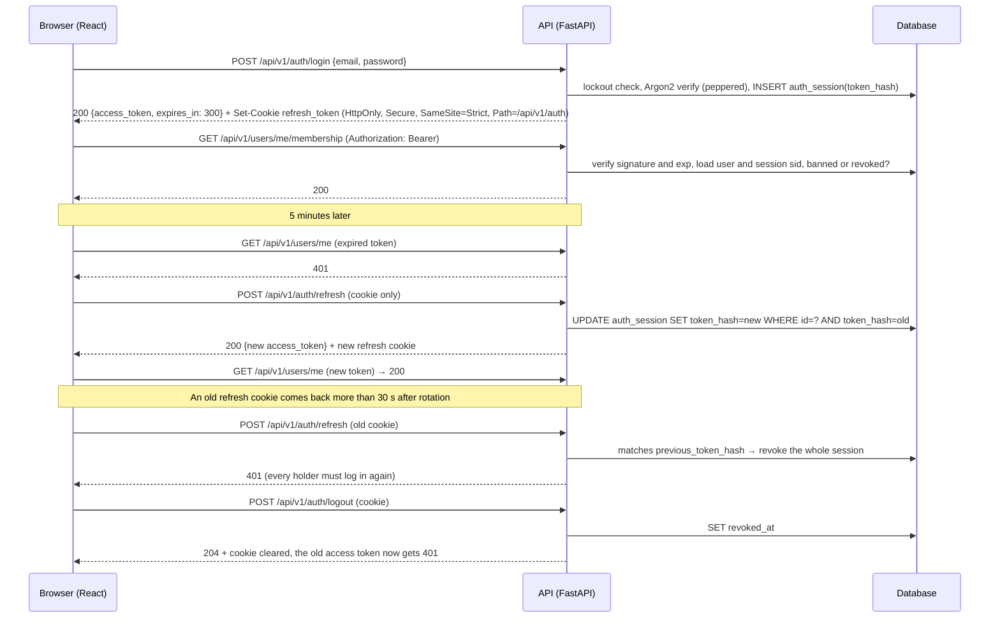

**Table 33: Access token claims**

| Claim | Value | Used for |
|---|---|---|
| `sub` | User id (string) | Load the user from the database on every request |
| `role` | Role at login time | Information only; permission checks use the role from the database |
| `sid` | `auth_session.id` | Check the session is still active, so logout, ban, password change and revoke work at once |
| `iat` | Issued at (UTC, to the fraction of a second) | Required claim |
| `exp` | `iat` + 5 minutes | Expiry; an expired token gets `401` |

- **Signing:** HS256 with `JWT_SECRET` from the environment (at least 32 bytes; the app refuses to start on Vercel without it). `jwt.decode(..., algorithms=["HS256"], options={"require": ["sub", "sid", "iat", "exp"]})` rejects other algorithms and missing claims.
- **Lifetimes:** access token **5 minutes**: a stolen token is useful only briefly, and because every request also checks the session, a revoke works even sooner. Refresh token **7 days** from the last use: a member who visits the gym a few times a week stays logged in. Rotation grace **30 seconds**: two tabs refreshing at the same moment are not treated as theft.
- **Storage in the browser:** the access token is a variable in `services/api.ts` (memory). *Risk:* XSS could read it while the page is open. *Defences:* React escapes all output, the CSP allows scripts only from the same origin (`script-src 'self'`, no inline scripts), and the token lives 5 minutes. The refresh token is an `HttpOnly` cookie, so scripts cannot read it at all. *Risk:* CSRF on the cookie. *Defences:* `SameSite=Strict` (the cookie is never sent on requests started by another site), `Path=/api/v1/auth` (sent only to login, refresh and logout), and every other endpoint needs the Bearer header, which a forged request cannot add. CORS allows no other origin with credentials.
- **What the server checks on every request** (`deps.get_auth()`, Figure 6): signature and expiry → user exists → user not banned (`403`) → the session `sid` belongs to the user and is not revoked or expired (`401`) → for most routes, no forced password change pending (`403`).
- **What the frontend does on a 401:** `api.ts` calls `refreshSession()` once (parallel failing requests share one refresh promise) and repeats the request with the new token. If the refresh fails, `AuthContext` clears the user and shows Log in, with a message such as "This account has been banned" when the API said so (S9). A server that cannot be reached logs nobody out.

### C7. RBAC Design

**Figure 6: Authorisation flow for one request**

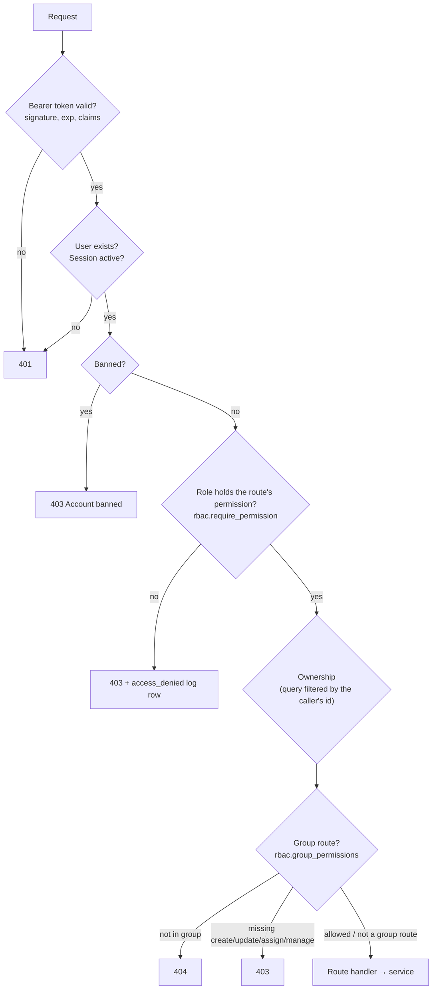

- **Roles and permission constants:** `Permission` is a string enum of 26 values (for example `members:read`, `payments:void`, `users:ban`, `activity:read`, `content:moderate`). `ROLE_PERMISSIONS` maps `user` → none, `trainer` → 4, `gym_manager` → 10, `admin` → those 10 plus 14 admin permissions (Table 10). `GroupPermission` has `read`, `create`, `update`, `assign`, `manage`.
- **The one reusable check** (`backend/app/rbac.py`):

```python
def require_permission(*permissions: Permission) -> Callable[..., User]:
    """A dependency: the caller must hold at least one of these permissions, or gets 403. It builds on
    get_current_user, so a missing or bad token gets 401 first and a banned account 403."""

    def check(user: CurrentUser, request: Request, session: SessionDep, client: ClientDep) -> User:
        if not any(has_permission(user, permission) for permission in permissions):
            needs = " or ".join(permission.value for permission in permissions)
            details = f"{request.method} {request.url.path} needs {needs}"
            activity_service.record(session, ActivityEvent.ACCESS_DENIED, client, actor=user, details=details)
            session.commit()
            raise HTTPException(status_code=403, detail="You do not have permission to do this")
        return user

    return check

# used on a route:
@router.post("/users/{user_id}/ban", response_model=AdminUserRead)
def ban_user(user_id: int, session: SessionDep, admin: Annotated[User, Depends(require_permission(Permission.USERS_BAN))], ...): ...
```

- **Ownership in queries:** "my" endpoints never take an id; the service filters by the caller's id from the token, for example `payment_service.list_own_payments()` selects `WHERE payment.member_id = :user_id`, and `session_service` revokes a session only `WHERE auth_session.user_id = :user_id` (another user's session therefore matches nothing and answers `404`). Group routes load the caller's `group_member` row and compute `rbac.group_permissions(user, owner_id, member)`; an empty set raises `404`.
- **Adding a role or permission:** add the constant to `Permission`, add it to the roles in `ROLE_PERMISSIONS`, and declare `require_permission(Permission.NEW)` on the route. The frontend menu and page guards update themselves, because `/users/me` returns the caller's permission list. `test_rules.py` fails if any other file compares role names.
- **Special rules:** admins cannot change their own role or ban another admin (`user_service`, `400`); banned users are stopped in `get_auth()` before any permission check; a must-change-password account can only call `GET /users/me` and `POST /users/me/password`.

### C8. Admin Dashboard Design

**Figure 7: Admin pages and the endpoints they call**

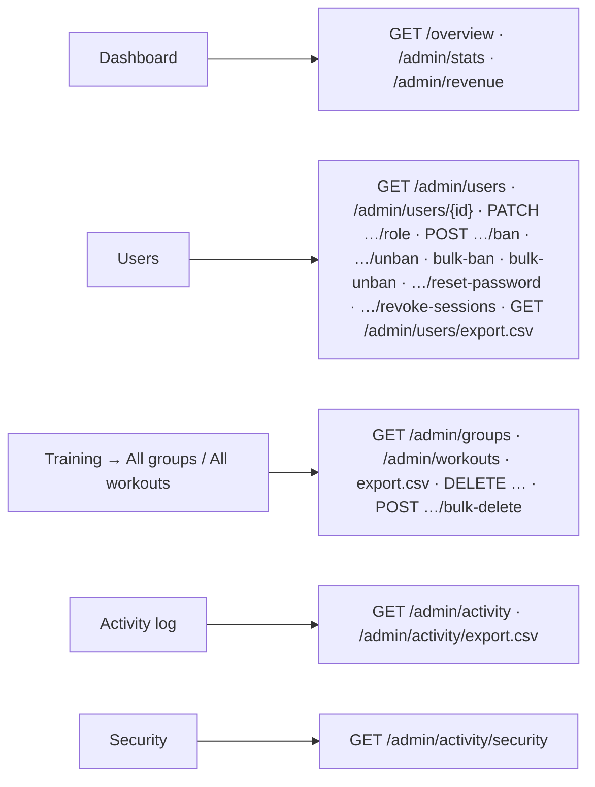

**Table 34: Admin pages**

| Page | Endpoints | Filters and pagination | Actions | Audit events written |
|---|---|---|---|---|
| Dashboard | `GET /overview`, `/admin/stats`, `/admin/revenue` | — | Refresh; links to the matching lists | — |
| Users | `GET /admin/users`, `/admin/users/{id}`, `/admin/users/export.csv` | Search (name, email), role, status; 20 per page with total | Change role, ban (reason), unban, bulk ban / unban, reset password, log out everywhere, export | `role_change`, `ban`, `unban`, `password_reset`, `session_revoke`, `export` |
| User detail | `GET /admin/users/{id}` | — | Same actions as above; links to the person's activity and content | as above |
| All groups / All workouts (moderation) | `GET /admin/groups`, `/admin/workouts`, `…/export.csv`, `DELETE …/{id}`, `POST …/bulk-delete` | Owner, group, status, date range, text; paginated | Delete one, delete ticked (up to 100), export | `group_delete`, `workout_delete`, `export` |
| Activity log | `GET /admin/activity`, `/admin/activity/export.csv` | Event, user, date range, text (email, IP, details); paginated | Export with the same filters | `export` |
| Security | `GET /admin/activity/security` | Window 1–168 hours, minimum count | Click an address to open its activity | — |

- **Bulk actions report what happened:** `POST /admin/users/bulk-ban` returns `{"banned": [...], "skipped": [{"id": 9, "reason": "Admins cannot be banned"}, ...]}`; the page shows "Banned 3, skipped 1 (admin)". Moderation bulk delete returns how many were deleted and skips unknown ids. Each runs in one transaction.
- **CSV respects the filters:** the list and the export share the same filter object and the same `_conditions()` function and order, so the file holds exactly the rows on screen (all pages), up to 10,000, with a byte order mark and formula-safe cells.

### C9. Security Design and Threats

**Table 35: Threats and defences**

| Threat | Defence | Where |
|---|---|---|
| Password database leak | Argon2id over HMAC-SHA256 with a 32-byte pepper kept only in Vercel; the leaked hashes cannot be tested without the pepper | `app/security.py` |
| Stolen access token | Lives 5 minutes; tied to a session that logout, ban or revoke ends at once; kept in memory, not `localStorage` | `security.py`, `deps.get_auth()`, `services/api.ts` |
| Stolen refresh token | HttpOnly cookie; stored as a hash; rotated on every use; reuse after 30 s ends the whole session | `services/session_service.py` |
| Brute-force login | 5 wrong passwords → 15-minute lock (`429`), same for unknown emails; counts in the database; shown on the Security page | `services/auth_service.py`, `activity_service.security_summary()` |
| Privilege escalation | Sign up always gives `user`; only `users:change_role` changes roles; admins cannot change their own; role read from the database each request | `rbac.py`, `user_service.change_role()` |
| Access to another user's record | Own data selected by the token's user id; staff routes need permissions; groups answer `404` to outsiders | `services/*`, `group_service.access()` |
| Cross-site scripting (XSS) | React escapes output; CSP `script-src 'self'`; no `dangerouslySetInnerHTML`; token not in storage | `vercel.json`, frontend |
| Cross-site request forgery (CSRF) | Refresh cookie `SameSite=Strict`, path-limited; all other endpoints need the Bearer header | `routers/auth.py` |
| CORS misuse | Allowlist of exact origins with credentials; `*` refused at start-up; other origins get no CORS headers | `app/cors.py`, `app/config.py` |
| Secrets in the repository | Only in Vercel env vars; `.env` ignored; `.env.example` placeholders too short to be accepted; test passwords never committed | `.gitignore`, `backend/.env.example` |
| SQL injection | SQLModel/SQLAlchemy parameterised queries only; search escapes `%` and `_` | `services/search.py` |
| Over-posting of fields | Separate Create/Update schemas list the allowed fields (no `role`, `is_banned`, `owner_id` in user input); response schemas never include hashes | `app/models.py` |
| Clickjacking, MIME sniffing | `X-Frame-Options: DENY`, `frame-ancestors 'none'`, `X-Content-Type-Options: nosniff`, HSTS | `vercel.json` |
| CSV formula injection | Cells starting with `=`, `+`, `-`, `@`, tab or CR get a leading `'` | `services/csv_export.py` |
| Log flooding with bad tokens | `auth_rejected` written at most once a minute per IP address | `activity_service.record_auth_rejected()` |

### C10. Deployment on Vercel

**Figure 8: Deployment layout**

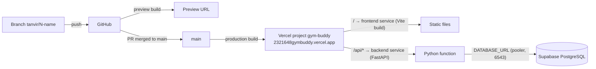

- **Projects:** one Vercel project (`gym-buddy`) with two services in `vercel.json`: `backend` (root `backend`, framework `fastapi`, entrypoint `main:app`) and `frontend` (root `frontend`, framework `vite`). Rewrites send `/api/(.*)` to the backend and everything else to the frontend (and any unknown path to `index.html`, so deep links work).
- **How the frontend finds the API:** it calls relative URLs (`/api/v1/...`) on its own origin; locally, Vite proxies `/api` to `http://localhost:8000`.
- **Database:** Supabase PostgreSQL through the transaction pooler. The app brings the schema up to date on start (creates missing tables, adds missing columns and indexes) and skips the work when the stored schema fingerprint matches.
- **Redeploy:** merge a pull request into `main` (or push to `main`); Vercel builds and promotes it. "Instant Rollback" on the project page restores the previous deployment.

**Table 36: Environment variables (names only)**

| Name | Purpose |
|---|---|
| `DATABASE_URL` | Supabase transaction pooler connection string |
| `JWT_SECRET` | Signs access tokens (≥ 32 bytes; required on Vercel) |
| `PASSWORD_PEPPER` | Mixed into every password before hashing (≥ 32 bytes; must never change) |
| `FRONTEND_ORIGIN` | Extra origins CORS may answer (the deployed frontend is always allowed) |
| `VERCEL` (set by Vercel) | Tells the app it runs on Vercel: no `.env`, client IP from `X-Forwarded-For` |

### C11. Testing

**Strategy.**

1. **Automated API tests** (`backend/tests/`, pytest): each test runs against a new SQLite database with test-only secrets; an `account("ana", role="admin")` helper signs up and logs in. Several tests sweep the OpenAPI schema so a new endpoint is covered automatically (every endpoint needs a login; every staff and admin endpoint is `403` for a user).
2. **End-to-end browser run** (Playwright, Chrome, local app on PostgreSQL): 24 flows as every role, including expiry and silent refresh, two parallel bookings for the last place, a ban, role change, reset and revoke while the person is logged in.
3. **Manual checks on the live site** with the seeded demo accounts; the screenshots in Part D were taken during these checks.

**How to run:** `cd backend`, `pip install -r requirements-dev.txt`, then `pytest` (about 40 seconds).

**Table 37: Tests and results (run on 28 November 2026: 136 passed, 0 failed; S21)**

| Test | Requirement | Result |
|---|---|---|
| `test_tokens.py::test_expired_token_gets_401` | FR-AUTH-05 (expiry) | Pass |
| `test_tokens.py::test_tampered_token_gets_401` | FR-AUTH-05 (tampering) | Pass |
| `test_tokens.py::test_token_with_a_changed_user_id_gets_401` | FR-AUTH-05 | Pass |
| `test_tokens.py::test_token_is_valid_for_5_minutes` | FR-AUTH-04 | Pass |
| `test_tokens.py::test_token_stops_working_after_logout` | FR-AUTH-08 | Pass |
| `test_tokens.py::test_token_stops_working_when_the_user_is_banned` | FR-RBAC-11 | Pass |
| `test_refresh.py::test_refresh_rotates_the_cookie_and_gives_a_working_token` | FR-AUTH-06 | Pass |
| `test_refresh.py::test_reusing_a_replaced_cookie_ends_the_whole_session` | FR-AUTH-07 | Pass |
| `test_refresh.py::test_banned_user_cannot_refresh` | FR-RBAC-11 | Pass |
| `test_devices.py::test_logging_a_device_out_ends_its_refresh_and_access_tokens` | FR-AUTH-10 | Pass |
| `test_login.py::test_wrong_password_and_unknown_email_get_the_same_401` | FR-AUTH-03 | Pass |
| `test_login.py::test_fifth_wrong_password_locks_the_account` | FR-AUTH-11 (lockout) | Pass |
| `test_login.py::test_an_email_with_no_account_is_locked_like_an_account` | FR-AUTH-11 | Pass |
| `test_rules.py::test_guessing_the_current_password_locks_the_account` | FR-AUTH-13 | Pass |
| `test_rbac.py::test_a_user_cannot_reach_another_users_records` | FR-RBAC-05 (ownership) | Pass |
| `test_rbac.py::test_non_admins_get_403_on_every_admin_route` (user, trainer, gym manager) | FR-RBAC-03 | Pass |
| `test_rules.py::test_every_endpoint_but_the_public_ones_needs_a_login` | FR-RBAC-03 | Pass |
| `test_rules.py::test_a_plain_user_gets_403_on_every_staff_and_admin_endpoint` | FR-RBAC-03 | Pass |
| `test_rbac.py::test_role_change_applies_on_the_next_request` | FR-RBAC-04 | Pass |
| `test_rbac.py::test_group_member_without_can_update_gets_403_and_with_it_200` | FR-RBAC-06 (group matrix) | Pass |
| `test_rules.py::test_a_member_with_every_permission_cannot_delete_a_workout` | FR-RBAC-07 | Pass |
| `test_rbac.py::test_only_the_owner_renames_or_deletes_a_group` | FR-RBAC-07 | Pass |
| `test_rbac.py::test_a_group_and_its_workouts_are_404_for_an_outsider` | FR-RBAC-08 | Pass |
| `test_rbac.py::test_admin_cannot_ban_another_admin_or_themself` | FR-RBAC-10 (admin rules) | Pass |
| `test_rbac.py::test_admin_cannot_change_their_own_role` | FR-RBAC-10 | Pass |
| `test_rbac.py::test_bulk_ban_skips_admins_and_bans_the_rest` | FR-ADM-07 | Pass |
| `test_security_view.py::test_an_address_shows_what_happened_the_emails_tried_and_the_browser` | FR-ADM-11 | Pass |
| `test_robustness.py::test_every_csv_export_is_limited_to_the_newest_rows` | FR-ADM-12 | Pass |
| `test_robustness.py::test_staff_deletes_and_voids_are_logged` | FR-ADM-13 | Pass |
| `test_cors.py::test_other_origins_get_no_cors_headers` (4 origins) | NFR-15 | Pass |
| All other tests (`test_gym.py`, `test_startup.py`, `test_config.py`, …) | FR-DOM, NFR | Pass (136 / 136 in total) |

## Part D. Evidence: Screenshots of the Running Application

All screenshots of the app were taken on the deployed URL `https://2321648gymbuddy.vercel.app` on 28 November 2026, in a real Chrome window with the address bar visible and the logged-in user shown at the bottom of the sidebar. Access tokens and cookie values are masked with a grey box. IP addresses, and the rows of real people who signed up on the live site (not demo accounts), are blurred.

### D1. User Side


**S1 (FR-AUTH-01):** Sign up refuses a 3-character password: "Use at least 8 characters." No account is created.

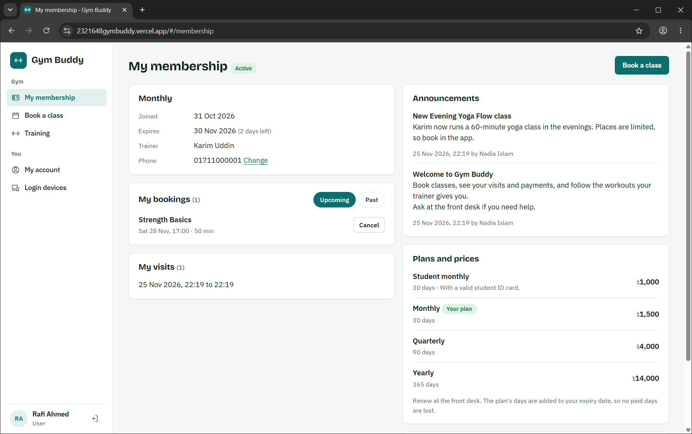
**S2 (FR-RBAC-05, FR-DOM-01):** A member (Rafi, role User) sees only his own membership, booking, visit and the plan prices. The page calls only `/users/me/*` endpoints, which take the id from the token.


**S3 (FR-AUTH-12, FR-AUTH-13):** My account: profile and contact details, and the change password form rejecting a wrong current password ("Current password is wrong", `400`).

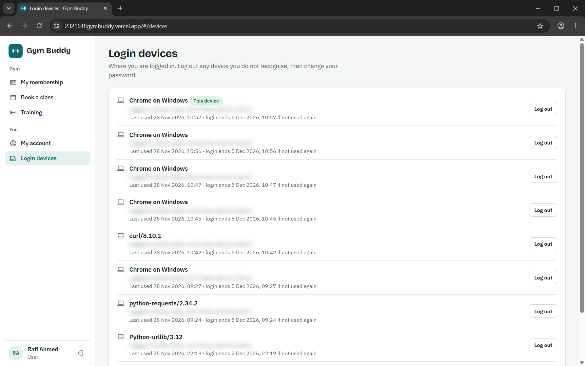
**S4 (FR-AUTH-09, FR-AUTH-10):** Login devices: each active session with browser, last use and expiry, the current one marked, and a Log out button for each.


**S5 (FR-RBAC-06, FR-RBAC-07):** The owner's view of the training group "Strength Program": Rafi may Add, Edit and Assign; Sadia may only Add; Tanim may only view. Only the owner has Delete, Rename and Remove.

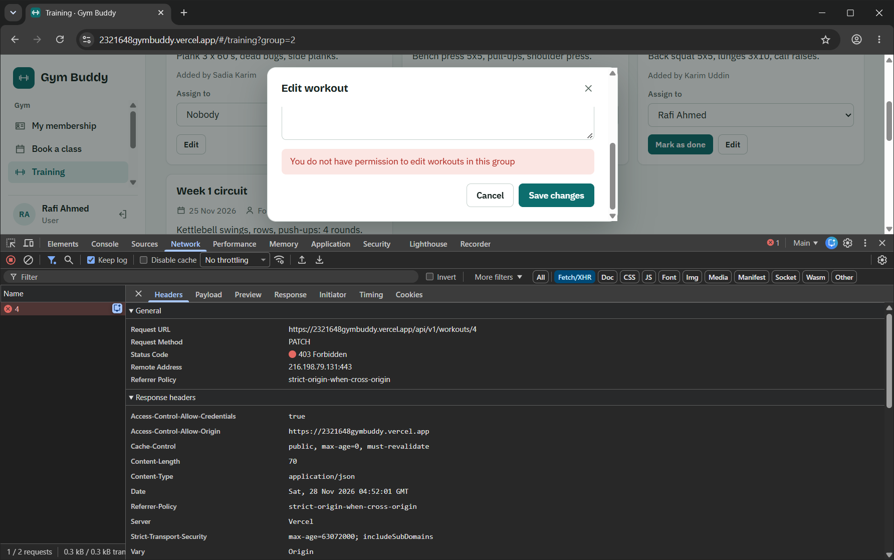
**S6 (FR-RBAC-06):** After the owner removed Rafi's Edit permission, Rafi's edit is refused: the dialog shows "You do not have permission to edit workouts in this group" and the network tab shows `PATCH /api/v1/workouts/4` → `403 Forbidden`.

### D2. Security Behaviour


**S7a (FR-AUTH-04, FR-AUTH-05):** More than 5 minutes after login, the next request (`me`) gets `401`; the app calls `refresh` (`200`) and repeats `me` (`200`); the page loads without the user noticing.


**S7b (FR-AUTH-04):** The rejected request's headers: `Authorization: Bearer eyJhbGci…` (token masked) on `GET /api/v1/users/me`.

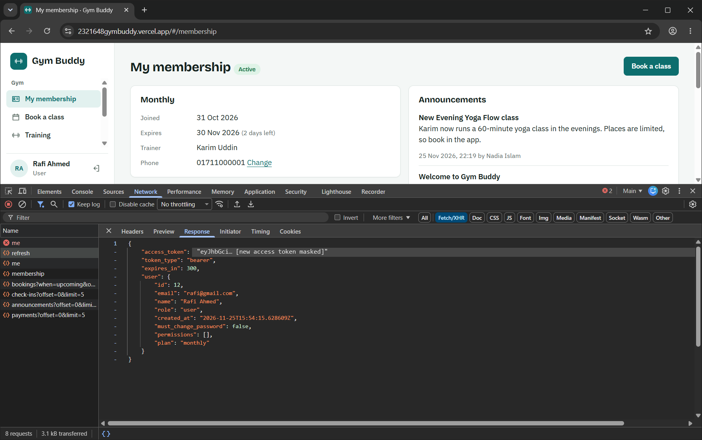
**S8a (FR-AUTH-06):** The refresh response: a new `access_token` (masked), `expires_in: 300`, and the user with an empty permission list (role User).

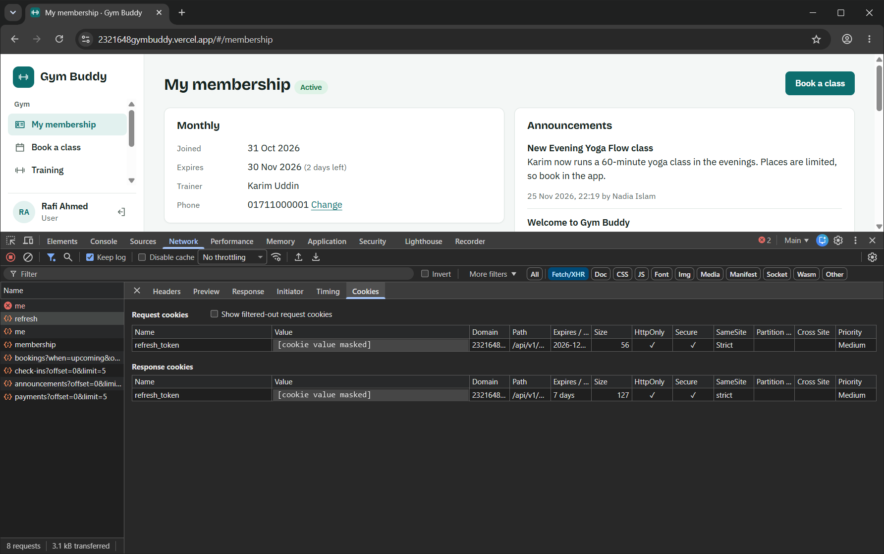
**S8b (FR-AUTH-06, NFR-14):** The refresh request's cookies: the old `refresh_token` was sent and a different new one was set (rotation), with **HttpOnly ✓, Secure ✓, SameSite Strict**, path `/api/v1/…`, valid 7 days (values masked).


**S9 (FR-RBAC-11):** Mitu was banned by an admin while logged in. Her very next request (`classes`) got `403`; the app logged her out and shows "This account has been banned."

### D3. Admin Dashboard


**S10 (FR-ADM-01, FR-DOM-11):** Dashboard: today's front desk numbers, next classes, announcements, and revenue, expenses and net income for the month.

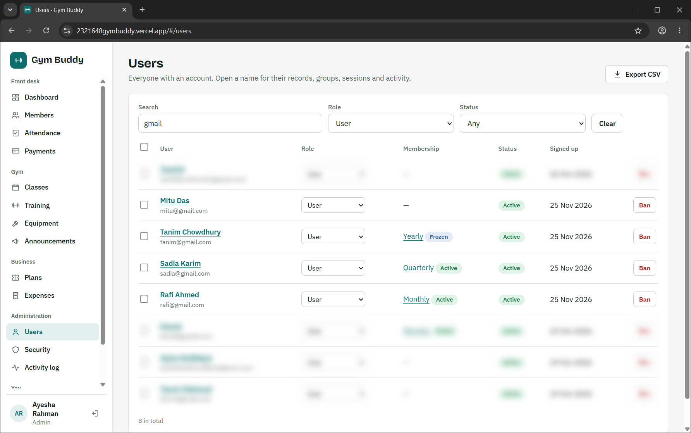
**S11 (FR-ADM-02):** Users list searched for "gmail" with Role = User: 8 in total, with membership, status and Ban buttons (rows of non-demo accounts blurred).


**S12 (FR-ADM-03, FR-ADM-06, FR-ADM-08):** User detail for Rafi: account, membership, 7 active sessions (IP addresses blurred), training groups, and Reset password, Log out everywhere and Ban.


**S13a (FR-ADM-04):** The ban dialog with a reason that goes to the activity log.


**S13b (FR-ADM-04):** After the ban: "Mitu Das is banned and logged out of every browser", status Banned with the reason, and an Unban button.


**S14 (FR-ADM-09):** Training → All workouts (moderation) filtered by Status = To do, two workouts ticked, with the bulk "Delete selected" bar (not confirmed, so the demo data stays).

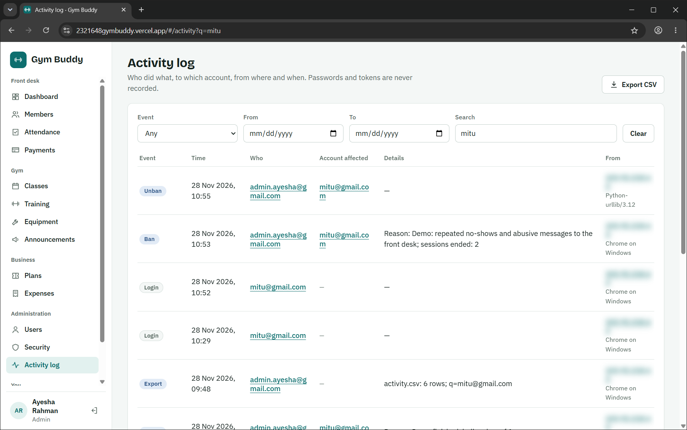
**S15 (FR-ADM-10, FR-ADM-13):** Activity log searched for "mitu": the Unban and the Ban (with reason and "sessions ended: 2") from S13, and Mitu's logins, each with who, the account affected, time and browser (IP blurred).

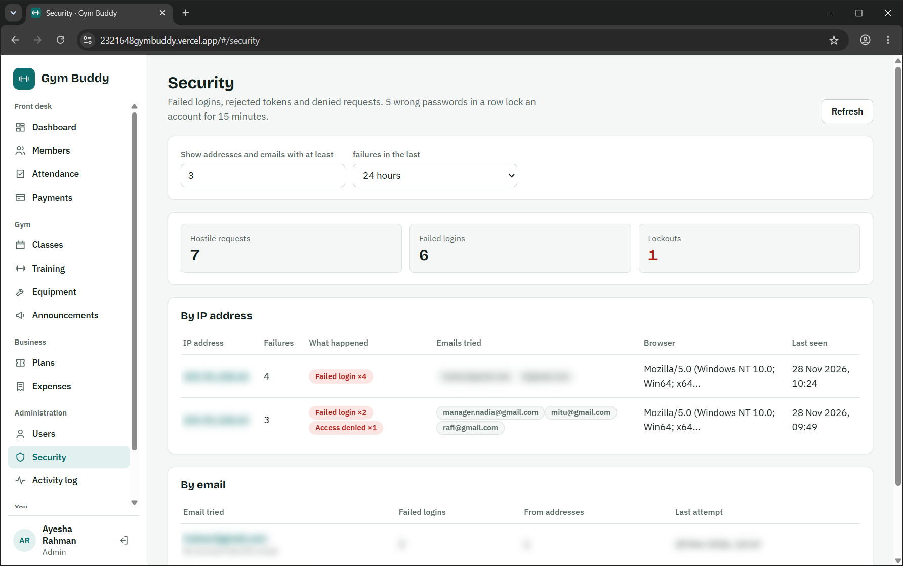
**S16 (FR-ADM-11, FR-AUTH-11):** Security view for the last 24 hours: hostile requests, failed logins and lockouts, grouped by IP address (with the emails tried) and by email (IP addresses and non-demo emails blurred).


**S17 (FR-ADM-12):** The activity log CSV (`activity-2026-11-28.csv`, same filter as S15) downloaded and opened: header row, newest first, the ban and unban rows (IP addresses blurred).

### D4. Deployment


**S18 (NFR-10):** The Vercel project: production deployment from branch `main` (commit `cfa374b`, "Merge pull request #95"), status Ready, domain `2321648gymbuddy.vercel.app`. Captured from the Vercel dashboard page.

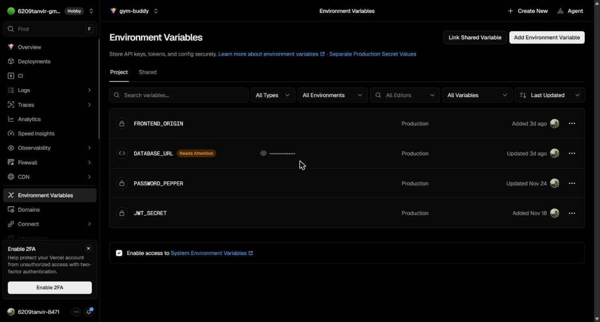
**S19 (NFR-05):** Environment variables of the project: `FRONTEND_ORIGIN`, `DATABASE_URL`, `PASSWORD_PEPPER`, `JWT_SECRET`, values hidden (sensitive variables cannot be revealed).

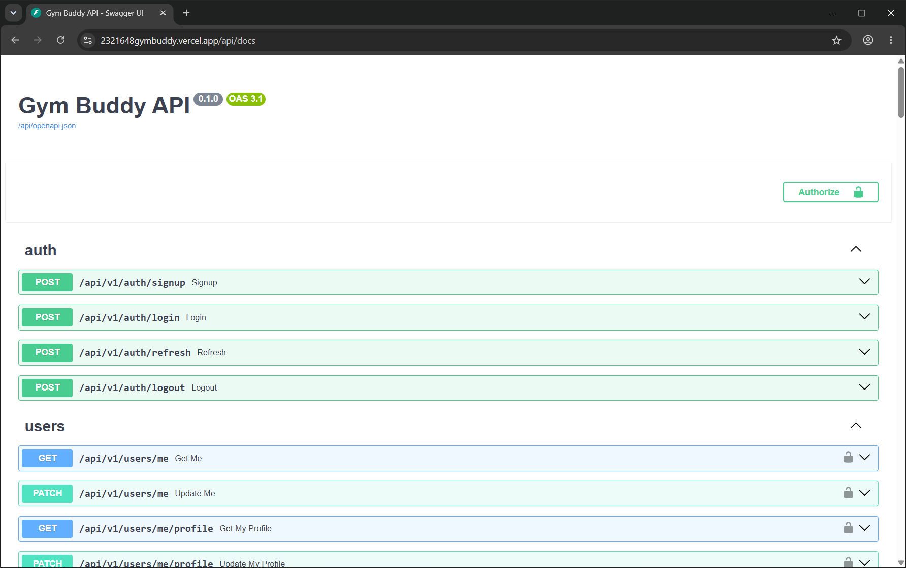
**S20 (NFR-09):** The live API documentation at `/api/docs`.

### D5. Tests

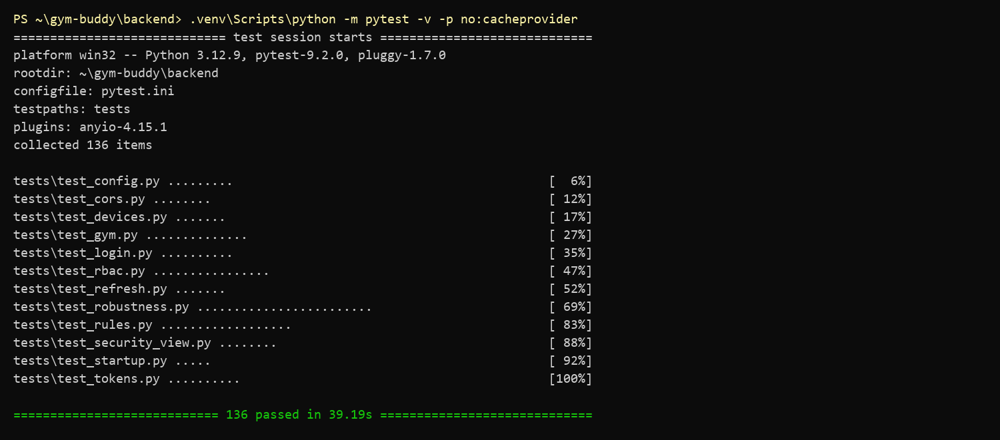
**S21 (NFR-24):** `pytest` in `backend/`: 136 tests collected, 136 passed in 39 s.

## Part E. Project Management and Conclusion

### E1. How to Run and Test

**Prerequisites:** Python 3.10+ (3.12 used), Node.js 22+, Git.

1. Clone: `git clone https://github.com/TanvirMahmudTushar/gym-buddy.git` and `cd gym-buddy`.
2. **Environment file (optional locally):** copy `backend/.env.example` to `backend/.env`. Without it the backend uses a local SQLite file and temporary secrets.

   ```env
   DATABASE_URL=                      # empty = SQLite (backend/gym_buddy.db); or a PostgreSQL URL
   JWT_SECRET=<48 random characters>  # python -c "import secrets; print(secrets.token_urlsafe(48))"
   PASSWORD_PEPPER=<48 random characters>
   FRONTEND_ORIGIN=http://localhost:5173
   ```
3. **Backend** (terminal 1):

   ```bash
   cd backend
   python -m venv .venv
   .venv\Scripts\Activate.ps1          # macOS/Linux: source .venv/bin/activate
   pip install -r requirements-dev.txt
   fastapi dev main.py                 # http://localhost:8000, docs at /api/docs
   ```
4. **Frontend** (terminal 2):

   ```bash
   cd frontend
   npm install
   npm run dev                         # http://localhost:5173 (proxies /api to the backend)
   ```
5. **Tests:** in `backend/` with the virtual environment active, run `pytest` (136 tests, about 40 s).
6. **Demo data (optional):** `python scripts/seed_demo.py --base-url http://localhost:8000` creates the demo accounts and sample data through the API. The first run prints one SQL line that makes the first admin; run it and start the script again.
7. **Logging in with the test accounts:** the live site has two **admin** accounts and three **user** accounts (plus a gym manager, a trainer and a fourth user) and a training group with mixed permissions. Their user IDs and passwords are in the Appendix of the PDF report and in the submission form, never in this file.

### E2. GitHub Work

Every feature went through an issue, a branch named `tanvir/<issue>-<name>` and a pull request into `main` that says `Closes #N`, with one exception (the gym management rework, issue #76, was committed to `main` directly). All 107 commits in the repository are mine: 95 under my name and 12 that Git recorded with my GitHub profile URL as the author name. I worked alone; there was no team this semester.

**Table 38: Issues, pull requests and what they delivered**

| Area | Issue → pull request | What it delivered |
|---|---|---|
| Documents | #1 → [#2](https://github.com/TanvirMahmudTushar/gym-buddy/pull/2) | PRD, SRS and TDD |
| MVP (mid-term) | #3–#7 → [#8](https://github.com/TanvirMahmudTushar/gym-buddy/pull/8)–[#12](https://github.com/TanvirMahmudTushar/gym-buddy/pull/12), #13–#19 → #14–#20 | Member model, CRUD API, one-page front end, totals and offset, frontend folders, bulk delete |
| Service layer (mid-term feedback) | #21 → [#22](https://github.com/TanvirMahmudTushar/gym-buddy/pull/22) | Business rules moved from routes into services |
| Login and roles | #23 → [#24](https://github.com/TanvirMahmudTushar/gym-buddy/pull/24) | Sign up, log in, roles |
| Admin dashboard and bans | #25 → [#26](https://github.com/TanvirMahmudTushar/gym-buddy/pull/26) | Statistics, ban and unban |
| Gym operations | #27–#36 → #28–#42 | Check-ins, classes, member booking, payments, plan prices, members as users, payments list and void, revenue |
| Lockout and headers | #43 → [#44](https://github.com/TanvirMahmudTushar/gym-buddy/pull/44) | Login lockout, security headers |
| Front desk features | #45–#51 → #52–#58 | Connected pages, bookings, overview, admin password reset, trainers, announcements, profile details |
| **JWT refresh and sessions** | #59 → [#67](https://github.com/TanvirMahmudTushar/gym-buddy/pull/67) | 5-minute access token, rotating refresh cookie, server-side sessions |
| **RBAC module** | #60 → [#68](https://github.com/TanvirMahmudTushar/gym-buddy/pull/68) | Permission constants, `require_permission()`, permissions sent to the app |
| **Activity log and security view** | #61 → [#69](https://github.com/TanvirMahmudTushar/gym-buddy/pull/69) | Audit log, Security page |
| **Groups with permissions** | #62 → [#70](https://github.com/TanvirMahmudTushar/gym-buddy/pull/70) | Training groups, Add / Edit / Assign, owner-only actions |
| **Admin user tools** | #63 → [#71](https://github.com/TanvirMahmudTushar/gym-buddy/pull/71) | Filters, user detail, bulk ban, revoke sessions |
| **Content moderation** | #64 → [#72](https://github.com/TanvirMahmudTushar/gym-buddy/pull/72) | All groups / All workouts, bulk delete, CSV |
| CORS and tests | #65 → [#73](https://github.com/TanvirMahmudTushar/gym-buddy/pull/73) | `.env.example`, CORS allowlist, pytest suite |
| Performance and robustness | #75 → [#77](https://github.com/TanvirMahmudTushar/gym-buddy/pull/77), #78 → [#79](https://github.com/TanvirMahmudTushar/gym-buddy/pull/79) | Fewer queries, fuzzing fixes, gym's day, shared UI parts |
| Final rules | #80 → [#81](https://github.com/TanvirMahmudTushar/gym-buddy/pull/81), #82 → [#83](https://github.com/TanvirMahmudTushar/gym-buddy/pull/83) | Every spec rule in one module, owner-only deletes; `vercel.json` fix |
| Devices and review fixes | #86 → [#87](https://github.com/TanvirMahmudTushar/gym-buddy/pull/87), #89 → [#90](https://github.com/TanvirMahmudTushar/gym-buddy/pull/90), #92 → [#93](https://github.com/TanvirMahmudTushar/gym-buddy/pull/93) | Login devices page, staff renewal guard, unknown-email lockout, CSV caps, CSP, role walkthrough fixes |
| Documents | #66, #84, #94 → #74, #85, #95 | Final report, README test accounts, documents matched to the code |

**Timeline:** documents on 31 October; MVP 31 October to 4 November (mid assessment); final release 18 to 25 November (accounts and roles 18 Nov, payments 18–20 Nov, operations 20–21 Nov, security and admin 21–22 Nov, gym management and hardening 24–25 Nov); report and evidence 28 November.

### E3. Limitations

- **No CI pipeline.** The 136 tests run on my machine before each merge; nothing stops a pull request that was not tested.
- **No migration tool.** The app only adds tables, columns and indexes on start. A rename or removal of a column would need Alembic first.
- **The parallel-booking guarantee is not an automated test.** It was checked in the end-to-end run on PostgreSQL (row lock), but SQLite in the test suite cannot reproduce the race.
- **Weak demo password.** All demo accounts share one simple password so the examiner can log in; Chrome even flags it as found in a data breach. The app only requires 8 characters and does not check passwords against breach lists.
- **No CSRF token.** The refresh and logout endpoints rely on `SameSite=Strict` and the path-limited cookie. Very old browsers that ignore `SameSite` would be exposed.
- **Rate limiting covers login only.** Sign up and other endpoints have no per-IP request limit; Vercel's platform limits are the only protection against floods.
- **Activity log grows forever.** Old rows are never deleted or archived.
- **No email.** No verification, reminders or self-service password reset; a forgotten password needs an admin.
- **Every request reads the session from the database.** This makes revoke instant but adds one query per request (combined with the user lookup into one query).
- **Free hosting limits.** Supabase pauses after a week without use, and the first request after a deploy or a pause is slow (cold start).

### E4. Future Work

1. **GitHub Actions CI** running `pytest` and `npm run build` on every pull request: stops untested changes from reaching `main`.
2. **Alembic migrations**: needed before the first non-additive schema change.
3. **Breach and strength check for passwords** (for example the k-anonymity Pwned Passwords API): the 8-character rule alone is weak.
4. **Per-IP rate limiting on sign up and refresh**: closes the remaining flooding paths.
5. **Email (verification, renewal reminders, self-service reset)**: removes the admin from password recovery and reduces expired memberships.
6. **Activity log retention** (archive rows older than a year): keeps the table fast.
7. **Online payments** through a local gateway: members could renew from the app.
8. **Waiting lists and recurring classes**: fewer manual steps for the timetable.

### E5. Sources, Libraries and Tools

**Table 39: Sources, libraries and tools**

| Name | Version or link | Used for |
|---|---|---|
| FastAPI | 0.162.0, https://fastapi.tiangolo.com | API framework, dependencies for auth and RBAC, OpenAPI docs |
| SQLModel / SQLAlchemy | 0.0.48 / 2.1.6 | ORM and table models |
| Pydantic | 2.14.2 | Validation of requests and responses |
| psycopg | 3.3.6 | PostgreSQL driver |
| PyJWT | 2.15.1 | Signing and verifying access tokens |
| argon2-cffi | 25.1.0 | Password hashing |
| python-dotenv | 1.2.4 | Reading `backend/.env` on a developer machine |
| pytest / httpx | 9.2.0 / 0.28.1 | Automated API tests |
| React / React DOM | 19.3.0 | Frontend |
| TypeScript | 7.0.2 | Typed frontend code |
| Vite / @vitejs/plugin-react | 8.3.2 / 6.1.1 | Dev server and build |
| Playwright (Python) | https://playwright.dev | End-to-end browser checks and the screenshots in Part D |
| Vercel | https://vercel.com/docs | Hosting, `vercel.json` services and rewrites, environment variables |
| Supabase | https://supabase.com/docs | Managed PostgreSQL and the transaction pooler |
| RFC 7519 (JWT), RFC 6265 (cookies) | https://www.rfc-editor.org/rfc/rfc7519 | Token and cookie design |
| OWASP ASVS 4.0 and Cheat Sheets (Password Storage, JWT, CSRF, Logging) | https://owasp.org/www-project-application-security-verification-standard/ | Security requirements and the threat table |
| MDN Web Docs (cookies, CSP, CORS) | https://developer.mozilla.org | Browser security headers and cookie flags |
| YouTube: "JSON Web Token – Bangla Tutorial", Learn with Sumit (LWS) | https://youtu.be/MB9SgSYw0Gw | Learning how JWTs are built, signed and verified |
| YouTube: "FastAPI JWT Tutorial – How to add User Authentication", Eric Roby | https://youtu.be/0A_GCXBCNUQ | Learning the FastAPI pattern for login and protected routes with dependencies |
| Course material, CSE309 (Sayef Reyadh) and the sample report | Google Classroom | Requirements of the final project and the report format |
| Visual Studio Code, Git, GitHub, GitHub CLI | — | Editing, version control, issues and pull requests |
| Chrome DevTools | — | Network and cookie inspection (S6–S9) |

**Use of AI tools.** I used GitHub Copilot for inline completions and Claude for explanations, code review, and test ideas. I decided the design, built the system Architecture, wrote code, fixed code and reviewed code generate

## Appendix: Test accounts

The test account user IDs and passwords are given only in the PDF version of this report and in the submission form, as the course instructions require; GitHub flags passwords committed to a repository. The live site has two admins, three users (plus a fourth user who is not in any group), a gym manager and a trainer, and the training group "Strength Program" in which one member may add, edit and assign, one may only add and one may only view.
