Independent University, Bangladesh  
CSE309 Web Application & Internet

# Final Project Submission Report

**Submitted by:**  
Name: Tanvir Mahmud  
Student ID: 2321648  
Section: 5  
Serial: 21

Project Title: Gym Buddy: A Gym Management System  
Vercel URL: https://2321648gymbuddy.vercel.app/  
GitHub Repository: https://github.com/TanvirMahmudTushar/gym-buddy

**Submitted To:**  
Sayef Reyadh  
Adjunct Lecturer  
Department of Computer Science & Engineering  
Independent University, Bangladesh

Semester: Autumn 2026  
Date of Submission: 28 November 2026

## Table of Contents

* [1. Executive Summary](#1-executive-summary)
* [Part A. Product Requirements (PRD)](#part-a-product-requirements-prd)
* [Part B. Software Requirements (SRS)](#part-b-software-requirements-srs)
* [Part C. Technical Design (TDD)](#part-c-technical-design-tdd)
* [Part D. Evidence: Screenshots of the Running Application](#part-d-evidence-screenshots-of-the-running-application)
* [Part E. Project Management and Conclusion](#part-e-project-management-and-conclusion)
* [Appendix. Test Accounts and Video Demo](#appendix-test-accounts-and-video-demo)

### List of Figures and Screenshots

| No. | Caption | Section |
|---|---|---|
| Figure 1 | Use case diagram | B5 |
| Figure 2 | System architecture | C2 |
| Figure 3 | Entity relationship diagram | C4 |
| Figure 4 | JWT sequence diagram | C6 |
| Figure 5 | Authorisation flow for one request | C7 |
| Figure 6 | Admin pages and the endpoints they call | C8 |
| Figure 7 | Deployment layout | C10 |
| S1 | Sign up page rejects a weak password | D1 |
| S2 | A member sees only their own records | D1 |
| S3 | Wrong current password is rejected | D1 |
| S4 | Sessions list with Log out buttons | D1 |
| S5 | Group members and their permissions | D1 |
| S6 | Action denied by RBAC with a 403 | D1 |
| S7a, S7b | Expired token gets 401 and the masked Authorization header | D2 |
| S8a, S8b | Refresh returns a new token and the HttpOnly cookie | D2 |
| S9 | Banned user is rejected on the next request | D2 |
| S10 | Admin overview statistics | D3 |
| S11 | Users list with search, filters and pagination | D3 |
| S12, S12b | User detail with sessions and recent activity | D3 |
| S13a, S13b | Ban dialog with a reason and the banned state | D3 |
| S14 | Moderation list with a filter and a bulk action | D3 |
| S15 | Activity log with the events from the steps above | D3 |
| S16 | Security view with failed logins by IP and by account | D3 |
| S17 | CSV export downloaded and opened | D3 |
| S18 | Vercel production deployment and domain | D4 |
| S19 | Vercel environment variable names | D4 |
| S20 | Live API documentation | D4 |
| S21 | Test run with all tests passing | D5 |

## 1. Executive Summary

### 1.1 Project overview

**Gym Buddy** is a web app for running a small gym. Many small gyms in Bangladesh still keep members in a paper register. Gym Buddy replaces it. Members sign up, check their membership, book classes and follow workouts from their trainer. The front desk starts memberships, checks members in and takes payments. Trainers run their classes and their training groups. Admins manage users, roles, bans, plans and money, and they read the activity log.

**Stack:** React with TypeScript (Vite), FastAPI with SQLModel, PostgreSQL on Supabase, deployed on Vercel.

### 1.2 What was built since the mid assessment

At the mid assessment the app was only a member CRUD API with one page. Since then I added:

* **JWT authentication with refresh and logout:** a 5 minute access token in memory, a 7 day refresh cookie that changes on every use, logout, a Login devices page and a lockout after 5 wrong passwords.
* **Role based access control:** four roles (User, Trainer, Gym Manager, Admin) and 26 permissions in one module, ownership rules, and Add, Edit and Assign permissions inside training groups.
* **Admin dashboard:** statistics, a Users page with search, filters, details, ban, unban, bulk ban, role change and session revoke, content moderation, the Activity log, the Security view and CSV exports.
* **Audit logging, brute force protection and deployment:** every security event goes into an activity log, wrong passwords lead to a lockout, and the app runs on Vercel with a hosted database.

### 1.3 Live links

**Table 1: Links**

| What | Link |
|---|---|
| GitHub repository | https://github.com/TanvirMahmudTushar/gym-buddy |
| Vercel frontend | https://2321648gymbuddy.vercel.app/ |
| API | https://2321648gymbuddy.vercel.app/api/v1 |
| API docs | https://2321648gymbuddy.vercel.app/api/docs |
| Video demo | https://youtu.be/VMhoKTs-Au0 |

The test account user IDs and passwords are only in the Appendix of the PDF report.

## Part A. Product Requirements (PRD)

### A1. Problem Statement

Small gyms keep their members in a paper register or a spreadsheet. The front desk cannot quickly see whose membership has expired, who is inside right now or whether a class is full. Members must phone or visit the desk to ask about their membership or to book a place. Trainers keep their plans in notebooks or chat groups that the gym cannot see.

This costs the gym money because expired members keep training and some payments are never written down. Classes get too full. A shared spreadsheet also has no privacy. Anyone who opens it can read every phone number, and nobody knows who changed what.

### A2. Users and Roles

**Table 2: Users and roles**

| Role | Who they are | Main tasks | Must never be able to |
|---|---|---|---|
| Visitor | Anyone who is not logged in | Sign up and log in | Read or change any data |
| User | A gym member | See their own membership, visits, payments and bookings. Book classes. Change their profile and password. End their own sessions | See another member's data or use staff and admin pages |
| Group member | A user who was added to a training group | See the group's workouts. Add, edit or assign workouts if the owner allows it | Delete workouts, rename the group or manage members |
| Group owner | The trainer or staff member who made the group | Everything a member can do, plus delete workouts, rename or delete the group and set each member's permissions | Touch groups they do not own or belong to |
| Trainer | A coach at the gym | See their classes and clients, mark attendance, start training groups | Use member, payment or admin pages |
| Gym Manager | The front desk | Memberships, check ins, payments, classes, equipment and announcements | Delete accounts, void payments, export CSV files or use admin pages |
| Admin | The gym owner | Everything a Gym Manager can do, plus users, roles, bans, plans, expenses, moderation, activity log and security view | Change their own role, ban another admin or edit other people's workouts |

### A3. Goals and Success Measures

**Table 3: Goals and measures**

| ID | Goal | Measure |
|---|---|---|
| G1 | Staff manage memberships, check ins and payments in one place | A membership can be started and paid in one step. A frozen or expired member cannot check in |
| G2 | **Security:** no user can read another user's data | Every "my" page uses the user id from the token. A normal user gets 403 on every staff and admin endpoint |
| G3 | **Security:** sessions are short and can be ended | The access token lasts 5 minutes. After logout, ban or revoke, the next request fails |
| G4 | **Security:** password guessing does not work | The 5th wrong password in a row returns 429 and blocks login for 15 minutes |
| G5 | A class is never over booked | A full class returns 409, even when two people book the last place at the same time |
| G6 | Admins can see who did what | Every ban, role change, delete and export adds one row to the activity log |

### A4. Scope and Non-Goals

**In scope:**

* Authentication: sign up, log in, refresh, log out, session list, lockout, profile and password change.
* RBAC: roles, permissions, ownership rules and training groups with member permissions.
* Admin dashboard: statistics, users, moderation, activity log, security view and CSV exports.
* Audit log and deployment on Vercel.
* Gym features: plans, memberships, payments, check ins, classes and bookings, trainers, workouts, equipment, expenses and announcements.

**Out of scope:**

| Not built | Why |
|---|---|
| Online payments | It needs a payment gateway account. Staff record cash, card and mobile payments by hand |
| Email and SMS | It needs a paid provider. An admin can reset a forgotten password instead |
| QR code check in | It needs extra hardware |
| Waiting lists and repeating classes | A small gym does not need them yet |
| A CI pipeline and a migration tool | There was not enough time. I run the tests on my computer before every merge |

**Assumptions and constraints:**

* The app works in current Chrome, Edge, Firefox and Safari, on phones and computers.
* Vercel functions keep no memory between requests, so sessions and lockout counters live in the database.
* Supabase is on the free plan. It pauses after a week without use.
* Dates follow the gym's time zone in Dhaka. Times are stored in UTC.
* I built the final version alone in about four weeks.

### A5. User Stories

**Table 4: User stories**

| ID | User story |
|---|---|
| US-01 | As a visitor I want to sign up with my email and a password so that I get my own account. |
| US-02 | As a user I want to stay logged in while I use the app and log out when I leave so that only I use my account. |
| US-03 | As a user I want to see where I am logged in and log out a device so that a lost phone cannot use my account. |
| US-04 | As a user I want wrong password guesses to be blocked so that my account is hard to break into. |
| US-05 | As a member I want to see my plan, expiry date, visits and payments so that I know when to renew. |
| US-06 | As a member I want to book and cancel a class so that I do not need to call the front desk. |
| US-07 | As a trainer I want to start a group and choose who may add, edit or assign workouts so that members can help without breaking the plan. |
| US-08 | As a group member with Add permission I want to add a workout so that the group sees today's plan. |
| US-09 | As a group owner I want an edit from a member without Edit permission to be refused so that the plan stays as I set it. |
| US-10 | As a member I want groups I am not in to stay hidden so that private groups stay private. |
| US-11 | As a gym manager I want to start a membership with its first payment and check members in so that the desk runs from one screen. |
| US-12 | As an admin I want a dashboard with members, revenue and net income so that I can see how the gym is doing. |
| US-13 | As an admin I want to find a user and ban them with a reason so that they are logged out at once. |
| US-14 | As an admin I want to see who did what and from where so that I can react to an attack or a mistake. |
| US-15 | As an admin I want to delete unsuitable groups or workouts, one or many at a time, so that the content stays clean. |
| US-16 | As an admin I want to export users, payments and the activity log as CSV so that I can keep records outside the app. |

## Part B. Software Requirements (SRS)

### B1. Introduction

**Purpose.** This part says exactly what Gym Buddy shall do. Every requirement has an ID. The same IDs appear in the tests (C11), the traceability matrix (B7) and the screenshots (Part D).

**Readers.** The course instructor, a developer who will maintain the code and a tester.

**Definitions**

| Term | Meaning |
|---|---|
| JWT | JSON Web Token. A signed piece of JSON. Gym Buddy signs it with HS256 and a secret |
| Access token | A JWT sent with every API request in the `Authorization` header. It lasts 5 minutes and is kept only in memory |
| Refresh token | A random value in an HttpOnly cookie. It is used only to get a new access token. It lasts 7 days and changes on every use |
| RBAC | Role based access control. What a person may do depends on the permissions of their role |
| Role | User, Trainer, Gym Manager or Admin. Every account has exactly one |
| Permission | A named right such as `users:ban`. Each endpoint asks for a permission, not for a role |
| Audit log | The `activity_log` table. It keeps one row for each security event or admin action |

**References.** RFC 7519 (JWT), RFC 6265 (cookies), OWASP ASVS 4.0, OWASP Cheat Sheets for passwords, JWT and CSRF, the FastAPI documentation and the Vercel documentation.

### B2. Functional Requirements

**Table 5: Authentication (FR-AUTH)**

| ID | Requirement |
|---|---|
| FR-AUTH-01 | The system shall let a visitor sign up with a name, a unique email and a password of 8 to 128 characters, and shall always give the new account the User role. |
| FR-AUTH-02 | The system shall hash every password with Argon2 after mixing it with a secret pepper, and shall never store or return a plain password. |
| FR-AUTH-03 | The system shall log a user in and return an access token and a refresh cookie, and shall give the same 401 message for a wrong password and an unknown email. |
| FR-AUTH-04 | The system shall sign access tokens with HS256, put the user id, role, session id, issue time and expiry in them, and make them expire after 5 minutes. |
| FR-AUTH-05 | The system shall check the signature, the expiry, the user, the ban and the session on every protected request, and shall return 401 when any check fails (403 for a ban). |
| FR-AUTH-06 | The system shall give a new access token for a valid refresh cookie and replace the refresh token every time. |
| FR-AUTH-07 | The system shall end the whole session when an old refresh token is used again more than 30 seconds after it was replaced. |
| FR-AUTH-08 | The system shall end the session on logout so that its access token stops working on the next request. |
| FR-AUTH-09 | The system shall show users their own active sessions with the browser, IP address, last use and expiry. |
| FR-AUTH-10 | The system shall let users end any of their own sessions. |
| FR-AUTH-11 | The system shall block login for 15 minutes with 429 after 5 wrong passwords in a row, also for emails that have no account. |
| FR-AUTH-12 | The system shall let users change their name, phone, date of birth and emergency contact, but not their email or role. |
| FR-AUTH-13 | The system shall ask for the current password before a password change, record every failed attempt and end all other sessions after a change. |
| FR-AUTH-14 | The system shall let an admin reset a user's password to a temporary one that the user must change before doing anything else. |

**Table 6: Role based access control (FR-RBAC)**

| ID | Requirement |
|---|---|
| FR-RBAC-01 | The system shall give every account exactly one role: User, Trainer, Gym Manager or Admin. |
| FR-RBAC-02 | The system shall keep all roles and permissions in one RBAC module, and every protected endpoint shall name the permission it needs. |
| FR-RBAC-03 | The system shall check permissions on the server for every request and return 401 without a login and 403 without the permission. |
| FR-RBAC-04 | The system shall read the role from the database on every request so that a role change works at once. |
| FR-RBAC-05 | The system shall take the user id from the token for every "my" endpoint so that users only reach their own records. |
| FR-RBAC-06 | The system shall let a group member add, edit or assign workouts only with the matching permission and return 403 otherwise. |
| FR-RBAC-07 | The system shall let only the group owner delete workouts, rename or delete the group and manage members. |
| FR-RBAC-08 | The system shall return 404 for a group and its workouts to anyone who is not in the group. |
| FR-RBAC-09 | The system shall let only trainers, gym managers and admins start a training group. |
| FR-RBAC-10 | The system shall stop an admin from changing their own role, banning themselves or banning another admin. |
| FR-RBAC-11 | The system shall reject a banned user with 403 on the very next request. |
| FR-RBAC-12 | The system shall never let a user choose or raise their own role. |
| FR-RBAC-13 | The system shall let only admins delete accounts and edit staff memberships. |

**Table 7: Admin dashboard (FR-ADM)**

| ID | Requirement |
|---|---|
| FR-ADM-01 | The system shall show admins statistics about users, banned users, members, classes, check ins, workouts, groups, revenue and accounts new in the last 7 days. |
| FR-ADM-02 | The system shall list users with search by name or email, filters by role and status, and pagination. |
| FR-ADM-03 | The system shall show one user's details with their records, groups, sessions and recent activity. |
| FR-ADM-04 | The system shall let an admin ban a user with a reason, end all their sessions at once, and unban them later. |
| FR-ADM-05 | The system shall let an admin change another user's role. |
| FR-ADM-06 | The system shall let an admin end every session of another user. |
| FR-ADM-07 | The system shall ban or unban up to 100 users at once and report which were done and which were skipped. |
| FR-ADM-08 | The system shall let an admin reset a user's password. |
| FR-ADM-09 | The system shall list all workouts and groups with filters and let an admin delete one or many. |
| FR-ADM-10 | The system shall keep an activity log and let admins filter it by event, user, date and text. |
| FR-ADM-11 | The system shall show failed logins and denied requests grouped by IP address and by account. |
| FR-ADM-12 | The system shall export users, payments, expenses, workouts, groups and the activity log as CSV files that use the same filters as the list. |
| FR-ADM-13 | The system shall write every admin change to the activity log in the same transaction as the change. |

**Table 8: Gym features (FR-DOM)**

| ID | Requirement |
|---|---|
| FR-DOM-01 | The system shall let staff start, edit, freeze, renew and search memberships, and let admins delete them. |
| FR-DOM-02 | The system shall let admins add, edit, retire and delete plans. |
| FR-DOM-03 | The system shall record check ins and check outs for members with a valid membership. |
| FR-DOM-04 | The system shall let staff manage classes and let members book and cancel, without ever going over capacity. |
| FR-DOM-05 | The system shall record payments, renew memberships from them and let admins void them. |
| FR-DOM-06 | The system shall show trainers their own classes and clients and let them mark attendance. |
| FR-DOM-07 | The system shall show members their assigned workouts and let only the assigned person mark one as done. |
| FR-DOM-08 | The system shall track equipment, faults and service dates. |
| FR-DOM-09 | The system shall let admins record expenses and see net income. |
| FR-DOM-10 | The system shall let staff post announcements that members see. |
| FR-DOM-11 | The system shall show staff a front desk overview of today. |

### B3. Non-Functional Requirements

**Table 9: Non-functional requirements**

| ID | Area | Requirement |
|---|---|---|
| NFR-01 | Security | Secrets live only in environment variables. The repository has only `.env.example` with placeholders |
| NFR-02 | Security | Login errors are the same for every reason. The client never sees a stack trace |
| NFR-03 | Security | The refresh cookie is HttpOnly, Secure and SameSite Strict |
| NFR-04 | Security | CORS allows only the deployed frontend |
| NFR-05 | Security | Every response sends security headers, and pages send a Content Security Policy |
| NFR-06 | Security | The activity log never stores a password, token or hash |
| NFR-07 | Performance | Every list is paginated (limit 1 to 100). Most requests answer in under 500 ms |
| NFR-08 | Performance | Login answers in under 1 second |
| NFR-09 | Usability | Every page works on a phone and shows loading, empty and error states |
| NFR-10 | Usability | Every endpoint is documented on the API docs page |
| NFR-11 | Reliability | Data stays after a restart or a new deployment |
| NFR-12 | Reliability | A class is never booked over capacity |
| NFR-13 | Maintainability | Routes only handle HTTP, services hold the rules, and one module holds all role rules |
| NFR-14 | Maintainability | Automated tests pass before every merge |
| NFR-15 | Deployment | A merge into `main` deploys the live site |

### B4. Roles and Permission Matrix

These tables match the code in `backend/app/rbac.py`. "Own" means the caller's own records only.

**Table 10: Endpoint groups by role**

| Endpoint group | Visitor | User | Group member | Group owner | Admin |
|---|---|---|---|---|---|
| Sign up, log in, refresh, log out | Yes | Yes | Yes | Yes | Yes |
| `/users/me` (profile, password, sessions, membership, payments, bookings) | No | Own | Own | Own | Own |
| Read classes, plans and announcements, book own class | No | Yes | Yes | Yes | Yes |
| Members, check ins, payments, overview (Gym Manager and Admin) | No | No | No | No | Yes |
| Delete accounts, void payments, CSV exports, expenses, plans | No | No | No | No | Yes |
| Start a training group (Trainer, Gym Manager, Admin) | No | No | No | Yes | Yes |
| Read a group and its workouts | No | No | Yes | Yes | Only if in the group |
| Add, edit or assign a group workout | No | No | Only with the permission | Yes | Only if in the group |
| Delete a workout, rename or delete the group, manage members | No | No | No | Yes | Only if owner |
| Admin statistics, users, activity log, security view, moderation | No | No | No | No | Yes |

**Table 11: Group permissions**

| Permission | Allows | Owner | Member | Not in the group |
|---|---|---|---|---|
| Read | See the group, its people and its workouts | Yes | Yes | 404 |
| Create (Add) | Add a workout to the group | Yes | Only if ticked | 404 |
| Update (Edit) | Edit any workout in the group | Yes | Only if ticked | 404 |
| Assign | Give a workout to someone in the group | Yes | Only if ticked | 404 |
| Manage | Delete workouts, rename or delete the group, add or remove people and change their permissions | Yes | No (403). A member can only leave | 404 |

**Table 12: Admin rules**

| Rule | What happens |
|---|---|
| An admin changes their own role | Refused with 400, so there is always at least one admin |
| An admin bans themselves or another admin | Refused with 400. A bulk ban skips them |
| An admin resets another admin's password | Refused with 400 |
| An admin's extra rights inside a training group | None. An admin who is not in a group gets 404 like everyone else. Admins can only list and delete content from the moderation pages |

### B5. Use Cases

**Figure 1: Use case diagram**

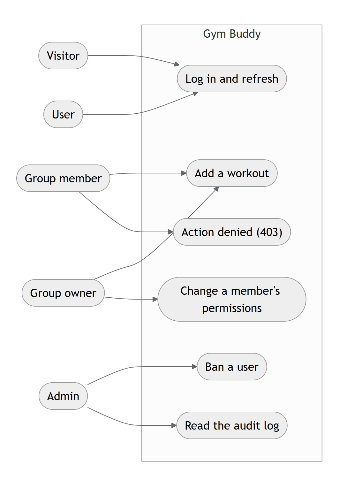

**Table 13: Use case descriptions**

| ID | Use case | Actor | Preconditions | Main flow | Alternative and error flows | Postconditions |
|---|---|---|---|---|---|---|
| UC1 | Log in and refresh | User | The account exists and is not banned | 1. The user enters an email and a password. 2. The server checks them. 3. The server returns an access token and sets the refresh cookie. 4. After 5 minutes a request gets 401. 5. The app calls refresh once and repeats the request | Wrong password 401. Fifth wrong password 429. Banned 403 | The user is logged in |
| UC2 | Add a workout (create a record) | Group member with Add | The member is in the group | 1. The member opens the group. 2. The member fills in the workout. 3. The server checks the Add permission. 4. The server saves it | No Add permission 403. Not in the group 404. Bad input 422 | The workout appears for everyone in the group |
| UC3 | Change a member's permissions | Group owner | The person is in the group | 1. The owner opens People and permissions. 2. The owner ticks or unticks Add, Edit or Assign. 3. The server checks that the caller is the owner and saves | Not the owner 403. Not in the group 404 | The new rule works on the member's next request |
| UC4 | Action denied | Group member without Edit | The member is in the group | 1. The member tries to save an edit. 2. The server finds no Edit permission. 3. The server returns 403. 4. The app shows the message | A user calling an admin page also gets 403, and the attempt is logged | Nothing changes (S6) |
| UC5 | Ban a user | Admin | The target is not an admin and not the caller | 1. The admin finds the user. 2. The admin clicks Ban and writes a reason. 3. The server bans the user, ends all sessions and writes a log row | Target is an admin 400. Unknown user 404 | The user's next request gets 403 (S9) |
| UC6 | Read the audit log | Admin | The admin is logged in | 1. The admin opens the Activity log. 2. The admin picks filters. 3. The server returns matching rows, newest first. 4. The admin can export them as CSV | Bad filter 422. Not an admin 403 | The export itself is logged |

### B6. Acceptance Criteria

**Table 14: Acceptance criteria**

| ID | Given | When | Then |
|---|---|---|---|
| AC-1 | An access token older than 5 minutes | It is sent to a protected endpoint | The server returns 401. The app refreshes once and the repeated request works (FR-AUTH-05) |
| AC-2 | A token with a changed signature or user id | It is sent to any protected endpoint | The server returns 401 (FR-AUTH-05) |
| AC-3 | User A is logged in | A asks for User B's session or member record | The server returns 404 or 403 (FR-RBAC-05) |
| AC-4 | A group member without Edit | The member edits a workout | The server returns 403. After the owner ticks Edit, the same request works (FR-RBAC-06) |
| AC-5 | A user with a valid access token | An admin bans the user | The user's next request returns 403 (FR-RBAC-11) |
| AC-6 | Two admins | One tries to ban the other | The server returns 400 (FR-RBAC-10) |
| AC-7 | An account | 5 wrong passwords are sent in a row | The 5th returns 429 and even the right password is refused for 15 minutes (FR-AUTH-11) |
| AC-8 | A refresh token that was replaced more than 30 seconds ago | It is used again | The server returns 401 and ends the whole session (FR-AUTH-07) |
| AC-9 | A user who logged out | The old access token is used again | The server returns 401 (FR-AUTH-08) |
| AC-10 | A user who is not in a group | They open the group | The server returns 404 (FR-RBAC-08) |

### B7. Traceability Matrix

**Table 15: Requirement, endpoint or screen, test, screenshot**

| Requirement | Endpoint or screen | Automated test | Screenshot |
|---|---|---|---|
| FR-AUTH-01 | `POST /auth/signup`, Sign up page | `test_nobody_can_give_themself_a_role` | S1 |
| FR-AUTH-02 | Password hashing in `security.py` | `test_right_password_gives_tokens_and_a_refresh_cookie` | None |
| FR-AUTH-03 | `POST /auth/login`, Log in page | `test_wrong_password_and_unknown_email_get_the_same_401` | None |
| FR-AUTH-04 | Token creation in `security.py` | `test_token_is_valid_for_5_minutes` | S7b |
| FR-AUTH-05 | `deps.get_auth()` | `test_expired_token_gets_401`, `test_tampered_token_gets_401` | S7a |
| FR-AUTH-06 | `POST /auth/refresh` | `test_refresh_rotates_the_cookie_and_gives_a_working_token` | S8a, S8b |
| FR-AUTH-07 | `POST /auth/refresh` | `test_reusing_a_replaced_cookie_ends_the_whole_session` | None |
| FR-AUTH-08 | `POST /auth/logout` | `test_token_stops_working_after_logout` | None |
| FR-AUTH-09 | `GET /users/me/sessions`, Login devices page | `test_each_login_is_a_device_and_the_one_asking_is_marked` | S4 |
| FR-AUTH-10 | `DELETE /users/me/sessions/{id}` | `test_logging_a_device_out_ends_its_refresh_and_access_tokens` | S4 |
| FR-AUTH-11 | `POST /auth/login` | `test_fifth_wrong_password_locks_the_account` | S16 |
| FR-AUTH-12 | `PATCH /users/me/profile`, My account page | Manual test | S3 |
| FR-AUTH-13 | `POST /users/me/password`, My account page | `test_every_failed_password_change_is_recorded` | S3 |
| FR-AUTH-14 | `POST /admin/users/{id}/reset-password` | Manual test | S12 |
| FR-RBAC-01 | `app_user.role` | `test_a_role_typed_wrongly_in_the_database_is_a_plain_user_not_a_500` | None |
| FR-RBAC-02 | `rbac.py` | `test_role_names_are_compared_only_in_the_rbac_module` | None |
| FR-RBAC-03 | `require_permission()` | `test_a_plain_user_gets_403_on_every_staff_and_admin_endpoint` | S6 |
| FR-RBAC-04 | `deps.get_auth()` | `test_role_change_applies_on_the_next_request` | None |
| FR-RBAC-05 | `/users/me` endpoints | `test_a_user_cannot_reach_another_users_records` | S2 |
| FR-RBAC-06 | `PATCH /workouts/{id}`, group page | `test_group_member_without_can_update_gets_403_and_with_it_200` | S5, S6 |
| FR-RBAC-07 | `DELETE /workouts/{id}`, `DELETE /groups/{id}` | `test_a_member_with_every_permission_cannot_delete_a_workout` | S5 |
| FR-RBAC-08 | `GET /groups/{id}` | `test_a_group_and_its_workouts_are_404_for_an_outsider` | None |
| FR-RBAC-09 | `POST /groups` | `test_members_cannot_start_a_group_but_trainers_and_staff_can` | None |
| FR-RBAC-10 | `/admin/users/{id}/ban`, `/role` | `test_admin_cannot_ban_another_admin_or_themself` | None |
| FR-RBAC-11 | `deps.get_auth()` | `test_token_stops_working_when_the_user_is_banned` | S9 |
| FR-RBAC-12 | `POST /auth/signup` | `test_nobody_can_give_themself_a_role` | None |
| FR-RBAC-13 | `DELETE /members/{id}` | `test_only_an_admin_deletes_accounts` | None |
| FR-ADM-01 | `GET /admin/stats`, Dashboard | `test_the_dashboard_counts_users_records_and_groups_new_in_7_days` | S10 |
| FR-ADM-02 | `GET /admin/users`, Users page | `test_admin_gets_200_on_every_admin_route` | S11 |
| FR-ADM-03 | `GET /admin/users/{id}`, user detail | `test_user_details_list_the_users_records` | S12, S12b |
| FR-ADM-04 | `POST /admin/users/{id}/ban` and `/unban` | `test_token_stops_working_when_the_user_is_banned` | S13a, S13b |
| FR-ADM-05 | `PATCH /admin/users/{id}/role` | `test_role_change_applies_on_the_next_request` | S11 |
| FR-ADM-06 | `POST /admin/users/{id}/revoke-sessions` | Manual test | S12 |
| FR-ADM-07 | `POST /admin/users/bulk-ban` | `test_bulk_ban_skips_admins_and_bans_the_rest` | None |
| FR-ADM-08 | `POST /admin/users/{id}/reset-password` | Manual test | S12 |
| FR-ADM-09 | `/admin/workouts`, `/admin/groups` | `test_moderation_filters_workouts_by_status_and_group` | S14 |
| FR-ADM-10 | `GET /admin/activity`, Activity log | `test_leaving_removing_and_cancelling_are_logged` | S15 |
| FR-ADM-11 | `GET /admin/activity/security`, Security page | `test_an_address_shows_what_happened_the_emails_tried_and_the_browser` | S16 |
| FR-ADM-12 | `export.csv` endpoints | `test_every_csv_export_is_limited_to_the_newest_rows` | S17 |
| FR-ADM-13 | `activity_service.record()` | `test_staff_deletes_and_voids_are_logged` | S15 |
| FR-DOM-01 | `/members`, Members page | `test_a_new_membership_runs_for_the_plans_days_and_can_be_paid_at_once` | S2 |
| FR-DOM-02 | `/plans`, Plans page | `test_admin_adds_edits_retires_and_deletes_a_plan` | S2 |
| FR-DOM-03 | `/check-ins`, Attendance page | `test_check_in_then_out` | S10 |
| FR-DOM-04 | `/classes`, Book a class page | `test_a_class_cannot_start_in_the_past` | S10 |
| FR-DOM-05 | `/payments`, Payments page | `test_staff_deletes_and_voids_are_logged` | S10 |
| FR-DOM-06 | `/trainers/me`, My classes page | `test_trainer_marks_attendance_of_their_own_class_only` | None |
| FR-DOM-07 | `/workouts/assigned` | `test_only_the_assigned_member_marks_a_workout_done` | S5 |
| FR-DOM-08 | `/equipment`, Equipment page | `test_equipment_service_and_faults` | S10 |
| FR-DOM-09 | `/expenses`, Expenses page | `test_expenses_and_net_income` | S10 |
| FR-DOM-10 | `/announcements` | Manual test | S2 |
| FR-DOM-11 | `GET /overview`, Dashboard | Manual test | S10 |
| NFR-01 | Vercel settings, `.env.example` | Manual check | S19 |
| NFR-02 | Login, error handler | `test_wrong_password_and_unknown_email_get_the_same_401` | None |
| NFR-03 | Refresh cookie | `test_right_password_gives_tokens_and_a_refresh_cookie` | S8b |
| NFR-04 | `cors.py` | `test_other_origins_get_no_cors_headers` | None |
| NFR-05 | `vercel.json` headers | Manual check | None |
| NFR-06 | `activity_service.py` | `test_failed_logins_are_in_the_activity_log_without_the_password` | S15 |
| NFR-07 | `params.py` | `test_an_offset_no_column_can_hold_is_refused` | None |
| NFR-08 | Login | Manual check | None |
| NFR-09 | Every page | Manual check | S2, S10 |
| NFR-10 | `/api/docs` | Manual check | S20 |
| NFR-11 | Supabase database | Manual check | None |
| NFR-12 | Booking | Manual test with two bookings at once | None |
| NFR-13 | `routers`, `services`, `rbac.py` | `test_role_names_are_compared_only_in_the_rbac_module` | None |
| NFR-14 | `backend/tests` | All 136 tests | S21 |
| NFR-15 | Vercel and GitHub | Manual check | S18 |

## Part C. Technical Design (TDD)

### C1. Technology Stack

**Table 16: Technology stack**

| Component | Technology | Version | Reason |
|---|---|---|---|
| Frontend | React with TypeScript | React 19.3.0, TypeScript 7.0.2 | Typed components. The course uses it |
| Build tool | Vite | 8.3.2 | Fast development server and small builds |
| UI library | None. Own CSS and shared components | None | Fewer dependencies and a strict Content Security Policy |
| Backend | FastAPI | 0.162.0 | Validation, dependencies for auth and API docs are built in |
| Database | PostgreSQL on Supabase (SQLite on my computer) | Managed | Free hosted database that keeps data after restarts |
| ORM | SQLModel with SQLAlchemy | 0.0.48 and 2.1.6 | One class is both the table and the schema. Queries use parameters |
| Password hashing | Argon2 (`argon2-cffi`) with a pepper | 25.1.0 | Slow hashing recommended by OWASP |
| JWT library | PyJWT | 2.15.1 | Small and well tested |
| Testing | pytest with httpx | 9.2.0 and 0.28.1 | Quick API tests on a temporary database |
| Hosting | Vercel | None | Deploys every merge into `main` |

### C2. System Architecture

**Figure 2: System architecture**

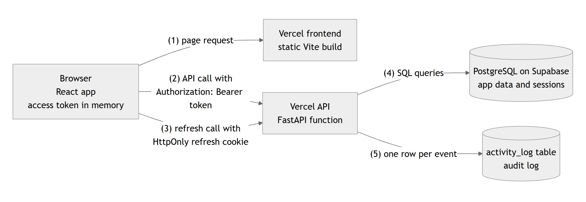

1. **Page request.** The browser loads the React app from the Vercel frontend. Every path that does not start with `/api` goes to the frontend.
2. **API call with the access token.** Every API call goes through `services/api.ts`, which adds the `Authorization: Bearer` header. The token lives only in a variable, so it is gone when the tab closes.
3. **Refresh call with the cookie.** After a 401, or when the page loads, the app calls `/api/v1/auth/refresh`. The browser adds the HttpOnly cookie by itself, and JavaScript can never read it.
4. **SQL queries.** The FastAPI function talks to Supabase through its connection pooler. Every query goes through SQLModel with parameters.
5. **Audit log.** Services write one row to `activity_log` for each security event. The row is saved in the same transaction as the change.

The frontend and the API share one address, so the app itself needs no CORS. The CORS list only decides if another site may call the API.

### C3. Backend and Frontend Structure

**Backend folder tree**

```text
backend/
    main.py              creates the app, routers, error handlers and /api/docs
    requirements.txt     libraries that Vercel installs
    .env.example         variable names with placeholders
    app/
        config.py        settings from the environment
        cors.py          CORS allow list
        database.py      database engine and session
        models.py        tables and request and response schemas
        security.py      password hashing and JWT tokens
        deps.py          get_auth(): token, user, ban and session check
        rbac.py          roles, permissions and require_permission()
        errors.py        turns service errors into HTTP status codes
        routers/         17 files, one per area (auth, users, admin, groups, ...)
        services/        21 files with the business rules and queries
    tests/               13 test files, 136 tests
```

* **Routes** live in `routers/`. They read the request, ask for a permission and call one service function.
* **Services** live in `services/`. They hold every rule and query. There is no separate repository layer because the queries are short.
* **Models** live in `models.py`. Response schemas list their fields, so a password hash can never be returned.
* **Authentication code** lives in `security.py`, `deps.py`, `routers/auth.py` and `services/session_service.py`.
* **The RBAC module** is `rbac.py`. It is the only file that names roles.
* **Admin code** lives in `routers/admin.py`, `routers/activity.py` and `routers/moderation.py` with their services.

**Frontend folder tree**

```text
frontend/
    vite.config.ts       sends /api to the backend during development
    src/
        App.tsx          picks the page from the address and guards it
        context/         AuthContext: the logged in user and permissions
        layouts/         AppLayout: the menu built from the permissions
        pages/           23 pages (Dashboard, Users, Training, My account, ...)
        components/      61 shared parts (forms, lists, dialogs, pager)
        services/        18 modules, api.ts adds the token and refreshes once
        hooks/           paging and search helpers
        types/           TypeScript types for the API
        utils/           dates and formatting
```

* **Pages** live in `pages/` and **components** in `components/`.
* **The API client** is `services/api.ts`.
* **The authentication context** is `context/AuthContext.tsx`.
* **Route guards** are in `App.tsx`. A page opens only if the user's permissions allow it. Otherwise the app shows No access. The server checks again on every request.

### C4. Data Model

**Figure 3: Entity relationship diagram**

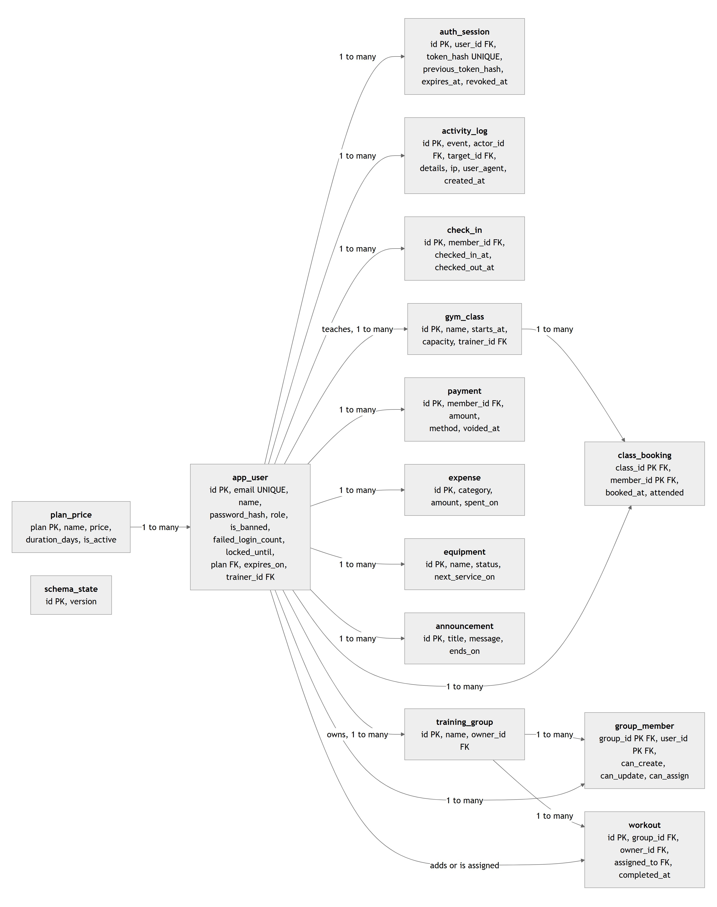

**How the security data is stored**

* **Roles:** the `role` column of `app_user`. The link between roles and permissions is code in `rbac.py`, so nobody can change it through the API.
* **Bans:** `is_banned`, `banned_at` and `ban_reason` in `app_user`. A ban also ends every session of that user.
* **Sessions and refresh tokens:** one row per login in `auth_session`. It keeps only a hash of the refresh token, the previous hash for reuse detection, the expiry, the IP address, the browser and the time it was revoked.
* **Lockout:** `failed_login_count` and `locked_until` in `app_user`. They are in the database because Vercel functions share no memory.
* **Group membership with permissions:** `group_member` has one row per person in a group, with `can_create`, `can_update` and `can_assign`. The owner is `owner_id` in `training_group`.
* **Activity log:** `activity_log` only grows. It copies the emails into the row, so a row still makes sense after an account is deleted.

**Table 17: `app_user`**

| Column | Type | Key / constraint |
|---|---|---|
| `id` | integer | PK |
| `email` | varchar(254) | unique, not null, indexed |
| `name` | varchar(100) | not null |
| `password_hash` | varchar | not null |
| `role` | varchar(20) | not null |
| `is_banned` | boolean | not null |
| `banned_at` | datetime | nullable |
| `ban_reason` | varchar(500) | nullable |
| `password_changed_at` | datetime | nullable |
| `must_change_password` | boolean | not null |
| `failed_login_count` | integer | not null |
| `locked_until` | datetime | nullable |
| `created_at` | datetime | not null |
| `plan` | varchar(40) | nullable |
| `joined_on` | date | nullable |
| `expires_on` | date | nullable |
| `trainer_id` | integer | FK → app_user.id (SET NULL), indexed |
| `is_frozen` | boolean | not null |
| `phone` | varchar(20) | nullable |
| `date_of_birth` | date | nullable |
| `emergency_contact_name` | varchar(100) | nullable |
| `emergency_contact_phone` | varchar(20) | nullable |
| `notes` | varchar(500) | nullable |

**Table 18: `plan_price`**

| Column | Type | Key / constraint |
|---|---|---|
| `plan` | varchar(40) | PK |
| `name` | varchar(60) | not null |
| `price` | integer | not null |
| `duration_days` | integer | not null |
| `description` | varchar(300) | nullable |
| `is_active` | boolean | not null |
| `updated_at` | datetime | not null |

**Table 19: `schema_state`**

| Column | Type | Key / constraint |
|---|---|---|
| `id` | integer | PK |
| `version` | varchar(64) | not null |

**Table 20: `activity_log`**

| Column | Type | Key / constraint |
|---|---|---|
| `id` | integer | PK |
| `created_at` | datetime | not null, indexed |
| `event` | varchar(30) | not null, indexed |
| `actor_id` | integer | FK → app_user.id (SET NULL), indexed |
| `actor_email` | varchar(254) | nullable |
| `target_id` | integer | FK → app_user.id (SET NULL), indexed |
| `target_email` | varchar(254) | nullable |
| `details` | varchar(500) | nullable |
| `ip` | varchar(45) | nullable |
| `user_agent` | varchar(300) | nullable |

**Table 21: `announcement`**

| Column | Type | Key / constraint |
|---|---|---|
| `id` | integer | PK |
| `title` | varchar(100) | not null |
| `message` | varchar(1000) | not null |
| `ends_on` | date | nullable |
| `posted_by` | integer | FK → app_user.id (SET NULL) |
| `posted_at` | datetime | not null, indexed |
| `updated_at` | datetime | nullable |

**Table 22: `auth_session`**

| Column | Type | Key / constraint |
|---|---|---|
| `id` | integer | PK |
| `user_id` | integer | FK → app_user.id (CASCADE), not null, indexed |
| `token_hash` | varchar(64) | unique, not null, indexed |
| `previous_token_hash` | varchar(64) | indexed |
| `rotated_at` | datetime | nullable |
| `created_at` | datetime | not null |
| `last_used_at` | datetime | not null |
| `expires_at` | datetime | not null |
| `ip` | varchar(45) | nullable |
| `user_agent` | varchar(300) | nullable |
| `revoked_at` | datetime | nullable |

**Table 23: `check_in`**

| Column | Type | Key / constraint |
|---|---|---|
| `id` | integer | PK |
| `member_id` | integer | FK → app_user.id (CASCADE), not null, indexed |
| `checked_in_at` | datetime | not null, indexed |
| `recorded_by` | integer | FK → app_user.id |
| `checked_out_at` | datetime | nullable |

**Table 24: `equipment`**

| Column | Type | Key / constraint |
|---|---|---|
| `id` | integer | PK |
| `name` | varchar(100) | not null |
| `category` | varchar(20) | not null |
| `quantity` | integer | not null |
| `status` | varchar(20) | not null, indexed |
| `purchased_on` | date | nullable |
| `service_every_days` | integer | nullable |
| `last_serviced_on` | date | nullable |
| `next_service_on` | date | indexed |
| `issue` | varchar(500) | nullable |
| `reported_by` | integer | FK → app_user.id (SET NULL) |
| `reported_at` | datetime | nullable |
| `notes` | varchar(500) | nullable |
| `created_at` | datetime | not null |
| `updated_at` | datetime | not null |

**Table 25: `expense`**

| Column | Type | Key / constraint |
|---|---|---|
| `id` | integer | PK |
| `category` | varchar(20) | not null |
| `amount` | integer | not null |
| `spent_on` | date | not null, indexed |
| `description` | varchar(200) | nullable |
| `recorded_by` | integer | FK → app_user.id (SET NULL) |
| `created_at` | datetime | not null |

**Table 26: `gym_class`**

| Column | Type | Key / constraint |
|---|---|---|
| `id` | integer | PK |
| `name` | varchar(100) | not null |
| `description` | varchar(500) | nullable |
| `trainer_id` | integer | FK → app_user.id (SET NULL), indexed |
| `trainer_name` | varchar(100) | nullable |
| `starts_at` | datetime | not null, indexed |
| `duration_minutes` | integer | not null |
| `capacity` | integer | not null |
| `created_by` | integer | FK → app_user.id |
| `created_at` | datetime | not null |
| `updated_at` | datetime | not null |

**Table 27: `payment`**

| Column | Type | Key / constraint |
|---|---|---|
| `id` | integer | PK |
| `member_id` | integer | FK → app_user.id (SET NULL), indexed |
| `member_name` | varchar(100) | not null |
| `amount` | integer | not null |
| `method` | varchar(20) | not null |
| `plan` | varchar(40) | nullable |
| `note` | varchar(200) | nullable |
| `paid_at` | datetime | not null, indexed |
| `renewed_until` | date | nullable |
| `recorded_by` | integer | FK → app_user.id |
| `voided_at` | datetime | nullable |
| `void_reason` | varchar(200) | nullable |
| `voided_by` | integer | FK → app_user.id |

**Table 28: `training_group`**

| Column | Type | Key / constraint |
|---|---|---|
| `id` | integer | PK |
| `name` | varchar(100) | not null |
| `owner_id` | integer | FK → app_user.id (CASCADE), not null, indexed |
| `created_at` | datetime | not null |

**Table 29: `class_booking`**

| Column | Type | Key / constraint |
|---|---|---|
| `class_id` | integer | PK, FK → gym_class.id (CASCADE) |
| `member_id` | integer | PK, FK → app_user.id (CASCADE) |
| `booked_at` | datetime | not null |
| `attended` | boolean | nullable |

**Table 30: `group_member`**

| Column | Type | Key / constraint |
|---|---|---|
| `group_id` | integer | PK, FK → training_group.id (CASCADE) |
| `user_id` | integer | PK, FK → app_user.id (CASCADE) |
| `can_create` | boolean | not null |
| `can_update` | boolean | not null |
| `can_assign` | boolean | not null |
| `added_at` | datetime | not null |

**Table 31: `workout`**

| Column | Type | Key / constraint |
|---|---|---|
| `id` | integer | PK |
| `owner_id` | integer | FK → app_user.id (SET NULL), indexed |
| `group_id` | integer | FK → training_group.id (CASCADE), indexed |
| `title` | varchar(100) | not null |
| `workout_date` | date | not null |
| `notes` | varchar(1000) | nullable |
| `assigned_to` | integer | FK → app_user.id (SET NULL), indexed |
| `completed_at` | datetime | nullable |
| `created_at` | datetime | not null |
| `updated_at` | datetime | not null |

### C5. API Design

* **Version prefix:** every endpoint starts with `/api/v1`. The health check is `/api/health`.
* **Pagination:** lists take `offset` and `limit` (1 to 100, default 20) and return `items` and `total`.
* **Error format:** every error is `{"detail": "one sentence"}`. Validation errors never repeat what was sent, because it could be a password.
* **Status codes:** 201 created, 204 deleted, 400 rule broken, 401 not logged in, 403 no permission or banned, 404 not found, 409 conflict, 422 bad input, 429 locked out.
* **Auth column:** "Yes" means the request needs `Authorization: Bearer <access token>`.

**Table 32: Endpoint list (106 endpoints, taken from the running code)**

| # | Method and path | Auth | Permission | Body | Success | Errors |
|---|---|---|---|---|---|---|
| 1 | `POST /api/v1/auth/signup` | No | public | `SignupRequest` | 201 | 409, 422 |
| 2 | `POST /api/v1/auth/login` | No | public | `LoginRequest` | 200 | 401, 403 banned, 422, 429 |
| 3 | `POST /api/v1/auth/refresh` | No | public | None | 200 | 401 |
| 4 | `POST /api/v1/auth/logout` | No | public | None | 204 | None |
| 5 | `GET /api/v1/users/me` | Yes | login only (own data) | None | 200 | 401 |
| 6 | `PATCH /api/v1/users/me` | Yes | login only (own data) | `UserNameUpdate` | 200 | 401, 422 |
| 7 | `GET /api/v1/users/me/profile` | Yes | login only (own data) | None | 200 | 401 |
| 8 | `PATCH /api/v1/users/me/profile` | Yes | login only (own data) | `ProfileUpdate` | 200 | 401, 422 |
| 9 | `GET /api/v1/users/me/membership` | Yes | login only (own data) | None | 200 | 401 |
| 10 | `GET /api/v1/users/me/check-ins` | Yes | login only (own data) | None | 200 | 401 |
| 11 | `GET /api/v1/users/me/bookings` | Yes | login only (own data) | None | 200 | 401 |
| 12 | `GET /api/v1/users/me/payments` | Yes | login only (own data) | None | 200 | 401 |
| 13 | `POST /api/v1/users/me/password` | Yes | login only (own data) | `PasswordChange` | 204 | 401, 422 |
| 14 | `GET /api/v1/users/me/sessions` | Yes | login only (own data) | None | 200 | 401 |
| 15 | `DELETE /api/v1/users/me/sessions/{session_id}` | Yes | login only (own data) | None | 204 | 401, 404, 422 |
| 16 | `GET /api/v1/admin/stats` | Yes | `dashboard:read` | None | 200 | 401, 403 |
| 17 | `GET /api/v1/admin/revenue` | Yes | `dashboard:read` | None | 200 | 401, 403 |
| 18 | `GET /api/v1/admin/users` | Yes | `users:read` | None | 200 | 401, 403 |
| 19 | `GET /api/v1/admin/users/export.csv` | Yes | `users:export` | None | 200 | 401, 403 |
| 20 | `POST /api/v1/admin/users/bulk-ban` | Yes | `users:ban` | `BulkUserAction` | 200 | 401, 403, 422 |
| 21 | `POST /api/v1/admin/users/bulk-unban` | Yes | `users:ban` | `BulkUserAction` | 200 | 401, 403, 422 |
| 22 | `GET /api/v1/admin/users/{user_id}` | Yes | `users:read` | None | 200 | 401, 403, 404, 422 |
| 23 | `POST /api/v1/admin/users/{user_id}/revoke-sessions` | Yes | `users:revoke_sessions` | None | 200 | 401, 403, 404, 422 |
| 24 | `PATCH /api/v1/admin/users/{user_id}/role` | Yes | `users:change_role` | `UserRoleUpdate` | 200 | 401, 403, 404, 422 |
| 25 | `POST /api/v1/admin/users/{user_id}/ban` | Yes | `users:ban` | `body` | 200 | 401, 403, 404, 422 |
| 26 | `POST /api/v1/admin/users/{user_id}/unban` | Yes | `users:ban` | None | 200 | 401, 403, 404, 422 |
| 27 | `POST /api/v1/admin/users/{user_id}/reset-password` | Yes | `users:reset_password` | None | 200 | 401, 403, 404, 422 |
| 28 | `POST /api/v1/members` | Yes | `members:manage` | `MemberCreate` | 201 | 401, 403, 409, 422 |
| 29 | `GET /api/v1/members` | Yes | `members:read` | None | 200 | 401, 403 |
| 30 | `GET /api/v1/members/waiting` | Yes | `members:read` | None | 200 | 401, 403 |
| 31 | `POST /api/v1/members/bulk-delete` | Yes | `members:delete` | `MemberBulkDelete` | 200 | 401, 403, 422 |
| 32 | `GET /api/v1/members/{member_id}` | Yes | `members:read` | None | 200 | 401, 403, 404, 422 |
| 33 | `PATCH /api/v1/members/{member_id}` | Yes | `members:manage` | `MemberUpdate` | 200 | 401, 403, 404, 422 |
| 34 | `POST /api/v1/members/{member_id}/check-ins` | Yes | `check_ins:record` | None | 201 | 401, 403, 404, 409, 422 |
| 35 | `GET /api/v1/members/{member_id}/check-ins` | Yes | `members:read` | None | 200 | 401, 403, 404, 422 |
| 36 | `POST /api/v1/members/{member_id}/payments` | Yes | `payments:manage` | `PaymentCreate` | 201 | 401, 403, 404, 422 |
| 37 | `GET /api/v1/members/{member_id}/payments` | Yes | `payments:manage` | None | 200 | 401, 403, 404, 422 |
| 38 | `GET /api/v1/members/{member_id}/bookings` | Yes | `members:read` | None | 200 | 401, 403, 404, 422 |
| 39 | `DELETE /api/v1/members/{member_id}/bookings/{class_id}` | Yes | `members:manage` | None | 204 | 401, 403, 404, 422 |
| 40 | `DELETE /api/v1/members/{member_id}` | Yes | `members:delete` | None | 204 | 401, 403, 404, 422 |
| 41 | `GET /api/v1/check-ins` | Yes | `check_ins:record` | None | 200 | 401, 403 |
| 42 | `POST /api/v1/check-ins/{check_in_id}/check-out` | Yes | `check_ins:record` | None | 200 | 401, 403, 404, 422 |
| 43 | `POST /api/v1/classes` | Yes | `classes:manage` | `ClassCreate` | 201 | 401, 403, 422 |
| 44 | `GET /api/v1/classes` | Yes | login only (own data) | None | 200 | 401 |
| 45 | `GET /api/v1/classes/{class_id}` | Yes | login only (own data) | None | 200 | 401, 404, 422 |
| 46 | `PATCH /api/v1/classes/{class_id}` | Yes | `classes:manage` | `ClassUpdate` | 200 | 401, 403, 404, 422 |
| 47 | `DELETE /api/v1/classes/{class_id}` | Yes | `classes:manage` | None | 204 | 401, 403, 404, 422 |
| 48 | `GET /api/v1/classes/{class_id}/bookings` | Yes | `classes:manage` or `classes:teach` | None | 200 | 401, 403, 404, 422 |
| 49 | `PUT /api/v1/classes/{class_id}/bookings/{member_id}/attendance` | Yes | `classes:manage` or `classes:teach` | `AttendanceUpdate` | 200 | 401, 403, 404, 422 |
| 50 | `POST /api/v1/classes/{class_id}/bookings` | Yes | login only (own data) | None | 201 | 401, 404, 409, 422 |
| 51 | `DELETE /api/v1/classes/{class_id}/bookings` | Yes | login only (own data) | None | 204 | 401, 404, 422 |
| 52 | `GET /api/v1/plans` | Yes | login only (own data) | None | 200 | 401 |
| 53 | `POST /api/v1/plans` | Yes | `plans:edit` | `PlanCreate` | 201 | 401, 403, 409, 422 |
| 54 | `PATCH /api/v1/plans/{plan}` | Yes | `plans:edit` | `PlanUpdate` | 200 | 401, 403, 404, 422 |
| 55 | `DELETE /api/v1/plans/{plan}` | Yes | `plans:edit` | None | 204 | 401, 403, 404, 422 |
| 56 | `GET /api/v1/payments` | Yes | `payments:manage` | None | 200 | 401, 403 |
| 57 | `GET /api/v1/payments/export.csv` | Yes | `payments:export` | None | 200 | 401, 403 |
| 58 | `POST /api/v1/payments/{payment_id}/void` | Yes | `payments:void` | `VoidRequest` | 200 | 401, 403, 404, 422 |
| 59 | `GET /api/v1/overview` | Yes | `overview:read` | None | 200 | 401, 403 |
| 60 | `GET /api/v1/trainers` | Yes | `classes:manage` or `members:manage` | None | 200 | 401, 403 |
| 61 | `GET /api/v1/trainers/me/classes` | Yes | `classes:teach` | None | 200 | 401, 403 |
| 62 | `GET /api/v1/trainers/me/clients` | Yes | `clients:read` | None | 200 | 401, 403 |
| 63 | `GET /api/v1/announcements` | Yes | login only (own data) | None | 200 | 401 |
| 64 | `POST /api/v1/announcements` | Yes | `announcements:manage` | `AnnouncementCreate` | 201 | 401, 403, 422 |
| 65 | `PATCH /api/v1/announcements/{announcement_id}` | Yes | `announcements:manage` | `AnnouncementUpdate` | 200 | 401, 403, 404, 422 |
| 66 | `DELETE /api/v1/announcements/{announcement_id}` | Yes | `announcements:manage` | None | 204 | 401, 403, 404, 422 |
| 67 | `GET /api/v1/admin/activity` | Yes | `activity:read` | None | 200 | 401, 403 |
| 68 | `GET /api/v1/admin/activity/security` | Yes | `activity:read` | None | 200 | 401, 403 |
| 69 | `GET /api/v1/admin/activity/export.csv` | Yes | `activity:read` | None | 200 | 401, 403 |
| 70 | `GET /api/v1/workouts/assigned` | Yes | group permission (Table 11) | None | 200 | 401, 403 |
| 71 | `POST /api/v1/workouts` | Yes | group permission (Table 11) | `WorkoutCreate` | 201 | 401, 403, 422 |
| 72 | `GET /api/v1/workouts/{workout_id}` | Yes | group permission (Table 11) | None | 200 | 401, 403, 404, 422 |
| 73 | `PATCH /api/v1/workouts/{workout_id}` | Yes | group permission (Table 11) | `WorkoutUpdate` | 200 | 401, 403, 404, 422 |
| 74 | `PUT /api/v1/workouts/{workout_id}/assignee` | Yes | group permission (Table 11) | `WorkoutAssign` | 200 | 401, 403, 404, 422 |
| 75 | `PUT /api/v1/workouts/{workout_id}/completion` | Yes | group permission (Table 11) | `WorkoutCompletion` | 200 | 401, 403, 404, 422 |
| 76 | `DELETE /api/v1/workouts/{workout_id}` | Yes | group permission (Table 11) | None | 204 | 401, 403, 404, 422 |
| 77 | `GET /api/v1/groups` | Yes | login only (own data) | None | 200 | 401 |
| 78 | `POST /api/v1/groups` | Yes | `groups:create` | `GroupCreate` | 201 | 401, 403, 422 |
| 79 | `GET /api/v1/groups/{group_id}` | Yes | group permission (Table 11) | None | 200 | 401, 403, 404, 422 |
| 80 | `PATCH /api/v1/groups/{group_id}` | Yes | group permission (Table 11) | `GroupCreate` | 200 | 401, 403, 404, 422 |
| 81 | `DELETE /api/v1/groups/{group_id}` | Yes | group permission (Table 11) | None | 204 | 401, 403, 404, 422 |
| 82 | `GET /api/v1/groups/{group_id}/workouts` | Yes | group permission (Table 11) | None | 200 | 401, 403, 404, 422 |
| 83 | `GET /api/v1/groups/{group_id}/members` | Yes | group permission (Table 11) | None | 200 | 401, 403, 404, 422 |
| 84 | `POST /api/v1/groups/{group_id}/members` | Yes | group permission (Table 11) | `GroupMemberAdd` | 201 | 401, 403, 404, 409, 422 |
| 85 | `PATCH /api/v1/groups/{group_id}/members/{user_id}` | Yes | group permission (Table 11) | `GroupMemberUpdate` | 200 | 401, 403, 404, 422 |
| 86 | `DELETE /api/v1/groups/{group_id}/members/{user_id}` | Yes | group permission (Table 11) | None | 204 | 401, 403, 404, 422 |
| 87 | `GET /api/v1/admin/workouts` | Yes | `content:moderate` | None | 200 | 401, 403 |
| 88 | `GET /api/v1/admin/workouts/export.csv` | Yes | `content:moderate` | None | 200 | 401, 403 |
| 89 | `POST /api/v1/admin/workouts/bulk-delete` | Yes | `content:moderate` | `ContentBulkDelete` | 200 | 401, 403, 422 |
| 90 | `DELETE /api/v1/admin/workouts/{workout_id}` | Yes | `content:moderate` | None | 204 | 401, 403, 404, 422 |
| 91 | `GET /api/v1/admin/groups` | Yes | `content:moderate` | None | 200 | 401, 403 |
| 92 | `GET /api/v1/admin/groups/export.csv` | Yes | `content:moderate` | None | 200 | 401, 403 |
| 93 | `POST /api/v1/admin/groups/bulk-delete` | Yes | `content:moderate` | `ContentBulkDelete` | 200 | 401, 403, 422 |
| 94 | `DELETE /api/v1/admin/groups/{group_id}` | Yes | `content:moderate` | None | 204 | 401, 403, 404, 422 |
| 95 | `GET /api/v1/equipment` | Yes | `equipment:read` | None | 200 | 401, 403 |
| 96 | `POST /api/v1/equipment` | Yes | `equipment:manage` | `EquipmentCreate` | 201 | 401, 403, 422 |
| 97 | `PATCH /api/v1/equipment/{equipment_id}` | Yes | `equipment:manage` | `EquipmentUpdate` | 200 | 401, 403, 404, 422 |
| 98 | `POST /api/v1/equipment/{equipment_id}/report` | Yes | `equipment:read` | `EquipmentReport` | 200 | 401, 403, 404, 422 |
| 99 | `POST /api/v1/equipment/{equipment_id}/service` | Yes | `equipment:manage` | None | 200 | 401, 403, 404, 422 |
| 100 | `DELETE /api/v1/equipment/{equipment_id}` | Yes | `equipment:manage` | None | 204 | 401, 403, 404, 422 |
| 101 | `GET /api/v1/expenses` | Yes | `expenses:manage` | None | 200 | 401, 403 |
| 102 | `POST /api/v1/expenses` | Yes | `expenses:manage` | `ExpenseCreate` | 201 | 401, 403, 422 |
| 103 | `GET /api/v1/expenses/export.csv` | Yes | `expenses:manage` | None | 200 | 401, 403 |
| 104 | `PATCH /api/v1/expenses/{expense_id}` | Yes | `expenses:manage` | `ExpenseUpdate` | 200 | 401, 403, 404, 422 |
| 105 | `DELETE /api/v1/expenses/{expense_id}` | Yes | `expenses:manage` | None | 204 | 401, 403, 404, 422 |
| 106 | `GET /api/health` | No | public | None | 200 | None |

### C6. JWT Authentication Design

**Figure 4: JWT sequence diagram**

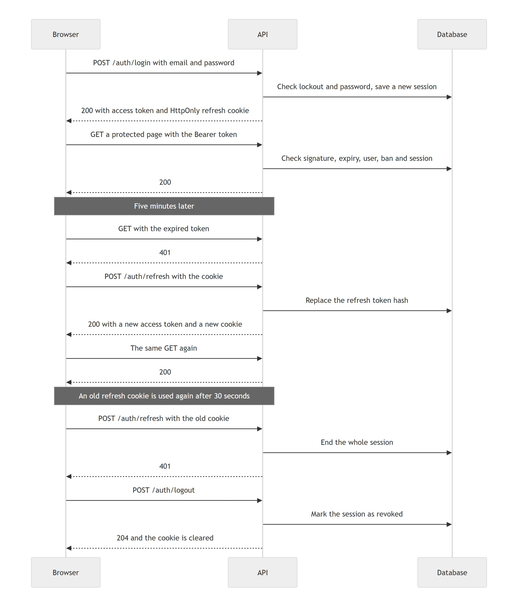

**Table 33: Token claims**

| Claim | Value | Why |
|---|---|---|
| `sub` | User id | The server loads the user on every request |
| `role` | Role at login | Only for information. Checks use the role in the database |
| `sid` | Session id | Logout, ban and revoke work at once |
| `iat` | Issue time | Required |
| `exp` | Issue time plus 5 minutes | The token expires |

* **Signing:** HS256 with `JWT_SECRET` from an environment variable of at least 32 bytes. The app refuses to start on Vercel without it.
* **Lifetimes:** the access token lasts 5 minutes, so a stolen token is useful only for a short time. The refresh token lasts 7 days, so members stay logged in between gym visits. An old refresh token gets 30 seconds of grace, so two tabs that refresh together are not treated as theft.
* **Storage in the browser:** the access token stays in memory. The risk is XSS. To reduce it, React escapes all output, the Content Security Policy allows only our own scripts and the token lasts only 5 minutes. The refresh token is an HttpOnly cookie, so scripts cannot read it. The risk there is CSRF. To stop it, the cookie is SameSite Strict and only sent to `/api/v1/auth`, and every other endpoint needs the Bearer header.
* **Server checks on every request:** the signature, the expiry, that the user exists, that the user is not banned and that the session is still active.
* **Frontend on a 401:** `api.ts` refreshes once and repeats the request. If the refresh fails, the app logs the user out and shows the Log in page with a message.

### C7. RBAC Design

**Figure 5: Authorisation flow for one request**

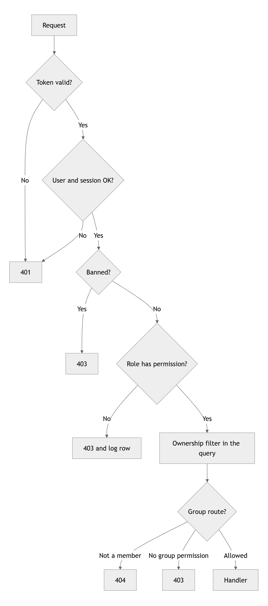

A request is checked in this order: token, user, role permission, ownership, group permission, and then the handler.

* **Roles and permission constants:** `Permission` lists 26 permissions such as `members:read`, `users:ban` and `content:moderate`. Users have none. Trainers have 4. Gym Managers have 10. Admins have those 10 plus 14 more. Groups have their own five: read, create, update, assign and manage.
* **The reusable check:**

```python
def require_permission(*permissions: Permission) -> Callable[..., User]:
    """The caller needs at least one of these permissions, or gets 403."""

    def check(user: CurrentUser, request: Request, session: SessionDep, client: ClientDep) -> User:
        if not any(has_permission(user, permission) for permission in permissions):
            needs = " or ".join(permission.value for permission in permissions)
            details = f"{request.method} {request.url.path} needs {needs}"
            activity_service.record(session, ActivityEvent.ACCESS_DENIED, client, actor=user, details=details)
            session.commit()
            raise HTTPException(status_code=403, detail="You do not have permission to do this")
        return user

    return check

# on a route
@router.post("/users/{user_id}/ban", response_model=AdminUserRead)
def ban_user(user_id: int, session: SessionDep, admin: Annotated[User, Depends(require_permission(Permission.USERS_BAN))]): ...
```

* **Ownership in queries:** "my" endpoints never take an id from the request. The query filters by the caller's id, for example `WHERE payment.member_id = :user_id` in `payment_service.list_own_payments()`. Group endpoints load the caller's `group_member` row first. No row means 404.
* **Adding a role or permission:** add the constant to `Permission`, add it to the roles in `ROLE_PERMISSIONS` and put `require_permission(Permission.NEW)` on the route. The menu updates by itself because `/users/me` returns the caller's permissions.
* **Special rules:** an admin cannot change their own role or ban another admin. A banned user is stopped in `get_auth()` before any permission check.

### C8. Admin Dashboard Design

**Figure 6: Admin pages and the endpoints they call**

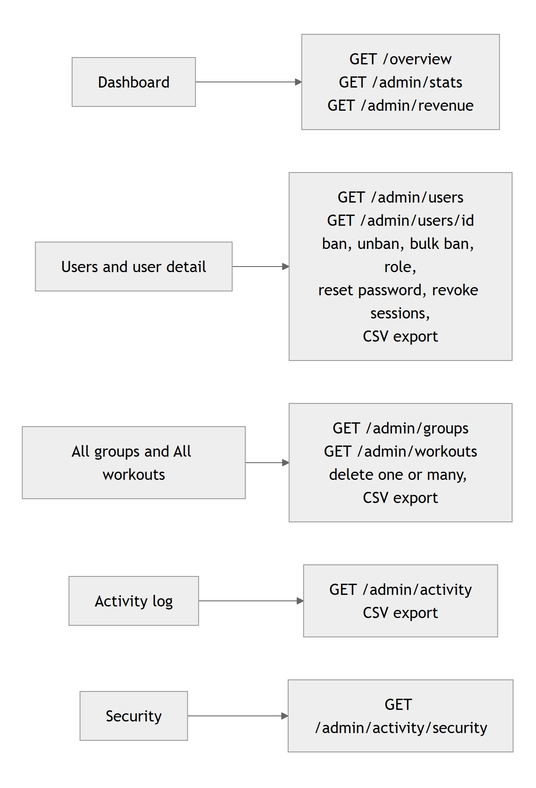

**Table 34: Admin pages**

| Page | Endpoints | Filters and pagination | Actions | Audit events |
|---|---|---|---|---|
| Dashboard | `/overview`, `/admin/stats`, `/admin/revenue` | None | Refresh | None |
| Users | `/admin/users`, `/admin/users/export.csv` | Search, role, status, 20 per page | Ban, unban, bulk ban, role change, reset password, log out everywhere, export | `ban`, `unban`, `role_change`, `password_reset`, `session_revoke`, `export` |
| User detail | `/admin/users/{id}` | None | Same actions as Users | Same as Users |
| All groups and All workouts | `/admin/groups`, `/admin/workouts` | Owner, group, status, dates, text, paginated | Delete one, delete many, export | `group_delete`, `workout_delete`, `export` |
| Activity log | `/admin/activity` | Event, user, dates, text, paginated | Export | `export` |
| Security | `/admin/activity/security` | Time window, lowest count | Open an address in the log | None |

* **Bulk actions:** a bulk ban returns the banned users and the skipped ones with a reason, for example "Admins cannot be banned". The page shows how many were banned and how many were skipped.
* **CSV exports:** the list and the export use the same filter code, so the file has exactly the rows on the screen. A file holds at most 10,000 rows.

### C9. Security Design and Threats

**Table 35: Threats and defences**

| Threat | Defence | Where |
|---|---|---|
| Password database leak | Argon2 hashes mixed with a secret pepper | `security.py` |
| Stolen access token | Lasts 5 minutes and is tied to a session that can be ended | `security.py`, `deps.py` |
| Stolen refresh token | HttpOnly cookie, stored as a hash, replaced on every use, reuse ends the session | `session_service.py` |
| Brute force login | 5 wrong passwords lock the account for 15 minutes | `auth_service.py` |
| Privilege escalation | New accounts are always Users. Only admins change roles, and never their own | `rbac.py`, `user_service.py` |
| Access to another user's record | Queries filter by the caller's id. Private groups return 404 | `services`, `group_service.py` |
| Cross site scripting | React escapes output. The Content Security Policy blocks other scripts | `vercel.json`, frontend |
| Cross site request forgery | SameSite Strict cookie. Other endpoints need the Bearer header | `routers/auth.py` |
| CORS misuse | Exact allow list. A wildcard is refused | `cors.py`, `config.py` |
| Secrets in the repository | Secrets only on Vercel. `.env` is ignored by git | `.gitignore`, `.env.example` |
| SQL injection | Only parameterised SQLModel queries | `services` |
| Over posting of fields | Input schemas list the allowed fields. Role and ban cannot be sent | `models.py` |

### C10. Deployment on Vercel

**Figure 7: Deployment layout**

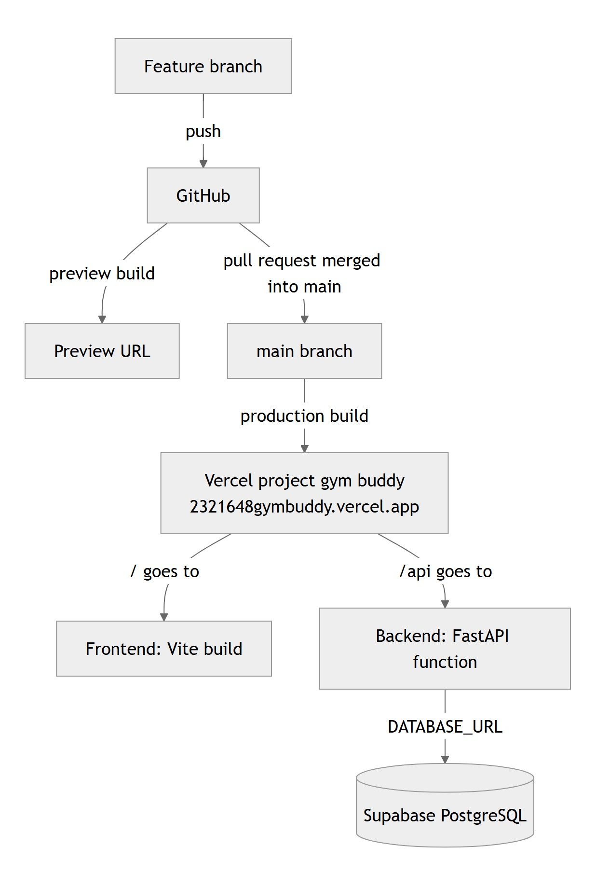

* **Projects:** one Vercel project with two services in `vercel.json`. The backend service runs `main:app` from the `backend` folder. The frontend service builds the Vite app from the `frontend` folder.
* **Rewrites:** `/api/...` goes to the backend. Every other path goes to the frontend, so page reloads and deep links work.
* **How the frontend finds the API:** it calls `/api/v1/...` on its own address. On my computer, Vite sends `/api` to `localhost:8000`.
* **Database:** PostgreSQL on Supabase. The app adds missing tables and columns when it starts.
* **Redeploy:** merge a pull request into `main`. Vercel builds and publishes it. Instant Rollback brings back the last version if something breaks.

**Table 36: Environment variables**

| Name | Purpose |
|---|---|
| `DATABASE_URL` | Connection to the Supabase database |
| `JWT_SECRET` | Signs the access tokens |
| `PASSWORD_PEPPER` | Secret mixed into every password before hashing |
| `FRONTEND_ORIGIN` | Extra address that CORS may allow |

### C11. Testing

**Strategy.** I used three kinds of tests:

1. **Automated API tests** with pytest. Each test runs on a new temporary database. Some tests go through every endpoint in the API docs, so a new endpoint is checked automatically.
2. **Browser tests** with Playwright on my computer. They log in as every role and try expiry, refresh, bans and group permissions.
3. **Manual tests on the live site** with the demo accounts. The screenshots in Part D come from these tests.

**How to run:** go to `backend`, run `pip install -r requirements-dev.txt` and then `pytest`.

**Table 37: Tests and results (28 November 2026: 136 passed, 0 failed)**

| Test | Requirement | Result |
|---|---|---|
| `test_expired_token_gets_401` | FR-AUTH-05 (expiry) | Pass |
| `test_tampered_token_gets_401` | FR-AUTH-05 (tampering) | Pass |
| `test_token_is_valid_for_5_minutes` | FR-AUTH-04 | Pass |
| `test_token_stops_working_after_logout` | FR-AUTH-08 | Pass |
| `test_refresh_rotates_the_cookie_and_gives_a_working_token` | FR-AUTH-06 | Pass |
| `test_reusing_a_replaced_cookie_ends_the_whole_session` | FR-AUTH-07 | Pass |
| `test_fifth_wrong_password_locks_the_account` | FR-AUTH-11 (lockout) | Pass |
| `test_a_user_cannot_reach_another_users_records` | FR-RBAC-05 (ownership) | Pass |
| `test_a_plain_user_gets_403_on_every_staff_and_admin_endpoint` | FR-RBAC-03 | Pass |
| `test_group_member_without_can_update_gets_403_and_with_it_200` | FR-RBAC-06 (group matrix) | Pass |
| `test_a_member_with_every_permission_cannot_delete_a_workout` | FR-RBAC-07 | Pass |
| `test_a_group_and_its_workouts_are_404_for_an_outsider` | FR-RBAC-08 | Pass |
| `test_admin_cannot_ban_another_admin_or_themself` | FR-RBAC-10 (admin rules) | Pass |
| `test_admin_cannot_change_their_own_role` | FR-RBAC-10 | Pass |
| `test_token_stops_working_when_the_user_is_banned` | FR-RBAC-11 | Pass |
| `test_bulk_ban_skips_admins_and_bans_the_rest` | FR-ADM-07 | Pass |
| `test_every_csv_export_is_limited_to_the_newest_rows` | FR-ADM-12 | Pass |
| All other tests | Gym features and settings | Pass |

## Part D. Evidence: Screenshots of the Running Application

I took every screenshot on the live site (https://2321648gymbuddy.vercel.app) on 28 November 2026. The address bar and the logged in user are visible. Tokens and cookie values are covered with a grey box. IP addresses and the accounts of real people (not demo accounts) are blurred.

### D1. User Side

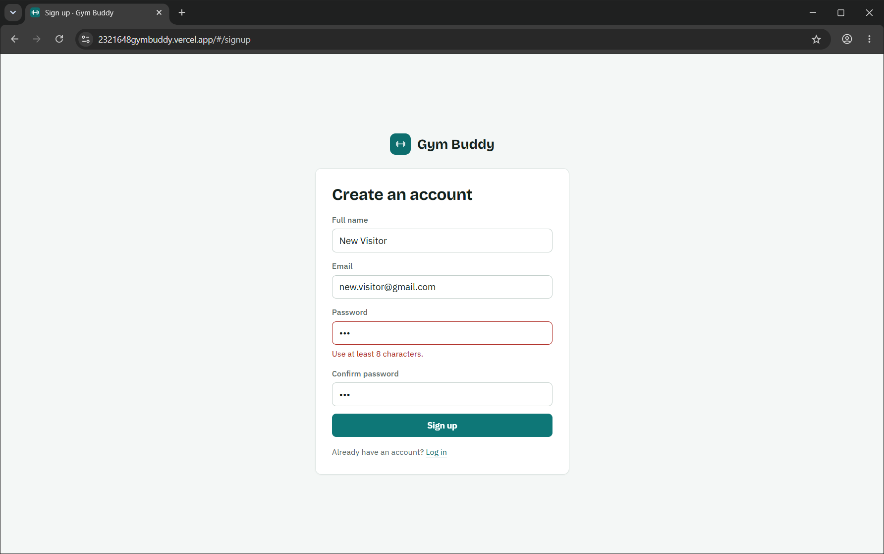
**S1 (FR-AUTH-01):** The sign up page rejects a 3 character password with "Use at least 8 characters".


**S2 (FR-RBAC-05, FR-DOM-01):** Rafi, a normal user, sees only his own membership, booking and visit.

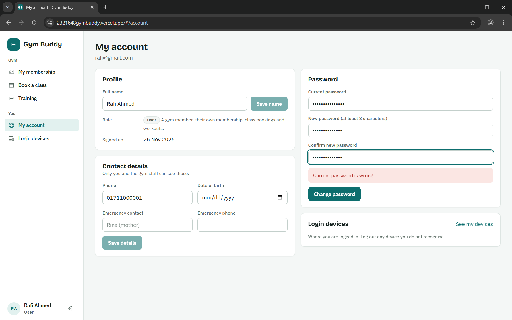
**S3 (FR-AUTH-12, FR-AUTH-13):** The profile page and the change password form. A wrong current password is rejected.


**S4 (FR-AUTH-09, FR-AUTH-10):** The Login devices page lists every session with a Log out button.

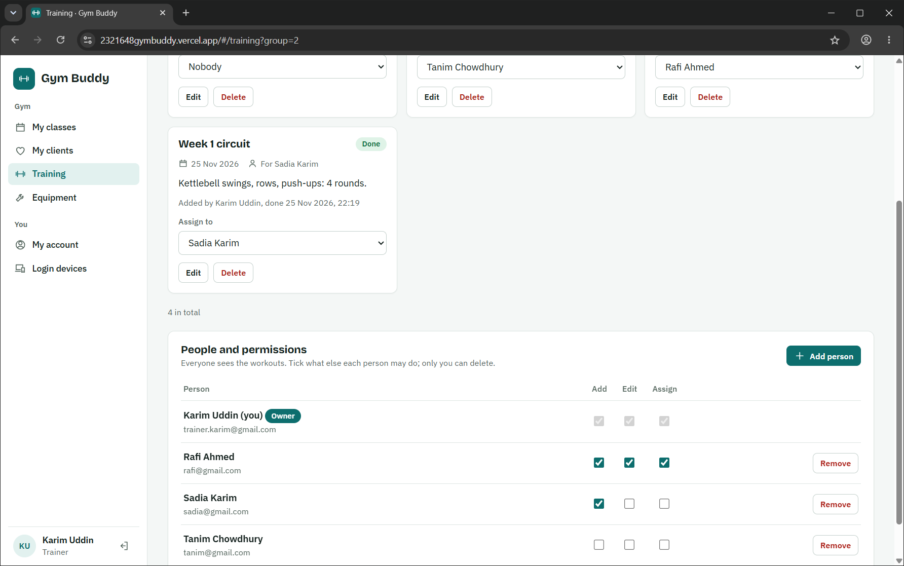
**S5 (FR-RBAC-06, FR-RBAC-07):** The owner's view of the "Strength Program" group. Rafi may add, edit and assign. Sadia may only add. Tanim may only view.


**S6 (FR-RBAC-06):** The owner took away Rafi's Edit permission. Rafi's edit is refused. The app shows the message and the network tab shows `PATCH /api/v1/workouts/4` with 403.

### D2. Security Behaviour

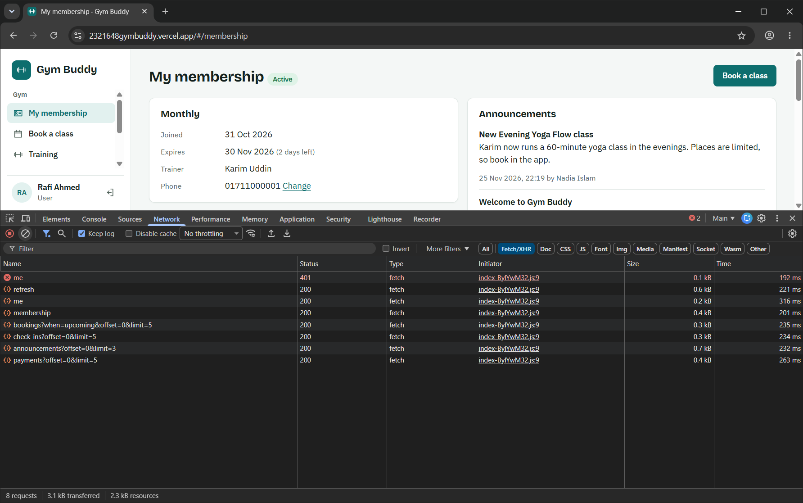
**S7a (FR-AUTH-05):** After 5 minutes, the request `me` gets 401. The app calls `refresh` (200) and repeats `me` (200).

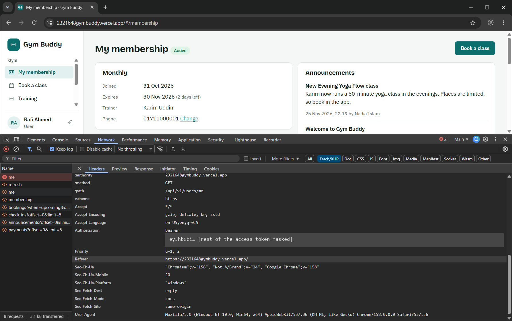
**S7b (FR-AUTH-04):** The Authorization header of the rejected request. The token is masked.


**S8a (FR-AUTH-06):** The refresh request returns a new access token (masked) that lasts 300 seconds.


**S8b (FR-AUTH-06, NFR-03):** The refresh cookie is HttpOnly, Secure and SameSite Strict. The old cookie was sent and a new one came back. The values are masked.

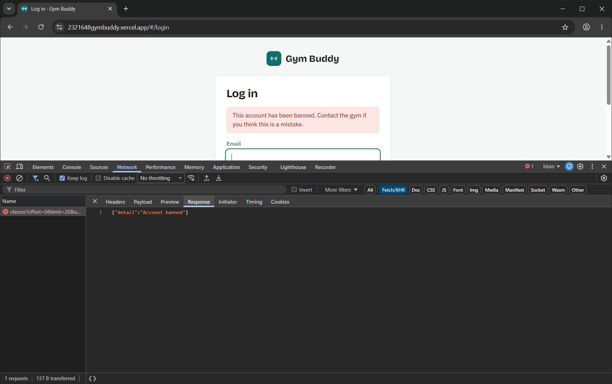
**S9 (FR-RBAC-11):** An admin banned Mitu while she was logged in. Her next request got 403 and the app showed "This account has been banned".

### D3. Admin Dashboard

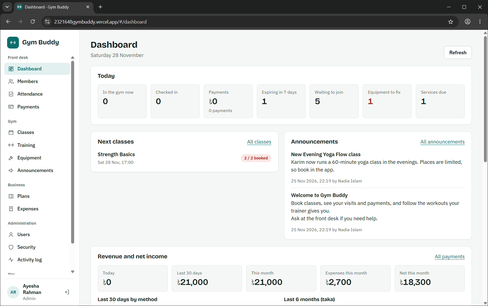
**S10 (FR-ADM-01, FR-DOM-11):** The Dashboard with today's numbers, the next classes, announcements, revenue and net income.


**S11 (FR-ADM-02):** The Users list with a search and the role filter. Rows of real people are blurred.

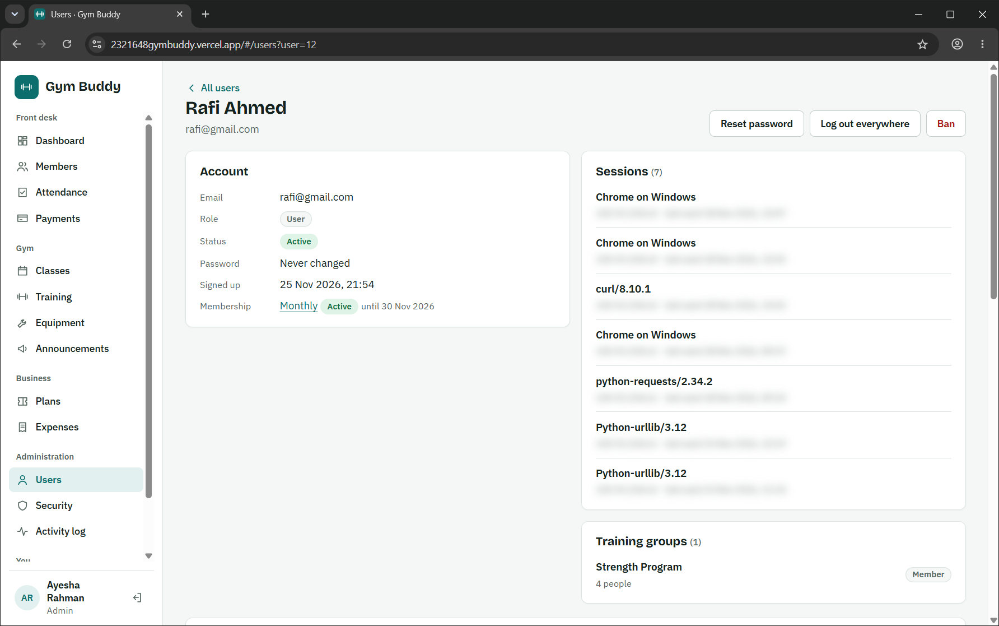
**S12 (FR-ADM-03, FR-ADM-06, FR-ADM-08):** Rafi's user detail with his account, sessions and groups, and the Reset password, Log out everywhere and Ban buttons.

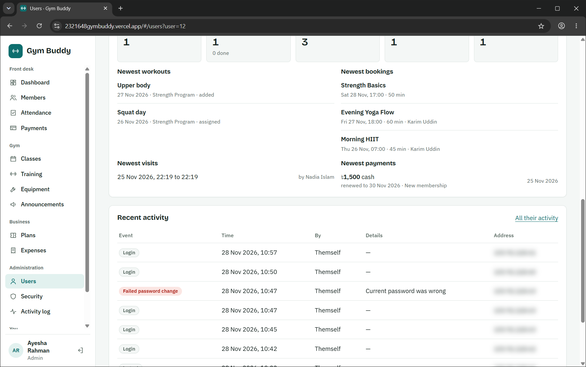
**S12b (FR-ADM-03):** The same page further down with his records and recent activity, including the failed password change from S3.

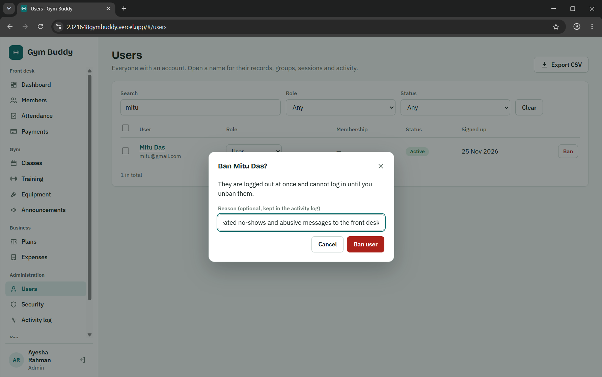
**S13a (FR-ADM-04):** The ban dialog with a reason.

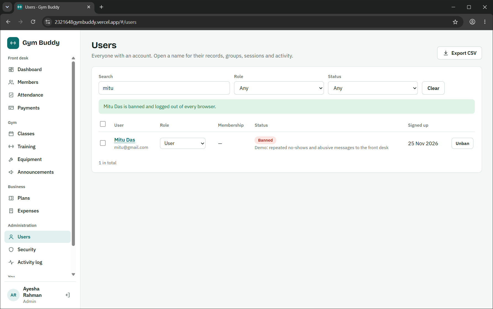
**S13b (FR-ADM-04):** After the ban, Mitu shows as Banned with the reason, and an Unban button appears.

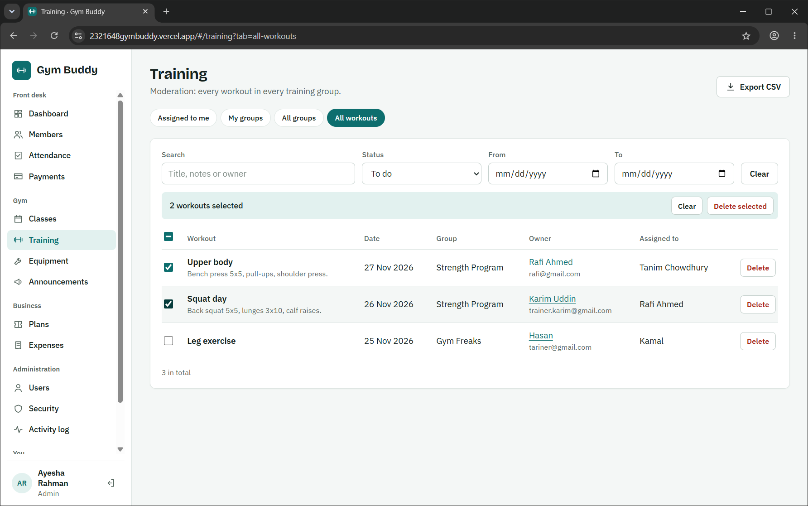
**S14 (FR-ADM-09):** All workouts filtered by status, with two workouts ticked and the bulk delete bar. I did not confirm the delete.


**S15 (FR-ADM-10, FR-ADM-13):** The Activity log searched for "mitu". It shows the ban and unban from S13 and her logins.


**S16 (FR-ADM-11, FR-AUTH-11):** The Security view with failed logins by IP address and by account, and the lockout count.

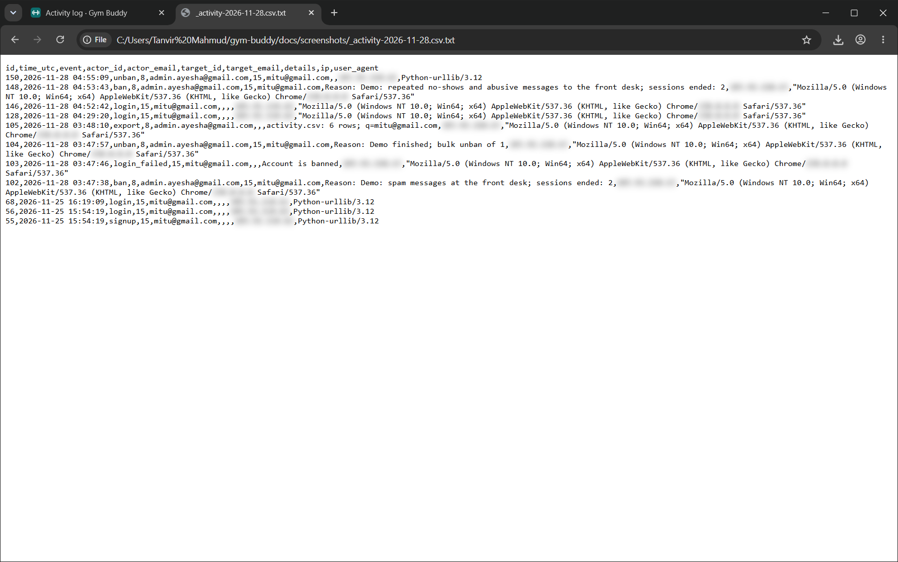
**S17 (FR-ADM-12):** The activity CSV export with the same filter as S15, downloaded and opened.

### D4. Deployment

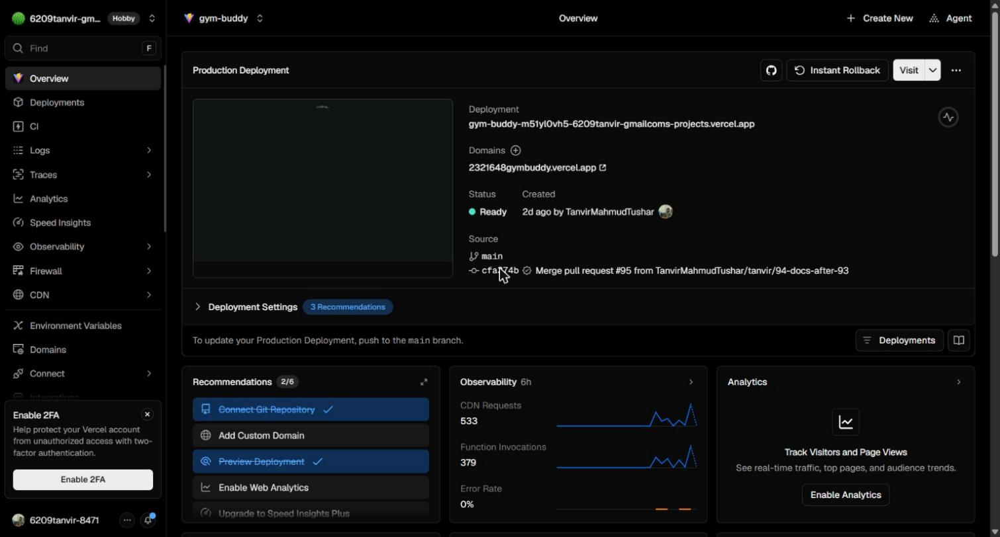
**S18 (NFR-15):** The Vercel project. The production deployment comes from `main` and is Ready on `2321648gymbuddy.vercel.app`.


**S19 (NFR-01):** The environment variable names on Vercel. The values are hidden.


**S20 (NFR-10):** The live API documentation page.

### D5. Tests


**S21 (NFR-14):** The test run: 136 tests passed.

## Part E. Project Management and Conclusion

### E1. How to Run and Test

**Prerequisites:** Python 3.10 or newer, Node.js 22 or newer and Git.

1. Clone the project: `git clone https://github.com/TanvirMahmudTushar/gym-buddy.git`
2. Copy `backend/.env.example` to `backend/.env` and fill it in. Without it, the backend uses a local SQLite file.

    ```env
    DATABASE_URL=                       # leave empty for SQLite
    JWT_SECRET=<48 random characters>
    PASSWORD_PEPPER=<48 random characters>
    FRONTEND_ORIGIN=http://localhost:5173
    ```

3. Start the backend in the first terminal:

    ```bash
    cd backend
    python -m venv .venv
    .venv\Scripts\Activate.ps1
    pip install -r requirements-dev.txt
    fastapi dev main.py
    ```

4. Start the frontend in a second terminal:

    ```bash
    cd frontend
    npm install
    npm run dev
    ```

5. Run the tests in the `backend` folder with `pytest`.
6. Open http://localhost:5173 and log in.

To try the live site, use the test accounts. There are two **admin** accounts and three **user** accounts, plus a gym manager and a trainer. The user IDs and passwords are in the Appendix of the PDF report, never in this file.

### E2. GitHub Work

Every feature had an issue, a branch named `tanvir/<issue>` and a pull request into `main` that closed the issue. All 107 commits are mine. I worked alone because there were no teams this semester.

**Table 38: Issues and pull requests**

| Feature | Issue and pull request | What it delivered |
|---|---|---|
| Documents | Issue #1, PR [#2](https://github.com/TanvirMahmudTushar/gym-buddy/pull/2) | PRD, SRS and TDD |
| Mid project | Issues #3 to #19, PRs #8 to #20 | Member CRUD API, one page frontend, bulk delete |
| Service layer | Issue #21, PR [#22](https://github.com/TanvirMahmudTushar/gym-buddy/pull/22) | Business rules moved out of the routes |
| Login and roles | Issue #23, PR [#24](https://github.com/TanvirMahmudTushar/gym-buddy/pull/24) | Sign up, log in and roles |
| Admin dashboard and bans | Issue #25, PR [#26](https://github.com/TanvirMahmudTushar/gym-buddy/pull/26) | Statistics, ban and unban |
| Lockout and headers | Issue #43, PR [#44](https://github.com/TanvirMahmudTushar/gym-buddy/pull/44) | Login lockout and security headers |
| JWT refresh and sessions | Issue #59, PR [#67](https://github.com/TanvirMahmudTushar/gym-buddy/pull/67) | 5 minute token, refresh cookie and sessions |
| RBAC module | Issue #60, PR [#68](https://github.com/TanvirMahmudTushar/gym-buddy/pull/68) | Permissions and `require_permission()` |
| Activity log | Issue #61, PR [#69](https://github.com/TanvirMahmudTushar/gym-buddy/pull/69) | Audit log and Security page |
| Groups with permissions | Issue #62, PR [#70](https://github.com/TanvirMahmudTushar/gym-buddy/pull/70) | Training groups with Add, Edit and Assign |
| Admin user tools | Issue #63, PR [#71](https://github.com/TanvirMahmudTushar/gym-buddy/pull/71) | Filters, user detail, bulk ban and revoke |
| Moderation | Issue #64, PR [#72](https://github.com/TanvirMahmudTushar/gym-buddy/pull/72) | All groups and All workouts with bulk delete |
| CORS and tests | Issue #65, PR [#73](https://github.com/TanvirMahmudTushar/gym-buddy/pull/73) | CORS allow list and the pytest suite |
| Login devices | Issue #86, PR [#87](https://github.com/TanvirMahmudTushar/gym-buddy/pull/87) | Login devices page |
| Final fixes | Issues #89 and #92, PRs [#90](https://github.com/TanvirMahmudTushar/gym-buddy/pull/90) and [#93](https://github.com/TanvirMahmudTushar/gym-buddy/pull/93) | Fixes found by testing every role |

**Timeline:** I wrote the documents on 31 October. I built the mid project from 31 October to 4 November. I built the final features from 18 to 25 November. I wrote this report on 28 November.

### E3. Limitations

* There is no CI pipeline. I run the tests on my computer before each merge.
* There is no migration tool. The app can only add tables and columns.
* The test for two people booking the last place at once is manual, not automated.
* All demo accounts share one simple password. The app only checks that a password has 8 characters.
* There is no CSRF token. The app relies on the SameSite Strict cookie.
* Only login has a rate limit. Sign up and other endpoints do not.
* The activity log is never cleaned up.
* There is no email, so a forgotten password needs an admin.
* Supabase pauses after a week without use, and the first request after that is slow.

### E4. Future Work

1. Add GitHub Actions to run the tests on every pull request, so untested code cannot reach `main`.
2. Add Alembic migrations before I rename or remove a column.
3. Check new passwords against lists of leaked passwords, because 8 characters alone is weak.
4. Add a rate limit to sign up and refresh to stop floods.
5. Add email for verification, reminders and password reset, so admins do less work.
6. Delete old activity log rows after a year to keep the table fast.
7. Add online payments so members can renew from the app.

### E5. Sources, Libraries and Tools

**Table 39: Sources, libraries and tools**

| Name | Version or link | Used for |
|---|---|---|
| FastAPI | 0.162.0 | Backend framework |
| SQLModel and SQLAlchemy | 0.0.48 and 2.1.6 | Database models and queries |
| Pydantic | 2.14.2 | Input and output validation |
| psycopg | 3.3.6 | PostgreSQL driver |
| PyJWT | 2.15.1 | Access tokens |
| `argon2-cffi` | 25.1.0 | Password hashing |
| pytest and httpx | 9.2.0 and 0.28.1 | Automated tests |
| React and React DOM | 19.3.0 | Frontend |
| TypeScript | 7.0.2 | Typed frontend code |
| Vite | 8.3.2 | Development server and build |
| Playwright | https://playwright.dev | Browser tests and screenshots |
| Vercel | https://vercel.com/docs | Hosting |
| Supabase | https://supabase.com/docs | Hosted PostgreSQL |
| RFC 7519 and RFC 6265 | https://www.rfc-editor.org/rfc/rfc7519 | Token and cookie design |
| OWASP ASVS and Cheat Sheets | https://owasp.org | Security rules and the threat table |
| MDN Web Docs | https://developer.mozilla.org | Cookies, CORS and security headers |
| JSON Web Token Bangla Tutorial (Learn with Sumit) | https://youtu.be/MB9SgSYw0Gw | Learning how JWTs work |
| FastAPI JWT Tutorial (Eric Roby) | https://youtu.be/0A_GCXBCNUQ | Learning login and protected routes in FastAPI |
| CSE309 course material | Google Classroom | Project rules and report format |
| VS Code, Git, GitHub and Chrome DevTools | None | Coding, version control and checking requests |

**Use of AI tools.** I used GitHub Copilot for inline code completions and Claude for explanations, code review and test ideas. I decided the design, built the system architecture, wrote the code, fixed the code and reviewed every piece of generated code.

## Appendix. Test Accounts and Video Demo

**Video demo:** https://youtu.be/VMhoKTs-Au0

The test account user IDs and passwords are only in the PDF version of this report. GitHub flags passwords in a repository. The live site has two admins, three users, a fourth user who is not in any group, a gym manager and a trainer. It also has the group "Strength Program", where one member may add, edit and assign, one may only add and one may only view.
