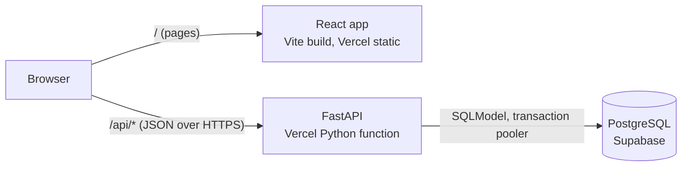
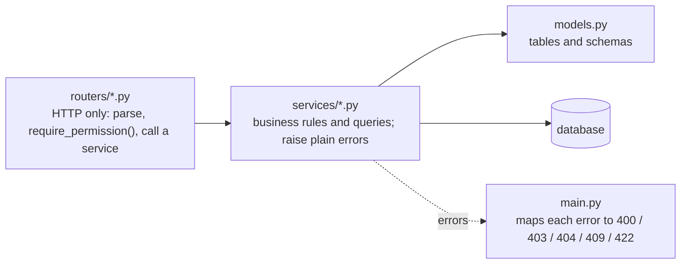
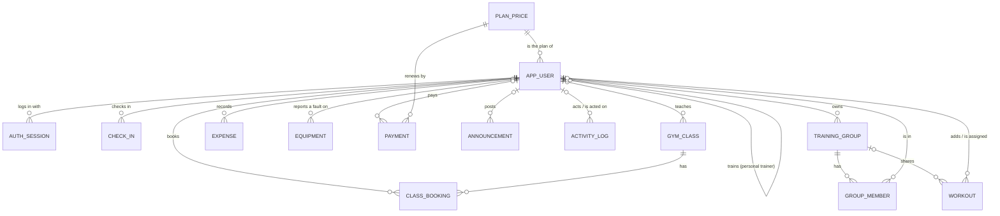

# Gym Buddy — Final Report

| | |
|---|---|
| Product | Gym Buddy, a gym management system |
| Author | Tanvir Mahmud Tushar |
| Release | Final (Beta), built on the mid-term MVP |
| Live app | https://2321648gymbuddy.vercel.app/ |
| API docs | https://2321648gymbuddy.vercel.app/api/docs |
| Repository | https://github.com/TanvirMahmudTushar/gym-buddy |
| Detailed documents | [PRD](01-prd.md) · [SRS](02-srs.md) · [TDD](03-tdd.md) |

This report covers the finished product in one place: what it is for (PRD), what it must do (SRS), how it is built (TDD), how it was tested and how the work was run. The three detailed documents hold every requirement, endpoint and table; this report summarises them and links to the right section.

## Contents

1. [Summary](#1-summary)
2. [How to test the live system](#2-how-to-test-the-live-system)
3. [Product requirements (PRD)](#3-product-requirements-prd)
4. [Software requirements (SRS)](#4-software-requirements-srs)
5. [Technical design (TDD)](#5-technical-design-tdd)
6. [Testing and quality](#6-testing-and-quality)
7. [Project management on GitHub](#7-project-management-on-github)
8. [Design decisions and problems solved](#8-design-decisions-and-problems-solved)
9. [Limitations and future work](#9-limitations-and-future-work)
10. [Conclusion](#10-conclusion)

## 1. Summary

Many small gyms keep their members in a paper register or a spreadsheet, so nobody can quickly tell whose membership has expired, who came in today, or whether a class is full. Gym Buddy replaces the register with one web app for the whole gym:

- **Members** sign up, see their membership, visits and payments, book and cancel classes, keep their contact and emergency details up to date, and follow the workouts their trainer gives them.
- **Gym managers** (front desk) start, renew, freeze and delete memberships, check members in and out, take payments, run the class timetable, keep the equipment working and post announcements, from a Dashboard that shows what needs attention today.
- **Trainers** see the classes they teach, who booked each one and who came, look after their own clients, run training groups, and report broken equipment.
- **Admins** do everything a gym manager does, and also set the plans, record expenses and see net income, manage accounts and roles, ban and unban, reset passwords, void payments, export CSVs, read the activity log and failed logins, and moderate training groups.

The mid-term MVP was a member CRUD API with a one-page front end. The final release turned it into a multi-user product with accounts, four roles under one permission module, classes and bookings, attendance, payments, expenses and net income, equipment, training groups, an audit log and security hardening.

| In numbers | |
|---|---|
| API | 105 operations on 78 paths under `/api/v1`, all listed in `/api/docs` |
| Database | 15 tables (PostgreSQL on Supabase; SQLite locally) |
| Roles and permissions | 4 roles, 25 permissions, plus 5 per-group permissions |
| Requirements | 121 functional (FR-01 to FR-121) and 24 non-functional, traced to 37 user stories |
| Front end | 21 pages, 45 components, 18 service modules |
| Tests | 74 automated backend tests (pytest), all passing |
| GitHub | 39 issues and 38 pull requests merged into `main` (the latest, for #75, included), each from its own branch. The gym management rework (#76) was committed to `main` directly |
| Code | about 7,100 lines of Python in the backend and 11,000 lines of TypeScript in the front end |

## 2. How to test the live system

Open https://2321648gymbuddy.vercel.app/ and log in with one of the accounts below. The email is the user ID. **Passwords are in the submission form and the PDF report only; they are never stored in the repository.**

| User ID (email) | Role | Lands on |
|---|---|---|
| `admin.ayesha@gymbuddy.example` | Admin | Dashboard |
| `admin.imran@gymbuddy.example` | Admin | Dashboard |
| `manager.nadia@gymbuddy.example` | Gym Manager | Dashboard |
| `trainer.karim@gymbuddy.example` | Trainer | My classes |
| `rafi@gymbuddy.example` | User | My membership |
| `sadia@gymbuddy.example` | User | My membership |
| `tanim@gymbuddy.example` | User | My membership |
| `mitu@gymbuddy.example` | User | My membership |

**Shared group with mixed permissions: "Strength Program"**, owned by the trainer Karim Uddin. Rafi may add, edit and assign workouts; Sadia may only add; Tanim may only read; Mitu is not in the group and gets `404` for it. The [README](../README.md#shared-group-with-mixed-permissions) lists what to try with each account.

**Sample data.** Four plans, three memberships (Rafi's expires within 7 days, Sadia's is active, Tanim's is frozen) with their payments, Karim as personal trainer of Rafi and Sadia, two visits today (Sadia is still inside), three upcoming classes (two taught by Karim; *Strength Basics* is full), two announcements, four pieces of equipment (the leg press is broken, a treadmill is due for a service), two expenses, and the group's four workouts (one done). Mitu has signed up but has no membership, so this account is on the gym manager's waiting list. The data is made by [`scripts/seed_demo.py`](../scripts/seed_demo.py) through the public API (see the README's **Demo data**).

**Trying the API directly.** `/api/docs` lists every endpoint. To call a protected one there, log in with `POST /api/v1/auth/login`, copy `access_token` from the response, and paste it into **Authorize**. It lasts 15 minutes.

## 3. Product requirements (PRD)

Full document: [01-prd.md](01-prd.md).

### 3.1 Problem and goals

Gym staff need one reliable place to keep members, see who has a valid membership, record who comes in and take payments. Members want to check their own status and reserve a place in a class without calling the front desk. A class has limited places, so it must never be over-booked, and personal details must stay private.

| Goal | Status |
|---|---|
| G-1 to G-3: a documented REST API for member CRUD, backed by a database | Done in the MVP; kept in the final under staff permissions |
| G-4: deployed on Vercel | Done. Production is deployed with `vercel --prod` from an up-to-date `main` (the Vercel project is not connected to GitHub) |
| G-5: members have accounts and see only their own data | Done: every "my" endpoint takes the user from the token, never from the request |
| G-6: access controlled by role | Done, and extended from the planned two roles to four, with permissions instead of role checks |
| G-7: class bookings that never exceed capacity | Done, including two people booking the last place at the same moment |
| G-8: attendance and usage stats | Done: check-ins and check-outs, who is inside now, class attendance, and the Dashboard |
| G-9: protected accounts and data | Done: Argon2 with a pepper, short-lived tokens, rotating refresh cookie, lockout, headers, CORS allowlist, audit log |

### 3.2 Users

| User | What they need | Role in the app |
|---|---|---|
| Gym member | Check membership and visits, book classes, see payments, follow assigned workouts | User |
| Trainer | Know who is coming to each class, look after clients, plan their training | Trainer |
| Front desk | Run memberships, attendance, payments, classes, equipment and announcements | Gym Manager |
| Owner / administrator | Set plans, see income and expenses, manage accounts and security | Admin |
| Instructor | Try the app and the API, read the code and the documents | Any of the test accounts |

### 3.3 Scope: what was planned and what shipped

The PRD planned the MVP and the Beta from the start, and the final release covers every Beta "Must". Several items the PRD had left out of scope were added once the core was finished, because they made the product usable for a real gym:

| Planned as out of scope | What happened |
|---|---|
| Payments and billing | **Added** as payment records (cash, card, bank transfer, mobile banking) with renewals, void and CSV, plans the gym can add and retire, and expenses with the month's net income. There is still no online card payment |
| Trainer accounts | **Added**: the Trainer role, the trainer picked from a list on each class and each member, My classes with attendance, and My clients |
| Search and sorting beyond the status filter | **Added**: member, user, payment and activity searches and filters |
| Workout plans | **Added**: training groups run by trainers and staff, with per-member permissions, assigned workouts and marking them done. A private workout diary was built first (PR #70) and then removed: nobody at the gym could see it, so it did not help run the gym |
| Equipment tracking | **Added**: the equipment list, reported faults, and services with the next due date |
| Password reset | **Added** as an admin reset with a one-time temporary password (no email reset) |
| Automated tests | **Added**: a pytest suite (74 tests). CI is still not set up |

Still out of scope: online payments, email or SMS, email verification and self-service password reset, QR check-in, waiting lists for full classes, recurring classes, and diet plans.

### 3.4 Features by release

| Area | MVP (mid-term) | Final |
|---|---|---|
| Plans | Three fixed plans | Admins add, edit, retire and delete plans; a new membership takes its length and first payment from the plan |
| Members | Add, list with status filter and pagination, view, edit, renew, freeze, delete, bulk delete | Members are user accounts with a membership; search; expiring soon; waiting list; contact and emergency details |
| Accounts | — | Sign up, log in and out, sessions with refresh, change name and password, list and log out browsers |
| Roles | — | User, Trainer, Gym Manager, Admin; one RBAC module; menus built from the caller's permissions |
| Classes | — | Timetable with trainers and capacity, bookings, cancel, a member's bookings, trainers' own classes, attendance |
| Attendance | — | Check in (valid membership only) and out, who is inside now, any day's list, history |
| Money | — | Payments with renewal, all payments with totals, void, CSV; expenses; revenue and net income |
| Equipment | — | List by status, reported faults, services and the next due date |
| Communication | — | Announcements with an end date |
| Training | — | Personal trainers and their clients; training groups with Add / Edit / Assign permissions; assigned workouts marked done |
| Admin | — | Dashboard, Users page (filters, details, bulk ban, log out everywhere, reset password, CSV), activity log, failed-login view, moderation of groups and workouts |
| Security | — | Argon2 + pepper, JWT access token + rotating refresh cookie, lockout, headers, CORS allowlist, audit log |

## 4. Software requirements (SRS)

Full document: [02-srs.md](02-srs.md). Every requirement has an ID, a release and the user story it serves; section 6 of the SRS traces each story to its requirements and endpoints.

### 4.1 Functional requirements

| SRS section | Area | Requirements |
|---|---|---|
| 3.1 | Members (MVP) | FR-01 to FR-11, FR-06a |
| 3.2 | Authentication, profile and sessions | FR-12 to FR-16, FR-40, FR-41, FR-80 to FR-82 |
| 3.3, 3.7 | Own membership and check-ins | FR-17, FR-18, FR-30 to FR-33, FR-42 |
| 3.4 | Member management by staff | FR-19, FR-23 |
| 3.5 | Roles, RBAC and admin | FR-20 to FR-22, FR-24, FR-35 to FR-39, FR-83, FR-98 to FR-103 |
| 3.6, 3.7c | Classes, bookings and renewals | FR-25 to FR-29, FR-58 to FR-61 |
| 3.7a | Plans and payments | FR-43 to FR-53 |
| 3.7b | Finding members and the waiting list | FR-54 to FR-57 |
| 3.7d | Front desk overview | FR-62, FR-63 |
| 3.7e | Admin password reset | FR-64 to FR-66 |
| 3.7f | Trainers | FR-67 to FR-71 |
| 3.7g | Announcements | FR-72 to FR-75 |
| 3.7h | Member profile details | FR-76 to FR-79 |
| 3.7i | Activity log and security view | FR-84 to FR-89 |
| 3.7j | Training groups and workouts | FR-90 to FR-97 |
| 3.7k | Content moderation | FR-104 to FR-108 |
| 3.7l | Plans, attendance, trainers, equipment, expenses | FR-109 to FR-121 |
| 3.8 | Login lockout | FR-34 |

All 121 are built, except FR-90 (the private workout diary), which was built and then withdrawn. Each SRS section ends with a "Built so far" note that records how it was built and any detail that differs from the first wording.

### 4.2 Roles and permissions

The server never asks "is this an admin?". Every protected endpoint names a permission, and [`backend/app/rbac.py`](../backend/app/rbac.py) maps each role to the permissions it holds. The role is read from the database on every request, so a role change applies at once. No login gives `401`; a missing permission gives `403`.

| Permission | User | Trainer | Gym Manager | Admin |
|---|---|---|---|---|
| Own account, membership, bookings, payments, sessions, the groups they are in (login only) | ✓ | ✓ | ✓ | ✓ |
| `classes:teach` (my classes, who booked and who came), `clients:read` (my clients) | | ✓ | | |
| `groups:create`, `equipment:read` | | ✓ | ✓ | ✓ |
| `members:read`, `members:manage`, `check_ins:record`, `payments:manage`, `classes:manage`, `equipment:manage`, `overview:read`, `announcements:manage` | | | ✓ | ✓ |
| `payments:void`, `payments:export`, `expenses:manage`, `dashboard:read`, `plans:edit` | | | | ✓ |
| `users:read`, `users:change_role`, `users:ban`, `users:reset_password`, `users:revoke_sessions`, `users:export` | | | | ✓ |
| `activity:read`, `content:moderate` | | | | ✓ |

**Group permissions** add a second, per-group layer in the same module: the owner holds `read`, `create`, `update`, `assign` and `manage`; a member holds `read` plus whichever of `create`, `update` and `assign` the owner ticked. Someone outside the group gets `404` for the group and its workouts, so a private group does not even show that it exists. The full action-by-role matrix is [SRS section 3.11](02-srs.md#311-permission-matrix--beta).

### 4.3 Non-functional requirements

| Area | Requirement (SRS IDs) | How it is met |
|---|---|---|
| Persistence | NFR-02 | PostgreSQL on Supabase; nothing kept on the serverless function's disk |
| Security: passwords | NFR-11, NFR-22 | Argon2 over HMAC-SHA256 with `PASSWORD_PEPPER`; never stored, logged or returned in plain text |
| Security: tokens | NFR-12 to NFR-14 | 15-minute JWT in memory; 7-day random refresh token in an `HttpOnly`, `Secure`, `SameSite=Strict` cookie, stored only as a SHA-256 hash and replaced on every refresh |
| Security: browser | NFR-15, NFR-16 | CORS only for `FRONTEND_ORIGIN`; `nosniff`, `DENY` framing, referrer policy and HSTS on every response |
| Security: checks | NFR-17, NFR-06, NFR-07 | Every permission check on the server; ORM queries only; a generic `500` with no stack trace |
| Privacy | NFR-20 | Phone, date of birth, emergency contact and notes only for staff and the person themself |
| Consistency | NFR-21 | Booking locks the class row, counts and inserts in one transaction |
| Audit | NFR-23 | Activity log rows never hold a password, token or hash |
| Maintainability | NFR-08, NFR-24 | Routers → services → database layers; 74 automated tests |
| Secrets | NFR-05 | Only in Vercel environment variables; `backend/.env.example` holds placeholders only |

Two NFRs were changed during the project and are recorded in the SRS: schema changes are applied by the app on start rather than by Alembic (NFR-19, see section 8), and production is deployed with `vercel --prod` rather than on every push (NFR-10).

## 5. Technical design (TDD)

Full document: [03-tdd.md](03-tdd.md).

### 5.1 Architecture



The front end and the API are one Vercel project on one origin: `vercel.json` sends `/api/*` to the FastAPI service and everything else to the React build. Because they share the origin, the app needs no CORS; the CORS allowlist only decides which other site, if any, may call the API.

| Layer | Choice | Why |
|---|---|---|
| API | FastAPI | Validation, OpenAPI docs and type hints built in |
| Models | SQLModel | One class is both the table and the Pydantic schema |
| Database | PostgreSQL on Supabase (SQLite locally) | Managed, free tier, connection pooler for serverless |
| Auth | PyJWT, `argon2-cffi` | Signed access tokens; memory-hard password hashing |
| Front end | Vite + React + TypeScript | Typed components and fast builds |
| Hosting | Vercel | Front end and backend in one project |

### 5.2 Backend layers



- **Routers** (`backend/app/routers/`, 17 files) only read the request, declare the permission they need, and call one service function.
- **Services** (`backend/app/services/`, 21 files) hold every rule and every database query, for example `class_service.book_class()` (capacity and membership checks), `payment_service.record_payment()` (renewal from the right date) and `session_service.rotate()` (refresh rotation). They raise plain Python errors such as `ClassFullError`, and `main.py` turns each into its status code, so no service knows about HTTP.
- **Shared modules:** `rbac.py` (permissions), `deps.py` (who is calling: token, ban and session check), `security.py` (hashing and tokens), `request_info.py` (client IP and browser for the logs), `config.py` and `cors.py`.

This split was the one point marked down at the mid-term (the logic was in the route functions). It was fixed in PR #22 for members and followed by every feature after it.

### 5.3 Front end

One page per route under a hash router (`#/members`, `#/classes`, …). `AuthContext` holds the logged-in user and their permissions; `PlansContext` holds the plans' names and prices; `AppLayout` builds the sidebar from those permissions, so each role sees only the pages it may open, and each page also guards itself. Every API call goes through `services/api.ts`, which adds the access token, and on a `401` refreshes it once and repeats the request, so an expired token is invisible to the person. Lists use one `usePagedList` hook for **Load more**, and every page has loading, error and empty states.

### 5.4 Data model

Members are users: there is no separate member table. A user becomes a member when staff set a plan on their account, which keeps one identity per person and lets a member log in to see their own record.



| Table | Holds |
|---|---|
| `app_user` | Account (email, name, password hash, role, ban, lockout) and membership (plan, joined and expiry dates, frozen, personal trainer, phone, date of birth, emergency contact, notes) |
| `auth_session` | One row per login: refresh token hash, the previous hash (reuse detection), expiry, IP and browser, revoked time |
| `check_in`, `gym_class`, `class_booking` | Visits (in and out), the timetable, and bookings with attendance (`class_booking` has a composite primary key, so nobody books a class twice) |
| `plan_price`, `payment`, `expense` | The plans (name, price, length, offered or retired); payments with method, renewal and void details (kept when the member's account is deleted); what the gym spends |
| `equipment` | What the gym owns, whether it works, the reported fault and the next service |
| `announcement`, `activity_log` | News for members; the audit log |
| `schema_state` | One row: the schema version the database was last brought up to, so a normal start skips the checks |
| `training_group`, `group_member`, `workout` | Training groups, each member's permission flags, and the group's workouts with who each is for and when it was done |

`app_user` is named so because `user` is reserved in PostgreSQL, and `gym_class` because `class` is reserved in Python. Every column, rule and index is in [TDD section 5](03-tdd.md#5-data-model).

### 5.5 API design

- Resources are plural nouns under `/api/v1` (`/members`, `/classes/{id}/bookings`, `/members/{id}/check-ins`), and `PATCH` changes only the fields sent.
- Every list takes `offset` and `limit` and returns `{items, total, offset, limit}`, where `total` counts every match, not just the page.
- Status codes are consistent: `201` create, `204` delete, `400` a rule refused, `401` not logged in, `403` no permission, `404` not found (or not allowed to know it exists), `409` conflict, `422` invalid input, `429` locked out.
- Errors are always `{"detail": "..."}` with a message the app can show as it is.

The README's REST API table and [TDD section 6](03-tdd.md#6-rest-api-design) list all 105 operations.

### 5.6 Authentication and sessions

```mermaid
sequenceDiagram
    participant B as Browser
    participant A as API
    participant D as Database
    B->>A: POST /auth/login {email, password}
    A->>D: check lockout, verify Argon2 (peppered), insert auth_session
    A-->>B: access token (15 min, in memory) + refresh cookie (HttpOnly, 7 days)
    B->>A: GET /api/v1/... with Bearer token
    A->>D: verify token, load user, check ban and that the session is active
    A-->>B: 200, or 401 when the token expired or the session ended
    B->>A: POST /auth/refresh (cookie)
    A->>D: swap the token hash only if unchanged (rotation)
    A-->>B: new access token + new cookie; the app repeats the request
```

- Every request checks that its session is still active, so logging out, a password change, an admin reset, "log out everywhere" and a ban take effect on the very next request, not after 15 minutes.
- A replaced refresh token that comes back more than 30 seconds later can only be a copy, so the whole session is ended.
- After 5 wrong passwords in a row an account is locked for 15 minutes (`429` with `Retry-After`). The count is kept in the database because serverless functions share no memory.

### 5.7 Deployment and configuration

| Variable | Purpose |
|---|---|
| `DATABASE_URL` | Supabase transaction pooler (port 6543); the engine keeps a small pool of connections and uses no prepared statements, as the pooler requires |
| `JWT_SECRET`, `PASSWORD_PEPPER` | 32+ byte secrets, required on Vercel; the pepper must never change once set |
| `FRONTEND_ORIGIN` | The one origin CORS answers (`https://2321648gymbuddy.vercel.app`) |

On start the backend creates any missing table, adds any missing column and gives a new database its first plans, keeping existing data, so an older database upgrades itself. Production is deployed with `vercel --prod` from an up-to-date `main`.

## 6. Testing and quality

**Automated tests.** `backend/tests/` has 74 pytest tests that run against a throwaway SQLite database, emptied before each test, with test-only secrets, so they never touch real data:

| File | What it proves |
|---|---|
| `test_login.py` | Correct login and cookie flags; wrong password and unknown email look the same; the 5th wrong password locks the account, even against the right password; the failed login is logged without the password |
| `test_tokens.py` | Missing, tampered, forged and expired tokens get `401`; a token stops working after logout; a banned user gets `403` |
| `test_refresh.py` | Rotation, the 30-second grace period, reuse ending the whole session, and refresh refused after logout or a ban |
| `test_rbac.py` | Every admin route is `403` for the other three roles and `401` for a visitor; a role change applies with the same token; another person's session is `404` and member record `403`; members cannot start a group; a group and its workouts are `404` to outsiders, even an admin; group permissions; admins cannot ban each other |
| `test_gym.py` | Plans (add, retire, delete rules), a membership paid in the same step, check-in and check-out, class attendance (own class only, not a day before), a trainer's own clients only, marking a workout done (assignee only), equipment services and faults, expenses and net income, a user's record counts |
| `test_startup.py` | A normal start and the login check are one query each; an older schema is filled in again; a token does not open another account's session |
| `test_cors.py` | Only `FRONTEND_ORIGIN` gets CORS headers; look-alike origins and `null` get none; `*` is never sent |
| `test_config.py` | Settings loading and the `FRONTEND_ORIGIN` rules |

Run with `pip install -r requirements-dev.txt` and `pytest` in `backend/`.

**End-to-end checks.** Each feature was tried against a running backend as each role before it was merged, including the error cases (a full class, a frozen membership, a missing permission). The demo data script doubles as a smoke test: it drives sign-up, roles, memberships, payments, check-ins and check-outs, classes, bookings, announcements, equipment, expenses, the training group and its permissions through the public API and stops at the first unexpected answer. Its results were then checked by role: the right landing page and permissions for each account, `403` for a group member editing without permission, `404` for an outsider, and the Dashboard numbers matching their lists.

**Manual checks on the live site.** Each main page is opened on the Vercel URL as the role that uses it, at desktop and phone width, checking the browser console for errors and that the loading, error and empty states show.

## 7. Project management on GitHub

Work went through GitHub issues and pull requests, one issue per feature, with one exception: the gym management rework (#76) was committed to `main` directly, and its issue was written afterwards.

- Branch `tanvir/<issue>-<short-name>`, for example `tanvir/62-workouts-groups`.
- Each pull request says `Closes #N`, has a summary, the list of changes, the request flow, and a checklist of what was tested, and is merged into `main`.
- Labels mark the release (`mvp`) and the kind of work (`enhancement`, `documentation`).

| Phase | Dates (2026) | Pull requests | What was delivered |
|---|---|---|---|
| Documents | 31 Oct | #2 | PRD, SRS and TDD covering both releases |
| MVP | 31 Oct – 4 Nov | #8 – #20 | Member model, CRUD API, one-page front end, list totals, bulk delete, front-end folders; deployed for the mid-term |
| Service layer | 18 Nov | #22 | Member logic moved out of the routes (the mid-term feedback) |
| Accounts and roles | 18 Nov | #24 – #32 | Sign up and login, roles, admin dashboard and bans, check-ins, classes, user membership and booking |
| Payments | 18 – 20 Nov | #37 – #42 | Payments, plan prices, members as users, payments list and void, revenue |
| Gym operations | 20 – 21 Nov | #44 – #58 | Lockout and headers, connected pages, bookings and renewals, Overview, password reset, trainers, announcements, profile details |
| Security and admin | 21 – 22 Nov | #67 – #74 | Refresh sessions, the RBAC module, activity log, workouts and groups, admin user tools, moderation, CORS allowlist and the test suite |
| Gym management | 25 Nov | Issue #76, commit `f4554bb` | Plans, attendance, class attendance, personal trainers and clients, equipment, expenses and net income, the sidebar; the private workout diary and the separate Overview and Moderation pages removed |
| Speed | 25 Nov | Issue #75 | Reused database connections, a one-query login check, combined Dashboard counts and a one-query start |

The one point of mid-term feedback, on the backend's folder structure, was the first thing fixed in the final phase (PR #22).

## 8. Design decisions and problems solved

| Decision or problem | What was done and why |
|---|---|
| **Members became users** (PR #40) | The MVP had a separate `member` table, then a link from member to account. That meant two records per person, names that could disagree, and an extra linking step. Members are now accounts with a plan: the person signs up, staff start the membership by email, and every member page reads one row |
| **Permissions, not role checks** (PR #68) | With four roles, `if role == "admin"` checks were spreading across routers. One module now maps roles to permissions, every route names the permission it needs, and the app builds its menu from the same list. No status code changed for any role, which was confirmed by calling every route as each role before and after |
| **Two people booking the last place** | Counting and inserting in two steps lets both succeed. Booking now locks the class row (`SELECT … FOR UPDATE` on PostgreSQL) before counting, and the composite primary key blocks a double booking |
| **Short-lived tokens without logging people out** (PR #67) | A 15-minute access token in memory is safer than a long one in `localStorage`, but would log people out constantly. The rotating refresh cookie restores the token silently; a race between two tabs is allowed for 30 seconds, and a reuse after that ends the session |
| **Serverless constraints** | Vercel functions share no memory and have no lasting disk, so the lockout counter and sessions live in the database, and the database connections go through Supabase's transaction pooler without prepared statements |
| **Slow pages** | Every query crossed an ocean (the function ran in Washington DC, the database in Asia) and every request opened a new connection. The function was moved to the database's region, connections are reused, the Dashboard went from 63 queries to 22, the login check from 2 to 1, and a normal start from 26 statements to 1. The same request went from 1.6 s to 0.25 s after the move alone |
| **No Alembic** | Apart from one planned, announced drop of the old member tables when members became accounts, the schema only grew (new tables, new nullable or defaulted columns), so the app adds what is missing on start instead. This kept deployment to one step, but a rename or removal would need a real migration tool (section 9) |
| **Private by default** | A training group someone is not in answers `404`, not `403`, so ids do not reveal what exists. Admins moderate through separate lists that can delete but never edit |
| **Gym management, not a fitness diary** | The first version let anyone keep a private workout diary and start a social group. Neither helped run a gym, so the diary was removed, groups became training groups that trainers and staff run for members, and the time went into what a gym needs: plans, attendance, trainers' clients, equipment and expenses. The per-group permissions stayed as they were |
| **Retiring a plan instead of deleting it** | Members and payments hold a plan's code. Deleting a used plan would leave them without a name, so a used plan can only be retired: it is not offered again, and old records still read correctly |
| **Safe exports** | CSV cells that start with `=`, `+`, `-` or `@` get a leading `'`, so a name cannot run as a spreadsheet formula, and every export is written to the activity log |

## 9. Limitations and future work

- **CI:** the tests run locally before each merge. A GitHub Actions job running `pytest` on every pull request, and connecting Vercel to GitHub so `main` deploys by itself, are the next steps.
- **Migrations:** adopt Alembic before the first change that renames or removes a column.
- **Front-end tests:** the React app has no automated tests; component tests for the forms and an end-to-end run of the main flows would catch regressions.
- **Notifications:** renewal reminders and class changes by email or SMS.
- **Self-service password reset** by email, which needs email verification first.
- **Waiting lists** for full classes and **recurring classes**.
- **Online payments** through a payment gateway.
- **Activity log retention:** old rows are never deleted.

## 10. Conclusion

Gym Buddy grew from a single-table CRUD API into a complete gym system that a small gym could run day to day: members serve themselves, the front desk has one page per job, trainers run their classes and clients, and admins control plans, money, access and security. The work followed the plan in the PRD, SRS and TDD and went beyond it where the gym needed more, with almost every change made through an issue and a pull request. The main design choices (members as users, one permission module, a service layer, server-checked sessions) kept the code consistent as it grew to 105 endpoints, and the automated tests protect the parts that matter most: login, tokens, permissions and CORS.
